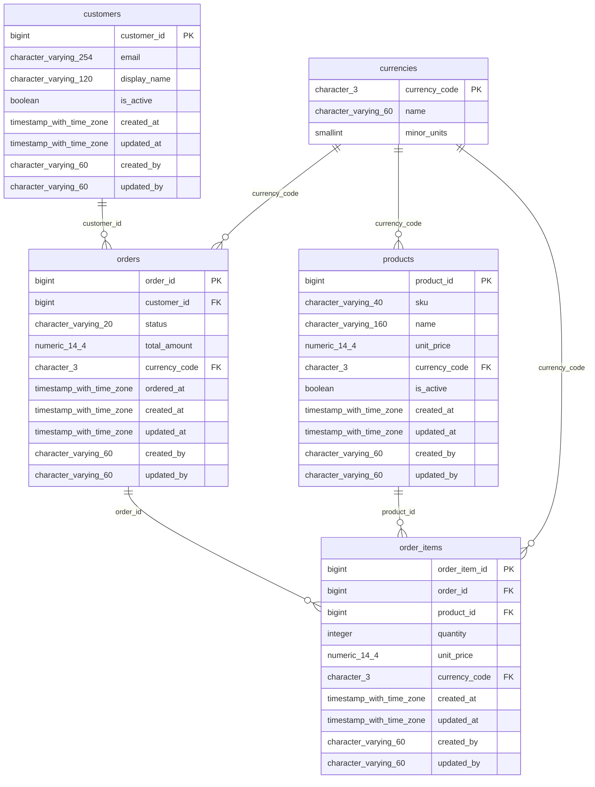
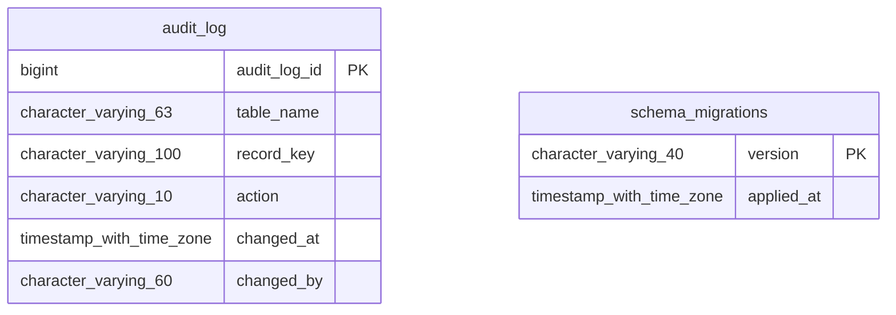

# Database assessment: clean_demo

Generated 2026-11-08T14:29:02+00:00. Plan hash `0680016076ca06852333807d11be11b5ec4a93a2dd526eb51470c5af4c7a0085`.

**This report describes proposals only. Nothing has been changed.**

## Executive summary

Database clean_demo (postgres, imported from sql_dump) has 7 table(s) and 0 view(s).

Overall health is 99.5 (A) with 79% confidence.

11 finding(s): 0 confirmed defect(s), 7 optional improvement(s) and 4 context-dependent item(s). 0 are critical and 0 are high severity.

91 rule(s) ran; 40 were skipped and 0 failed. See coverage.

The migration plan has 9 step(s): 0 with SQL and 9 manual. Nothing has been applied.

## Health scores

Overall **99.5**, grade **A**, confidence 79%. Capped: no.

**Method:** Each category starts at 100. A rule deducts its worst finding's severity points (critical 25, high 12, medium 5, low 1.5, informational 0), multiplied by kind (defect 1, context-dependent 0.5, optional 0.25), finding confidence, and the square root of the number of findings. Overall is a weighted average of assessed categories, capped at 59 if a confirmed critical defect exists. Confidence is the share of applicable rules that could actually run. These weights are a framework judgment, not a published standard.

| Category | Score | Grade | Confidence | Weight | Rules run | Rules skipped | Deductions |
|---|---|---|---|---|---|---|---|
| schema_quality | 100.0 | A | 100% | 14 | 13 | 0 | 0 |
| data_integrity | 100.0 | A | 100% | 16 | 18 | 0 | 0 |
| performance | 100.0 | A | 33% | 10 | 5 | 10 | 0 |
| security | 97.3 | A | 69% | 16 | 9 | 4 | 2 |
| data_quality | 100.0 | A | 100% | 12 | 11 | 0 | 0 |
| scalability | 100.0 | A | 100% | 6 | 5 | 0 | 0 |
| maintainability | 100.0 | A | 100% | 6 | 17 | 0 | 0 |
| data_engineering_readiness | 100.0 | A | 29% | 6 | 4 | 10 | 0 |
| governance | 98.2 | A | 100% | 6 | 8 | 0 | 2 |
| reliability_recovery | 100.0 | A | 33% | 8 | 1 | 2 | 0 |

### Deductions: performance

- input not available: query_stats

### Deductions: security

| Rule | Title | Count | Points |
|---|---|---|---|
| SECA-005 | Sampled values in public.customers.email look like email | 1 | 2.25 |
| SECA-004 | Possible email data in public.customers.email | 1 | 0.45 |

- input not available: security_metadata

### Deductions: data_engineering_readiness

- input not available: pipelines

### Deductions: governance

| Rule | Title | Count | Points |
|---|---|---|---|
| GVN-006 | No retention schedule structures found | 1 | 1.0 |
| GVN-002 | Columns of public.audit_log have no descriptions (6) | 6 | 0.83 |

### Deductions: reliability_recovery

- input not available: live

## Distributions

| Severity | Count |
|---|---|
| critical | 0 |
| high | 0 |
| medium | 2 |
| low | 7 |
| informational | 2 |

| Kind | Count |
|---|---|
| confirmed_defect | 0 |
| optional_improvement | 7 |
| context_dependent | 4 |

| Category | Count |
|---|---|
| schema_quality | 0 |
| data_integrity | 0 |
| performance | 0 |
| security | 2 |
| data_quality | 1 |
| scalability | 0 |
| maintainability | 0 |
| data_engineering_readiness | 0 |
| governance | 7 |
| reliability_recovery | 1 |

## Findings (11)

### Confirmed defects (0)

None.

### Optional improvements (7)

#### LOW: Columns of public.audit_log have no descriptions (6)

- **ID:** `GVN-002-2cb36f94`
- **Rule:** `GVN-002`
- **Severity:** low
- **Kind:** optional_improvement
- **Category:** governance
- **Database:** `clean_demo`
- **Table:** `public.audit_log`
- **Column:** (none)
- **Evidence:** 6 of 6 columns have no description.
- **Root cause:** Columns were created without descriptions.
- **Business impact:** Users misread columns whose meaning is not recorded.
- **Technical impact:** 6 columns of public.audit_log have no description.
- **Standards:** GOV-003: Tables and columns SHOULD have descriptions held with the schema artefact and containing no sensitive values.
- **Recommended solution:** Describe the columns in the schema, with no sensitive values.
- **Complexity:** low
- **Migration requirements:** Metadata only.
- **Risks:** None significant.
- **Validation strategy:** Re-run the check.
- **Confidence:** 0.90
- **Provisional standard:** yes

#### LOW: Columns of public.customers have no descriptions (8)

- **ID:** `GVN-002-33b66f7b`
- **Rule:** `GVN-002`
- **Severity:** low
- **Kind:** optional_improvement
- **Category:** governance
- **Database:** `clean_demo`
- **Table:** `public.customers`
- **Column:** (none)
- **Evidence:** 8 of 8 columns have no description.
- **Root cause:** Columns were created without descriptions.
- **Business impact:** Users misread columns whose meaning is not recorded.
- **Technical impact:** 8 columns of public.customers have no description.
- **Standards:** GOV-003: Tables and columns SHOULD have descriptions held with the schema artefact and containing no sensitive values.
- **Recommended solution:** Describe the columns in the schema, with no sensitive values.
- **Complexity:** low
- **Migration requirements:** Metadata only.
- **Risks:** None significant.
- **Validation strategy:** Re-run the check.
- **Confidence:** 0.90
- **Provisional standard:** yes

#### LOW: Columns of public.order_items have no descriptions (10)

- **ID:** `GVN-002-5774a2cc`
- **Rule:** `GVN-002`
- **Severity:** low
- **Kind:** optional_improvement
- **Category:** governance
- **Database:** `clean_demo`
- **Table:** `public.order_items`
- **Column:** (none)
- **Evidence:** 10 of 10 columns have no description.
- **Root cause:** Columns were created without descriptions.
- **Business impact:** Users misread columns whose meaning is not recorded.
- **Technical impact:** 10 columns of public.order_items have no description.
- **Standards:** GOV-003: Tables and columns SHOULD have descriptions held with the schema artefact and containing no sensitive values.
- **Recommended solution:** Describe the columns in the schema, with no sensitive values.
- **Complexity:** low
- **Migration requirements:** Metadata only.
- **Risks:** None significant.
- **Validation strategy:** Re-run the check.
- **Confidence:** 0.90
- **Provisional standard:** yes

#### LOW: Columns of public.orders have no descriptions (10)

- **ID:** `GVN-002-6b7f1d5c`
- **Rule:** `GVN-002`
- **Severity:** low
- **Kind:** optional_improvement
- **Category:** governance
- **Database:** `clean_demo`
- **Table:** `public.orders`
- **Column:** (none)
- **Evidence:** 10 of 10 columns have no description.
- **Root cause:** Columns were created without descriptions.
- **Business impact:** Users misread columns whose meaning is not recorded.
- **Technical impact:** 10 columns of public.orders have no description.
- **Standards:** GOV-003: Tables and columns SHOULD have descriptions held with the schema artefact and containing no sensitive values.
- **Recommended solution:** Describe the columns in the schema, with no sensitive values.
- **Complexity:** low
- **Migration requirements:** Metadata only.
- **Risks:** None significant.
- **Validation strategy:** Re-run the check.
- **Confidence:** 0.90
- **Provisional standard:** yes

#### LOW: Columns of public.products have no descriptions (10)

- **ID:** `GVN-002-53190a2b`
- **Rule:** `GVN-002`
- **Severity:** low
- **Kind:** optional_improvement
- **Category:** governance
- **Database:** `clean_demo`
- **Table:** `public.products`
- **Column:** (none)
- **Evidence:** 10 of 10 columns have no description.
- **Root cause:** Columns were created without descriptions.
- **Business impact:** Users misread columns whose meaning is not recorded.
- **Technical impact:** 10 columns of public.products have no description.
- **Standards:** GOV-003: Tables and columns SHOULD have descriptions held with the schema artefact and containing no sensitive values.
- **Recommended solution:** Describe the columns in the schema, with no sensitive values.
- **Complexity:** low
- **Migration requirements:** Metadata only.
- **Risks:** None significant.
- **Validation strategy:** Re-run the check.
- **Confidence:** 0.90
- **Provisional standard:** yes

#### LOW: Columns of public.schema_migrations have no descriptions (2)

- **ID:** `GVN-002-90ed8fc3`
- **Rule:** `GVN-002`
- **Severity:** low
- **Kind:** optional_improvement
- **Category:** governance
- **Database:** `clean_demo`
- **Table:** `public.schema_migrations`
- **Column:** (none)
- **Evidence:** 2 of 2 columns have no description.
- **Root cause:** Columns were created without descriptions.
- **Business impact:** Users misread columns whose meaning is not recorded.
- **Technical impact:** 2 columns of public.schema_migrations have no description.
- **Standards:** GOV-003: Tables and columns SHOULD have descriptions held with the schema artefact and containing no sensitive values.
- **Recommended solution:** Describe the columns in the schema, with no sensitive values.
- **Complexity:** low
- **Migration requirements:** Metadata only.
- **Risks:** None significant.
- **Validation strategy:** Re-run the check.
- **Confidence:** 0.90
- **Provisional standard:** yes

#### INFORMATIONAL: Table public.audit_log is empty

- **ID:** `DQ-001-ec65864f`
- **Rule:** `DQ-001`
- **Severity:** informational
- **Kind:** optional_improvement
- **Category:** data_quality
- **Database:** `clean_demo`
- **Table:** `public.audit_log`
- **Column:** (none)
- **Evidence:** Table public.audit_log has no rows.
- **Root cause:** The table has no rows; it may be unused or not yet populated.
- **Business impact:** Unused structures add maintenance cost and confusion.
- **Technical impact:** No data can be profiled in public.audit_log.
- **Standards:** DQA-012: Quality rules SHOULD use one dimension vocabulary, the DAMA UK six plus currency, mapped to ISO/IEC 25012.
- **Recommended solution:** Confirm whether the table is in use, and remove it through normal change control if it is not.
- **Complexity:** low
- **Migration requirements:** None until the table's purpose is confirmed.
- **Risks:** A table can be empty by design in this environment.
- **Validation strategy:** Confirm usage with the owning team.
- **Confidence:** 0.90
- **Provisional standard:** no


### Context-dependent items (4)

#### MEDIUM: No retention schedule structures found

- **ID:** `GVN-006-9dbc549e`
- **Rule:** `GVN-006`
- **Severity:** medium
- **Kind:** context_dependent
- **Category:** governance
- **Database:** `clean_demo`
- **Table:** (none)
- **Column:** (none)
- **Evidence:** No retention schedule or legal hold table was found; this may be held outside the database.
- **Root cause:** No retention schedule or legal hold structure is visible in this database.
- **Business impact:** Requires legal review: retention obligations differ by record class and jurisdiction, and cannot be assessed from the schema.
- **Technical impact:** No table matches the configured retention patterns.
- **Standards:** RET-021: A retention schedule SHOULD be keyed by record class, jurisdiction, start event and legal hold.
- **Recommended solution:** Requires legal review. Define a schedule keyed by record class, jurisdiction, start event and legal hold.
- **Complexity:** high
- **Migration requirements:** No automatic change. Nothing is deleted on the basis of this finding.
- **Risks:** The schedule may be held outside the database.
- **Validation strategy:** Confirm the schedule with counsel for each legal entity.
- **Confidence:** 0.40
- **Provisional standard:** yes

#### MEDIUM: Sampled values in public.customers.email look like email

- **ID:** `SECA-005-29bd2d4c`
- **Rule:** `SECA-005`
- **Severity:** medium
- **Kind:** context_dependent
- **Category:** security
- **Database:** `clean_demo`
- **Table:** `public.customers`
- **Column:** `email`
- **Evidence:** 3 of 3 sampled values look like email; masked examples: a***@***.com, b***@***.org.
- **Root cause:** The column holds values with a recognizable sensitive format.
- **Business impact:** Sensitive data outside the inventory cannot be protected or included in erasure.
- **Technical impact:** Masked sampling matched email in email.
- **Standards:** SEC-009: Sensitive data SHOULD be inventoried and classified at attribute level, in context, with required protections per level.
- **Recommended solution:** Confirm the content, classify the column, and apply the protections for that level.
- **Complexity:** low
- **Migration requirements:** Metadata only, unless the classification calls for encryption or tokenization.
- **Risks:** Format matches can be coincidental.
- **Validation strategy:** Review the sample with the data owner; evidence is masked.
- **Confidence:** 0.90
- **Provisional standard:** no

#### LOW: Possible email data in public.customers.email

- **ID:** `SECA-004-89ff9e01`
- **Rule:** `SECA-004`
- **Severity:** low
- **Kind:** context_dependent
- **Category:** security
- **Database:** `clean_demo`
- **Table:** `public.customers`
- **Column:** `email`
- **Evidence:** Column name suggests email data.
- **Root cause:** The column name matches a sensitive data pattern, and the database holds no classification for it.
- **Business impact:** Unknown sensitive data cannot be protected or included in a data inventory.
- **Technical impact:** Column email may hold email data.
- **Standards:** SEC-009: Sensitive data SHOULD be inventoried and classified at attribute level, in context, with required protections per level.
- **Recommended solution:** Confirm the content and classify the column at attribute level.
- **Complexity:** low
- **Migration requirements:** Metadata only.
- **Risks:** Name matching can be wrong in both directions.
- **Validation strategy:** Review the classification inventory against this list.
- **Confidence:** 0.60
- **Provisional standard:** no

#### INFORMATIONAL: Replicas or history are not a substitute for backup

- **ID:** `REL-003-37add961`
- **Rule:** `REL-003`
- **Severity:** informational
- **Kind:** context_dependent
- **Category:** reliability_recovery
- **Database:** `clean_demo`
- **Table:** (none)
- **Column:** (none)
- **Evidence:** history tables: audit_log.
- **Root cause:** Replication or history structures exist, and can be mistaken for backups.
- **Business impact:** A deletion or corruption propagates to replicas and may not be recoverable.
- **Technical impact:** Replicas and history tables do not protect against loss of the primary store's contents.
- **Standards:** BDR-005: Replicas and standbys MUST NOT be counted as a substitute for separate backups.
- **Recommended solution:** Keep separate backups in addition to any replicas or history.
- **Complexity:** low
- **Migration requirements:** None.
- **Risks:** None significant.
- **Validation strategy:** Confirm a separate backup exists and is restore-tested.
- **Confidence:** 0.40
- **Provisional standard:** no


## Root cause groups (6)

| Id | Cause | Count | Tables | Systemic | Rules | Shared fix |
|---|---|---|---|---|---|---|
| RC-5c03772c34 | Columns were created without descriptions. | 6 | 6 | yes | GVN-002 | manual |
| RC-48ef82f5b3 | Replication or history structures exist, and can be mistaken for backups. | 1 | 0 | no | REL-003 |  |
| RC-5e3187a995 | The table has no rows; it may be unused or not yet populated. | 1 | 1 | no | DQ-001 |  |
| RC-9c33155c20 | The column holds values with a recognizable sensitive format. | 1 | 1 | no | SECA-005 | manual |
| RC-fbaa2b6103 | The column name matches a sensitive data pattern, and the database holds no classification for it. | 1 | 1 | no | SECA-004 | manual |
| RC-fdedabe968 | No retention schedule or legal hold structure is visible in this database. | 1 | 0 | no | GVN-006 | manual |

## Recommendations (8)

### REC-d2483a653a [P3] Address 3 finding(s) on public.customers

Priority score 21.0. Findings: `GVN-002-33b66f7b`, `SECA-004-89ff9e01`, `SECA-005-29bd2d4c`.

**Priority rationale:** Worst severity is medium (20 points). Strongest finding kind is context_dependent (+0). Confidence 0.90 scales the score by 0.95. Complexity low (+5). 1 database objects depend on this structure (+0). Manual work or data repair is needed (-3).

**Existing structure:**

```sql
TABLE public.customers (
  customer_id bigint NOT NULL IDENTITY,
  email character varying(254) NOT NULL,
  display_name character varying(120) NOT NULL,
  is_active boolean NOT NULL DEFAULT true,
  created_at timestamp with time zone NOT NULL DEFAULT now(),
  updated_at timestamp with time zone NOT NULL DEFAULT now(),
  created_by character varying(60) NOT NULL,
  updated_by character varying(60) NOT NULL,
  PRIMARY KEY (customer_id)
)
UNIQUE INDEX unique_customers_email ON customers (email)
```

**Weakness:**

- [medium] Sampled values in public.customers.email look like email: 3 of 3 sampled values look like email; masked examples: a***@***.com, b***@***.org.
- [low] Columns of public.customers have no descriptions (8): 8 of 8 columns have no description.
- [low] Possible email data in public.customers.email: Column name suggests email data.

**Recommended structure:**

```sql
TABLE public.customers (
  customer_id bigint NOT NULL IDENTITY,
  email character varying(254) NOT NULL,
  display_name character varying(120) NOT NULL,
  is_active boolean NOT NULL DEFAULT true,
  created_at timestamp with time zone NOT NULL DEFAULT now(),
  updated_at timestamp with time zone NOT NULL DEFAULT now(),
  created_by character varying(60) NOT NULL,
  updated_by character varying(60) NOT NULL,
  PRIMARY KEY (customer_id)
)
UNIQUE INDEX unique_customers_email ON customers (email)

Deferred:
- SECA-005-29bd2d4c (manual) is left as a manual decision and is not shown.
- GVN-002-33b66f7b (manual) is left as a manual decision and is not shown.
- SECA-004-89ff9e01 (manual) is left as a manual decision and is not shown.
```

**Before:**

```sql
TABLE public.customers (
  customer_id bigint NOT NULL IDENTITY,
  email character varying(254) NOT NULL,
  display_name character varying(120) NOT NULL,
  is_active boolean NOT NULL DEFAULT true,
  created_at timestamp with time zone NOT NULL DEFAULT now(),
  updated_at timestamp with time zone NOT NULL DEFAULT now(),
  created_by character varying(60) NOT NULL,
  updated_by character varying(60) NOT NULL,
  PRIMARY KEY (customer_id)
)
UNIQUE INDEX unique_customers_email ON customers (email)
```

**After:**

```sql
TABLE public.customers (
  customer_id bigint NOT NULL IDENTITY,
  email character varying(254) NOT NULL,
  display_name character varying(120) NOT NULL,
  is_active boolean NOT NULL DEFAULT true,
  created_at timestamp with time zone NOT NULL DEFAULT now(),
  updated_at timestamp with time zone NOT NULL DEFAULT now(),
  created_by character varying(60) NOT NULL,
  updated_by character varying(60) NOT NULL,
  PRIMARY KEY (customer_id)
)
UNIQUE INDEX unique_customers_email ON customers (email)
```

**Proposed SQL:**

```sql
-- M003 MANUAL: Describe the columns, with no sensitive values.

-- M004 MANUAL: Classify email (email) and record its required protections.

-- M005 MANUAL: Classify email (email) and protect it accordingly.
```

**Application dependencies:**

- status: not_evaluated, message: Application impact was not evaluated: no application source directory was supplied.

**Data dependencies:**

- kind: foreign_key_in, object: public.orders.fk_orders_customer, method: metadata, columns: ['customer_id'], detail: public.orders (customer_id) references this table.

**Data migration:** The proposed SQL does not change existing data. Confirm that against your own requirements.

**Rollback:** M003: manual step; define the rollback during its review.
M004: manual step; define the rollback during its review.
M005: manual step; define the rollback during its review.

**Validation tests:**

- Review the sample with the data owner; evidence is masked.
- Re-run the check.
- Review the classification inventory against this list.

**Business notes:**

- No business rule was inferred. Confirm each change against how the business uses this data.
- SECA-005-29bd2d4c: context dependent; a data owner must decide whether it applies.
- SECA-004-89ff9e01: context dependent; a data owner must decide whether it applies.

**Requires review:** yes


### REC-9495c4a7e7 [P4] Address 1 finding(s) on reliability_recovery

Priority score 10.1. Findings: `REL-003-37add961`.

**Priority rationale:** Worst severity is informational (3 points). Strongest finding kind is context_dependent (+0). Confidence 0.40 scales the score by 0.70. Complexity low (+5). 0 database objects depend on this structure (+3).

**Existing structure:**

```sql
Concern: reliability_recovery. Not specific to one table.
```

**Weakness:**

- [informational] Replicas or history are not a substitute for backup: history tables: audit_log.

**Recommended structure:**

```sql
Concern: reliability_recovery. Not specific to one table.
```

**Before:**

```sql
Concern: reliability_recovery. Not specific to one table.
```

**After:**

```sql
Concern: reliability_recovery. Not specific to one table.
```

**Proposed SQL:**

```sql
-- No SQL proposed for these findings.
```

**Application dependencies:**

- status: not_evaluated, message: Application impact was not evaluated: no application source directory was supplied.

**Data dependencies:**

- None.

**Data migration:** The proposed SQL does not change existing data. Confirm that against your own requirements.

**Rollback:** No SQL is proposed, so no rollback is needed.

**Validation tests:**

- Confirm a separate backup exists and is restore-tested.

**Business notes:**

- No business rule was inferred. Confirm each change against how the business uses this data.
- REL-003-37add961: context dependent; a data owner must decide whether it applies.

**Requires review:** yes


### REC-13a1b79f85 [P4] Address 1 finding(s) on public.schema_migrations

Priority score 9.8. Findings: `GVN-002-90ed8fc3`.

**Priority rationale:** Worst severity is low (10 points). Strongest finding kind is optional_improvement (-5). Confidence 0.90 scales the score by 0.95. Complexity low (+5). 0 database objects depend on this structure (+3). Manual work or data repair is needed (-3).

**Existing structure:**

```sql
TABLE public.schema_migrations (
  version character varying(40) NOT NULL,
  applied_at timestamp with time zone NOT NULL DEFAULT now(),
  PRIMARY KEY (version)
)
```

**Weakness:**

- [low] Columns of public.schema_migrations have no descriptions (2): 2 of 2 columns have no description.

**Recommended structure:**

```sql
TABLE public.schema_migrations (
  version character varying(40) NOT NULL,
  applied_at timestamp with time zone NOT NULL DEFAULT now(),
  PRIMARY KEY (version)
)

Deferred:
- GVN-002-90ed8fc3 (manual) is left as a manual decision and is not shown.
```

**Before:**

```sql
TABLE public.schema_migrations (
  version character varying(40) NOT NULL,
  applied_at timestamp with time zone NOT NULL DEFAULT now(),
  PRIMARY KEY (version)
)
```

**After:**

```sql
TABLE public.schema_migrations (
  version character varying(40) NOT NULL,
  applied_at timestamp with time zone NOT NULL DEFAULT now(),
  PRIMARY KEY (version)
)
```

**Proposed SQL:**

```sql
-- M009 MANUAL: Describe the columns, with no sensitive values.
```

**Application dependencies:**

- status: not_evaluated, message: Application impact was not evaluated: no application source directory was supplied.

**Data dependencies:**

- None.

**Data migration:** The proposed SQL does not change existing data. Confirm that against your own requirements.

**Rollback:** M009: manual step; define the rollback during its review.

**Validation tests:**

- Re-run the check.

**Business notes:**

- No business rule was inferred. Confirm each change against how the business uses this data.

**Requires review:** yes


### REC-53319b0a04 [P4] Address 2 finding(s) on public.audit_log

Priority score 9.8. Findings: `DQ-001-ec65864f`, `GVN-002-2cb36f94`.

**Priority rationale:** Worst severity is low (10 points). Strongest finding kind is optional_improvement (-5). Confidence 0.90 scales the score by 0.95. Complexity low (+5). 0 database objects depend on this structure (+3). Manual work or data repair is needed (-3).

**Existing structure:**

```sql
TABLE public.audit_log (
  audit_log_id bigint NOT NULL IDENTITY,
  table_name character varying(63) NOT NULL,
  record_key character varying(100) NOT NULL,
  action character varying(10) NOT NULL,
  changed_at timestamp with time zone NOT NULL DEFAULT now(),
  changed_by character varying(60) NOT NULL,
  PRIMARY KEY (audit_log_id),
  CHECK (action IN ('insert', 'update', 'delete')) -- check_audit_log_action
)
```

**Weakness:**

- [low] Columns of public.audit_log have no descriptions (6): 6 of 6 columns have no description.
- [informational] Table public.audit_log is empty: Table public.audit_log has no rows.

**Recommended structure:**

```sql
TABLE public.audit_log (
  audit_log_id bigint NOT NULL IDENTITY,
  table_name character varying(63) NOT NULL,
  record_key character varying(100) NOT NULL,
  action character varying(10) NOT NULL,
  changed_at timestamp with time zone NOT NULL DEFAULT now(),
  changed_by character varying(60) NOT NULL,
  PRIMARY KEY (audit_log_id),
  CHECK (action IN ('insert', 'update', 'delete')) -- check_audit_log_action
)

Deferred:
- GVN-002-2cb36f94 (manual) is left as a manual decision and is not shown.
```

**Before:**

```sql
TABLE public.audit_log (
  audit_log_id bigint NOT NULL IDENTITY,
  table_name character varying(63) NOT NULL,
  record_key character varying(100) NOT NULL,
  action character varying(10) NOT NULL,
  changed_at timestamp with time zone NOT NULL DEFAULT now(),
  changed_by character varying(60) NOT NULL,
  PRIMARY KEY (audit_log_id),
  CHECK (action IN ('insert', 'update', 'delete')) -- check_audit_log_action
)
```

**After:**

```sql
TABLE public.audit_log (
  audit_log_id bigint NOT NULL IDENTITY,
  table_name character varying(63) NOT NULL,
  record_key character varying(100) NOT NULL,
  action character varying(10) NOT NULL,
  changed_at timestamp with time zone NOT NULL DEFAULT now(),
  changed_by character varying(60) NOT NULL,
  PRIMARY KEY (audit_log_id),
  CHECK (action IN ('insert', 'update', 'delete')) -- check_audit_log_action
)
```

**Proposed SQL:**

```sql
-- M002 MANUAL: Describe the columns, with no sensitive values.
```

**Application dependencies:**

- status: not_evaluated, message: Application impact was not evaluated: no application source directory was supplied.

**Data dependencies:**

- None.

**Data migration:** The proposed SQL does not change existing data. Confirm that against your own requirements.

**Rollback:** M002: manual step; define the rollback during its review.

**Validation tests:**

- Re-run the check.
- Confirm usage with the owning team.

**Business notes:**

- No business rule was inferred. Confirm each change against how the business uses this data.

**Requires review:** yes


### REC-61c3207d8c [P4] Address 1 finding(s) on governance

Priority score 9.0. Findings: `GVN-006-9dbc549e`.

**Priority rationale:** Worst severity is medium (20 points). Strongest finding kind is context_dependent (+0). Confidence 0.40 scales the score by 0.70. Complexity high (-5). 0 database objects depend on this structure (+3). Manual work or data repair is needed (-3).

**Existing structure:**

```sql
Concern: governance. Not specific to one table.
```

**Weakness:**

- [medium] No retention schedule structures found: No retention schedule or legal hold table was found; this may be held outside the database.

**Recommended structure:**

```sql
Concern: governance. Not specific to one table.
```

**Before:**

```sql
Concern: governance. Not specific to one table.
```

**After:**

```sql
Concern: governance. Not specific to one table.
```

**Proposed SQL:**

```sql
-- M001 MANUAL: Requires legal review: define retention by record class, jurisdiction, start event and hold.
```

**Application dependencies:**

- status: not_evaluated, message: Application impact was not evaluated: no application source directory was supplied.

**Data dependencies:**

- None.

**Data migration:** The proposed SQL does not change existing data. Confirm that against your own requirements.

**Rollback:** M001: manual step; define the rollback during its review.

**Validation tests:**

- Confirm the schedule with counsel for each legal entity.

**Business notes:**

- No business rule was inferred. Confirm each change against how the business uses this data.
- GVN-006-9dbc549e: context dependent; a data owner must decide whether it applies.

**Requires review:** yes


### REC-290c0d0669 [P4] Address 1 finding(s) on public.order_items

Priority score 4.8. Findings: `GVN-002-5774a2cc`.

**Priority rationale:** Worst severity is low (10 points). Strongest finding kind is optional_improvement (-5). Confidence 0.90 scales the score by 0.95. Complexity low (+5). 3 database objects depend on this structure (-2). Manual work or data repair is needed (-3).

**Existing structure:**

```sql
TABLE public.order_items (
  order_item_id bigint NOT NULL IDENTITY,
  order_id bigint NOT NULL,
  product_id bigint NOT NULL,
  quantity integer NOT NULL,
  unit_price numeric(14,4) NOT NULL,
  currency_code character(3) NOT NULL,
  created_at timestamp with time zone NOT NULL DEFAULT now(),
  updated_at timestamp with time zone NOT NULL DEFAULT now(),
  created_by character varying(60) NOT NULL,
  updated_by character varying(60) NOT NULL,
  PRIMARY KEY (order_item_id),
  FOREIGN KEY (order_id) REFERENCES orders (order_id) ON DELETE CASCADE,
  FOREIGN KEY (product_id) REFERENCES products (product_id) ON DELETE RESTRICT,
  FOREIGN KEY (currency_code) REFERENCES currencies (currency_code) ON DELETE RESTRICT,
  CHECK (quantity > 0) -- check_order_items_quantity,
  CHECK (unit_price >= 0) -- check_order_items_price
)
UNIQUE INDEX unique_order_items_line ON order_items (order_id, product_id)
INDEX index_order_items_product_id ON order_items (product_id)
INDEX index_order_items_currency_code ON order_items (currency_code)
```

**Weakness:**

- [low] Columns of public.order_items have no descriptions (10): 10 of 10 columns have no description.

**Recommended structure:**

```sql
TABLE public.order_items (
  order_item_id bigint NOT NULL IDENTITY,
  order_id bigint NOT NULL,
  product_id bigint NOT NULL,
  quantity integer NOT NULL,
  unit_price numeric(14,4) NOT NULL,
  currency_code character(3) NOT NULL,
  created_at timestamp with time zone NOT NULL DEFAULT now(),
  updated_at timestamp with time zone NOT NULL DEFAULT now(),
  created_by character varying(60) NOT NULL,
  updated_by character varying(60) NOT NULL,
  PRIMARY KEY (order_item_id),
  FOREIGN KEY (order_id) REFERENCES orders (order_id) ON DELETE CASCADE,
  FOREIGN KEY (product_id) REFERENCES products (product_id) ON DELETE RESTRICT,
  FOREIGN KEY (currency_code) REFERENCES currencies (currency_code) ON DELETE RESTRICT,
  CHECK (quantity > 0) -- check_order_items_quantity,
  CHECK (unit_price >= 0) -- check_order_items_price
)
UNIQUE INDEX unique_order_items_line ON order_items (order_id, product_id)
INDEX index_order_items_product_id ON order_items (product_id)
INDEX index_order_items_currency_code ON order_items (currency_code)

Deferred:
- GVN-002-5774a2cc (manual) is left as a manual decision and is not shown.
```

**Before:**

```sql
TABLE public.order_items (
  order_item_id bigint NOT NULL IDENTITY,
  order_id bigint NOT NULL,
  product_id bigint NOT NULL,
  quantity integer NOT NULL,
  unit_price numeric(14,4) NOT NULL,
  currency_code character(3) NOT NULL,
  created_at timestamp with time zone NOT NULL DEFAULT now(),
  updated_at timestamp with time zone NOT NULL DEFAULT now(),
  created_by character varying(60) NOT NULL,
  updated_by character varying(60) NOT NULL,
  PRIMARY KEY (order_item_id),
  FOREIGN KEY (order_id) REFERENCES orders (order_id) ON DELETE CASCADE,
  FOREIGN KEY (product_id) REFERENCES products (product_id) ON DELETE RESTRICT,
  FOREIGN KEY (currency_code) REFERENCES currencies (currency_code) ON DELETE RESTRICT,
  CHECK (quantity > 0) -- check_order_items_quantity,
  CHECK (unit_price >= 0) -- check_order_items_price
)
UNIQUE INDEX unique_order_items_line ON order_items (order_id, product_id)
INDEX index_order_items_product_id ON order_items (product_id)
INDEX index_order_items_currency_code ON order_items (currency_code)
```

**After:**

```sql
TABLE public.order_items (
  order_item_id bigint NOT NULL IDENTITY,
  order_id bigint NOT NULL,
  product_id bigint NOT NULL,
  quantity integer NOT NULL,
  unit_price numeric(14,4) NOT NULL,
  currency_code character(3) NOT NULL,
  created_at timestamp with time zone NOT NULL DEFAULT now(),
  updated_at timestamp with time zone NOT NULL DEFAULT now(),
  created_by character varying(60) NOT NULL,
  updated_by character varying(60) NOT NULL,
  PRIMARY KEY (order_item_id),
  FOREIGN KEY (order_id) REFERENCES orders (order_id) ON DELETE CASCADE,
  FOREIGN KEY (product_id) REFERENCES products (product_id) ON DELETE RESTRICT,
  FOREIGN KEY (currency_code) REFERENCES currencies (currency_code) ON DELETE RESTRICT,
  CHECK (quantity > 0) -- check_order_items_quantity,
  CHECK (unit_price >= 0) -- check_order_items_price
)
UNIQUE INDEX unique_order_items_line ON order_items (order_id, product_id)
INDEX index_order_items_product_id ON order_items (product_id)
INDEX index_order_items_currency_code ON order_items (currency_code)
```

**Proposed SQL:**

```sql
-- M006 MANUAL: Describe the columns, with no sensitive values.
```

**Application dependencies:**

- status: not_evaluated, message: Application impact was not evaluated: no application source directory was supplied.

**Data dependencies:**

- kind: foreign_key_out, object: fk_order_items_order, method: metadata, columns: ['order_id'], detail: This table references orders.
- kind: foreign_key_out, object: fk_order_items_product, method: metadata, columns: ['product_id'], detail: This table references products.
- kind: foreign_key_out, object: fk_order_items_currency, method: metadata, columns: ['currency_code'], detail: This table references currencies.

**Data migration:** The proposed SQL does not change existing data. Confirm that against your own requirements.

**Rollback:** M006: manual step; define the rollback during its review.

**Validation tests:**

- Re-run the check.

**Business notes:**

- No business rule was inferred. Confirm each change against how the business uses this data.

**Requires review:** yes


### REC-5397aa3d79 [P4] Address 1 finding(s) on public.orders

Priority score 4.8. Findings: `GVN-002-6b7f1d5c`.

**Priority rationale:** Worst severity is low (10 points). Strongest finding kind is optional_improvement (-5). Confidence 0.90 scales the score by 0.95. Complexity low (+5). 3 database objects depend on this structure (-2). Manual work or data repair is needed (-3).

**Existing structure:**

```sql
TABLE public.orders (
  order_id bigint NOT NULL IDENTITY,
  customer_id bigint NOT NULL,
  status character varying(20) NOT NULL,
  total_amount numeric(14,4) NOT NULL,
  currency_code character(3) NOT NULL,
  ordered_at timestamp with time zone NOT NULL,
  created_at timestamp with time zone NOT NULL DEFAULT now(),
  updated_at timestamp with time zone NOT NULL DEFAULT now(),
  created_by character varying(60) NOT NULL,
  updated_by character varying(60) NOT NULL,
  PRIMARY KEY (order_id),
  FOREIGN KEY (customer_id) REFERENCES customers (customer_id) ON DELETE RESTRICT,
  FOREIGN KEY (currency_code) REFERENCES currencies (currency_code) ON DELETE RESTRICT,
  CHECK (status IN ('open', 'shipped', 'cancelled')) -- check_orders_status,
  CHECK (total_amount >= 0) -- check_orders_total
)
INDEX index_orders_customer_id ON orders (customer_id)
INDEX index_orders_currency_code ON orders (currency_code)
```

**Weakness:**

- [low] Columns of public.orders have no descriptions (10): 10 of 10 columns have no description.

**Recommended structure:**

```sql
TABLE public.orders (
  order_id bigint NOT NULL IDENTITY,
  customer_id bigint NOT NULL,
  status character varying(20) NOT NULL,
  total_amount numeric(14,4) NOT NULL,
  currency_code character(3) NOT NULL,
  ordered_at timestamp with time zone NOT NULL,
  created_at timestamp with time zone NOT NULL DEFAULT now(),
  updated_at timestamp with time zone NOT NULL DEFAULT now(),
  created_by character varying(60) NOT NULL,
  updated_by character varying(60) NOT NULL,
  PRIMARY KEY (order_id),
  FOREIGN KEY (customer_id) REFERENCES customers (customer_id) ON DELETE RESTRICT,
  FOREIGN KEY (currency_code) REFERENCES currencies (currency_code) ON DELETE RESTRICT,
  CHECK (status IN ('open', 'shipped', 'cancelled')) -- check_orders_status,
  CHECK (total_amount >= 0) -- check_orders_total
)
INDEX index_orders_customer_id ON orders (customer_id)
INDEX index_orders_currency_code ON orders (currency_code)

Deferred:
- GVN-002-6b7f1d5c (manual) is left as a manual decision and is not shown.
```

**Before:**

```sql
TABLE public.orders (
  order_id bigint NOT NULL IDENTITY,
  customer_id bigint NOT NULL,
  status character varying(20) NOT NULL,
  total_amount numeric(14,4) NOT NULL,
  currency_code character(3) NOT NULL,
  ordered_at timestamp with time zone NOT NULL,
  created_at timestamp with time zone NOT NULL DEFAULT now(),
  updated_at timestamp with time zone NOT NULL DEFAULT now(),
  created_by character varying(60) NOT NULL,
  updated_by character varying(60) NOT NULL,
  PRIMARY KEY (order_id),
  FOREIGN KEY (customer_id) REFERENCES customers (customer_id) ON DELETE RESTRICT,
  FOREIGN KEY (currency_code) REFERENCES currencies (currency_code) ON DELETE RESTRICT,
  CHECK (status IN ('open', 'shipped', 'cancelled')) -- check_orders_status,
  CHECK (total_amount >= 0) -- check_orders_total
)
INDEX index_orders_customer_id ON orders (customer_id)
INDEX index_orders_currency_code ON orders (currency_code)
```

**After:**

```sql
TABLE public.orders (
  order_id bigint NOT NULL IDENTITY,
  customer_id bigint NOT NULL,
  status character varying(20) NOT NULL,
  total_amount numeric(14,4) NOT NULL,
  currency_code character(3) NOT NULL,
  ordered_at timestamp with time zone NOT NULL,
  created_at timestamp with time zone NOT NULL DEFAULT now(),
  updated_at timestamp with time zone NOT NULL DEFAULT now(),
  created_by character varying(60) NOT NULL,
  updated_by character varying(60) NOT NULL,
  PRIMARY KEY (order_id),
  FOREIGN KEY (customer_id) REFERENCES customers (customer_id) ON DELETE RESTRICT,
  FOREIGN KEY (currency_code) REFERENCES currencies (currency_code) ON DELETE RESTRICT,
  CHECK (status IN ('open', 'shipped', 'cancelled')) -- check_orders_status,
  CHECK (total_amount >= 0) -- check_orders_total
)
INDEX index_orders_customer_id ON orders (customer_id)
INDEX index_orders_currency_code ON orders (currency_code)
```

**Proposed SQL:**

```sql
-- M007 MANUAL: Describe the columns, with no sensitive values.
```

**Application dependencies:**

- status: not_evaluated, message: Application impact was not evaluated: no application source directory was supplied.

**Data dependencies:**

- kind: foreign_key_in, object: public.order_items.fk_order_items_order, method: metadata, columns: ['order_id'], detail: public.order_items (order_id) references this table.
- kind: foreign_key_out, object: fk_orders_customer, method: metadata, columns: ['customer_id'], detail: This table references customers.
- kind: foreign_key_out, object: fk_orders_currency, method: metadata, columns: ['currency_code'], detail: This table references currencies.

**Data migration:** The proposed SQL does not change existing data. Confirm that against your own requirements.

**Rollback:** M007: manual step; define the rollback during its review.

**Validation tests:**

- Re-run the check.

**Business notes:**

- No business rule was inferred. Confirm each change against how the business uses this data.

**Requires review:** yes


### REC-c920087780 [P4] Address 1 finding(s) on public.products

Priority score 4.8. Findings: `GVN-002-53190a2b`.

**Priority rationale:** Worst severity is low (10 points). Strongest finding kind is optional_improvement (-5). Confidence 0.90 scales the score by 0.95. Complexity low (+5). 2 database objects depend on this structure (-2). Manual work or data repair is needed (-3).

**Existing structure:**

```sql
TABLE public.products (
  product_id bigint NOT NULL IDENTITY,
  sku character varying(40) NOT NULL,
  name character varying(160) NOT NULL,
  unit_price numeric(14,4) NOT NULL,
  currency_code character(3) NOT NULL,
  is_active boolean NOT NULL DEFAULT true,
  created_at timestamp with time zone NOT NULL DEFAULT now(),
  updated_at timestamp with time zone NOT NULL DEFAULT now(),
  created_by character varying(60) NOT NULL,
  updated_by character varying(60) NOT NULL,
  PRIMARY KEY (product_id),
  FOREIGN KEY (currency_code) REFERENCES currencies (currency_code) ON DELETE RESTRICT,
  CHECK (unit_price >= 0) -- check_products_price
)
UNIQUE INDEX unique_products_sku ON products (sku)
INDEX index_products_currency_code ON products (currency_code)
```

**Weakness:**

- [low] Columns of public.products have no descriptions (10): 10 of 10 columns have no description.

**Recommended structure:**

```sql
TABLE public.products (
  product_id bigint NOT NULL IDENTITY,
  sku character varying(40) NOT NULL,
  name character varying(160) NOT NULL,
  unit_price numeric(14,4) NOT NULL,
  currency_code character(3) NOT NULL,
  is_active boolean NOT NULL DEFAULT true,
  created_at timestamp with time zone NOT NULL DEFAULT now(),
  updated_at timestamp with time zone NOT NULL DEFAULT now(),
  created_by character varying(60) NOT NULL,
  updated_by character varying(60) NOT NULL,
  PRIMARY KEY (product_id),
  FOREIGN KEY (currency_code) REFERENCES currencies (currency_code) ON DELETE RESTRICT,
  CHECK (unit_price >= 0) -- check_products_price
)
UNIQUE INDEX unique_products_sku ON products (sku)
INDEX index_products_currency_code ON products (currency_code)

Deferred:
- GVN-002-53190a2b (manual) is left as a manual decision and is not shown.
```

**Before:**

```sql
TABLE public.products (
  product_id bigint NOT NULL IDENTITY,
  sku character varying(40) NOT NULL,
  name character varying(160) NOT NULL,
  unit_price numeric(14,4) NOT NULL,
  currency_code character(3) NOT NULL,
  is_active boolean NOT NULL DEFAULT true,
  created_at timestamp with time zone NOT NULL DEFAULT now(),
  updated_at timestamp with time zone NOT NULL DEFAULT now(),
  created_by character varying(60) NOT NULL,
  updated_by character varying(60) NOT NULL,
  PRIMARY KEY (product_id),
  FOREIGN KEY (currency_code) REFERENCES currencies (currency_code) ON DELETE RESTRICT,
  CHECK (unit_price >= 0) -- check_products_price
)
UNIQUE INDEX unique_products_sku ON products (sku)
INDEX index_products_currency_code ON products (currency_code)
```

**After:**

```sql
TABLE public.products (
  product_id bigint NOT NULL IDENTITY,
  sku character varying(40) NOT NULL,
  name character varying(160) NOT NULL,
  unit_price numeric(14,4) NOT NULL,
  currency_code character(3) NOT NULL,
  is_active boolean NOT NULL DEFAULT true,
  created_at timestamp with time zone NOT NULL DEFAULT now(),
  updated_at timestamp with time zone NOT NULL DEFAULT now(),
  created_by character varying(60) NOT NULL,
  updated_by character varying(60) NOT NULL,
  PRIMARY KEY (product_id),
  FOREIGN KEY (currency_code) REFERENCES currencies (currency_code) ON DELETE RESTRICT,
  CHECK (unit_price >= 0) -- check_products_price
)
UNIQUE INDEX unique_products_sku ON products (sku)
INDEX index_products_currency_code ON products (currency_code)
```

**Proposed SQL:**

```sql
-- M008 MANUAL: Describe the columns, with no sensitive values.
```

**Application dependencies:**

- status: not_evaluated, message: Application impact was not evaluated: no application source directory was supplied.

**Data dependencies:**

- kind: foreign_key_in, object: public.order_items.fk_order_items_product, method: metadata, columns: ['product_id'], detail: public.order_items (product_id) references this table.
- kind: foreign_key_out, object: fk_products_currency, method: metadata, columns: ['currency_code'], detail: This table references currencies.

**Data migration:** The proposed SQL does not change existing data. Confirm that against your own requirements.

**Rollback:** M008: manual step; define the rollback during its review.

**Validation tests:**

- Re-run the check.

**Business notes:**

- No business rule was inferred. Confirm each change against how the business uses this data.

**Requires review:** yes


## Migration plan summary

Target dialect postgres. Plan hash `0680016076ca06852333807d11be11b5ec4a93a2dd526eb51470c5af4c7a0085`. 9 step(s): 0 executable, 9 manual, 0 destructive, 0 refused, 0 not reversible.

**Backup first:** Take a verified physical base backup with continuous WAL archiving (pg_basebackup or your backup platform), or confirm the latest one is usable. pg_dump is a supplement only, useful for portable or partial restore. A replica or standby is not a backup. Restore the backup to a separate instance and verify it before relying on it, and record the time so the recovery point is known.

| Order | Id | Title | Type | Destructive | Reversible | Loss risk | Lock risk |
|---|---|---|---|---|---|---|---|
| 1 | M001 | Manual: Requires legal review: define retention by record class, jurisdiction, start eve | manual | False | False | none | low |
| 2 | M002 | Manual: Describe the columns, with no sensitive values. | manual | False | False | none | low |
| 3 | M003 | Manual: Describe the columns, with no sensitive values. | manual | False | False | none | low |
| 4 | M004 | Manual: Classify email (email) and record its required protections. | manual | False | False | none | low |
| 5 | M005 | Manual: Classify email (email) and protect it accordingly. | manual | False | False | none | low |
| 6 | M006 | Manual: Describe the columns, with no sensitive values. | manual | False | False | none | low |
| 7 | M007 | Manual: Describe the columns, with no sensitive values. | manual | False | False | none | low |
| 8 | M008 | Manual: Describe the columns, with no sensitive values. | manual | False | False | none | low |
| 9 | M009 | Manual: Describe the columns, with no sensitive values. | manual | False | False | none | low |

### Destructive steps (0)

- None.

### Refused steps (0)

- None.

Unaddressed findings: 2. Already satisfied: 0.

Generated SQL files are in the `migrations` folder.

## Lineage (0 edges)

No lineage edges were found.

- Lineage is at object level. Column-level lineage is not derived.
- No pipeline manifest was supplied, so pipeline lineage is absent.

## Architecture

### Tables (7)

| Table | Columns | Primary key | FKs out | Referenced by | Indexes | Rows | RLS |
|---|---|---|---|---|---|---|---|
| public.schema_migrations | 2 | version | 0 | 0 | 0 | 1 | False |
| public.currencies | 3 | currency_code | 0 | 3 | 0 | 3 | False |
| public.customers | 8 | customer_id | 0 | 1 | 1 | 3 | False |
| public.products | 10 | product_id | 1 | 1 | 2 | 3 | False |
| public.orders | 10 | order_id | 2 | 1 | 2 | 2 | False |
| public.order_items | 10 | order_item_id | 3 | 0 | 3 | 3 | False |
| public.audit_log | 6 | audit_log_id | 0 | 0 | 0 | 0 | False |

### Relations (6)

| From | Columns | To | Ref columns | On delete | On update |
|---|---|---|---|---|---|
| public.products | currency_code | currencies | currency_code | RESTRICT | RESTRICT |
| public.orders | customer_id | customers | customer_id | RESTRICT | RESTRICT |
| public.orders | currency_code | currencies | currency_code | RESTRICT | RESTRICT |
| public.order_items | order_id | orders | order_id | CASCADE | RESTRICT |
| public.order_items | product_id | products | product_id | RESTRICT | RESTRICT |
| public.order_items | currency_code | currencies | currency_code | RESTRICT | RESTRICT |

### Domains by connectivity (2)

- **currencies domain** (5): `public.currencies`, `public.customers`, `public.order_items`, `public.orders`, `public.products`
- **Unconnected tables** (2): `public.audit_log`, `public.schema_migrations`

### ER diagrams

#### Current: Current schema of clean_demo (1 of 2: around currencies)



#### Current: Current schema of clean_demo (2 of 2: around audit_log)



#### Proposed: Proposed schema of clean_demo (1 of 2: around currencies)


#### Proposed: Proposed schema of clean_demo (2 of 2: around audit_log)


## Improvement roadmap

Phases follow recommendation priority (P1 to P4). A recommendation that another depends on is moved up to the phase of its dependent.

Prerequisites:

- Confirm a verified backup exists and has been restored in a test.
- Review every proposal with the people who own the data.
- Decide the 9 manual step(s); they carry no SQL.

### Phase 3: Improve: design and maintainability

| Rec | Title | Priority | Score | Steps | Depends on | Moved for |
|---|---|---|---|---|---|---|
| REC-d2483a653a | Address 3 finding(s) on public.customers | P3 | 21.0 | M003, M004, M005 |  |  |

### Phase 4: Refine: conventions and polish

| Rec | Title | Priority | Score | Steps | Depends on | Moved for |
|---|---|---|---|---|---|---|
| REC-9495c4a7e7 | Address 1 finding(s) on reliability_recovery | P4 | 10.1 |  |  |  |
| REC-13a1b79f85 | Address 1 finding(s) on public.schema_migrations | P4 | 9.8 | M009 |  |  |
| REC-53319b0a04 | Address 2 finding(s) on public.audit_log | P4 | 9.8 | M002 |  |  |
| REC-61c3207d8c | Address 1 finding(s) on governance | P4 | 9.0 | M001 |  |  |
| REC-290c0d0669 | Address 1 finding(s) on public.order_items | P4 | 4.8 | M006 |  |  |
| REC-5397aa3d79 | Address 1 finding(s) on public.orders | P4 | 4.8 | M007 |  |  |
| REC-c920087780 | Address 1 finding(s) on public.products | P4 | 4.8 | M008 |  |  |

## Coverage

91 rules executed, 40 skipped, 0 errors. Inputs available: data, declared_schema.

### Executed

`DE-005`, `DE-006`, `DE-014`, `DE-015`, `DQ-001`, `DQ-002`, `DQ-003`, `DQ-005`, `DQ-006`, `DQ-007`, `DQ-009`, `DQ-011`, `DQ-012`, `DQ-013`, `DQ-014`, `DQ-015`, `DQ-016`, `FINA-001`, `FINA-002`, `FINA-003`, `GVN-001`, `GVN-002`, `GVN-003`, `GVN-004`, `GVN-005`, `GVN-006`, `GVN-007`, `PERF-001`, `PERF-002`, `PERF-003`, `PERF-005`, `PERF-006`, `PERF-030`, `PERF-031`, `PERF-032`, `PERF-033`, `REL-003`, `SCH-001`, `SCH-002`, `SCH-003`, `SCH-004`, `SCH-005`, `SCH-006`, `SCH-007`, `SCH-010`, `SCH-011`, `SCH-012`, `SCH-013`, `SCH-020`, `SCH-021`, `SCH-022`, `SCH-023`, `SCH-024`, `SCH-030`, `SCH-031`, `SCH-032`, `SCH-033`, `SCH-034`, `SCH-035`, `SCH-036`, `SCH-037`, `SCH-038`, `SCH-039`, `SCH-040`, `SCH-041`, `SCH-042`, `SCH-043`, `SCH-044`, `SCH-045`, `SCH-046`, `SCH-050`, `SCH-051`, `SCH-052`, `SCH-053`, `SCH-054`, `SCH-055`, `SCH-056`, `SCH-057`, `SCH-058`, `SCH-059`, `SCH-060`, `SCH-061`, `SECA-004`, `SECA-005`, `SECA-006`, `SECA-007`, `SECA-008`, `SECA-009`, `SECA-011`, `SECA-012`, `TENA-010`

### Skipped

| Rule | Reason |
|---|---|
| DE-001 | input not available: pipelines |
| DE-002 | input not available: pipelines |
| DE-003 | input not available: pipelines |
| DE-004 | input not available: pipelines |
| DE-007 | input not available: pipelines |
| DE-008 | input not available: pipelines |
| DE-009 | input not available: pipelines |
| DE-010 | input not available: pipelines |
| DE-011 | input not available: pipelines |
| DE-012 | not applicable to workload OLTP |
| DE-013 | input not available: pipelines |
| DQ-004 | not applicable to workload OLTP |
| DQ-008 | not applicable to workload OLTP |
| DQ-010 | not applicable to workload OLTP |
| PERF-004 | input not available: query_stats |
| PERF-010 | input not available: query_stats |
| PERF-011 | input not available: query_stats |
| PERF-012 | input not available: query_stats |
| PERF-013 | input not available: query_stats |
| PERF-014 | input not available: query_stats |
| PERF-015 | input not available: query_stats |
| PERF-016 | input not available: query_stats |
| PERF-020 | input not available: query_stats |
| PERF-021 | input not available: query_stats |
| REL-001 | input not available: live |
| REL-002 | input not available: live |
| SCH-047 | disabled by configuration |
| SECA-001 | input not available: security_metadata |
| SECA-002 | input not available: security_metadata |
| SECA-003 | input not available: security_metadata |
| SECA-010 | input not available: security_metadata |
| TENA-001 | not applicable to tenancy none |
| TENA-002 | not applicable to tenancy none |
| TENA-003 | not applicable to tenancy none |
| TENA-004 | not applicable to tenancy none |
| TENA-005 | not applicable to tenancy none |
| TENA-006 | not applicable to tenancy none |
| TENA-007 | not applicable to tenancy none |
| TENA-008 | not applicable to tenancy none |
| TENA-009 | not applicable to tenancy none |

### Errors

None.

## Import warnings (0)

- None.

## Limitations

- Roles and grants were not available, so privilege rules were skipped.
- No query workload was available, so query-level performance rules were skipped.
- No pipeline manifest was supplied, so pipeline rules were skipped.
- The source is an import, not a live server: runtime settings, recovery configuration and real row counts may be absent or different from production.
- No application source was supplied, so application impact was not evaluated.
- Findings are heuristic. Severity and scores are guidance for review, not certification.
- Proposed SQL is untested against your data and must be reviewed before use.
