# Database assessment: erp_demo

Generated 2026-11-08T14:28:56+00:00. Plan hash `b02aa33f386b1b342bea2c617ddccee4f7cb926d664a773d00af7608fc76e01b`.

**This report describes proposals only. Nothing has been changed.**

## Executive summary

Database erp_demo (mysql, imported from sql_dump) has 11 table(s) and 0 view(s).

Overall health is 59.0 (D) with 90% confidence.

165 finding(s): 21 confirmed defect(s), 84 optional improvement(s) and 60 context-dependent item(s). 14 are critical and 19 are high severity.

The overall score is capped because at least one confirmed critical defect exists.

112 rule(s) ran; 19 were skipped and 0 failed. See coverage.

The migration plan has 172 step(s): 89 with SQL and 83 manual. Nothing has been applied.

Top confirmed risks:

- [critical] Table customers has no primary key (`SCH-001-0444c15e`)
- [critical] Table order_items has no primary key (`SCH-001-3e750629`)
- [critical] Password column users.password stores plaintext values (`SECA-008-96cb1f18`)
- [critical] Monetary column customers.credit_limit uses binary floating point (`SCH-020-639966f4`)
- [critical] Monetary column employees.salary uses binary floating point (`SCH-020-e58a4292`)

## Health scores

Overall **59.0**, grade **D**, confidence 90%. Capped: yes.

**Method:** Each category starts at 100. A rule deducts its worst finding's severity points (critical 25, high 12, medium 5, low 1.5, informational 0), multiplied by kind (defect 1, context-dependent 0.5, optional 0.25), finding confidence, and the square root of the number of findings. Overall is a weighted average of assessed categories, capped at 59 if a confirmed critical defect exists. Confidence is the share of applicable rules that could actually run. These weights are a framework judgment, not a published standard.

| Category | Score | Grade | Confidence | Weight | Rules run | Rules skipped | Deductions |
|---|---|---|---|---|---|---|---|
| schema_quality | 75.4 | B | 100% | 14 | 13 | 0 | 4 |
| data_integrity | 0.0 | F | 100% | 16 | 18 | 0 | 8 |
| performance | 86.2 | B | 100% | 10 | 15 | 0 | 5 |
| security | 50.9 | D | 69% | 16 | 9 | 4 | 7 |
| data_quality | 84.4 | B | 100% | 12 | 11 | 0 | 4 |
| scalability | 100.0 | A | 100% | 6 | 5 | 0 | 0 |
| maintainability | 99.2 | A | 100% | 6 | 18 | 0 | 2 |
| data_engineering_readiness | 78.4 | B | 100% | 6 | 14 | 0 | 11 |
| governance | 91.8 | A | 100% | 6 | 8 | 0 | 7 |
| reliability_recovery | 100.0 | A | 33% | 8 | 1 | 2 | 0 |

### Deductions: schema_quality

| Rule | Title | Count | Points |
|---|---|---|---|
| SCH-011 | Delimited list stored in customers.tags | 2 | 15.27 |
| SCH-031 | Date stored as text in orders.order_date | 1 | 4.5 |
| SCH-043 | Inconsistent or non-Unicode text encoding in customers (non-Unicode) | 1 | 4.5 |
| SCH-038 | Most columns in orders are nullable | 2 | 0.37 |

### Deductions: data_integrity

| Rule | Title | Count | Points |
|---|---|---|---|
| SCH-020 | Monetary column customers.credit_limit uses binary floating point | 8 | 60.1 |
| SCH-001 | Table customers has no primary key | 2 | 34.65 |
| SCH-002 | Column accounts.company_id looks like an undeclared reference to companies | 13 | 18.39 |
| FINA-001 | Unbalanced journals in journal_lines | 1 | 17.5 |
| DQ-009 | Orphan references in order_items.order_id to orders (weak inference) | 2 | 4.24 |
| SCH-030 | Instant column companies.created_at stores no time zone | 5 | 4.19 |
| SCH-024 | Amounts in customers have no currency | 6 | 3.67 |
| SCH-046 | Status column journal_entries.status has no CHECK or reference table | 3 | 0.52 |

### Deductions: performance

| Rule | Title | Count | Points |
|---|---|---|---|
| PERF-010 | Non-SARGable predicate on customers (email) | 1 | 4.25 |
| PERF-012 | Deep OFFSET pagination in query 817056f8f2 | 1 | 4.25 |
| PERF-016 | Expensive query 886e68375b | 3 | 3.46 |
| PERF-015 | Possible N+1 lookups on products | 1 | 1.38 |
| PERF-011 | SELECT * in query dc01be591f | 2 | 0.48 |

### Deductions: security

| Rule | Title | Count | Points |
|---|---|---|---|
| SECA-008 | Password column users.password stores plaintext values | 1 | 22.5 |
| SECA-007 | Possible stored card number in payments.card_number (sampled values) | 1 | 11.25 |
| SECA-006 | Possible card authentication data in payments.cvv | 1 | 8.75 |
| SECA-005 | Sampled values in customers.email look like email | 2 | 3.18 |
| SECA-009 | Sensitive column employees.national_id (national_id) has no encryption signal | 1 | 1.5 |
| SECA-004 | Possible email data in customers.email | 7 | 1.19 |
| TENA-010 | Table journal_lines has no company identifier in a multi-company system | 1 | 0.75 |

- input not available: security_metadata

### Deductions: data_quality

| Rule | Title | Count | Points |
|---|---|---|---|
| DQ-002 | Duplicate rows in customers | 1 | 4.5 |
| DQ-011 | Invalid email format values in users.email | 1 | 4.5 |
| DQ-014 | End before start in employees: end_date | 1 | 4.5 |
| DQ-003 | Likely natural key customers.customer_code has duplicates | 2 | 2.12 |

### Deductions: maintainability

| Rule | Title | Count | Points |
|---|---|---|---|
| GVN-007 | No migration history table found | 1 | 0.45 |
| SCH-057 | Primary key naming differs from the &lt;entity_singular>_id form | 1 | 0.32 |

### Deductions: data_engineering_readiness

| Rule | Title | Count | Points |
|---|---|---|---|
| DE-001 | Pipeline step nightly_sales_load.load_fact_sales is not idempotent | 1 | 5.4 |
| DE-002 | Overwrite in daily_ledger_snapshot.snapshot_journal is not atomic | 1 | 5.4 |
| DE-007 | Pipeline nightly_sales_load records no run metadata | 1 | 2.25 |
| DE-009 | Pipeline nightly_sales_load has no quality gates | 1 | 2.25 |
| DE-006 | Table customers has no key for change capture | 2 | 1.77 |
| DE-004 | Query extract nightly_sales_load.extract_orders has no incremental column | 1 | 1.12 |
| DE-014 | SELECT * in nightly_sales_load: load_fact_sales | 2 | 0.95 |
| DE-005 | Table accounts has no reliable change column | 11 | 0.75 |
| DE-008 | Pipeline nightly_sales_load emits no lineage | 1 | 0.68 |
| DE-011 | Pipeline nightly_sales_load has no retries configured | 1 | 0.68 |
| DE-010 | Pipeline nightly_sales_load has no owner | 1 | 0.34 |

### Deductions: governance

| Rule | Title | Count | Points |
|---|---|---|---|
| SCH-044 | Table accounts is missing audit column created_at | 40 | 2.13 |
| GVN-004 | No data classification metadata found | 1 | 1.25 |
| GVN-005 | No audit or history structures found | 1 | 1.25 |
| GVN-001 | Table accounts has no description | 11 | 1.12 |
| GVN-002 | Columns of accounts have no descriptions (4) | 11 | 1.12 |
| GVN-006 | No retention schedule structures found | 1 | 1.0 |
| GVN-003 | No ownership metadata found | 1 | 0.38 |

### Deductions: reliability_recovery

- input not available: live

## Distributions

| Severity | Count |
|---|---|
| critical | 14 |
| high | 19 |
| medium | 36 |
| low | 95 |
| informational | 1 |

| Kind | Count |
|---|---|
| confirmed_defect | 21 |
| optional_improvement | 84 |
| context_dependent | 60 |

| Category | Count |
|---|---|
| schema_quality | 6 |
| data_integrity | 40 |
| performance | 8 |
| security | 14 |
| data_quality | 5 |
| scalability | 0 |
| maintainability | 3 |
| data_engineering_readiness | 23 |
| governance | 66 |
| reliability_recovery | 0 |

## Findings (165)

### Confirmed defects (21)

#### CRITICAL: Unbalanced journals in journal_lines

- **ID:** `FINA-001-458c5e89`
- **Rule:** `FINA-001`
- **Severity:** critical
- **Kind:** confirmed_defect
- **Category:** data_integrity
- **Database:** `erp_demo`
- **Table:** `journal_lines`
- **Column:** `debit`
- **Evidence:** 1 of 4 journals, with posting status not detectable, so drafts may be included do not balance: 3 (difference 100.00).
- **Root cause:** Journal entries were written without a balance check in the posting transaction.
- **Business impact:** Debits and credits that do not match mean the books are misstated.
- **Technical impact:** SUM of debits differs from SUM of credits per journal_entry_id.
- **Standards:** FIN-025: Every posted journal in a double-entry ledger MUST have entries that sum to zero.
- **Recommended solution:** Investigate each journal with finance, and correct through reversing or correcting entries.
- **Complexity:** high
- **Migration requirements:** Manual repair through correcting entries. Posted entries are preserved.
- **Risks:** Corrections to closed periods need finance approval.
- **Validation strategy:** Re-run after correction; every posted journal must net to zero.
- **Confidence:** 0.70
- **Provisional standard:** no

#### CRITICAL: Table customers has no primary key

- **ID:** `SCH-001-0444c15e`
- **Rule:** `SCH-001`
- **Severity:** critical
- **Kind:** confirmed_defect
- **Category:** data_integrity
- **Database:** `erp_demo`
- **Table:** `customers`
- **Column:** (none)
- **Evidence:** Table customers declares no primary key; no NOT NULL unique key exists.
- **Root cause:** The table was created without a declared primary key.
- **Business impact:** Duplicate rows can enter silently and individual records cannot be reliably corrected or referenced.
- **Technical impact:** Replication, updates by key, foreign keys from other tables and ORM mapping all lack a stable row identity.
- **Standards:** INT-001: Every OLTP system-of-record base table MUST declare a primary key.; TST-013: Primary key presence and framework-required columns SHOULD be checked automatically.
- **Recommended solution:** Declare a primary key on the natural unique key if one exists, otherwise add a surrogate key.
- **Complexity:** medium
- **Migration requirements:** Check for duplicates and NULLs first. Adding a key builds an index and can lock the table.
- **Risks:** Fails if duplicates exist. Plan an online method for large tables.
- **Validation strategy:** Confirm the constraint exists and that row counts are unchanged.
- **Confidence:** 0.98
- **Provisional standard:** no

#### CRITICAL: Table order_items has no primary key

- **ID:** `SCH-001-3e750629`
- **Rule:** `SCH-001`
- **Severity:** critical
- **Kind:** confirmed_defect
- **Category:** data_integrity
- **Database:** `erp_demo`
- **Table:** `order_items`
- **Column:** (none)
- **Evidence:** Table order_items declares no primary key; no NOT NULL unique key exists.
- **Root cause:** The table was created without a declared primary key.
- **Business impact:** Duplicate rows can enter silently and individual records cannot be reliably corrected or referenced.
- **Technical impact:** Replication, updates by key, foreign keys from other tables and ORM mapping all lack a stable row identity.
- **Standards:** INT-001: Every OLTP system-of-record base table MUST declare a primary key.; TST-013: Primary key presence and framework-required columns SHOULD be checked automatically.
- **Recommended solution:** Declare a primary key on the natural unique key if one exists, otherwise add a surrogate key.
- **Complexity:** medium
- **Migration requirements:** Check for duplicates and NULLs first. Adding a key builds an index and can lock the table.
- **Risks:** Fails if duplicates exist. Plan an online method for large tables.
- **Validation strategy:** Confirm the constraint exists and that row counts are unchanged.
- **Confidence:** 0.98
- **Provisional standard:** no

#### CRITICAL: Monetary column customers.credit_limit uses binary floating point

- **ID:** `SCH-020-639966f4`
- **Rule:** `SCH-020`
- **Severity:** critical
- **Kind:** confirmed_defect
- **Category:** data_integrity
- **Database:** `erp_demo`
- **Table:** `customers`
- **Column:** `credit_limit`
- **Evidence:** customers.credit_limit is float, a binary floating-point type, and its name indicates a monetary value.
- **Root cause:** A money column was declared as float, real or double.
- **Business impact:** Totals can be off by small amounts and fail reconciliation or audit.
- **Technical impact:** Binary floating point cannot hold most decimal fractions exactly, and errors accumulate in aggregates.
- **Standards:** TYP-001: Monetary values MUST be stored in an exact decimal type or in integer minor units, and MUST NOT be stored or calculated in binary floating point.
- **Recommended solution:** Change the column to an exact decimal type.
- **Complexity:** medium
- **Migration requirements:** Convert with explicit rounding reviewed by the data owner. Large tables need an online method.
- **Risks:** Rounding during conversion can change stored values.
- **Validation strategy:** Reconcile sums before and after, and confirm the catalog type.
- **Confidence:** 0.85
- **Provisional standard:** no

#### CRITICAL: Monetary column employees.salary uses binary floating point

- **ID:** `SCH-020-e58a4292`
- **Rule:** `SCH-020`
- **Severity:** critical
- **Kind:** confirmed_defect
- **Category:** data_integrity
- **Database:** `erp_demo`
- **Table:** `employees`
- **Column:** `salary`
- **Evidence:** employees.salary is float, a binary floating-point type, and its name indicates a monetary value.
- **Root cause:** A money column was declared as float, real or double.
- **Business impact:** Totals can be off by small amounts and fail reconciliation or audit.
- **Technical impact:** Binary floating point cannot hold most decimal fractions exactly, and errors accumulate in aggregates.
- **Standards:** TYP-001: Monetary values MUST be stored in an exact decimal type or in integer minor units, and MUST NOT be stored or calculated in binary floating point.
- **Recommended solution:** Change the column to an exact decimal type.
- **Complexity:** medium
- **Migration requirements:** Convert with explicit rounding reviewed by the data owner. Large tables need an online method.
- **Risks:** Rounding during conversion can change stored values.
- **Validation strategy:** Reconcile sums before and after, and confirm the catalog type.
- **Confidence:** 0.85
- **Provisional standard:** no

#### CRITICAL: Monetary column journal_lines.credit uses binary floating point

- **ID:** `SCH-020-129ee72d`
- **Rule:** `SCH-020`
- **Severity:** critical
- **Kind:** confirmed_defect
- **Category:** data_integrity
- **Database:** `erp_demo`
- **Table:** `journal_lines`
- **Column:** `credit`
- **Evidence:** journal_lines.credit is float, a binary floating-point type, and its name indicates a monetary value.
- **Root cause:** A money column was declared as float, real or double.
- **Business impact:** Totals can be off by small amounts and fail reconciliation or audit.
- **Technical impact:** Binary floating point cannot hold most decimal fractions exactly, and errors accumulate in aggregates.
- **Standards:** TYP-001: Monetary values MUST be stored in an exact decimal type or in integer minor units, and MUST NOT be stored or calculated in binary floating point.
- **Recommended solution:** Change the column to an exact decimal type.
- **Complexity:** medium
- **Migration requirements:** Convert with explicit rounding reviewed by the data owner. Large tables need an online method.
- **Risks:** Rounding during conversion can change stored values.
- **Validation strategy:** Reconcile sums before and after, and confirm the catalog type.
- **Confidence:** 0.85
- **Provisional standard:** no

#### CRITICAL: Monetary column journal_lines.debit uses binary floating point

- **ID:** `SCH-020-fa680358`
- **Rule:** `SCH-020`
- **Severity:** critical
- **Kind:** confirmed_defect
- **Category:** data_integrity
- **Database:** `erp_demo`
- **Table:** `journal_lines`
- **Column:** `debit`
- **Evidence:** journal_lines.debit is float, a binary floating-point type, and its name indicates a monetary value.
- **Root cause:** A money column was declared as float, real or double.
- **Business impact:** Totals can be off by small amounts and fail reconciliation or audit.
- **Technical impact:** Binary floating point cannot hold most decimal fractions exactly, and errors accumulate in aggregates.
- **Standards:** TYP-001: Monetary values MUST be stored in an exact decimal type or in integer minor units, and MUST NOT be stored or calculated in binary floating point.
- **Recommended solution:** Change the column to an exact decimal type.
- **Complexity:** medium
- **Migration requirements:** Convert with explicit rounding reviewed by the data owner. Large tables need an online method.
- **Risks:** Rounding during conversion can change stored values.
- **Validation strategy:** Reconcile sums before and after, and confirm the catalog type.
- **Confidence:** 0.85
- **Provisional standard:** no

#### CRITICAL: Monetary column orders.total uses binary floating point

- **ID:** `SCH-020-bc1e8a52`
- **Rule:** `SCH-020`
- **Severity:** critical
- **Kind:** confirmed_defect
- **Category:** data_integrity
- **Database:** `erp_demo`
- **Table:** `orders`
- **Column:** `total`
- **Evidence:** orders.total is float, a binary floating-point type, and its name indicates a monetary value.
- **Root cause:** A money column was declared as float, real or double.
- **Business impact:** Totals can be off by small amounts and fail reconciliation or audit.
- **Technical impact:** Binary floating point cannot hold most decimal fractions exactly, and errors accumulate in aggregates.
- **Standards:** TYP-001: Monetary values MUST be stored in an exact decimal type or in integer minor units, and MUST NOT be stored or calculated in binary floating point.
- **Recommended solution:** Change the column to an exact decimal type.
- **Complexity:** medium
- **Migration requirements:** Convert with explicit rounding reviewed by the data owner. Large tables need an online method.
- **Risks:** Rounding during conversion can change stored values.
- **Validation strategy:** Reconcile sums before and after, and confirm the catalog type.
- **Confidence:** 0.85
- **Provisional standard:** no

#### CRITICAL: Monetary column payments.amount uses binary floating point

- **ID:** `SCH-020-b9ce260d`
- **Rule:** `SCH-020`
- **Severity:** critical
- **Kind:** confirmed_defect
- **Category:** data_integrity
- **Database:** `erp_demo`
- **Table:** `payments`
- **Column:** `amount`
- **Evidence:** payments.amount is float, a binary floating-point type, and its name indicates a monetary value.
- **Root cause:** A money column was declared as float, real or double.
- **Business impact:** Totals can be off by small amounts and fail reconciliation or audit.
- **Technical impact:** Binary floating point cannot hold most decimal fractions exactly, and errors accumulate in aggregates.
- **Standards:** TYP-001: Monetary values MUST be stored in an exact decimal type or in integer minor units, and MUST NOT be stored or calculated in binary floating point.
- **Recommended solution:** Change the column to an exact decimal type.
- **Complexity:** medium
- **Migration requirements:** Convert with explicit rounding reviewed by the data owner. Large tables need an online method.
- **Risks:** Rounding during conversion can change stored values.
- **Validation strategy:** Reconcile sums before and after, and confirm the catalog type.
- **Confidence:** 0.85
- **Provisional standard:** no

#### CRITICAL: Monetary column products.cost uses binary floating point

- **ID:** `SCH-020-e7f49e41`
- **Rule:** `SCH-020`
- **Severity:** critical
- **Kind:** confirmed_defect
- **Category:** data_integrity
- **Database:** `erp_demo`
- **Table:** `products`
- **Column:** `cost`
- **Evidence:** products.cost is double, a binary floating-point type, and its name indicates a monetary value.
- **Root cause:** A money column was declared as float, real or double.
- **Business impact:** Totals can be off by small amounts and fail reconciliation or audit.
- **Technical impact:** Binary floating point cannot hold most decimal fractions exactly, and errors accumulate in aggregates.
- **Standards:** TYP-001: Monetary values MUST be stored in an exact decimal type or in integer minor units, and MUST NOT be stored or calculated in binary floating point.
- **Recommended solution:** Change the column to an exact decimal type.
- **Complexity:** medium
- **Migration requirements:** Convert with explicit rounding reviewed by the data owner. Large tables need an online method.
- **Risks:** Rounding during conversion can change stored values.
- **Validation strategy:** Reconcile sums before and after, and confirm the catalog type.
- **Confidence:** 0.85
- **Provisional standard:** no

#### CRITICAL: Monetary column products.price uses binary floating point

- **ID:** `SCH-020-6d799605`
- **Rule:** `SCH-020`
- **Severity:** critical
- **Kind:** confirmed_defect
- **Category:** data_integrity
- **Database:** `erp_demo`
- **Table:** `products`
- **Column:** `price`
- **Evidence:** products.price is float, a binary floating-point type, and its name indicates a monetary value.
- **Root cause:** A money column was declared as float, real or double.
- **Business impact:** Totals can be off by small amounts and fail reconciliation or audit.
- **Technical impact:** Binary floating point cannot hold most decimal fractions exactly, and errors accumulate in aggregates.
- **Standards:** TYP-001: Monetary values MUST be stored in an exact decimal type or in integer minor units, and MUST NOT be stored or calculated in binary floating point.
- **Recommended solution:** Change the column to an exact decimal type.
- **Complexity:** medium
- **Migration requirements:** Convert with explicit rounding reviewed by the data owner. Large tables need an online method.
- **Risks:** Rounding during conversion can change stored values.
- **Validation strategy:** Reconcile sums before and after, and confirm the catalog type.
- **Confidence:** 0.85
- **Provisional standard:** no

#### CRITICAL: Password column users.password stores plaintext values

- **ID:** `SECA-008-96cb1f18`
- **Rule:** `SECA-008`
- **Severity:** critical
- **Kind:** confirmed_defect
- **Category:** security
- **Database:** `erp_demo`
- **Table:** `users`
- **Column:** `password`
- **Evidence:** 7 of 7 sampled values do not match any password-hash shape.
- **Root cause:** Values are stored without a password-hashing algorithm.
- **Business impact:** A database leak would directly expose user credentials.
- **Technical impact:** Sampled values of password match the shape: plaintext.
- **Standards:** SEC-027: Stored passwords MUST be hashed with a password-hashing algorithm and MUST NOT be reversibly encrypted.
- **Recommended solution:** Store only an Argon2id, scrypt, bcrypt or PBKDF2 hash, and migrate at next login or by forced reset.
- **Complexity:** medium
- **Migration requirements:** Rehash on login, or force a reset for accounts that do not return.
- **Risks:** A forced reset affects users; a shape match cannot prove the algorithm.
- **Validation strategy:** Re-sample and confirm that every value matches a password-hash shape. Values are not shown.
- **Confidence:** 0.90
- **Provisional standard:** no

#### HIGH: Delimited list stored in customers.tags

- **ID:** `SCH-011-49d874da`
- **Rule:** `SCH-011`
- **Severity:** high
- **Kind:** confirmed_defect
- **Category:** schema_quality
- **Database:** `erp_demo`
- **Table:** `customers`
- **Column:** `tags`
- **Evidence:** 93% of 27 sampled values in customers.tags are delimited lists of short tokens.
- **Root cause:** Several values are stored in one text column separated by a delimiter.
- **Business impact:** Items cannot be reliably searched, counted or validated, so reports can be wrong.
- **Technical impact:** No index or foreign key can apply to individual items.
- **Standards:** NRM-001: Relational system-of-record base tables MUST NOT store repeating groups, delimited lists or numbered-column arrays.
- **Recommended solution:** Move the items to a child or association table.
- **Complexity:** high
- **Migration requirements:** Create the child table, split existing values into rows, switch code, then drop the column.
- **Risks:** Bad delimiters in existing data need cleaning first.
- **Validation strategy:** Reconcile item counts before and after.
- **Confidence:** 0.90
- **Provisional standard:** no

#### HIGH: Delimited list stored in products.category_ids

- **ID:** `SCH-011-c286a9ca`
- **Rule:** `SCH-011`
- **Severity:** high
- **Kind:** confirmed_defect
- **Category:** schema_quality
- **Database:** `erp_demo`
- **Table:** `products`
- **Column:** `category_ids`
- **Evidence:** 92% of 26 sampled values in products.category_ids are delimited lists of short tokens.
- **Root cause:** Several values are stored in one text column separated by a delimiter.
- **Business impact:** Items cannot be reliably searched, counted or validated, so reports can be wrong.
- **Technical impact:** No index or foreign key can apply to individual items.
- **Standards:** NRM-001: Relational system-of-record base tables MUST NOT store repeating groups, delimited lists or numbered-column arrays.
- **Recommended solution:** Move the items to a child or association table.
- **Complexity:** high
- **Migration requirements:** Create the child table, split existing values into rows, switch code, then drop the column.
- **Risks:** Bad delimiters in existing data need cleaning first.
- **Validation strategy:** Reconcile item counts before and after.
- **Confidence:** 0.90
- **Provisional standard:** no

#### MEDIUM: Duplicate rows in customers

- **ID:** `DQ-002-3d126ab2`
- **Rule:** `DQ-002`
- **Severity:** medium
- **Kind:** confirmed_defect
- **Category:** data_quality
- **Database:** `erp_demo`
- **Table:** `customers`
- **Column:** (none)
- **Evidence:** 1 duplicate groups covering 2 rows in the sample, comparing 8 columns.
- **Root cause:** No key prevents the same record from being written more than once.
- **Business impact:** Duplicates overstate counts and amounts in reports.
- **Technical impact:** Rows repeat across all compared columns in customers.
- **Standards:** DQA-001: Validation SHOULD combine source constraints, pipeline gates and warehouse tests according to the failure class each catches.; DQA-012: Quality rules SHOULD use one dimension vocabulary, the DAMA UK six plus currency, mapped to ISO/IEC 25012.
- **Recommended solution:** Decide the surviving records under a repair plan, then enforce a key.
- **Complexity:** medium
- **Migration requirements:** Manual repair plan, then a unique constraint. Records are not deleted automatically.
- **Risks:** Rows that look identical can be separate business events.
- **Validation strategy:** Re-run the check after repair; the duplicate count must be zero.
- **Confidence:** 0.90
- **Provisional standard:** no

#### MEDIUM: Invalid email format values in users.email

- **ID:** `DQ-011-d68aefe5`
- **Rule:** `DQ-011`
- **Severity:** medium
- **Kind:** confirmed_defect
- **Category:** data_quality
- **Database:** `erp_demo`
- **Table:** `users`
- **Column:** `email`
- **Evidence:** 1 of 7 sampled values fail email format; examples: ***le.
- **Root cause:** The column is free text, and no validation runs at the point of write.
- **Business impact:** Invalid values break downstream processing and communications.
- **Technical impact:** Some values of email do not meet email format.
- **Standards:** DQA-012: Quality rules SHOULD use one dimension vocabulary, the DAMA UK six plus currency, mapped to ISO/IEC 25012.
- **Recommended solution:** Correct the values with the data owner and validate them at write.
- **Complexity:** low
- **Migration requirements:** Manual data repair, then a CHECK or application validation.
- **Risks:** A wide pattern can reject unusual but valid values.
- **Validation strategy:** Re-run the check after repair. Evidence is masked except for code lists.
- **Confidence:** 0.90
- **Provisional standard:** no

#### MEDIUM: End before start in employees: end_date

- **ID:** `DQ-014-5fde5855`
- **Rule:** `DQ-014`
- **Severity:** medium
- **Kind:** confirmed_defect
- **Category:** data_quality
- **Database:** `erp_demo`
- **Table:** `employees`
- **Column:** `end_date`
- **Evidence:** 1 sampled rows have end_date before start_date.
- **Root cause:** No CHECK constraint relates the two columns.
- **Business impact:** Date ranges that go backward break duration and period logic.
- **Technical impact:** end_date is earlier than start_date in some rows.
- **Standards:** DQA-012: Quality rules SHOULD use one dimension vocabulary, the DAMA UK six plus currency, mapped to ISO/IEC 25012.
- **Recommended solution:** Correct the rows with the data owner, then add a CHECK.
- **Complexity:** low
- **Migration requirements:** Manual data repair, then a CHECK.
- **Risks:** Text-typed dates can compare wrongly; confirm their format first.
- **Validation strategy:** Re-run after repair.
- **Confidence:** 0.90
- **Provisional standard:** no

#### MEDIUM: Non-SARGable predicate on customers (email)

- **ID:** `PERF-010-7a914eb5`
- **Rule:** `PERF-010`
- **Severity:** medium
- **Kind:** confirmed_defect
- **Category:** performance
- **Database:** `erp_demo`
- **Table:** `customers`
- **Column:** `email`
- **Evidence:** Predicate on email uses a function or expression wrapping the column, which prevents ordinary index use. Query: SELECT * FROM customers WHERE LOWER(email) = ?
- **Root cause:** A predicate wraps the column in a function or expression, or uses a leading wildcard.
- **Business impact:** The query slows as the table grows.
- **Technical impact:** Ordinary indexes cannot be used for this predicate.
- **Standards:** IDX-017: Query predicates SHOULD compare values of matching types and SHOULD NOT wrap indexed columns in functions unless a matching expression index exists.
- **Recommended solution:** Rewrite the predicate so the column stands alone, or add a matching expression index.
- **Complexity:** medium
- **Migration requirements:** Query change in application code; an expression index is an optional schema change.
- **Risks:** A rewrite must keep the same semantics, for example around NULL or time zones.
- **Validation strategy:** EXPLAIN shows an index seek.
- **Confidence:** 0.85
- **Provisional standard:** no

#### MEDIUM: Deep OFFSET pagination in query 817056f8f2

- **ID:** `PERF-012-e6086c56`
- **Rule:** `PERF-012`
- **Severity:** medium
- **Kind:** confirmed_defect
- **Category:** performance
- **Database:** `erp_demo`
- **Table:** `orders`
- **Column:** (none)
- **Evidence:** OFFSET 40000 scans and discards rows. Query: SELECT id, total FROM orders WHERE status = ? ORDER BY id LIMIT ? OFFSET ?
- **Root cause:** Paging uses OFFSET, which reads and discards earlier rows.
- **Business impact:** Later pages are slow, and items can be skipped or repeated while data changes.
- **Technical impact:** Work grows with the offset.
- **Standards:** IDX-021: Deep or unbounded result paging SHOULD use keyset pagination, with OFFSET limited to shallow random access.
- **Recommended solution:** Use keyset pagination on an indexed, unique ordering.
- **Complexity:** medium
- **Migration requirements:** Query and API change.
- **Risks:** Clients must page by key instead of page number.
- **Validation strategy:** Latency is flat across pages.
- **Confidence:** 0.85
- **Provisional standard:** no

#### MEDIUM: Date stored as text in orders.order_date

- **ID:** `SCH-031-7a0dc170`
- **Rule:** `SCH-031`
- **Severity:** medium
- **Kind:** confirmed_defect
- **Category:** schema_quality
- **Database:** `erp_demo`
- **Table:** `orders`
- **Column:** `order_date`
- **Evidence:** 100% of 26 sampled values in orders.order_date (varchar(20)) are dates or date-times.
- **Root cause:** A date or date-time value is stored in a text column.
- **Business impact:** Invalid or inconsistent dates can enter and make date reports wrong.
- **Technical impact:** Text cannot be range-filtered or validated reliably, and it sorts incorrectly in many formats.
- **Standards:** TYP-013: A value with no time-of-day meaning SHOULD be stored in a calendar date type and not as an instant.; TYP-016: Date-time values exchanged between systems as text SHOULD use ISO 8601, and ISO 8601 SHOULD NOT be treated as a storage type.
- **Recommended solution:** Change the column to a date or date-time type.
- **Complexity:** medium
- **Migration requirements:** Clean values that do not parse, then convert with an explicit format.
- **Risks:** Fails on unparseable values; ambiguous formats need a decision.
- **Validation strategy:** Count of unparseable values is zero before conversion.
- **Confidence:** 0.90
- **Provisional standard:** no

#### MEDIUM: Inconsistent or non-Unicode text encoding in customers (non-Unicode)

- **ID:** `SCH-043-86d21fe7`
- **Rule:** `SCH-043`
- **Severity:** medium
- **Kind:** confirmed_defect
- **Category:** schema_quality
- **Database:** `erp_demo`
- **Table:** `customers`
- **Column:** `customer_code`
- **Evidence:** customers has text stored in non-Unicode encoding latin1.
- **Root cause:** Tables were created with different character sets or collations, or with a non-Unicode encoding.
- **Business impact:** Some characters cannot be stored, and text comparisons can give unexpected results.
- **Technical impact:** Joins between mixed collations can fail or lose index use.
- **Standards:** TYP-019: A database SHOULD use one Unicode-capable encoding for text.
- **Recommended solution:** Convert the affected tables to the database's single approved Unicode encoding and collation.
- **Complexity:** medium
- **Migration requirements:** Convert in a maintenance window. Test collation changes against unique indexes first.
- **Risks:** Rewrites tables. Collation changes can introduce unique-key duplicates.
- **Validation strategy:** Catalog shows one encoding, and unique indexes still hold.
- **Confidence:** 0.90
- **Provisional standard:** no


### Optional improvements (84)

#### MEDIUM: Query extract nightly_sales_load.extract_orders has no incremental column

- **ID:** `DE-004-4b9f60a8`
- **Rule:** `DE-004`
- **Severity:** medium
- **Kind:** optional_improvement
- **Category:** data_engineering_readiness
- **Database:** `erp_demo`
- **Table:** `orders`
- **Column:** (none)
- **Evidence:** Extract step extract_orders of nightly_sales_load declares no incremental column.
- **Root cause:** The extract does not declare a column for finding changed rows.
- **Business impact:** Full re-reads load the source system, or changes are missed.
- **Technical impact:** nightly_sales_load.extract_orders cannot read only changed rows.
- **Standards:** PIP-008: Tables extracted by query SHOULD maintain a reliable change column and a defined way to observe deletes.
- **Recommended solution:** Declare a reliable change column and a way of observing deletes, or use log-based capture.
- **Complexity:** medium
- **Migration requirements:** Manifest change, and possibly a new source column.
- **Risks:** A column updated only by some writers will silently miss rows.
- **Validation strategy:** Compare source and target counts after an incremental run.
- **Confidence:** 0.90
- **Provisional standard:** yes

#### MEDIUM: Table journal_lines has no company identifier in a multi-company system

- **ID:** `TENA-010-5b506d16`
- **Rule:** `TENA-010`
- **Severity:** medium
- **Kind:** optional_improvement
- **Category:** security
- **Database:** `erp_demo`
- **Table:** `journal_lines`
- **Column:** `company_id`
- **Evidence:** Table journal_lines has no company_id column in a multi-company profile.
- **Root cause:** The table was not scoped to a company when multi-company support was introduced.
- **Business impact:** Records cannot be attributed to the legal and posting boundary.
- **Technical impact:** Company-level filtering and reporting on journal_lines is not possible.
- **Standards:** TEN-019: Transactional tables and most setup tables in an ERP SHOULD carry a company identifier.; TEN-018: Multi-company SaaS systems SHOULD identify the tenant and the company separately, as the customer boundary and the legal and posting boundary respectively.
- **Recommended solution:** Add company_id and backfill it, or record the table as tenant-shared master data.
- **Complexity:** medium
- **Migration requirements:** Additive column, then a backfill decided with the data owner.
- **Risks:** Master data may be correctly shared across companies, so confirm first.
- **Validation strategy:** Confirm company-level reports reconcile after the backfill.
- **Confidence:** 0.60
- **Provisional standard:** yes

#### LOW: Table accounts has no reliable change column

- **ID:** `DE-005-a43181c7`
- **Rule:** `DE-005`
- **Severity:** low
- **Kind:** optional_improvement
- **Category:** data_engineering_readiness
- **Database:** `erp_demo`
- **Table:** `accounts`
- **Column:** `updated_at`
- **Evidence:** Table accounts has no reliable change column.
- **Root cause:** The table does not record when a row last changed.
- **Business impact:** Incremental data feeds cannot be built without full table scans.
- **Technical impact:** Query-based extraction of accounts needs a full read.
- **Standards:** PIP-008: Tables extracted by query SHOULD maintain a reliable change column and a defined way to observe deletes.
- **Recommended solution:** Add updated_at, maintained by the engine or by a trigger, if the table will be extracted by query.
- **Complexity:** low
- **Migration requirements:** Additive column, then a trigger or an application change.
- **Risks:** Only useful if every write path maintains the column.
- **Validation strategy:** Update a row through each write path and confirm the column changes.
- **Confidence:** 0.60
- **Provisional standard:** yes

#### LOW: Table companies has no reliable change column

- **ID:** `DE-005-100fdcce`
- **Rule:** `DE-005`
- **Severity:** low
- **Kind:** optional_improvement
- **Category:** data_engineering_readiness
- **Database:** `erp_demo`
- **Table:** `companies`
- **Column:** `updated_at`
- **Evidence:** Table companies has no reliable change column.
- **Root cause:** The table does not record when a row last changed.
- **Business impact:** Incremental data feeds cannot be built without full table scans.
- **Technical impact:** Query-based extraction of companies needs a full read.
- **Standards:** PIP-008: Tables extracted by query SHOULD maintain a reliable change column and a defined way to observe deletes.
- **Recommended solution:** Add updated_at, maintained by the engine or by a trigger, if the table will be extracted by query.
- **Complexity:** low
- **Migration requirements:** Additive column, then a trigger or an application change.
- **Risks:** Only useful if every write path maintains the column.
- **Validation strategy:** Update a row through each write path and confirm the column changes.
- **Confidence:** 0.60
- **Provisional standard:** yes

#### LOW: Table customers has no reliable change column

- **ID:** `DE-005-188212aa`
- **Rule:** `DE-005`
- **Severity:** low
- **Kind:** optional_improvement
- **Category:** data_engineering_readiness
- **Database:** `erp_demo`
- **Table:** `customers`
- **Column:** `updated_at`
- **Evidence:** Table customers has no reliable change column.
- **Root cause:** The table does not record when a row last changed.
- **Business impact:** Incremental data feeds cannot be built without full table scans.
- **Technical impact:** Query-based extraction of customers needs a full read.
- **Standards:** PIP-008: Tables extracted by query SHOULD maintain a reliable change column and a defined way to observe deletes.
- **Recommended solution:** Add updated_at, maintained by the engine or by a trigger, if the table will be extracted by query.
- **Complexity:** low
- **Migration requirements:** Additive column, then a trigger or an application change.
- **Risks:** Only useful if every write path maintains the column.
- **Validation strategy:** Update a row through each write path and confirm the column changes.
- **Confidence:** 0.60
- **Provisional standard:** yes

#### LOW: Table employees has no reliable change column

- **ID:** `DE-005-e678e644`
- **Rule:** `DE-005`
- **Severity:** low
- **Kind:** optional_improvement
- **Category:** data_engineering_readiness
- **Database:** `erp_demo`
- **Table:** `employees`
- **Column:** `updated_at`
- **Evidence:** Table employees has no reliable change column.
- **Root cause:** The table does not record when a row last changed.
- **Business impact:** Incremental data feeds cannot be built without full table scans.
- **Technical impact:** Query-based extraction of employees needs a full read.
- **Standards:** PIP-008: Tables extracted by query SHOULD maintain a reliable change column and a defined way to observe deletes.
- **Recommended solution:** Add updated_at, maintained by the engine or by a trigger, if the table will be extracted by query.
- **Complexity:** low
- **Migration requirements:** Additive column, then a trigger or an application change.
- **Risks:** Only useful if every write path maintains the column.
- **Validation strategy:** Update a row through each write path and confirm the column changes.
- **Confidence:** 0.60
- **Provisional standard:** yes

#### LOW: Table journal_entries has no reliable change column

- **ID:** `DE-005-b4a4dd46`
- **Rule:** `DE-005`
- **Severity:** low
- **Kind:** optional_improvement
- **Category:** data_engineering_readiness
- **Database:** `erp_demo`
- **Table:** `journal_entries`
- **Column:** `updated_at`
- **Evidence:** Table journal_entries has no reliable change column.
- **Root cause:** The table does not record when a row last changed.
- **Business impact:** Incremental data feeds cannot be built without full table scans.
- **Technical impact:** Query-based extraction of journal_entries needs a full read.
- **Standards:** PIP-008: Tables extracted by query SHOULD maintain a reliable change column and a defined way to observe deletes.
- **Recommended solution:** Add updated_at, maintained by the engine or by a trigger, if the table will be extracted by query.
- **Complexity:** low
- **Migration requirements:** Additive column, then a trigger or an application change.
- **Risks:** Only useful if every write path maintains the column.
- **Validation strategy:** Update a row through each write path and confirm the column changes.
- **Confidence:** 0.60
- **Provisional standard:** yes

#### LOW: Table journal_lines has no reliable change column

- **ID:** `DE-005-723e82ef`
- **Rule:** `DE-005`
- **Severity:** low
- **Kind:** optional_improvement
- **Category:** data_engineering_readiness
- **Database:** `erp_demo`
- **Table:** `journal_lines`
- **Column:** `updated_at`
- **Evidence:** Table journal_lines has no reliable change column.
- **Root cause:** The table does not record when a row last changed.
- **Business impact:** Incremental data feeds cannot be built without full table scans.
- **Technical impact:** Query-based extraction of journal_lines needs a full read.
- **Standards:** PIP-008: Tables extracted by query SHOULD maintain a reliable change column and a defined way to observe deletes.
- **Recommended solution:** Add updated_at, maintained by the engine or by a trigger, if the table will be extracted by query.
- **Complexity:** low
- **Migration requirements:** Additive column, then a trigger or an application change.
- **Risks:** Only useful if every write path maintains the column.
- **Validation strategy:** Update a row through each write path and confirm the column changes.
- **Confidence:** 0.60
- **Provisional standard:** yes

#### LOW: Table order_items has no reliable change column

- **ID:** `DE-005-f6668c4f`
- **Rule:** `DE-005`
- **Severity:** low
- **Kind:** optional_improvement
- **Category:** data_engineering_readiness
- **Database:** `erp_demo`
- **Table:** `order_items`
- **Column:** `updated_at`
- **Evidence:** Table order_items has no reliable change column.
- **Root cause:** The table does not record when a row last changed.
- **Business impact:** Incremental data feeds cannot be built without full table scans.
- **Technical impact:** Query-based extraction of order_items needs a full read.
- **Standards:** PIP-008: Tables extracted by query SHOULD maintain a reliable change column and a defined way to observe deletes.
- **Recommended solution:** Add updated_at, maintained by the engine or by a trigger, if the table will be extracted by query.
- **Complexity:** low
- **Migration requirements:** Additive column, then a trigger or an application change.
- **Risks:** Only useful if every write path maintains the column.
- **Validation strategy:** Update a row through each write path and confirm the column changes.
- **Confidence:** 0.60
- **Provisional standard:** yes

#### LOW: Table orders has no reliable change column

- **ID:** `DE-005-0f048a50`
- **Rule:** `DE-005`
- **Severity:** low
- **Kind:** optional_improvement
- **Category:** data_engineering_readiness
- **Database:** `erp_demo`
- **Table:** `orders`
- **Column:** `updated_at`
- **Evidence:** Table orders has no reliable change column.
- **Root cause:** The table does not record when a row last changed.
- **Business impact:** Incremental data feeds cannot be built without full table scans.
- **Technical impact:** Query-based extraction of orders needs a full read.
- **Standards:** PIP-008: Tables extracted by query SHOULD maintain a reliable change column and a defined way to observe deletes.
- **Recommended solution:** Add updated_at, maintained by the engine or by a trigger, if the table will be extracted by query.
- **Complexity:** low
- **Migration requirements:** Additive column, then a trigger or an application change.
- **Risks:** Only useful if every write path maintains the column.
- **Validation strategy:** Update a row through each write path and confirm the column changes.
- **Confidence:** 0.60
- **Provisional standard:** yes

#### LOW: Table payments has no reliable change column

- **ID:** `DE-005-61606a4d`
- **Rule:** `DE-005`
- **Severity:** low
- **Kind:** optional_improvement
- **Category:** data_engineering_readiness
- **Database:** `erp_demo`
- **Table:** `payments`
- **Column:** `updated_at`
- **Evidence:** Table payments has no reliable change column.
- **Root cause:** The table does not record when a row last changed.
- **Business impact:** Incremental data feeds cannot be built without full table scans.
- **Technical impact:** Query-based extraction of payments needs a full read.
- **Standards:** PIP-008: Tables extracted by query SHOULD maintain a reliable change column and a defined way to observe deletes.
- **Recommended solution:** Add updated_at, maintained by the engine or by a trigger, if the table will be extracted by query.
- **Complexity:** low
- **Migration requirements:** Additive column, then a trigger or an application change.
- **Risks:** Only useful if every write path maintains the column.
- **Validation strategy:** Update a row through each write path and confirm the column changes.
- **Confidence:** 0.60
- **Provisional standard:** yes

#### LOW: Table products has no reliable change column

- **ID:** `DE-005-33c4d511`
- **Rule:** `DE-005`
- **Severity:** low
- **Kind:** optional_improvement
- **Category:** data_engineering_readiness
- **Database:** `erp_demo`
- **Table:** `products`
- **Column:** `updated_at`
- **Evidence:** Table products has no reliable change column.
- **Root cause:** The table does not record when a row last changed.
- **Business impact:** Incremental data feeds cannot be built without full table scans.
- **Technical impact:** Query-based extraction of products needs a full read.
- **Standards:** PIP-008: Tables extracted by query SHOULD maintain a reliable change column and a defined way to observe deletes.
- **Recommended solution:** Add updated_at, maintained by the engine or by a trigger, if the table will be extracted by query.
- **Complexity:** low
- **Migration requirements:** Additive column, then a trigger or an application change.
- **Risks:** Only useful if every write path maintains the column.
- **Validation strategy:** Update a row through each write path and confirm the column changes.
- **Confidence:** 0.60
- **Provisional standard:** yes

#### LOW: Table users has no reliable change column

- **ID:** `DE-005-ff3ccff9`
- **Rule:** `DE-005`
- **Severity:** low
- **Kind:** optional_improvement
- **Category:** data_engineering_readiness
- **Database:** `erp_demo`
- **Table:** `users`
- **Column:** `updated_at`
- **Evidence:** Table users has no reliable change column.
- **Root cause:** The table does not record when a row last changed.
- **Business impact:** Incremental data feeds cannot be built without full table scans.
- **Technical impact:** Query-based extraction of users needs a full read.
- **Standards:** PIP-008: Tables extracted by query SHOULD maintain a reliable change column and a defined way to observe deletes.
- **Recommended solution:** Add updated_at, maintained by the engine or by a trigger, if the table will be extracted by query.
- **Complexity:** low
- **Migration requirements:** Additive column, then a trigger or an application change.
- **Risks:** Only useful if every write path maintains the column.
- **Validation strategy:** Update a row through each write path and confirm the column changes.
- **Confidence:** 0.60
- **Provisional standard:** yes

#### LOW: Pipeline nightly_sales_load has no owner

- **ID:** `DE-010-e5e9a46a`
- **Rule:** `DE-010`
- **Severity:** low
- **Kind:** optional_improvement
- **Category:** data_engineering_readiness
- **Database:** `erp_demo`
- **Table:** (none)
- **Column:** (none)
- **Evidence:** Job nightly_sales_load has no owner.
- **Root cause:** No accountable owner is recorded for the job.
- **Business impact:** Failures have no one responsible for resolving them.
- **Technical impact:** Alerts for nightly_sales_load have no destination.
- **Standards:** GOV-002: Each table or dataset SHOULD have a named accountable owner.
- **Recommended solution:** Name an accountable owner in the manifest.
- **Complexity:** low
- **Migration requirements:** Manifest change.
- **Risks:** None significant.
- **Validation strategy:** Confirm the manifest names an owner.
- **Confidence:** 0.90
- **Provisional standard:** yes

#### LOW: Table accounts has no description

- **ID:** `GVN-001-e733e96c`
- **Rule:** `GVN-001`
- **Severity:** low
- **Kind:** optional_improvement
- **Category:** governance
- **Database:** `erp_demo`
- **Table:** `accounts`
- **Column:** (none)
- **Evidence:** Table accounts has no description.
- **Root cause:** The table was created without a description in the schema.
- **Business impact:** Users misread data whose meaning is not recorded.
- **Technical impact:** accounts has no description in the schema.
- **Standards:** GOV-003: Tables and columns SHOULD have descriptions held with the schema artefact and containing no sensitive values.
- **Recommended solution:** Add a description held with the schema, with no sensitive values.
- **Complexity:** low
- **Migration requirements:** Metadata only.
- **Risks:** None significant.
- **Validation strategy:** Re-run the check.
- **Confidence:** 0.90
- **Provisional standard:** yes

#### LOW: Table companies has no description

- **ID:** `GVN-001-2b5348cd`
- **Rule:** `GVN-001`
- **Severity:** low
- **Kind:** optional_improvement
- **Category:** governance
- **Database:** `erp_demo`
- **Table:** `companies`
- **Column:** (none)
- **Evidence:** Table companies has no description.
- **Root cause:** The table was created without a description in the schema.
- **Business impact:** Users misread data whose meaning is not recorded.
- **Technical impact:** companies has no description in the schema.
- **Standards:** GOV-003: Tables and columns SHOULD have descriptions held with the schema artefact and containing no sensitive values.
- **Recommended solution:** Add a description held with the schema, with no sensitive values.
- **Complexity:** low
- **Migration requirements:** Metadata only.
- **Risks:** None significant.
- **Validation strategy:** Re-run the check.
- **Confidence:** 0.90
- **Provisional standard:** yes

#### LOW: Table customers has no description

- **ID:** `GVN-001-66e349cc`
- **Rule:** `GVN-001`
- **Severity:** low
- **Kind:** optional_improvement
- **Category:** governance
- **Database:** `erp_demo`
- **Table:** `customers`
- **Column:** (none)
- **Evidence:** Table customers has no description.
- **Root cause:** The table was created without a description in the schema.
- **Business impact:** Users misread data whose meaning is not recorded.
- **Technical impact:** customers has no description in the schema.
- **Standards:** GOV-003: Tables and columns SHOULD have descriptions held with the schema artefact and containing no sensitive values.
- **Recommended solution:** Add a description held with the schema, with no sensitive values.
- **Complexity:** low
- **Migration requirements:** Metadata only.
- **Risks:** None significant.
- **Validation strategy:** Re-run the check.
- **Confidence:** 0.90
- **Provisional standard:** yes

#### LOW: Table employees has no description

- **ID:** `GVN-001-54110bfc`
- **Rule:** `GVN-001`
- **Severity:** low
- **Kind:** optional_improvement
- **Category:** governance
- **Database:** `erp_demo`
- **Table:** `employees`
- **Column:** (none)
- **Evidence:** Table employees has no description.
- **Root cause:** The table was created without a description in the schema.
- **Business impact:** Users misread data whose meaning is not recorded.
- **Technical impact:** employees has no description in the schema.
- **Standards:** GOV-003: Tables and columns SHOULD have descriptions held with the schema artefact and containing no sensitive values.
- **Recommended solution:** Add a description held with the schema, with no sensitive values.
- **Complexity:** low
- **Migration requirements:** Metadata only.
- **Risks:** None significant.
- **Validation strategy:** Re-run the check.
- **Confidence:** 0.90
- **Provisional standard:** yes

#### LOW: Table journal_entries has no description

- **ID:** `GVN-001-abe89954`
- **Rule:** `GVN-001`
- **Severity:** low
- **Kind:** optional_improvement
- **Category:** governance
- **Database:** `erp_demo`
- **Table:** `journal_entries`
- **Column:** (none)
- **Evidence:** Table journal_entries has no description.
- **Root cause:** The table was created without a description in the schema.
- **Business impact:** Users misread data whose meaning is not recorded.
- **Technical impact:** journal_entries has no description in the schema.
- **Standards:** GOV-003: Tables and columns SHOULD have descriptions held with the schema artefact and containing no sensitive values.
- **Recommended solution:** Add a description held with the schema, with no sensitive values.
- **Complexity:** low
- **Migration requirements:** Metadata only.
- **Risks:** None significant.
- **Validation strategy:** Re-run the check.
- **Confidence:** 0.90
- **Provisional standard:** yes

#### LOW: Table journal_lines has no description

- **ID:** `GVN-001-5d02c231`
- **Rule:** `GVN-001`
- **Severity:** low
- **Kind:** optional_improvement
- **Category:** governance
- **Database:** `erp_demo`
- **Table:** `journal_lines`
- **Column:** (none)
- **Evidence:** Table journal_lines has no description.
- **Root cause:** The table was created without a description in the schema.
- **Business impact:** Users misread data whose meaning is not recorded.
- **Technical impact:** journal_lines has no description in the schema.
- **Standards:** GOV-003: Tables and columns SHOULD have descriptions held with the schema artefact and containing no sensitive values.
- **Recommended solution:** Add a description held with the schema, with no sensitive values.
- **Complexity:** low
- **Migration requirements:** Metadata only.
- **Risks:** None significant.
- **Validation strategy:** Re-run the check.
- **Confidence:** 0.90
- **Provisional standard:** yes

#### LOW: Table order_items has no description

- **ID:** `GVN-001-58d8d33a`
- **Rule:** `GVN-001`
- **Severity:** low
- **Kind:** optional_improvement
- **Category:** governance
- **Database:** `erp_demo`
- **Table:** `order_items`
- **Column:** (none)
- **Evidence:** Table order_items has no description.
- **Root cause:** The table was created without a description in the schema.
- **Business impact:** Users misread data whose meaning is not recorded.
- **Technical impact:** order_items has no description in the schema.
- **Standards:** GOV-003: Tables and columns SHOULD have descriptions held with the schema artefact and containing no sensitive values.
- **Recommended solution:** Add a description held with the schema, with no sensitive values.
- **Complexity:** low
- **Migration requirements:** Metadata only.
- **Risks:** None significant.
- **Validation strategy:** Re-run the check.
- **Confidence:** 0.90
- **Provisional standard:** yes

#### LOW: Table orders has no description

- **ID:** `GVN-001-7c2cf7b7`
- **Rule:** `GVN-001`
- **Severity:** low
- **Kind:** optional_improvement
- **Category:** governance
- **Database:** `erp_demo`
- **Table:** `orders`
- **Column:** (none)
- **Evidence:** Table orders has no description.
- **Root cause:** The table was created without a description in the schema.
- **Business impact:** Users misread data whose meaning is not recorded.
- **Technical impact:** orders has no description in the schema.
- **Standards:** GOV-003: Tables and columns SHOULD have descriptions held with the schema artefact and containing no sensitive values.
- **Recommended solution:** Add a description held with the schema, with no sensitive values.
- **Complexity:** low
- **Migration requirements:** Metadata only.
- **Risks:** None significant.
- **Validation strategy:** Re-run the check.
- **Confidence:** 0.90
- **Provisional standard:** yes

#### LOW: Table payments has no description

- **ID:** `GVN-001-9df42dbf`
- **Rule:** `GVN-001`
- **Severity:** low
- **Kind:** optional_improvement
- **Category:** governance
- **Database:** `erp_demo`
- **Table:** `payments`
- **Column:** (none)
- **Evidence:** Table payments has no description.
- **Root cause:** The table was created without a description in the schema.
- **Business impact:** Users misread data whose meaning is not recorded.
- **Technical impact:** payments has no description in the schema.
- **Standards:** GOV-003: Tables and columns SHOULD have descriptions held with the schema artefact and containing no sensitive values.
- **Recommended solution:** Add a description held with the schema, with no sensitive values.
- **Complexity:** low
- **Migration requirements:** Metadata only.
- **Risks:** None significant.
- **Validation strategy:** Re-run the check.
- **Confidence:** 0.90
- **Provisional standard:** yes

#### LOW: Table products has no description

- **ID:** `GVN-001-65557f33`
- **Rule:** `GVN-001`
- **Severity:** low
- **Kind:** optional_improvement
- **Category:** governance
- **Database:** `erp_demo`
- **Table:** `products`
- **Column:** (none)
- **Evidence:** Table products has no description.
- **Root cause:** The table was created without a description in the schema.
- **Business impact:** Users misread data whose meaning is not recorded.
- **Technical impact:** products has no description in the schema.
- **Standards:** GOV-003: Tables and columns SHOULD have descriptions held with the schema artefact and containing no sensitive values.
- **Recommended solution:** Add a description held with the schema, with no sensitive values.
- **Complexity:** low
- **Migration requirements:** Metadata only.
- **Risks:** None significant.
- **Validation strategy:** Re-run the check.
- **Confidence:** 0.90
- **Provisional standard:** yes

#### LOW: Table users has no description

- **ID:** `GVN-001-d3dc31c5`
- **Rule:** `GVN-001`
- **Severity:** low
- **Kind:** optional_improvement
- **Category:** governance
- **Database:** `erp_demo`
- **Table:** `users`
- **Column:** (none)
- **Evidence:** Table users has no description.
- **Root cause:** The table was created without a description in the schema.
- **Business impact:** Users misread data whose meaning is not recorded.
- **Technical impact:** users has no description in the schema.
- **Standards:** GOV-003: Tables and columns SHOULD have descriptions held with the schema artefact and containing no sensitive values.
- **Recommended solution:** Add a description held with the schema, with no sensitive values.
- **Complexity:** low
- **Migration requirements:** Metadata only.
- **Risks:** None significant.
- **Validation strategy:** Re-run the check.
- **Confidence:** 0.90
- **Provisional standard:** yes

#### LOW: Columns of accounts have no descriptions (4)

- **ID:** `GVN-002-f2f341d8`
- **Rule:** `GVN-002`
- **Severity:** low
- **Kind:** optional_improvement
- **Category:** governance
- **Database:** `erp_demo`
- **Table:** `accounts`
- **Column:** (none)
- **Evidence:** 4 of 4 columns have no description.
- **Root cause:** Columns were created without descriptions.
- **Business impact:** Users misread columns whose meaning is not recorded.
- **Technical impact:** 4 columns of accounts have no description.
- **Standards:** GOV-003: Tables and columns SHOULD have descriptions held with the schema artefact and containing no sensitive values.
- **Recommended solution:** Describe the columns in the schema, with no sensitive values.
- **Complexity:** low
- **Migration requirements:** Metadata only.
- **Risks:** None significant.
- **Validation strategy:** Re-run the check.
- **Confidence:** 0.90
- **Provisional standard:** yes

#### LOW: Columns of companies have no descriptions (4)

- **ID:** `GVN-002-1ac800d5`
- **Rule:** `GVN-002`
- **Severity:** low
- **Kind:** optional_improvement
- **Category:** governance
- **Database:** `erp_demo`
- **Table:** `companies`
- **Column:** (none)
- **Evidence:** 4 of 4 columns have no description.
- **Root cause:** Columns were created without descriptions.
- **Business impact:** Users misread columns whose meaning is not recorded.
- **Technical impact:** 4 columns of companies have no description.
- **Standards:** GOV-003: Tables and columns SHOULD have descriptions held with the schema artefact and containing no sensitive values.
- **Recommended solution:** Describe the columns in the schema, with no sensitive values.
- **Complexity:** low
- **Migration requirements:** Metadata only.
- **Risks:** None significant.
- **Validation strategy:** Re-run the check.
- **Confidence:** 0.90
- **Provisional standard:** yes

#### LOW: Columns of customers have no descriptions (9)

- **ID:** `GVN-002-805a4568`
- **Rule:** `GVN-002`
- **Severity:** low
- **Kind:** optional_improvement
- **Category:** governance
- **Database:** `erp_demo`
- **Table:** `customers`
- **Column:** (none)
- **Evidence:** 9 of 9 columns have no description.
- **Root cause:** Columns were created without descriptions.
- **Business impact:** Users misread columns whose meaning is not recorded.
- **Technical impact:** 9 columns of customers have no description.
- **Standards:** GOV-003: Tables and columns SHOULD have descriptions held with the schema artefact and containing no sensitive values.
- **Recommended solution:** Describe the columns in the schema, with no sensitive values.
- **Complexity:** low
- **Migration requirements:** Metadata only.
- **Risks:** None significant.
- **Validation strategy:** Re-run the check.
- **Confidence:** 0.90
- **Provisional standard:** yes

#### LOW: Columns of employees have no descriptions (7)

- **ID:** `GVN-002-9475155e`
- **Rule:** `GVN-002`
- **Severity:** low
- **Kind:** optional_improvement
- **Category:** governance
- **Database:** `erp_demo`
- **Table:** `employees`
- **Column:** (none)
- **Evidence:** 7 of 7 columns have no description.
- **Root cause:** Columns were created without descriptions.
- **Business impact:** Users misread columns whose meaning is not recorded.
- **Technical impact:** 7 columns of employees have no description.
- **Standards:** GOV-003: Tables and columns SHOULD have descriptions held with the schema artefact and containing no sensitive values.
- **Recommended solution:** Describe the columns in the schema, with no sensitive values.
- **Complexity:** low
- **Migration requirements:** Metadata only.
- **Risks:** None significant.
- **Validation strategy:** Re-run the check.
- **Confidence:** 0.90
- **Provisional standard:** yes

#### LOW: Columns of journal_entries have no descriptions (6)

- **ID:** `GVN-002-0f5c5ff7`
- **Rule:** `GVN-002`
- **Severity:** low
- **Kind:** optional_improvement
- **Category:** governance
- **Database:** `erp_demo`
- **Table:** `journal_entries`
- **Column:** (none)
- **Evidence:** 6 of 6 columns have no description.
- **Root cause:** Columns were created without descriptions.
- **Business impact:** Users misread columns whose meaning is not recorded.
- **Technical impact:** 6 columns of journal_entries have no description.
- **Standards:** GOV-003: Tables and columns SHOULD have descriptions held with the schema artefact and containing no sensitive values.
- **Recommended solution:** Describe the columns in the schema, with no sensitive values.
- **Complexity:** low
- **Migration requirements:** Metadata only.
- **Risks:** None significant.
- **Validation strategy:** Re-run the check.
- **Confidence:** 0.90
- **Provisional standard:** yes

#### LOW: Columns of journal_lines have no descriptions (5)

- **ID:** `GVN-002-cc57ac41`
- **Rule:** `GVN-002`
- **Severity:** low
- **Kind:** optional_improvement
- **Category:** governance
- **Database:** `erp_demo`
- **Table:** `journal_lines`
- **Column:** (none)
- **Evidence:** 5 of 5 columns have no description.
- **Root cause:** Columns were created without descriptions.
- **Business impact:** Users misread columns whose meaning is not recorded.
- **Technical impact:** 5 columns of journal_lines have no description.
- **Standards:** GOV-003: Tables and columns SHOULD have descriptions held with the schema artefact and containing no sensitive values.
- **Recommended solution:** Describe the columns in the schema, with no sensitive values.
- **Complexity:** low
- **Migration requirements:** Metadata only.
- **Risks:** None significant.
- **Validation strategy:** Re-run the check.
- **Confidence:** 0.90
- **Provisional standard:** yes

#### LOW: Columns of order_items have no descriptions (4)

- **ID:** `GVN-002-6a1d42c4`
- **Rule:** `GVN-002`
- **Severity:** low
- **Kind:** optional_improvement
- **Category:** governance
- **Database:** `erp_demo`
- **Table:** `order_items`
- **Column:** (none)
- **Evidence:** 4 of 4 columns have no description.
- **Root cause:** Columns were created without descriptions.
- **Business impact:** Users misread columns whose meaning is not recorded.
- **Technical impact:** 4 columns of order_items have no description.
- **Standards:** GOV-003: Tables and columns SHOULD have descriptions held with the schema artefact and containing no sensitive values.
- **Recommended solution:** Describe the columns in the schema, with no sensitive values.
- **Complexity:** low
- **Migration requirements:** Metadata only.
- **Risks:** None significant.
- **Validation strategy:** Re-run the check.
- **Confidence:** 0.90
- **Provisional standard:** yes

#### LOW: Columns of orders have no descriptions (7)

- **ID:** `GVN-002-489ff0a8`
- **Rule:** `GVN-002`
- **Severity:** low
- **Kind:** optional_improvement
- **Category:** governance
- **Database:** `erp_demo`
- **Table:** `orders`
- **Column:** (none)
- **Evidence:** 7 of 7 columns have no description.
- **Root cause:** Columns were created without descriptions.
- **Business impact:** Users misread columns whose meaning is not recorded.
- **Technical impact:** 7 columns of orders have no description.
- **Standards:** GOV-003: Tables and columns SHOULD have descriptions held with the schema artefact and containing no sensitive values.
- **Recommended solution:** Describe the columns in the schema, with no sensitive values.
- **Complexity:** low
- **Migration requirements:** Metadata only.
- **Risks:** None significant.
- **Validation strategy:** Re-run the check.
- **Confidence:** 0.90
- **Provisional standard:** yes

#### LOW: Columns of payments have no descriptions (7)

- **ID:** `GVN-002-357e7ad6`
- **Rule:** `GVN-002`
- **Severity:** low
- **Kind:** optional_improvement
- **Category:** governance
- **Database:** `erp_demo`
- **Table:** `payments`
- **Column:** (none)
- **Evidence:** 7 of 7 columns have no description.
- **Root cause:** Columns were created without descriptions.
- **Business impact:** Users misread columns whose meaning is not recorded.
- **Technical impact:** 7 columns of payments have no description.
- **Standards:** GOV-003: Tables and columns SHOULD have descriptions held with the schema artefact and containing no sensitive values.
- **Recommended solution:** Describe the columns in the schema, with no sensitive values.
- **Complexity:** low
- **Migration requirements:** Metadata only.
- **Risks:** None significant.
- **Validation strategy:** Re-run the check.
- **Confidence:** 0.90
- **Provisional standard:** yes

#### LOW: Columns of products have no descriptions (8)

- **ID:** `GVN-002-10b4c6fc`
- **Rule:** `GVN-002`
- **Severity:** low
- **Kind:** optional_improvement
- **Category:** governance
- **Database:** `erp_demo`
- **Table:** `products`
- **Column:** (none)
- **Evidence:** 8 of 8 columns have no description.
- **Root cause:** Columns were created without descriptions.
- **Business impact:** Users misread columns whose meaning is not recorded.
- **Technical impact:** 8 columns of products have no description.
- **Standards:** GOV-003: Tables and columns SHOULD have descriptions held with the schema artefact and containing no sensitive values.
- **Recommended solution:** Describe the columns in the schema, with no sensitive values.
- **Complexity:** low
- **Migration requirements:** Metadata only.
- **Risks:** None significant.
- **Validation strategy:** Re-run the check.
- **Confidence:** 0.90
- **Provisional standard:** yes

#### LOW: Columns of users have no descriptions (7)

- **ID:** `GVN-002-66e0a5dc`
- **Rule:** `GVN-002`
- **Severity:** low
- **Kind:** optional_improvement
- **Category:** governance
- **Database:** `erp_demo`
- **Table:** `users`
- **Column:** (none)
- **Evidence:** 7 of 7 columns have no description.
- **Root cause:** Columns were created without descriptions.
- **Business impact:** Users misread columns whose meaning is not recorded.
- **Technical impact:** 7 columns of users have no description.
- **Standards:** GOV-003: Tables and columns SHOULD have descriptions held with the schema artefact and containing no sensitive values.
- **Recommended solution:** Describe the columns in the schema, with no sensitive values.
- **Complexity:** low
- **Migration requirements:** Metadata only.
- **Risks:** None significant.
- **Validation strategy:** Re-run the check.
- **Confidence:** 0.90
- **Provisional standard:** yes

#### LOW: SELECT * in query dc01be591f

- **ID:** `PERF-011-8d144c07`
- **Rule:** `PERF-011`
- **Severity:** low
- **Kind:** optional_improvement
- **Category:** performance
- **Database:** `erp_demo`
- **Table:** `customers`
- **Column:** (none)
- **Evidence:** SELECT * returns every column. Query: SELECT * FROM customers WHERE LOWER(email) = ?
- **Root cause:** The query selects every column.
- **Business impact:** More data is read and transferred than needed.
- **Technical impact:** Covering indexes cannot be used, and schema changes can alter results.
- **Standards:** IDX-020: Queries in application and pipeline code SHOULD name the columns they need rather than selecting all columns.
- **Recommended solution:** Name the columns the query needs.
- **Complexity:** low
- **Migration requirements:** Query change in application code.
- **Risks:** Callers that depend on all columns must be updated.
- **Validation strategy:** Result usage is unchanged.
- **Confidence:** 0.90
- **Provisional standard:** yes

#### LOW: SELECT * in query 127fafd40d

- **ID:** `PERF-011-d6a59559`
- **Rule:** `PERF-011`
- **Severity:** low
- **Kind:** optional_improvement
- **Category:** performance
- **Database:** `erp_demo`
- **Table:** `products`
- **Column:** (none)
- **Evidence:** SELECT * returns every column. Query: SELECT * FROM products WHERE company_id = ?
- **Root cause:** The query selects every column.
- **Business impact:** More data is read and transferred than needed.
- **Technical impact:** Covering indexes cannot be used, and schema changes can alter results.
- **Standards:** IDX-020: Queries in application and pipeline code SHOULD name the columns they need rather than selecting all columns.
- **Recommended solution:** Name the columns the query needs.
- **Complexity:** low
- **Migration requirements:** Query change in application code.
- **Risks:** Callers that depend on all columns must be updated.
- **Validation strategy:** Result usage is unchanged.
- **Confidence:** 0.90
- **Provisional standard:** yes

#### LOW: Most columns in orders are nullable

- **ID:** `SCH-038-adb035c9`
- **Rule:** `SCH-038`
- **Severity:** low
- **Kind:** optional_improvement
- **Category:** schema_quality
- **Database:** `erp_demo`
- **Table:** `orders`
- **Column:** (none)
- **Evidence:** 5 of 6 non-key columns in orders are nullable (83%).
- **Root cause:** Columns were left nullable by default, not by decision.
- **Business impact:** Missing values can appear in any record, which reduces data quality.
- **Technical impact:** NULL handling complicates queries and hides missing data.
- **Standards:** INT-008: Columns SHOULD be NOT NULL unless absence has a documented meaning.
- **Recommended solution:** Set NOT NULL on each column whose absence has no documented meaning.
- **Complexity:** medium
- **Migration requirements:** Backfill or confirm no NULLs, then add NOT NULL one column at a time.
- **Risks:** Inserts that omit a column will start to fail.
- **Validation strategy:** Catalog nullability matches the agreed design.
- **Confidence:** 0.70
- **Provisional standard:** no

#### LOW: Most columns in users are nullable

- **ID:** `SCH-038-d60a729c`
- **Rule:** `SCH-038`
- **Severity:** low
- **Kind:** optional_improvement
- **Category:** schema_quality
- **Database:** `erp_demo`
- **Table:** `users`
- **Column:** (none)
- **Evidence:** 5 of 6 non-key columns in users are nullable (83%).
- **Root cause:** Columns were left nullable by default, not by decision.
- **Business impact:** Missing values can appear in any record, which reduces data quality.
- **Technical impact:** NULL handling complicates queries and hides missing data.
- **Standards:** INT-008: Columns SHOULD be NOT NULL unless absence has a documented meaning.
- **Recommended solution:** Set NOT NULL on each column whose absence has no documented meaning.
- **Complexity:** medium
- **Migration requirements:** Backfill or confirm no NULLs, then add NOT NULL one column at a time.
- **Risks:** Inserts that omit a column will start to fail.
- **Validation strategy:** Catalog nullability matches the agreed design.
- **Confidence:** 0.70
- **Provisional standard:** no

#### LOW: Table accounts is missing audit column created_at

- **ID:** `SCH-044-906c4fd6`
- **Rule:** `SCH-044`
- **Severity:** low
- **Kind:** optional_improvement
- **Category:** governance
- **Database:** `erp_demo`
- **Table:** `accounts`
- **Column:** `created_at`
- **Evidence:** accounts has none of the required audit column(s): created_at, created_on.
- **Root cause:** The table does not record who changed each row and when.
- **Business impact:** It cannot be shown who created or last changed a record.
- **Technical impact:** Incremental extraction and investigation have no change marker.
- **Standards:** TST-017: Tables subject to the audit standard SHOULD be checked automatically for the framework's required audit columns.; AUD-001: Business tables SHOULD record who created and last updated each row and when.
- **Recommended solution:** Add the audit column and populate it from the application or a trigger.
- **Complexity:** low
- **Migration requirements:** Add the column as nullable, backfill where a source exists.
- **Risks:** Historic rows cannot be accurately backfilled.
- **Validation strategy:** New and updated rows have the column populated.
- **Confidence:** 0.90
- **Provisional standard:** no

#### LOW: Table accounts is missing audit column created_by

- **ID:** `SCH-044-6b2bc42f`
- **Rule:** `SCH-044`
- **Severity:** low
- **Kind:** optional_improvement
- **Category:** governance
- **Database:** `erp_demo`
- **Table:** `accounts`
- **Column:** `created_by`
- **Evidence:** accounts has none of the required audit column(s): created_by.
- **Root cause:** The table does not record who changed each row and when.
- **Business impact:** It cannot be shown who created or last changed a record.
- **Technical impact:** Incremental extraction and investigation have no change marker.
- **Standards:** TST-017: Tables subject to the audit standard SHOULD be checked automatically for the framework's required audit columns.; AUD-001: Business tables SHOULD record who created and last updated each row and when.
- **Recommended solution:** Add the audit column and populate it from the application or a trigger.
- **Complexity:** low
- **Migration requirements:** Add the column as nullable, backfill where a source exists.
- **Risks:** Historic rows cannot be accurately backfilled.
- **Validation strategy:** New and updated rows have the column populated.
- **Confidence:** 0.90
- **Provisional standard:** no

#### LOW: Table accounts is missing audit column updated_at

- **ID:** `SCH-044-8765c23f`
- **Rule:** `SCH-044`
- **Severity:** low
- **Kind:** optional_improvement
- **Category:** governance
- **Database:** `erp_demo`
- **Table:** `accounts`
- **Column:** `updated_at`
- **Evidence:** accounts has none of the required audit column(s): updated_at, updated_on.
- **Root cause:** The table does not record who changed each row and when.
- **Business impact:** It cannot be shown who created or last changed a record.
- **Technical impact:** Incremental extraction and investigation have no change marker.
- **Standards:** TST-017: Tables subject to the audit standard SHOULD be checked automatically for the framework's required audit columns.; AUD-001: Business tables SHOULD record who created and last updated each row and when.
- **Recommended solution:** Add the audit column and populate it from the application or a trigger.
- **Complexity:** low
- **Migration requirements:** Add the column as nullable, backfill where a source exists.
- **Risks:** Historic rows cannot be accurately backfilled.
- **Validation strategy:** New and updated rows have the column populated.
- **Confidence:** 0.90
- **Provisional standard:** no

#### LOW: Table accounts is missing audit column updated_by

- **ID:** `SCH-044-950ae22c`
- **Rule:** `SCH-044`
- **Severity:** low
- **Kind:** optional_improvement
- **Category:** governance
- **Database:** `erp_demo`
- **Table:** `accounts`
- **Column:** `updated_by`
- **Evidence:** accounts has none of the required audit column(s): updated_by.
- **Root cause:** The table does not record who changed each row and when.
- **Business impact:** It cannot be shown who created or last changed a record.
- **Technical impact:** Incremental extraction and investigation have no change marker.
- **Standards:** TST-017: Tables subject to the audit standard SHOULD be checked automatically for the framework's required audit columns.; AUD-001: Business tables SHOULD record who created and last updated each row and when.
- **Recommended solution:** Add the audit column and populate it from the application or a trigger.
- **Complexity:** low
- **Migration requirements:** Add the column as nullable, backfill where a source exists.
- **Risks:** Historic rows cannot be accurately backfilled.
- **Validation strategy:** New and updated rows have the column populated.
- **Confidence:** 0.90
- **Provisional standard:** no

#### LOW: Table companies is missing audit column created_by

- **ID:** `SCH-044-1359b7c3`
- **Rule:** `SCH-044`
- **Severity:** low
- **Kind:** optional_improvement
- **Category:** governance
- **Database:** `erp_demo`
- **Table:** `companies`
- **Column:** `created_by`
- **Evidence:** companies has none of the required audit column(s): created_by.
- **Root cause:** The table does not record who changed each row and when.
- **Business impact:** It cannot be shown who created or last changed a record.
- **Technical impact:** Incremental extraction and investigation have no change marker.
- **Standards:** TST-017: Tables subject to the audit standard SHOULD be checked automatically for the framework's required audit columns.; AUD-001: Business tables SHOULD record who created and last updated each row and when.
- **Recommended solution:** Add the audit column and populate it from the application or a trigger.
- **Complexity:** low
- **Migration requirements:** Add the column as nullable, backfill where a source exists.
- **Risks:** Historic rows cannot be accurately backfilled.
- **Validation strategy:** New and updated rows have the column populated.
- **Confidence:** 0.90
- **Provisional standard:** no

#### LOW: Table companies is missing audit column updated_at

- **ID:** `SCH-044-6b5155cb`
- **Rule:** `SCH-044`
- **Severity:** low
- **Kind:** optional_improvement
- **Category:** governance
- **Database:** `erp_demo`
- **Table:** `companies`
- **Column:** `updated_at`
- **Evidence:** companies has none of the required audit column(s): updated_at, updated_on.
- **Root cause:** The table does not record who changed each row and when.
- **Business impact:** It cannot be shown who created or last changed a record.
- **Technical impact:** Incremental extraction and investigation have no change marker.
- **Standards:** TST-017: Tables subject to the audit standard SHOULD be checked automatically for the framework's required audit columns.; AUD-001: Business tables SHOULD record who created and last updated each row and when.
- **Recommended solution:** Add the audit column and populate it from the application or a trigger.
- **Complexity:** low
- **Migration requirements:** Add the column as nullable, backfill where a source exists.
- **Risks:** Historic rows cannot be accurately backfilled.
- **Validation strategy:** New and updated rows have the column populated.
- **Confidence:** 0.90
- **Provisional standard:** no

#### LOW: Table companies is missing audit column updated_by

- **ID:** `SCH-044-9b922ad6`
- **Rule:** `SCH-044`
- **Severity:** low
- **Kind:** optional_improvement
- **Category:** governance
- **Database:** `erp_demo`
- **Table:** `companies`
- **Column:** `updated_by`
- **Evidence:** companies has none of the required audit column(s): updated_by.
- **Root cause:** The table does not record who changed each row and when.
- **Business impact:** It cannot be shown who created or last changed a record.
- **Technical impact:** Incremental extraction and investigation have no change marker.
- **Standards:** TST-017: Tables subject to the audit standard SHOULD be checked automatically for the framework's required audit columns.; AUD-001: Business tables SHOULD record who created and last updated each row and when.
- **Recommended solution:** Add the audit column and populate it from the application or a trigger.
- **Complexity:** low
- **Migration requirements:** Add the column as nullable, backfill where a source exists.
- **Risks:** Historic rows cannot be accurately backfilled.
- **Validation strategy:** New and updated rows have the column populated.
- **Confidence:** 0.90
- **Provisional standard:** no

#### LOW: Table customers is missing audit column created_by

- **ID:** `SCH-044-726b715c`
- **Rule:** `SCH-044`
- **Severity:** low
- **Kind:** optional_improvement
- **Category:** governance
- **Database:** `erp_demo`
- **Table:** `customers`
- **Column:** `created_by`
- **Evidence:** customers has none of the required audit column(s): created_by.
- **Root cause:** The table does not record who changed each row and when.
- **Business impact:** It cannot be shown who created or last changed a record.
- **Technical impact:** Incremental extraction and investigation have no change marker.
- **Standards:** TST-017: Tables subject to the audit standard SHOULD be checked automatically for the framework's required audit columns.; AUD-001: Business tables SHOULD record who created and last updated each row and when.
- **Recommended solution:** Add the audit column and populate it from the application or a trigger.
- **Complexity:** low
- **Migration requirements:** Add the column as nullable, backfill where a source exists.
- **Risks:** Historic rows cannot be accurately backfilled.
- **Validation strategy:** New and updated rows have the column populated.
- **Confidence:** 0.90
- **Provisional standard:** no

#### LOW: Table customers is missing audit column updated_at

- **ID:** `SCH-044-24866e97`
- **Rule:** `SCH-044`
- **Severity:** low
- **Kind:** optional_improvement
- **Category:** governance
- **Database:** `erp_demo`
- **Table:** `customers`
- **Column:** `updated_at`
- **Evidence:** customers has none of the required audit column(s): updated_at, updated_on.
- **Root cause:** The table does not record who changed each row and when.
- **Business impact:** It cannot be shown who created or last changed a record.
- **Technical impact:** Incremental extraction and investigation have no change marker.
- **Standards:** TST-017: Tables subject to the audit standard SHOULD be checked automatically for the framework's required audit columns.; AUD-001: Business tables SHOULD record who created and last updated each row and when.
- **Recommended solution:** Add the audit column and populate it from the application or a trigger.
- **Complexity:** low
- **Migration requirements:** Add the column as nullable, backfill where a source exists.
- **Risks:** Historic rows cannot be accurately backfilled.
- **Validation strategy:** New and updated rows have the column populated.
- **Confidence:** 0.90
- **Provisional standard:** no

#### LOW: Table customers is missing audit column updated_by

- **ID:** `SCH-044-822ca9c0`
- **Rule:** `SCH-044`
- **Severity:** low
- **Kind:** optional_improvement
- **Category:** governance
- **Database:** `erp_demo`
- **Table:** `customers`
- **Column:** `updated_by`
- **Evidence:** customers has none of the required audit column(s): updated_by.
- **Root cause:** The table does not record who changed each row and when.
- **Business impact:** It cannot be shown who created or last changed a record.
- **Technical impact:** Incremental extraction and investigation have no change marker.
- **Standards:** TST-017: Tables subject to the audit standard SHOULD be checked automatically for the framework's required audit columns.; AUD-001: Business tables SHOULD record who created and last updated each row and when.
- **Recommended solution:** Add the audit column and populate it from the application or a trigger.
- **Complexity:** low
- **Migration requirements:** Add the column as nullable, backfill where a source exists.
- **Risks:** Historic rows cannot be accurately backfilled.
- **Validation strategy:** New and updated rows have the column populated.
- **Confidence:** 0.90
- **Provisional standard:** no

#### LOW: Table employees is missing audit column created_at

- **ID:** `SCH-044-dd34630a`
- **Rule:** `SCH-044`
- **Severity:** low
- **Kind:** optional_improvement
- **Category:** governance
- **Database:** `erp_demo`
- **Table:** `employees`
- **Column:** `created_at`
- **Evidence:** employees has none of the required audit column(s): created_at, created_on.
- **Root cause:** The table does not record who changed each row and when.
- **Business impact:** It cannot be shown who created or last changed a record.
- **Technical impact:** Incremental extraction and investigation have no change marker.
- **Standards:** TST-017: Tables subject to the audit standard SHOULD be checked automatically for the framework's required audit columns.; AUD-001: Business tables SHOULD record who created and last updated each row and when.
- **Recommended solution:** Add the audit column and populate it from the application or a trigger.
- **Complexity:** low
- **Migration requirements:** Add the column as nullable, backfill where a source exists.
- **Risks:** Historic rows cannot be accurately backfilled.
- **Validation strategy:** New and updated rows have the column populated.
- **Confidence:** 0.90
- **Provisional standard:** no

#### LOW: Table employees is missing audit column created_by

- **ID:** `SCH-044-09747442`
- **Rule:** `SCH-044`
- **Severity:** low
- **Kind:** optional_improvement
- **Category:** governance
- **Database:** `erp_demo`
- **Table:** `employees`
- **Column:** `created_by`
- **Evidence:** employees has none of the required audit column(s): created_by.
- **Root cause:** The table does not record who changed each row and when.
- **Business impact:** It cannot be shown who created or last changed a record.
- **Technical impact:** Incremental extraction and investigation have no change marker.
- **Standards:** TST-017: Tables subject to the audit standard SHOULD be checked automatically for the framework's required audit columns.; AUD-001: Business tables SHOULD record who created and last updated each row and when.
- **Recommended solution:** Add the audit column and populate it from the application or a trigger.
- **Complexity:** low
- **Migration requirements:** Add the column as nullable, backfill where a source exists.
- **Risks:** Historic rows cannot be accurately backfilled.
- **Validation strategy:** New and updated rows have the column populated.
- **Confidence:** 0.90
- **Provisional standard:** no

#### LOW: Table employees is missing audit column updated_at

- **ID:** `SCH-044-9bfda7b5`
- **Rule:** `SCH-044`
- **Severity:** low
- **Kind:** optional_improvement
- **Category:** governance
- **Database:** `erp_demo`
- **Table:** `employees`
- **Column:** `updated_at`
- **Evidence:** employees has none of the required audit column(s): updated_at, updated_on.
- **Root cause:** The table does not record who changed each row and when.
- **Business impact:** It cannot be shown who created or last changed a record.
- **Technical impact:** Incremental extraction and investigation have no change marker.
- **Standards:** TST-017: Tables subject to the audit standard SHOULD be checked automatically for the framework's required audit columns.; AUD-001: Business tables SHOULD record who created and last updated each row and when.
- **Recommended solution:** Add the audit column and populate it from the application or a trigger.
- **Complexity:** low
- **Migration requirements:** Add the column as nullable, backfill where a source exists.
- **Risks:** Historic rows cannot be accurately backfilled.
- **Validation strategy:** New and updated rows have the column populated.
- **Confidence:** 0.90
- **Provisional standard:** no

#### LOW: Table employees is missing audit column updated_by

- **ID:** `SCH-044-c5471324`
- **Rule:** `SCH-044`
- **Severity:** low
- **Kind:** optional_improvement
- **Category:** governance
- **Database:** `erp_demo`
- **Table:** `employees`
- **Column:** `updated_by`
- **Evidence:** employees has none of the required audit column(s): updated_by.
- **Root cause:** The table does not record who changed each row and when.
- **Business impact:** It cannot be shown who created or last changed a record.
- **Technical impact:** Incremental extraction and investigation have no change marker.
- **Standards:** TST-017: Tables subject to the audit standard SHOULD be checked automatically for the framework's required audit columns.; AUD-001: Business tables SHOULD record who created and last updated each row and when.
- **Recommended solution:** Add the audit column and populate it from the application or a trigger.
- **Complexity:** low
- **Migration requirements:** Add the column as nullable, backfill where a source exists.
- **Risks:** Historic rows cannot be accurately backfilled.
- **Validation strategy:** New and updated rows have the column populated.
- **Confidence:** 0.90
- **Provisional standard:** no

#### LOW: Table journal_entries is missing audit column created_at

- **ID:** `SCH-044-9c4ec20b`
- **Rule:** `SCH-044`
- **Severity:** low
- **Kind:** optional_improvement
- **Category:** governance
- **Database:** `erp_demo`
- **Table:** `journal_entries`
- **Column:** `created_at`
- **Evidence:** journal_entries has none of the required audit column(s): created_at, created_on.
- **Root cause:** The table does not record who changed each row and when.
- **Business impact:** It cannot be shown who created or last changed a record.
- **Technical impact:** Incremental extraction and investigation have no change marker.
- **Standards:** TST-017: Tables subject to the audit standard SHOULD be checked automatically for the framework's required audit columns.; AUD-001: Business tables SHOULD record who created and last updated each row and when.
- **Recommended solution:** Add the audit column and populate it from the application or a trigger.
- **Complexity:** low
- **Migration requirements:** Add the column as nullable, backfill where a source exists.
- **Risks:** Historic rows cannot be accurately backfilled.
- **Validation strategy:** New and updated rows have the column populated.
- **Confidence:** 0.90
- **Provisional standard:** no

#### LOW: Table journal_entries is missing audit column created_by

- **ID:** `SCH-044-e6a8b210`
- **Rule:** `SCH-044`
- **Severity:** low
- **Kind:** optional_improvement
- **Category:** governance
- **Database:** `erp_demo`
- **Table:** `journal_entries`
- **Column:** `created_by`
- **Evidence:** journal_entries has none of the required audit column(s): created_by.
- **Root cause:** The table does not record who changed each row and when.
- **Business impact:** It cannot be shown who created or last changed a record.
- **Technical impact:** Incremental extraction and investigation have no change marker.
- **Standards:** TST-017: Tables subject to the audit standard SHOULD be checked automatically for the framework's required audit columns.; AUD-001: Business tables SHOULD record who created and last updated each row and when.
- **Recommended solution:** Add the audit column and populate it from the application or a trigger.
- **Complexity:** low
- **Migration requirements:** Add the column as nullable, backfill where a source exists.
- **Risks:** Historic rows cannot be accurately backfilled.
- **Validation strategy:** New and updated rows have the column populated.
- **Confidence:** 0.90
- **Provisional standard:** no

#### LOW: Table journal_entries is missing audit column updated_at

- **ID:** `SCH-044-e9b44ddd`
- **Rule:** `SCH-044`
- **Severity:** low
- **Kind:** optional_improvement
- **Category:** governance
- **Database:** `erp_demo`
- **Table:** `journal_entries`
- **Column:** `updated_at`
- **Evidence:** journal_entries has none of the required audit column(s): updated_at, updated_on.
- **Root cause:** The table does not record who changed each row and when.
- **Business impact:** It cannot be shown who created or last changed a record.
- **Technical impact:** Incremental extraction and investigation have no change marker.
- **Standards:** TST-017: Tables subject to the audit standard SHOULD be checked automatically for the framework's required audit columns.; AUD-001: Business tables SHOULD record who created and last updated each row and when.
- **Recommended solution:** Add the audit column and populate it from the application or a trigger.
- **Complexity:** low
- **Migration requirements:** Add the column as nullable, backfill where a source exists.
- **Risks:** Historic rows cannot be accurately backfilled.
- **Validation strategy:** New and updated rows have the column populated.
- **Confidence:** 0.90
- **Provisional standard:** no

#### LOW: Table journal_entries is missing audit column updated_by

- **ID:** `SCH-044-0391a489`
- **Rule:** `SCH-044`
- **Severity:** low
- **Kind:** optional_improvement
- **Category:** governance
- **Database:** `erp_demo`
- **Table:** `journal_entries`
- **Column:** `updated_by`
- **Evidence:** journal_entries has none of the required audit column(s): updated_by.
- **Root cause:** The table does not record who changed each row and when.
- **Business impact:** It cannot be shown who created or last changed a record.
- **Technical impact:** Incremental extraction and investigation have no change marker.
- **Standards:** TST-017: Tables subject to the audit standard SHOULD be checked automatically for the framework's required audit columns.; AUD-001: Business tables SHOULD record who created and last updated each row and when.
- **Recommended solution:** Add the audit column and populate it from the application or a trigger.
- **Complexity:** low
- **Migration requirements:** Add the column as nullable, backfill where a source exists.
- **Risks:** Historic rows cannot be accurately backfilled.
- **Validation strategy:** New and updated rows have the column populated.
- **Confidence:** 0.90
- **Provisional standard:** no

#### LOW: Table journal_lines is missing audit column created_at

- **ID:** `SCH-044-068433a3`
- **Rule:** `SCH-044`
- **Severity:** low
- **Kind:** optional_improvement
- **Category:** governance
- **Database:** `erp_demo`
- **Table:** `journal_lines`
- **Column:** `created_at`
- **Evidence:** journal_lines has none of the required audit column(s): created_at, created_on.
- **Root cause:** The table does not record who changed each row and when.
- **Business impact:** It cannot be shown who created or last changed a record.
- **Technical impact:** Incremental extraction and investigation have no change marker.
- **Standards:** TST-017: Tables subject to the audit standard SHOULD be checked automatically for the framework's required audit columns.; AUD-001: Business tables SHOULD record who created and last updated each row and when.
- **Recommended solution:** Add the audit column and populate it from the application or a trigger.
- **Complexity:** low
- **Migration requirements:** Add the column as nullable, backfill where a source exists.
- **Risks:** Historic rows cannot be accurately backfilled.
- **Validation strategy:** New and updated rows have the column populated.
- **Confidence:** 0.90
- **Provisional standard:** no

#### LOW: Table journal_lines is missing audit column created_by

- **ID:** `SCH-044-3914b86a`
- **Rule:** `SCH-044`
- **Severity:** low
- **Kind:** optional_improvement
- **Category:** governance
- **Database:** `erp_demo`
- **Table:** `journal_lines`
- **Column:** `created_by`
- **Evidence:** journal_lines has none of the required audit column(s): created_by.
- **Root cause:** The table does not record who changed each row and when.
- **Business impact:** It cannot be shown who created or last changed a record.
- **Technical impact:** Incremental extraction and investigation have no change marker.
- **Standards:** TST-017: Tables subject to the audit standard SHOULD be checked automatically for the framework's required audit columns.; AUD-001: Business tables SHOULD record who created and last updated each row and when.
- **Recommended solution:** Add the audit column and populate it from the application or a trigger.
- **Complexity:** low
- **Migration requirements:** Add the column as nullable, backfill where a source exists.
- **Risks:** Historic rows cannot be accurately backfilled.
- **Validation strategy:** New and updated rows have the column populated.
- **Confidence:** 0.90
- **Provisional standard:** no

#### LOW: Table journal_lines is missing audit column updated_at

- **ID:** `SCH-044-453c8e93`
- **Rule:** `SCH-044`
- **Severity:** low
- **Kind:** optional_improvement
- **Category:** governance
- **Database:** `erp_demo`
- **Table:** `journal_lines`
- **Column:** `updated_at`
- **Evidence:** journal_lines has none of the required audit column(s): updated_at, updated_on.
- **Root cause:** The table does not record who changed each row and when.
- **Business impact:** It cannot be shown who created or last changed a record.
- **Technical impact:** Incremental extraction and investigation have no change marker.
- **Standards:** TST-017: Tables subject to the audit standard SHOULD be checked automatically for the framework's required audit columns.; AUD-001: Business tables SHOULD record who created and last updated each row and when.
- **Recommended solution:** Add the audit column and populate it from the application or a trigger.
- **Complexity:** low
- **Migration requirements:** Add the column as nullable, backfill where a source exists.
- **Risks:** Historic rows cannot be accurately backfilled.
- **Validation strategy:** New and updated rows have the column populated.
- **Confidence:** 0.90
- **Provisional standard:** no

#### LOW: Table journal_lines is missing audit column updated_by

- **ID:** `SCH-044-9fd3fba2`
- **Rule:** `SCH-044`
- **Severity:** low
- **Kind:** optional_improvement
- **Category:** governance
- **Database:** `erp_demo`
- **Table:** `journal_lines`
- **Column:** `updated_by`
- **Evidence:** journal_lines has none of the required audit column(s): updated_by.
- **Root cause:** The table does not record who changed each row and when.
- **Business impact:** It cannot be shown who created or last changed a record.
- **Technical impact:** Incremental extraction and investigation have no change marker.
- **Standards:** TST-017: Tables subject to the audit standard SHOULD be checked automatically for the framework's required audit columns.; AUD-001: Business tables SHOULD record who created and last updated each row and when.
- **Recommended solution:** Add the audit column and populate it from the application or a trigger.
- **Complexity:** low
- **Migration requirements:** Add the column as nullable, backfill where a source exists.
- **Risks:** Historic rows cannot be accurately backfilled.
- **Validation strategy:** New and updated rows have the column populated.
- **Confidence:** 0.90
- **Provisional standard:** no

#### LOW: Table order_items is missing audit column created_at

- **ID:** `SCH-044-05ad5bc3`
- **Rule:** `SCH-044`
- **Severity:** low
- **Kind:** optional_improvement
- **Category:** governance
- **Database:** `erp_demo`
- **Table:** `order_items`
- **Column:** `created_at`
- **Evidence:** order_items has none of the required audit column(s): created_at, created_on.
- **Root cause:** The table does not record who changed each row and when.
- **Business impact:** It cannot be shown who created or last changed a record.
- **Technical impact:** Incremental extraction and investigation have no change marker.
- **Standards:** TST-017: Tables subject to the audit standard SHOULD be checked automatically for the framework's required audit columns.; AUD-001: Business tables SHOULD record who created and last updated each row and when.
- **Recommended solution:** Add the audit column and populate it from the application or a trigger.
- **Complexity:** low
- **Migration requirements:** Add the column as nullable, backfill where a source exists.
- **Risks:** Historic rows cannot be accurately backfilled.
- **Validation strategy:** New and updated rows have the column populated.
- **Confidence:** 0.90
- **Provisional standard:** no

#### LOW: Table order_items is missing audit column created_by

- **ID:** `SCH-044-f5b95085`
- **Rule:** `SCH-044`
- **Severity:** low
- **Kind:** optional_improvement
- **Category:** governance
- **Database:** `erp_demo`
- **Table:** `order_items`
- **Column:** `created_by`
- **Evidence:** order_items has none of the required audit column(s): created_by.
- **Root cause:** The table does not record who changed each row and when.
- **Business impact:** It cannot be shown who created or last changed a record.
- **Technical impact:** Incremental extraction and investigation have no change marker.
- **Standards:** TST-017: Tables subject to the audit standard SHOULD be checked automatically for the framework's required audit columns.; AUD-001: Business tables SHOULD record who created and last updated each row and when.
- **Recommended solution:** Add the audit column and populate it from the application or a trigger.
- **Complexity:** low
- **Migration requirements:** Add the column as nullable, backfill where a source exists.
- **Risks:** Historic rows cannot be accurately backfilled.
- **Validation strategy:** New and updated rows have the column populated.
- **Confidence:** 0.90
- **Provisional standard:** no

#### LOW: Table order_items is missing audit column updated_at

- **ID:** `SCH-044-e3858165`
- **Rule:** `SCH-044`
- **Severity:** low
- **Kind:** optional_improvement
- **Category:** governance
- **Database:** `erp_demo`
- **Table:** `order_items`
- **Column:** `updated_at`
- **Evidence:** order_items has none of the required audit column(s): updated_at, updated_on.
- **Root cause:** The table does not record who changed each row and when.
- **Business impact:** It cannot be shown who created or last changed a record.
- **Technical impact:** Incremental extraction and investigation have no change marker.
- **Standards:** TST-017: Tables subject to the audit standard SHOULD be checked automatically for the framework's required audit columns.; AUD-001: Business tables SHOULD record who created and last updated each row and when.
- **Recommended solution:** Add the audit column and populate it from the application or a trigger.
- **Complexity:** low
- **Migration requirements:** Add the column as nullable, backfill where a source exists.
- **Risks:** Historic rows cannot be accurately backfilled.
- **Validation strategy:** New and updated rows have the column populated.
- **Confidence:** 0.90
- **Provisional standard:** no

#### LOW: Table order_items is missing audit column updated_by

- **ID:** `SCH-044-bb6b2543`
- **Rule:** `SCH-044`
- **Severity:** low
- **Kind:** optional_improvement
- **Category:** governance
- **Database:** `erp_demo`
- **Table:** `order_items`
- **Column:** `updated_by`
- **Evidence:** order_items has none of the required audit column(s): updated_by.
- **Root cause:** The table does not record who changed each row and when.
- **Business impact:** It cannot be shown who created or last changed a record.
- **Technical impact:** Incremental extraction and investigation have no change marker.
- **Standards:** TST-017: Tables subject to the audit standard SHOULD be checked automatically for the framework's required audit columns.; AUD-001: Business tables SHOULD record who created and last updated each row and when.
- **Recommended solution:** Add the audit column and populate it from the application or a trigger.
- **Complexity:** low
- **Migration requirements:** Add the column as nullable, backfill where a source exists.
- **Risks:** Historic rows cannot be accurately backfilled.
- **Validation strategy:** New and updated rows have the column populated.
- **Confidence:** 0.90
- **Provisional standard:** no

#### LOW: Table orders is missing audit column created_by

- **ID:** `SCH-044-7c7ca3dc`
- **Rule:** `SCH-044`
- **Severity:** low
- **Kind:** optional_improvement
- **Category:** governance
- **Database:** `erp_demo`
- **Table:** `orders`
- **Column:** `created_by`
- **Evidence:** orders has none of the required audit column(s): created_by.
- **Root cause:** The table does not record who changed each row and when.
- **Business impact:** It cannot be shown who created or last changed a record.
- **Technical impact:** Incremental extraction and investigation have no change marker.
- **Standards:** TST-017: Tables subject to the audit standard SHOULD be checked automatically for the framework's required audit columns.; AUD-001: Business tables SHOULD record who created and last updated each row and when.
- **Recommended solution:** Add the audit column and populate it from the application or a trigger.
- **Complexity:** low
- **Migration requirements:** Add the column as nullable, backfill where a source exists.
- **Risks:** Historic rows cannot be accurately backfilled.
- **Validation strategy:** New and updated rows have the column populated.
- **Confidence:** 0.90
- **Provisional standard:** no

#### LOW: Table orders is missing audit column updated_at

- **ID:** `SCH-044-fead535f`
- **Rule:** `SCH-044`
- **Severity:** low
- **Kind:** optional_improvement
- **Category:** governance
- **Database:** `erp_demo`
- **Table:** `orders`
- **Column:** `updated_at`
- **Evidence:** orders has none of the required audit column(s): updated_at, updated_on.
- **Root cause:** The table does not record who changed each row and when.
- **Business impact:** It cannot be shown who created or last changed a record.
- **Technical impact:** Incremental extraction and investigation have no change marker.
- **Standards:** TST-017: Tables subject to the audit standard SHOULD be checked automatically for the framework's required audit columns.; AUD-001: Business tables SHOULD record who created and last updated each row and when.
- **Recommended solution:** Add the audit column and populate it from the application or a trigger.
- **Complexity:** low
- **Migration requirements:** Add the column as nullable, backfill where a source exists.
- **Risks:** Historic rows cannot be accurately backfilled.
- **Validation strategy:** New and updated rows have the column populated.
- **Confidence:** 0.90
- **Provisional standard:** no

#### LOW: Table orders is missing audit column updated_by

- **ID:** `SCH-044-bb0c4bda`
- **Rule:** `SCH-044`
- **Severity:** low
- **Kind:** optional_improvement
- **Category:** governance
- **Database:** `erp_demo`
- **Table:** `orders`
- **Column:** `updated_by`
- **Evidence:** orders has none of the required audit column(s): updated_by.
- **Root cause:** The table does not record who changed each row and when.
- **Business impact:** It cannot be shown who created or last changed a record.
- **Technical impact:** Incremental extraction and investigation have no change marker.
- **Standards:** TST-017: Tables subject to the audit standard SHOULD be checked automatically for the framework's required audit columns.; AUD-001: Business tables SHOULD record who created and last updated each row and when.
- **Recommended solution:** Add the audit column and populate it from the application or a trigger.
- **Complexity:** low
- **Migration requirements:** Add the column as nullable, backfill where a source exists.
- **Risks:** Historic rows cannot be accurately backfilled.
- **Validation strategy:** New and updated rows have the column populated.
- **Confidence:** 0.90
- **Provisional standard:** no

#### LOW: Table payments is missing audit column created_at

- **ID:** `SCH-044-6fa2bc16`
- **Rule:** `SCH-044`
- **Severity:** low
- **Kind:** optional_improvement
- **Category:** governance
- **Database:** `erp_demo`
- **Table:** `payments`
- **Column:** `created_at`
- **Evidence:** payments has none of the required audit column(s): created_at, created_on.
- **Root cause:** The table does not record who changed each row and when.
- **Business impact:** It cannot be shown who created or last changed a record.
- **Technical impact:** Incremental extraction and investigation have no change marker.
- **Standards:** TST-017: Tables subject to the audit standard SHOULD be checked automatically for the framework's required audit columns.; AUD-001: Business tables SHOULD record who created and last updated each row and when.
- **Recommended solution:** Add the audit column and populate it from the application or a trigger.
- **Complexity:** low
- **Migration requirements:** Add the column as nullable, backfill where a source exists.
- **Risks:** Historic rows cannot be accurately backfilled.
- **Validation strategy:** New and updated rows have the column populated.
- **Confidence:** 0.90
- **Provisional standard:** no

#### LOW: Table payments is missing audit column created_by

- **ID:** `SCH-044-79b1707b`
- **Rule:** `SCH-044`
- **Severity:** low
- **Kind:** optional_improvement
- **Category:** governance
- **Database:** `erp_demo`
- **Table:** `payments`
- **Column:** `created_by`
- **Evidence:** payments has none of the required audit column(s): created_by.
- **Root cause:** The table does not record who changed each row and when.
- **Business impact:** It cannot be shown who created or last changed a record.
- **Technical impact:** Incremental extraction and investigation have no change marker.
- **Standards:** TST-017: Tables subject to the audit standard SHOULD be checked automatically for the framework's required audit columns.; AUD-001: Business tables SHOULD record who created and last updated each row and when.
- **Recommended solution:** Add the audit column and populate it from the application or a trigger.
- **Complexity:** low
- **Migration requirements:** Add the column as nullable, backfill where a source exists.
- **Risks:** Historic rows cannot be accurately backfilled.
- **Validation strategy:** New and updated rows have the column populated.
- **Confidence:** 0.90
- **Provisional standard:** no

#### LOW: Table payments is missing audit column updated_at

- **ID:** `SCH-044-adb4f28c`
- **Rule:** `SCH-044`
- **Severity:** low
- **Kind:** optional_improvement
- **Category:** governance
- **Database:** `erp_demo`
- **Table:** `payments`
- **Column:** `updated_at`
- **Evidence:** payments has none of the required audit column(s): updated_at, updated_on.
- **Root cause:** The table does not record who changed each row and when.
- **Business impact:** It cannot be shown who created or last changed a record.
- **Technical impact:** Incremental extraction and investigation have no change marker.
- **Standards:** TST-017: Tables subject to the audit standard SHOULD be checked automatically for the framework's required audit columns.; AUD-001: Business tables SHOULD record who created and last updated each row and when.
- **Recommended solution:** Add the audit column and populate it from the application or a trigger.
- **Complexity:** low
- **Migration requirements:** Add the column as nullable, backfill where a source exists.
- **Risks:** Historic rows cannot be accurately backfilled.
- **Validation strategy:** New and updated rows have the column populated.
- **Confidence:** 0.90
- **Provisional standard:** no

#### LOW: Table payments is missing audit column updated_by

- **ID:** `SCH-044-745e1a9d`
- **Rule:** `SCH-044`
- **Severity:** low
- **Kind:** optional_improvement
- **Category:** governance
- **Database:** `erp_demo`
- **Table:** `payments`
- **Column:** `updated_by`
- **Evidence:** payments has none of the required audit column(s): updated_by.
- **Root cause:** The table does not record who changed each row and when.
- **Business impact:** It cannot be shown who created or last changed a record.
- **Technical impact:** Incremental extraction and investigation have no change marker.
- **Standards:** TST-017: Tables subject to the audit standard SHOULD be checked automatically for the framework's required audit columns.; AUD-001: Business tables SHOULD record who created and last updated each row and when.
- **Recommended solution:** Add the audit column and populate it from the application or a trigger.
- **Complexity:** low
- **Migration requirements:** Add the column as nullable, backfill where a source exists.
- **Risks:** Historic rows cannot be accurately backfilled.
- **Validation strategy:** New and updated rows have the column populated.
- **Confidence:** 0.90
- **Provisional standard:** no

#### LOW: Table products is missing audit column created_at

- **ID:** `SCH-044-5c093b21`
- **Rule:** `SCH-044`
- **Severity:** low
- **Kind:** optional_improvement
- **Category:** governance
- **Database:** `erp_demo`
- **Table:** `products`
- **Column:** `created_at`
- **Evidence:** products has none of the required audit column(s): created_at, created_on.
- **Root cause:** The table does not record who changed each row and when.
- **Business impact:** It cannot be shown who created or last changed a record.
- **Technical impact:** Incremental extraction and investigation have no change marker.
- **Standards:** TST-017: Tables subject to the audit standard SHOULD be checked automatically for the framework's required audit columns.; AUD-001: Business tables SHOULD record who created and last updated each row and when.
- **Recommended solution:** Add the audit column and populate it from the application or a trigger.
- **Complexity:** low
- **Migration requirements:** Add the column as nullable, backfill where a source exists.
- **Risks:** Historic rows cannot be accurately backfilled.
- **Validation strategy:** New and updated rows have the column populated.
- **Confidence:** 0.90
- **Provisional standard:** no

#### LOW: Table products is missing audit column created_by

- **ID:** `SCH-044-1271a2d0`
- **Rule:** `SCH-044`
- **Severity:** low
- **Kind:** optional_improvement
- **Category:** governance
- **Database:** `erp_demo`
- **Table:** `products`
- **Column:** `created_by`
- **Evidence:** products has none of the required audit column(s): created_by.
- **Root cause:** The table does not record who changed each row and when.
- **Business impact:** It cannot be shown who created or last changed a record.
- **Technical impact:** Incremental extraction and investigation have no change marker.
- **Standards:** TST-017: Tables subject to the audit standard SHOULD be checked automatically for the framework's required audit columns.; AUD-001: Business tables SHOULD record who created and last updated each row and when.
- **Recommended solution:** Add the audit column and populate it from the application or a trigger.
- **Complexity:** low
- **Migration requirements:** Add the column as nullable, backfill where a source exists.
- **Risks:** Historic rows cannot be accurately backfilled.
- **Validation strategy:** New and updated rows have the column populated.
- **Confidence:** 0.90
- **Provisional standard:** no

#### LOW: Table products is missing audit column updated_at

- **ID:** `SCH-044-cc300f00`
- **Rule:** `SCH-044`
- **Severity:** low
- **Kind:** optional_improvement
- **Category:** governance
- **Database:** `erp_demo`
- **Table:** `products`
- **Column:** `updated_at`
- **Evidence:** products has none of the required audit column(s): updated_at, updated_on.
- **Root cause:** The table does not record who changed each row and when.
- **Business impact:** It cannot be shown who created or last changed a record.
- **Technical impact:** Incremental extraction and investigation have no change marker.
- **Standards:** TST-017: Tables subject to the audit standard SHOULD be checked automatically for the framework's required audit columns.; AUD-001: Business tables SHOULD record who created and last updated each row and when.
- **Recommended solution:** Add the audit column and populate it from the application or a trigger.
- **Complexity:** low
- **Migration requirements:** Add the column as nullable, backfill where a source exists.
- **Risks:** Historic rows cannot be accurately backfilled.
- **Validation strategy:** New and updated rows have the column populated.
- **Confidence:** 0.90
- **Provisional standard:** no

#### LOW: Table products is missing audit column updated_by

- **ID:** `SCH-044-842e6b48`
- **Rule:** `SCH-044`
- **Severity:** low
- **Kind:** optional_improvement
- **Category:** governance
- **Database:** `erp_demo`
- **Table:** `products`
- **Column:** `updated_by`
- **Evidence:** products has none of the required audit column(s): updated_by.
- **Root cause:** The table does not record who changed each row and when.
- **Business impact:** It cannot be shown who created or last changed a record.
- **Technical impact:** Incremental extraction and investigation have no change marker.
- **Standards:** TST-017: Tables subject to the audit standard SHOULD be checked automatically for the framework's required audit columns.; AUD-001: Business tables SHOULD record who created and last updated each row and when.
- **Recommended solution:** Add the audit column and populate it from the application or a trigger.
- **Complexity:** low
- **Migration requirements:** Add the column as nullable, backfill where a source exists.
- **Risks:** Historic rows cannot be accurately backfilled.
- **Validation strategy:** New and updated rows have the column populated.
- **Confidence:** 0.90
- **Provisional standard:** no

#### LOW: Table users is missing audit column created_by

- **ID:** `SCH-044-87466308`
- **Rule:** `SCH-044`
- **Severity:** low
- **Kind:** optional_improvement
- **Category:** governance
- **Database:** `erp_demo`
- **Table:** `users`
- **Column:** `created_by`
- **Evidence:** users has none of the required audit column(s): created_by.
- **Root cause:** The table does not record who changed each row and when.
- **Business impact:** It cannot be shown who created or last changed a record.
- **Technical impact:** Incremental extraction and investigation have no change marker.
- **Standards:** TST-017: Tables subject to the audit standard SHOULD be checked automatically for the framework's required audit columns.; AUD-001: Business tables SHOULD record who created and last updated each row and when.
- **Recommended solution:** Add the audit column and populate it from the application or a trigger.
- **Complexity:** low
- **Migration requirements:** Add the column as nullable, backfill where a source exists.
- **Risks:** Historic rows cannot be accurately backfilled.
- **Validation strategy:** New and updated rows have the column populated.
- **Confidence:** 0.90
- **Provisional standard:** no

#### LOW: Table users is missing audit column updated_at

- **ID:** `SCH-044-65a05286`
- **Rule:** `SCH-044`
- **Severity:** low
- **Kind:** optional_improvement
- **Category:** governance
- **Database:** `erp_demo`
- **Table:** `users`
- **Column:** `updated_at`
- **Evidence:** users has none of the required audit column(s): updated_at, updated_on.
- **Root cause:** The table does not record who changed each row and when.
- **Business impact:** It cannot be shown who created or last changed a record.
- **Technical impact:** Incremental extraction and investigation have no change marker.
- **Standards:** TST-017: Tables subject to the audit standard SHOULD be checked automatically for the framework's required audit columns.; AUD-001: Business tables SHOULD record who created and last updated each row and when.
- **Recommended solution:** Add the audit column and populate it from the application or a trigger.
- **Complexity:** low
- **Migration requirements:** Add the column as nullable, backfill where a source exists.
- **Risks:** Historic rows cannot be accurately backfilled.
- **Validation strategy:** New and updated rows have the column populated.
- **Confidence:** 0.90
- **Provisional standard:** no

#### LOW: Table users is missing audit column updated_by

- **ID:** `SCH-044-40bf42d8`
- **Rule:** `SCH-044`
- **Severity:** low
- **Kind:** optional_improvement
- **Category:** governance
- **Database:** `erp_demo`
- **Table:** `users`
- **Column:** `updated_by`
- **Evidence:** users has none of the required audit column(s): updated_by.
- **Root cause:** The table does not record who changed each row and when.
- **Business impact:** It cannot be shown who created or last changed a record.
- **Technical impact:** Incremental extraction and investigation have no change marker.
- **Standards:** TST-017: Tables subject to the audit standard SHOULD be checked automatically for the framework's required audit columns.; AUD-001: Business tables SHOULD record who created and last updated each row and when.
- **Recommended solution:** Add the audit column and populate it from the application or a trigger.
- **Complexity:** low
- **Migration requirements:** Add the column as nullable, backfill where a source exists.
- **Risks:** Historic rows cannot be accurately backfilled.
- **Validation strategy:** New and updated rows have the column populated.
- **Confidence:** 0.90
- **Provisional standard:** no

#### LOW: Status column journal_entries.status has no CHECK or reference table

- **ID:** `SCH-046-563ab064`
- **Rule:** `SCH-046`
- **Severity:** low
- **Kind:** optional_improvement
- **Category:** data_integrity
- **Database:** `erp_demo`
- **Table:** `journal_entries`
- **Column:** `status`
- **Evidence:** journal_entries.status has 1 distinct values in 4 sampled rows and no CHECK constraint or foreign key.
- **Root cause:** A status column accepts any text.
- **Business impact:** Misspelled or invented statuses can appear and break workflows or reports.
- **Technical impact:** Nothing in the schema restricts the value set.
- **Standards:** TYP-022: A value set that can change or carries attributes SHOULD be a reference table referenced by a foreign key.
- **Recommended solution:** Add a CHECK for a small stable set, or reference a lookup table if the set changes.
- **Complexity:** low
- **Migration requirements:** Clean existing values, then add the CHECK.
- **Risks:** A CHECK blocks statuses the application adds later.
- **Validation strategy:** No rows violate the constraint.
- **Confidence:** 0.80
- **Provisional standard:** no

#### LOW: Status column orders.status has no CHECK or reference table

- **ID:** `SCH-046-7cccb025`
- **Rule:** `SCH-046`
- **Severity:** low
- **Kind:** optional_improvement
- **Category:** data_integrity
- **Database:** `erp_demo`
- **Table:** `orders`
- **Column:** `status`
- **Evidence:** orders.status has 3 distinct values in 26 sampled rows and no CHECK constraint or foreign key.
- **Root cause:** A status column accepts any text.
- **Business impact:** Misspelled or invented statuses can appear and break workflows or reports.
- **Technical impact:** Nothing in the schema restricts the value set.
- **Standards:** TYP-022: A value set that can change or carries attributes SHOULD be a reference table referenced by a foreign key.
- **Recommended solution:** Add a CHECK for a small stable set, or reference a lookup table if the set changes.
- **Complexity:** low
- **Migration requirements:** Clean existing values, then add the CHECK.
- **Risks:** A CHECK blocks statuses the application adds later.
- **Validation strategy:** No rows violate the constraint.
- **Confidence:** 0.80
- **Provisional standard:** no

#### LOW: Status column products.status has no CHECK or reference table

- **ID:** `SCH-046-9518a10a`
- **Rule:** `SCH-046`
- **Severity:** low
- **Kind:** optional_improvement
- **Category:** data_integrity
- **Database:** `erp_demo`
- **Table:** `products`
- **Column:** `status`
- **Evidence:** products.status has 2 distinct values in 26 sampled rows and no CHECK constraint or foreign key.
- **Root cause:** A status column accepts any text.
- **Business impact:** Misspelled or invented statuses can appear and break workflows or reports.
- **Technical impact:** Nothing in the schema restricts the value set.
- **Standards:** TYP-022: A value set that can change or carries attributes SHOULD be a reference table referenced by a foreign key.
- **Recommended solution:** Add a CHECK for a small stable set, or reference a lookup table if the set changes.
- **Complexity:** low
- **Migration requirements:** Clean existing values, then add the CHECK.
- **Risks:** A CHECK blocks statuses the application adds later.
- **Validation strategy:** No rows violate the constraint.
- **Confidence:** 0.80
- **Provisional standard:** no

#### LOW: Primary key naming differs from the &lt;entity_singular>_id form

- **ID:** `SCH-057-49cbed78`
- **Rule:** `SCH-057`
- **Severity:** low
- **Kind:** optional_improvement
- **Category:** maintainability
- **Database:** `erp_demo`
- **Table:** (none)
- **Column:** (none)
- **Evidence:** 9 of 9 single-column primary keys do not use the &lt;entity_singular>_id form; the naming is uniform across the database.
- **Root cause:** The surrogate primary key is not named after its entity.
- **Business impact:** Joins are less self-explanatory.
- **Technical impact:** Many tables share one column name, so unqualified references are ambiguous.
- **Standards:** NAM-017: A single-column surrogate primary key SHOULD be named as in NP-02.
- **Recommended solution:** Rename to the standard form, or record the existing uniform convention as an approved exception.
- **Complexity:** medium
- **Migration requirements:** Rename with a coordinated release, or record the exception.
- **Risks:** ORM mappings and all references must change.
- **Validation strategy:** Key names follow one convention.
- **Confidence:** 0.85
- **Provisional standard:** no


### Context-dependent items (60)

#### CRITICAL: Possible card authentication data in payments.cvv

- **ID:** `SECA-006-486f8c66`
- **Rule:** `SECA-006`
- **Severity:** critical
- **Kind:** context_dependent
- **Category:** security
- **Database:** `erp_demo`
- **Table:** `payments`
- **Column:** `cvv`
- **Evidence:** Column name cvv suggests card authentication data.
- **Root cause:** A column appears to retain card security or track data after authorization.
- **Business impact:** Requires legal review: retaining sensitive authentication data can breach card scheme obligations.
- **Technical impact:** Column cvv matches CVV, PIN or track data patterns.
- **Standards:** RET-020: Sensitive card authentication data MUST NOT be retained after authorization, even if encrypted.
- **Recommended solution:** Requires legal review. Confirm the content, stop storing it, and plan its controlled removal with the compliance owner.
- **Complexity:** high
- **Migration requirements:** No automatic change. Removal of records needs an approved plan.
- **Risks:** Removing data subject to legal hold or dispute needs a compliance decision.
- **Validation strategy:** Confirm with the PCI assessor that no sensitive authentication data remains.
- **Confidence:** 0.70
- **Provisional standard:** yes

#### CRITICAL: Possible stored card number in payments.card_number (sampled values)

- **ID:** `SECA-007-3c5a9618`
- **Rule:** `SECA-007`
- **Severity:** critical
- **Kind:** context_dependent
- **Category:** security
- **Database:** `erp_demo`
- **Table:** `payments`
- **Column:** `card_number`
- **Evidence:** 5 of 5 sampled values pass the Luhn check for a card number; masked example: ***11.
- **Root cause:** Card numbers are stored in readable form, or appear to be.
- **Business impact:** Requires legal review: readable card numbers can bring PCI DSS obligations and breach exposure.
- **Technical impact:** Column card_number holds or appears to hold PANs (sampled values).
- **Standards:** SEC-015: Stored PAN MUST be rendered unreadable by one of the approaches listed in PCI DSS 3.5.1, and disk-level or partition-level encryption alone MUST NOT be relied on.
- **Recommended solution:** Requires legal review. Confirm PCI scope, then tokenize or render the stored values unreadable.
- **Complexity:** high
- **Migration requirements:** Migrate through tokenization with a verified mapping; do not rely on disk encryption alone.
- **Risks:** Tokenization changes the format seen by every consumer.
- **Validation strategy:** Re-sample after migration and confirm no value passes the Luhn check. Evidence is masked.
- **Confidence:** 0.90
- **Provisional standard:** yes

#### HIGH: Pipeline step nightly_sales_load.load_fact_sales is not idempotent

- **ID:** `DE-001-82d7cae4`
- **Rule:** `DE-001`
- **Severity:** high
- **Kind:** context_dependent
- **Category:** data_engineering_readiness
- **Database:** `erp_demo`
- **Table:** `fact_sales`
- **Column:** (none)
- **Evidence:** Step load_fact_sales of nightly_sales_load appends with no merge key, dedupe guard or prior delete. The profile workload is OLTP; the standard is scoped to data_warehouse, lakehouse.
- **Root cause:** The step appends with no merge key, dedupe guard or delete of the interval before insert.
- **Business impact:** A rerun after a failure duplicates data, which overstates reported figures.
- **Technical impact:** Running nightly_sales_load.load_fact_sales twice writes the same rows twice.
- **Standards:** PIP-001: Every re-runnable pipeline step MUST leave the target in the same state, with no duplicates and no partial result, when re-run for the same input.
- **Recommended solution:** Make the write idempotent with a merge key or by replacing the declared interval.
- **Complexity:** medium
- **Migration requirements:** Pipeline code change; no schema change.
- **Risks:** Existing targets may already contain duplicates and need a repair plan.
- **Validation strategy:** Run the step twice on the same input and compare the row counts.
- **Confidence:** 0.90
- **Provisional standard:** no

#### HIGH: Overwrite in daily_ledger_snapshot.snapshot_journal is not atomic

- **ID:** `DE-002-4a1441ab`
- **Rule:** `DE-002`
- **Severity:** high
- **Kind:** context_dependent
- **Category:** data_engineering_readiness
- **Database:** `erp_demo`
- **Table:** `ledger_snapshot`
- **Column:** (none)
- **Evidence:** Step snapshot_journal of daily_ledger_snapshot replaces the target without a swap or transaction. The profile workload is OLTP; the standard is scoped to data_warehouse, lakehouse.
- **Root cause:** The target is emptied before the new data is written, outside a transaction or swap.
- **Business impact:** Readers see an empty or partial table during a load or after a failure.
- **Technical impact:** A failure between replace and insert leaves a partial result.
- **Standards:** PIP-001: Every re-runnable pipeline step MUST leave the target in the same state, with no duplicates and no partial result, when re-run for the same input.
- **Recommended solution:** Build into a staging table and swap, or wrap the replace in one transaction.
- **Complexity:** medium
- **Migration requirements:** Pipeline code change.
- **Risks:** A swap needs matching grants on the staging object.
- **Validation strategy:** Interrupt the load in a test and confirm readers still see complete data.
- **Confidence:** 0.90
- **Provisional standard:** no

#### HIGH: Orphan references in order_items.order_id to orders (weak inference)

- **ID:** `DQ-009-97a31b92`
- **Rule:** `DQ-009`
- **Severity:** high
- **Kind:** context_dependent
- **Category:** data_integrity
- **Database:** `erp_demo`
- **Table:** `order_items`
- **Column:** `order_id`
- **Evidence:** 2 of 9 sampled values of order_id have no match in orders.id; 78% resolve, and no foreign key is declared.
- **Root cause:** The column looks like a reference, but no foreign key is declared, so the engine does not enforce it.
- **Business impact:** Records that point to nothing are dropped by joins, so totals are understated.
- **Technical impact:** Some values of order_id have no match in orders.
- **Standards:** DQA-002: OLTP systems of record MUST enforce integrity with database constraints at the point of write.
- **Recommended solution:** Confirm the relationship, repair the orphans under a plan, then declare the foreign key.
- **Complexity:** medium
- **Migration requirements:** Manual repair plan, then a foreign key. Records are not deleted automatically.
- **Risks:** The inferred relationship can be wrong when the match rate is low.
- **Validation strategy:** Re-run after repair and confirm the foreign key validates.
- **Confidence:** 0.50
- **Provisional standard:** no

#### HIGH: Orphan references in order_items.product_id to products (weak inference)

- **ID:** `DQ-009-ee144b3d`
- **Rule:** `DQ-009`
- **Severity:** high
- **Kind:** context_dependent
- **Category:** data_integrity
- **Database:** `erp_demo`
- **Table:** `order_items`
- **Column:** `product_id`
- **Evidence:** 1 of 9 sampled values of product_id have no match in products.id; 89% resolve, and no foreign key is declared.
- **Root cause:** The column looks like a reference, but no foreign key is declared, so the engine does not enforce it.
- **Business impact:** Records that point to nothing are dropped by joins, so totals are understated.
- **Technical impact:** Some values of product_id have no match in products.
- **Standards:** DQA-002: OLTP systems of record MUST enforce integrity with database constraints at the point of write.
- **Recommended solution:** Confirm the relationship, repair the orphans under a plan, then declare the foreign key.
- **Complexity:** medium
- **Migration requirements:** Manual repair plan, then a foreign key. Records are not deleted automatically.
- **Risks:** The inferred relationship can be wrong when the match rate is low.
- **Validation strategy:** Re-run after repair and confirm the foreign key validates.
- **Confidence:** 0.50
- **Provisional standard:** no

#### HIGH: Column accounts.company_id looks like an undeclared reference to companies

- **ID:** `SCH-002-d694180a`
- **Rule:** `SCH-002`
- **Severity:** high
- **Kind:** context_dependent
- **Category:** data_integrity
- **Database:** `erp_demo`
- **Table:** `accounts`
- **Column:** `company_id`
- **Evidence:** Column accounts.company_id (int) looks like a reference to companies.id (int) but no foreign key is declared.
- **Root cause:** A column named like a reference to companies.id has no foreign key. This is inferred from names and types.
- **Business impact:** If it is a real reference, orphaned records can accumulate and reports can silently lose or misstate rows.
- **Technical impact:** The database cannot enforce the relationship, and the optimizer and diagramming tools cannot rely on it.
- **Standards:** INT-002: Non-sharded OLTP systems of record MUST enforce references between tables with database foreign keys.
- **Recommended solution:** Confirm the relationship, clean any orphan rows, and add a foreign key to companies.id.
- **Complexity:** medium
- **Migration requirements:** Find and resolve orphan rows, add the constraint as NOT VALID or equivalent where supported, then validate it.
- **Risks:** Fails on existing orphans. May be intentional across sharded or separated domains; INT-003 and ERD-007 cover those.
- **Validation strategy:** Orphan query returns zero and the constraint is validated.
- **Confidence:** 0.55
- **Provisional standard:** no

#### HIGH: Column customers.company_id looks like an undeclared reference to companies

- **ID:** `SCH-002-cddb80b6`
- **Rule:** `SCH-002`
- **Severity:** high
- **Kind:** context_dependent
- **Category:** data_integrity
- **Database:** `erp_demo`
- **Table:** `customers`
- **Column:** `company_id`
- **Evidence:** Column customers.company_id (int) looks like a reference to companies.id (int) but no foreign key is declared. In 27 sampled non-null rows, 27 (100.0%) exist in the parent.
- **Root cause:** A column named like a reference to companies.id has no foreign key. This is inferred from names and types.
- **Business impact:** If it is a real reference, orphaned records can accumulate and reports can silently lose or misstate rows.
- **Technical impact:** The database cannot enforce the relationship, and the optimizer and diagramming tools cannot rely on it.
- **Standards:** INT-002: Non-sharded OLTP systems of record MUST enforce references between tables with database foreign keys.
- **Recommended solution:** Confirm the relationship, clean any orphan rows, and add a foreign key to companies.id.
- **Complexity:** medium
- **Migration requirements:** Find and resolve orphan rows, add the constraint as NOT VALID or equivalent where supported, then validate it.
- **Risks:** Fails on existing orphans. May be intentional across sharded or separated domains; INT-003 and ERD-007 cover those.
- **Validation strategy:** Orphan query returns zero and the constraint is validated.
- **Confidence:** 0.85
- **Provisional standard:** no

#### HIGH: Column employees.company_id looks like an undeclared reference to companies

- **ID:** `SCH-002-acaf7e31`
- **Rule:** `SCH-002`
- **Severity:** high
- **Kind:** context_dependent
- **Category:** data_integrity
- **Database:** `erp_demo`
- **Table:** `employees`
- **Column:** `company_id`
- **Evidence:** Column employees.company_id (int) looks like a reference to companies.id (int) but no foreign key is declared.
- **Root cause:** A column named like a reference to companies.id has no foreign key. This is inferred from names and types.
- **Business impact:** If it is a real reference, orphaned records can accumulate and reports can silently lose or misstate rows.
- **Technical impact:** The database cannot enforce the relationship, and the optimizer and diagramming tools cannot rely on it.
- **Standards:** INT-002: Non-sharded OLTP systems of record MUST enforce references between tables with database foreign keys.
- **Recommended solution:** Confirm the relationship, clean any orphan rows, and add a foreign key to companies.id.
- **Complexity:** medium
- **Migration requirements:** Find and resolve orphan rows, add the constraint as NOT VALID or equivalent where supported, then validate it.
- **Risks:** Fails on existing orphans. May be intentional across sharded or separated domains; INT-003 and ERD-007 cover those.
- **Validation strategy:** Orphan query returns zero and the constraint is validated.
- **Confidence:** 0.55
- **Provisional standard:** no

#### HIGH: Column journal_entries.company_id looks like an undeclared reference to companies

- **ID:** `SCH-002-d4b4c1f2`
- **Rule:** `SCH-002`
- **Severity:** high
- **Kind:** context_dependent
- **Category:** data_integrity
- **Database:** `erp_demo`
- **Table:** `journal_entries`
- **Column:** `company_id`
- **Evidence:** Column journal_entries.company_id (int) looks like a reference to companies.id (int) but no foreign key is declared.
- **Root cause:** A column named like a reference to companies.id has no foreign key. This is inferred from names and types.
- **Business impact:** If it is a real reference, orphaned records can accumulate and reports can silently lose or misstate rows.
- **Technical impact:** The database cannot enforce the relationship, and the optimizer and diagramming tools cannot rely on it.
- **Standards:** INT-002: Non-sharded OLTP systems of record MUST enforce references between tables with database foreign keys.
- **Recommended solution:** Confirm the relationship, clean any orphan rows, and add a foreign key to companies.id.
- **Complexity:** medium
- **Migration requirements:** Find and resolve orphan rows, add the constraint as NOT VALID or equivalent where supported, then validate it.
- **Risks:** Fails on existing orphans. May be intentional across sharded or separated domains; INT-003 and ERD-007 cover those.
- **Validation strategy:** Orphan query returns zero and the constraint is validated.
- **Confidence:** 0.55
- **Provisional standard:** no

#### HIGH: Column journal_lines.account_id looks like an undeclared reference to accounts

- **ID:** `SCH-002-e4d31167`
- **Rule:** `SCH-002`
- **Severity:** high
- **Kind:** context_dependent
- **Category:** data_integrity
- **Database:** `erp_demo`
- **Table:** `journal_lines`
- **Column:** `account_id`
- **Evidence:** Column journal_lines.account_id (int) looks like a reference to accounts.id (int) but no foreign key is declared.
- **Root cause:** A column named like a reference to accounts.id has no foreign key. This is inferred from names and types.
- **Business impact:** If it is a real reference, orphaned records can accumulate and reports can silently lose or misstate rows.
- **Technical impact:** The database cannot enforce the relationship, and the optimizer and diagramming tools cannot rely on it.
- **Standards:** INT-002: Non-sharded OLTP systems of record MUST enforce references between tables with database foreign keys.
- **Recommended solution:** Confirm the relationship, clean any orphan rows, and add a foreign key to accounts.id.
- **Complexity:** medium
- **Migration requirements:** Find and resolve orphan rows, add the constraint as NOT VALID or equivalent where supported, then validate it.
- **Risks:** Fails on existing orphans. May be intentional across sharded or separated domains; INT-003 and ERD-007 cover those.
- **Validation strategy:** Orphan query returns zero and the constraint is validated.
- **Confidence:** 0.55
- **Provisional standard:** no

#### HIGH: Column journal_lines.journal_entry_id looks like an undeclared reference to journal_entries

- **ID:** `SCH-002-f5d88d13`
- **Rule:** `SCH-002`
- **Severity:** high
- **Kind:** context_dependent
- **Category:** data_integrity
- **Database:** `erp_demo`
- **Table:** `journal_lines`
- **Column:** `journal_entry_id`
- **Evidence:** Column journal_lines.journal_entry_id (int) looks like a reference to journal_entries.id (int) but no foreign key is declared.
- **Root cause:** A column named like a reference to journal_entries.id has no foreign key. This is inferred from names and types.
- **Business impact:** If it is a real reference, orphaned records can accumulate and reports can silently lose or misstate rows.
- **Technical impact:** The database cannot enforce the relationship, and the optimizer and diagramming tools cannot rely on it.
- **Standards:** INT-002: Non-sharded OLTP systems of record MUST enforce references between tables with database foreign keys.
- **Recommended solution:** Confirm the relationship, clean any orphan rows, and add a foreign key to journal_entries.id.
- **Complexity:** medium
- **Migration requirements:** Find and resolve orphan rows, add the constraint as NOT VALID or equivalent where supported, then validate it.
- **Risks:** Fails on existing orphans. May be intentional across sharded or separated domains; INT-003 and ERD-007 cover those.
- **Validation strategy:** Orphan query returns zero and the constraint is validated.
- **Confidence:** 0.55
- **Provisional standard:** no

#### HIGH: Column order_items.order_id looks like an undeclared reference to orders

- **ID:** `SCH-002-a89dacde`
- **Rule:** `SCH-002`
- **Severity:** high
- **Kind:** context_dependent
- **Category:** data_integrity
- **Database:** `erp_demo`
- **Table:** `order_items`
- **Column:** `order_id`
- **Evidence:** Column order_items.order_id (int) looks like a reference to orders.id (int) but no foreign key is declared.
- **Root cause:** A column named like a reference to orders.id has no foreign key. This is inferred from names and types.
- **Business impact:** If it is a real reference, orphaned records can accumulate and reports can silently lose or misstate rows.
- **Technical impact:** The database cannot enforce the relationship, and the optimizer and diagramming tools cannot rely on it.
- **Standards:** INT-002: Non-sharded OLTP systems of record MUST enforce references between tables with database foreign keys.
- **Recommended solution:** Confirm the relationship, clean any orphan rows, and add a foreign key to orders.id.
- **Complexity:** medium
- **Migration requirements:** Find and resolve orphan rows, add the constraint as NOT VALID or equivalent where supported, then validate it.
- **Risks:** Fails on existing orphans. May be intentional across sharded or separated domains; INT-003 and ERD-007 cover those.
- **Validation strategy:** Orphan query returns zero and the constraint is validated.
- **Confidence:** 0.55
- **Provisional standard:** no

#### HIGH: Column order_items.product_id looks like an undeclared reference to products

- **ID:** `SCH-002-9d088142`
- **Rule:** `SCH-002`
- **Severity:** high
- **Kind:** context_dependent
- **Category:** data_integrity
- **Database:** `erp_demo`
- **Table:** `order_items`
- **Column:** `product_id`
- **Evidence:** Column order_items.product_id (int) looks like a reference to products.id (int) but no foreign key is declared.
- **Root cause:** A column named like a reference to products.id has no foreign key. This is inferred from names and types.
- **Business impact:** If it is a real reference, orphaned records can accumulate and reports can silently lose or misstate rows.
- **Technical impact:** The database cannot enforce the relationship, and the optimizer and diagramming tools cannot rely on it.
- **Standards:** INT-002: Non-sharded OLTP systems of record MUST enforce references between tables with database foreign keys.
- **Recommended solution:** Confirm the relationship, clean any orphan rows, and add a foreign key to products.id.
- **Complexity:** medium
- **Migration requirements:** Find and resolve orphan rows, add the constraint as NOT VALID or equivalent where supported, then validate it.
- **Risks:** Fails on existing orphans. May be intentional across sharded or separated domains; INT-003 and ERD-007 cover those.
- **Validation strategy:** Orphan query returns zero and the constraint is validated.
- **Confidence:** 0.55
- **Provisional standard:** no

#### HIGH: Column orders.company_id looks like an undeclared reference to companies

- **ID:** `SCH-002-4b414a10`
- **Rule:** `SCH-002`
- **Severity:** high
- **Kind:** context_dependent
- **Category:** data_integrity
- **Database:** `erp_demo`
- **Table:** `orders`
- **Column:** `company_id`
- **Evidence:** Column orders.company_id (int) looks like a reference to companies.id (int) but no foreign key is declared. In 26 sampled non-null rows, 26 (100.0%) exist in the parent.
- **Root cause:** A column named like a reference to companies.id has no foreign key. This is inferred from names and types.
- **Business impact:** If it is a real reference, orphaned records can accumulate and reports can silently lose or misstate rows.
- **Technical impact:** The database cannot enforce the relationship, and the optimizer and diagramming tools cannot rely on it.
- **Standards:** INT-002: Non-sharded OLTP systems of record MUST enforce references between tables with database foreign keys.
- **Recommended solution:** Confirm the relationship, clean any orphan rows, and add a foreign key to companies.id.
- **Complexity:** medium
- **Migration requirements:** Find and resolve orphan rows, add the constraint as NOT VALID or equivalent where supported, then validate it.
- **Risks:** Fails on existing orphans. May be intentional across sharded or separated domains; INT-003 and ERD-007 cover those.
- **Validation strategy:** Orphan query returns zero and the constraint is validated.
- **Confidence:** 0.85
- **Provisional standard:** no

#### HIGH: Column payments.company_id looks like an undeclared reference to companies

- **ID:** `SCH-002-a218e59e`
- **Rule:** `SCH-002`
- **Severity:** high
- **Kind:** context_dependent
- **Category:** data_integrity
- **Database:** `erp_demo`
- **Table:** `payments`
- **Column:** `company_id`
- **Evidence:** Column payments.company_id (int) looks like a reference to companies.id (int) but no foreign key is declared.
- **Root cause:** A column named like a reference to companies.id has no foreign key. This is inferred from names and types.
- **Business impact:** If it is a real reference, orphaned records can accumulate and reports can silently lose or misstate rows.
- **Technical impact:** The database cannot enforce the relationship, and the optimizer and diagramming tools cannot rely on it.
- **Standards:** INT-002: Non-sharded OLTP systems of record MUST enforce references between tables with database foreign keys.
- **Recommended solution:** Confirm the relationship, clean any orphan rows, and add a foreign key to companies.id.
- **Complexity:** medium
- **Migration requirements:** Find and resolve orphan rows, add the constraint as NOT VALID or equivalent where supported, then validate it.
- **Risks:** Fails on existing orphans. May be intentional across sharded or separated domains; INT-003 and ERD-007 cover those.
- **Validation strategy:** Orphan query returns zero and the constraint is validated.
- **Confidence:** 0.55
- **Provisional standard:** no

#### HIGH: Column payments.order_id looks like an undeclared reference to orders

- **ID:** `SCH-002-4243b44b`
- **Rule:** `SCH-002`
- **Severity:** high
- **Kind:** context_dependent
- **Category:** data_integrity
- **Database:** `erp_demo`
- **Table:** `payments`
- **Column:** `order_id`
- **Evidence:** Column payments.order_id (int) looks like a reference to orders.id (int) but no foreign key is declared.
- **Root cause:** A column named like a reference to orders.id has no foreign key. This is inferred from names and types.
- **Business impact:** If it is a real reference, orphaned records can accumulate and reports can silently lose or misstate rows.
- **Technical impact:** The database cannot enforce the relationship, and the optimizer and diagramming tools cannot rely on it.
- **Standards:** INT-002: Non-sharded OLTP systems of record MUST enforce references between tables with database foreign keys.
- **Recommended solution:** Confirm the relationship, clean any orphan rows, and add a foreign key to orders.id.
- **Complexity:** medium
- **Migration requirements:** Find and resolve orphan rows, add the constraint as NOT VALID or equivalent where supported, then validate it.
- **Risks:** Fails on existing orphans. May be intentional across sharded or separated domains; INT-003 and ERD-007 cover those.
- **Validation strategy:** Orphan query returns zero and the constraint is validated.
- **Confidence:** 0.55
- **Provisional standard:** no

#### HIGH: Column products.company_id looks like an undeclared reference to companies

- **ID:** `SCH-002-950fd5ad`
- **Rule:** `SCH-002`
- **Severity:** high
- **Kind:** context_dependent
- **Category:** data_integrity
- **Database:** `erp_demo`
- **Table:** `products`
- **Column:** `company_id`
- **Evidence:** Column products.company_id (int) looks like a reference to companies.id (int) but no foreign key is declared. In 26 sampled non-null rows, 26 (100.0%) exist in the parent.
- **Root cause:** A column named like a reference to companies.id has no foreign key. This is inferred from names and types.
- **Business impact:** If it is a real reference, orphaned records can accumulate and reports can silently lose or misstate rows.
- **Technical impact:** The database cannot enforce the relationship, and the optimizer and diagramming tools cannot rely on it.
- **Standards:** INT-002: Non-sharded OLTP systems of record MUST enforce references between tables with database foreign keys.
- **Recommended solution:** Confirm the relationship, clean any orphan rows, and add a foreign key to companies.id.
- **Complexity:** medium
- **Migration requirements:** Find and resolve orphan rows, add the constraint as NOT VALID or equivalent where supported, then validate it.
- **Risks:** Fails on existing orphans. May be intentional across sharded or separated domains; INT-003 and ERD-007 cover those.
- **Validation strategy:** Orphan query returns zero and the constraint is validated.
- **Confidence:** 0.85
- **Provisional standard:** no

#### HIGH: Column users.company_id looks like an undeclared reference to companies

- **ID:** `SCH-002-86f4901c`
- **Rule:** `SCH-002`
- **Severity:** high
- **Kind:** context_dependent
- **Category:** data_integrity
- **Database:** `erp_demo`
- **Table:** `users`
- **Column:** `company_id`
- **Evidence:** Column users.company_id (int) looks like a reference to companies.id (int) but no foreign key is declared.
- **Root cause:** A column named like a reference to companies.id has no foreign key. This is inferred from names and types.
- **Business impact:** If it is a real reference, orphaned records can accumulate and reports can silently lose or misstate rows.
- **Technical impact:** The database cannot enforce the relationship, and the optimizer and diagramming tools cannot rely on it.
- **Standards:** INT-002: Non-sharded OLTP systems of record MUST enforce references between tables with database foreign keys.
- **Recommended solution:** Confirm the relationship, clean any orphan rows, and add a foreign key to companies.id.
- **Complexity:** medium
- **Migration requirements:** Find and resolve orphan rows, add the constraint as NOT VALID or equivalent where supported, then validate it.
- **Risks:** Fails on existing orphans. May be intentional across sharded or separated domains; INT-003 and ERD-007 cover those.
- **Validation strategy:** Orphan query returns zero and the constraint is validated.
- **Confidence:** 0.55
- **Provisional standard:** no

#### MEDIUM: Table customers has no key for change capture

- **ID:** `DE-006-7188b248`
- **Rule:** `DE-006`
- **Severity:** medium
- **Kind:** context_dependent
- **Category:** data_engineering_readiness
- **Database:** `erp_demo`
- **Table:** `customers`
- **Column:** (none)
- **Evidence:** Table customers has no key; no change-capture step was declared, so this is readiness only.
- **Root cause:** The table has neither a primary key nor a non-null unique key.
- **Business impact:** Updates and deletes cannot be replicated reliably, so downstream data drifts.
- **Technical impact:** Log-based capture cannot identify the rows changed in customers.
- **Standards:** PIP-006: Tables captured by log-based CDC MUST have a primary key or an equivalent configured replica identity whenever update and delete events are required.
- **Recommended solution:** Add a primary key or configure an equivalent replica identity.
- **Complexity:** medium
- **Migration requirements:** Confirm the candidate key is unique, then add it.
- **Risks:** Adding a key on duplicated data fails, and needs a repair plan first.
- **Validation strategy:** Confirm captured update and delete events carry the key.
- **Confidence:** 0.50
- **Provisional standard:** no

#### MEDIUM: Table order_items has no key for change capture

- **ID:** `DE-006-a91c2ad7`
- **Rule:** `DE-006`
- **Severity:** medium
- **Kind:** context_dependent
- **Category:** data_engineering_readiness
- **Database:** `erp_demo`
- **Table:** `order_items`
- **Column:** (none)
- **Evidence:** Table order_items has no key; no change-capture step was declared, so this is readiness only.
- **Root cause:** The table has neither a primary key nor a non-null unique key.
- **Business impact:** Updates and deletes cannot be replicated reliably, so downstream data drifts.
- **Technical impact:** Log-based capture cannot identify the rows changed in order_items.
- **Standards:** PIP-006: Tables captured by log-based CDC MUST have a primary key or an equivalent configured replica identity whenever update and delete events are required.
- **Recommended solution:** Add a primary key or configure an equivalent replica identity.
- **Complexity:** medium
- **Migration requirements:** Confirm the candidate key is unique, then add it.
- **Risks:** Adding a key on duplicated data fails, and needs a repair plan first.
- **Validation strategy:** Confirm captured update and delete events carry the key.
- **Confidence:** 0.50
- **Provisional standard:** no

#### MEDIUM: Pipeline nightly_sales_load records no run metadata

- **ID:** `DE-007-c5788163`
- **Rule:** `DE-007`
- **Severity:** medium
- **Kind:** context_dependent
- **Category:** data_engineering_readiness
- **Database:** `erp_demo`
- **Table:** (none)
- **Column:** (none)
- **Evidence:** Job nightly_sales_load does not record run metadata. The manifest does not state this, so it is treated as unknown.
- **Root cause:** The job does not persist run identity, source position, code version or result.
- **Business impact:** A bad load cannot be traced to its input or replayed.
- **Technical impact:** nightly_sales_load leaves no run record.
- **Standards:** PIP-027: Every load SHOULD record its run identity, source position or interval, code version and result.
- **Recommended solution:** Record run identity, source position, code version and result for each run.
- **Complexity:** low
- **Migration requirements:** Pipeline code change and a run log table.
- **Risks:** None significant.
- **Validation strategy:** Confirm one run log row per execution.
- **Confidence:** 0.90
- **Provisional standard:** yes

#### MEDIUM: Pipeline nightly_sales_load has no quality gates

- **ID:** `DE-009-33c086ba`
- **Rule:** `DE-009`
- **Severity:** medium
- **Kind:** context_dependent
- **Category:** data_engineering_readiness
- **Database:** `erp_demo`
- **Table:** (none)
- **Column:** (none)
- **Evidence:** Job nightly_sales_load declares no quality checks. The profile workload is OLTP; the standard is scoped to data_warehouse, lakehouse.
- **Root cause:** The job publishes output without declared checks.
- **Business impact:** Bad data reaches consumers before anyone notices.
- **Technical impact:** No check stands between the write and publication in nightly_sales_load.
- **Standards:** DQA-007: Consumer-facing datasets SHOULD be written out of view, audited, and only then published.
- **Recommended solution:** Write out of view, audit, and publish only after checks pass.
- **Complexity:** medium
- **Migration requirements:** Pipeline change.
- **Risks:** New gates can block loads until thresholds are tuned.
- **Validation strategy:** Inject a bad row in a test and confirm publication is blocked.
- **Confidence:** 0.90
- **Provisional standard:** no

#### MEDIUM: Likely natural key customers.customer_code has duplicates

- **ID:** `DQ-003-edd7267a`
- **Rule:** `DQ-003`
- **Severity:** medium
- **Kind:** context_dependent
- **Category:** data_quality
- **Database:** `erp_demo`
- **Table:** `customers`
- **Column:** `customer_code`
- **Evidence:** 2 values repeat across 4 rows in the sample, within company_id.
- **Root cause:** A column that looks like a business identifier has no unique constraint.
- **Business impact:** Two records with one identifier can cause wrong postings or wrong lookups.
- **Technical impact:** Values of customer_code repeat, within the tenant scope where one exists.
- **Standards:** DQA-001: Validation SHOULD combine source constraints, pipeline gates and warehouse tests according to the failure class each catches.; DQA-012: Quality rules SHOULD use one dimension vocabulary, the DAMA UK six plus currency, mapped to ISO/IEC 25012.
- **Recommended solution:** Confirm whether customer_code is a business key; if so, repair the duplicates under a plan and enforce uniqueness.
- **Complexity:** medium
- **Migration requirements:** Manual repair plan, then a unique index scoped to the tenant where applicable.
- **Risks:** The column may not be a key at all; this rests on its name and cardinality.
- **Validation strategy:** Re-run the check after repair.
- **Confidence:** 0.60
- **Provisional standard:** no

#### MEDIUM: Likely natural key customers.email has duplicates

- **ID:** `DQ-003-70aebd2a`
- **Rule:** `DQ-003`
- **Severity:** medium
- **Kind:** context_dependent
- **Category:** data_quality
- **Database:** `erp_demo`
- **Table:** `customers`
- **Column:** `email`
- **Evidence:** 1 values repeat across 2 rows in the sample, within company_id.
- **Root cause:** A column that looks like a business identifier has no unique constraint.
- **Business impact:** Two records with one identifier can cause wrong postings or wrong lookups.
- **Technical impact:** Values of email repeat, within the tenant scope where one exists.
- **Standards:** DQA-001: Validation SHOULD combine source constraints, pipeline gates and warehouse tests according to the failure class each catches.; DQA-012: Quality rules SHOULD use one dimension vocabulary, the DAMA UK six plus currency, mapped to ISO/IEC 25012.
- **Recommended solution:** Confirm whether email is a business key; if so, repair the duplicates under a plan and enforce uniqueness.
- **Complexity:** medium
- **Migration requirements:** Manual repair plan, then a unique index scoped to the tenant where applicable.
- **Risks:** The column may not be a key at all; this rests on its name and cardinality.
- **Validation strategy:** Re-run the check after repair.
- **Confidence:** 0.60
- **Provisional standard:** no

#### MEDIUM: No data classification metadata found

- **ID:** `GVN-004-45d2bce2`
- **Rule:** `GVN-004`
- **Severity:** medium
- **Kind:** context_dependent
- **Category:** governance
- **Database:** `erp_demo`
- **Table:** (none)
- **Column:** (none)
- **Evidence:** No classification marker in descriptions, columns or catalog tables.
- **Root cause:** Columns carry no classification attribute in this database.
- **Business impact:** Masking and retention cannot be driven by the sensitivity of the data.
- **Technical impact:** No classification can be derived from the schema; it may be held in an external catalog.
- **Standards:** GOV-004: Columns SHOULD carry a classification attribute that drives masking and retention.
- **Recommended solution:** Add a classification attribute per column that drives masking and retention.
- **Complexity:** medium
- **Migration requirements:** Metadata only.
- **Risks:** A catalog outside this database may already hold it.
- **Validation strategy:** Confirm sensitive columns resolve to a classification.
- **Confidence:** 0.50
- **Provisional standard:** yes

#### MEDIUM: No audit or history structures found

- **ID:** `GVN-005-1e74b93f`
- **Rule:** `GVN-005`
- **Severity:** medium
- **Kind:** context_dependent
- **Category:** governance
- **Database:** `erp_demo`
- **Table:** (none)
- **Column:** (none)
- **Evidence:** No audit or history table was found.
- **Root cause:** No audit or history table was found, and engine-level audit cannot be seen here.
- **Business impact:** Past changes cannot be reconstructed for investigation or audit.
- **Technical impact:** No table matches the configured audit and history patterns.
- **Standards:** RET-033: Each audit log class outside a scope with a stated period SHOULD have a retention period defined by the organization and recorded in the retention schedule.
- **Recommended solution:** Decide which record classes need audit history, and define a retention period for each audit log class.
- **Complexity:** medium
- **Migration requirements:** Depends on the chosen mechanism.
- **Risks:** Engine audit logs or external stores may already cover this.
- **Validation strategy:** Confirm audit records exist for a test change.
- **Confidence:** 0.50
- **Provisional standard:** no

#### MEDIUM: No retention schedule structures found

- **ID:** `GVN-006-57fc2b5d`
- **Rule:** `GVN-006`
- **Severity:** medium
- **Kind:** context_dependent
- **Category:** governance
- **Database:** `erp_demo`
- **Table:** (none)
- **Column:** (none)
- **Evidence:** No retention schedule or legal hold table was found; this may be held outside the database.
- **Root cause:** No retention schedule or legal hold structure is visible in this database.
- **Business impact:** Requires legal review: retention obligations differ by record class and jurisdiction, and cannot be assessed from the schema.
- **Technical impact:** No table matches the configured retention patterns.
- **Standards:** RET-021: A retention schedule SHOULD be keyed by record class, jurisdiction, start event and legal hold.
- **Recommended solution:** Requires legal review. Define a schedule keyed by record class, jurisdiction, start event and legal hold.
- **Complexity:** high
- **Migration requirements:** No automatic change. Nothing is deleted on the basis of this finding.
- **Risks:** The schedule may be held outside the database.
- **Validation strategy:** Confirm the schedule with counsel for each legal entity.
- **Confidence:** 0.40
- **Provisional standard:** yes

#### MEDIUM: Possible N+1 lookups on products

- **ID:** `PERF-015-f03a33b8`
- **Rule:** `PERF-015`
- **Severity:** medium
- **Kind:** context_dependent
- **Category:** performance
- **Database:** `erp_demo`
- **Table:** `products`
- **Column:** `company_id`
- **Evidence:** The same keyed lookup ran 15000 times on products by company_id. Query: SELECT * FROM products WHERE company_id = ?
- **Root cause:** One single-row lookup runs very many times, a pattern typical of loading related rows one at a time.
- **Business impact:** Pages and jobs slow down in proportion to the number of rows.
- **Technical impact:** Many round trips, each with planning and network cost.
- **Standards:** IDX-022: Related rows SHOULD be fetched with joins or batched queries rather than one query per parent row.
- **Recommended solution:** Fetch related rows with a join or a batched query.
- **Complexity:** medium
- **Migration requirements:** Application change.
- **Risks:** High call counts can also be legitimate point lookups from a cache miss path.
- **Validation strategy:** Call count falls with the same result.
- **Confidence:** 0.55
- **Provisional standard:** no

#### MEDIUM: Expensive query 886e68375b

- **ID:** `PERF-016-15322ee4`
- **Rule:** `PERF-016`
- **Severity:** medium
- **Kind:** context_dependent
- **Category:** performance
- **Database:** `erp_demo`
- **Table:** (none)
- **Column:** (none)
- **Evidence:** Query used 1050000 ms total over 300 calls (38% of observed time): SELECT order_id, SUM(unit_price * quantity) FROM order_items GROUP BY order_id
- **Root cause:** This query uses a large share of observed database time.
- **Business impact:** It drives capacity needs and can degrade other work.
- **Technical impact:** High total execution time over the observation period.
- **Standards:** IDX-018: Engines with cost-based optimizers SHOULD have statistics kept current, and plans for critical queries SHOULD be checked against observed behaviour.
- **Recommended solution:** Inspect the plan and tune the query or its indexes.
- **Complexity:** medium
- **Migration requirements:** Depends on the tuning chosen.
- **Risks:** Tuning must be tested with realistic data volumes.
- **Validation strategy:** Total time falls in the next observation period.
- **Confidence:** 0.80
- **Provisional standard:** no

#### MEDIUM: Expensive query 378cbddbc4

- **ID:** `PERF-016-24cabf14`
- **Rule:** `PERF-016`
- **Severity:** medium
- **Kind:** context_dependent
- **Category:** performance
- **Database:** `erp_demo`
- **Table:** (none)
- **Column:** (none)
- **Evidence:** Query used 744000 ms total over 2400 calls (27% of observed time): SELECT e.id FROM journal_lines l JOIN journal_entries e ON e.id = l.journal_entry_id WHERE l.account_id = ?
- **Root cause:** This query uses a large share of observed database time.
- **Business impact:** It drives capacity needs and can degrade other work.
- **Technical impact:** High total execution time over the observation period.
- **Standards:** IDX-018: Engines with cost-based optimizers SHOULD have statistics kept current, and plans for critical queries SHOULD be checked against observed behaviour.
- **Recommended solution:** Inspect the plan and tune the query or its indexes.
- **Complexity:** medium
- **Migration requirements:** Depends on the tuning chosen.
- **Risks:** Tuning must be tested with realistic data volumes.
- **Validation strategy:** Total time falls in the next observation period.
- **Confidence:** 0.80
- **Provisional standard:** no

#### MEDIUM: Expensive query dc01be591f

- **ID:** `PERF-016-901aa4c2`
- **Rule:** `PERF-016`
- **Severity:** medium
- **Kind:** context_dependent
- **Category:** performance
- **Database:** `erp_demo`
- **Table:** (none)
- **Column:** (none)
- **Evidence:** Query used 610900 ms total over 8200 calls (22% of observed time): SELECT * FROM customers WHERE LOWER(email) = ?
- **Root cause:** This query uses a large share of observed database time.
- **Business impact:** It drives capacity needs and can degrade other work.
- **Technical impact:** High total execution time over the observation period.
- **Standards:** IDX-018: Engines with cost-based optimizers SHOULD have statistics kept current, and plans for critical queries SHOULD be checked against observed behaviour.
- **Recommended solution:** Inspect the plan and tune the query or its indexes.
- **Complexity:** medium
- **Migration requirements:** Depends on the tuning chosen.
- **Risks:** Tuning must be tested with realistic data volumes.
- **Validation strategy:** Total time falls in the next observation period.
- **Confidence:** 0.80
- **Provisional standard:** no

#### MEDIUM: Amounts in customers have no currency

- **ID:** `SCH-024-e4c6aa03`
- **Rule:** `SCH-024`
- **Severity:** medium
- **Kind:** context_dependent
- **Category:** data_integrity
- **Database:** `erp_demo`
- **Table:** `customers`
- **Column:** `credit_limit`
- **Evidence:** customers has amount column(s) credit_limit but neither it nor a referenced parent has a currency column. Multi-currency context: the profile is multi-company.
- **Root cause:** The table holds monetary amounts with no currency column, in a database that uses several currencies.
- **Business impact:** An amount cannot be interpreted correctly, so totals may mix currencies.
- **Technical impact:** Aggregates across currencies are not detectable in SQL.
- **Standards:** TYP-005: Each amount in a multi-currency context SHOULD be stored with its currency, as an ISO 4217 alphabetic code.
- **Recommended solution:** Add an ISO 4217 currency code column, or confirm the table is single-currency by design.
- **Complexity:** medium
- **Migration requirements:** Add the column, backfill from business rules, then set NOT NULL.
- **Risks:** Backfill needs a reliable source for the historical currency.
- **Validation strategy:** No amount row lacks a currency.
- **Confidence:** 0.60
- **Provisional standard:** no

#### MEDIUM: Amounts in employees have no currency

- **ID:** `SCH-024-3fef95f9`
- **Rule:** `SCH-024`
- **Severity:** medium
- **Kind:** context_dependent
- **Category:** data_integrity
- **Database:** `erp_demo`
- **Table:** `employees`
- **Column:** `salary`
- **Evidence:** employees has amount column(s) salary but neither it nor a referenced parent has a currency column. Multi-currency context: the profile is multi-company.
- **Root cause:** The table holds monetary amounts with no currency column, in a database that uses several currencies.
- **Business impact:** An amount cannot be interpreted correctly, so totals may mix currencies.
- **Technical impact:** Aggregates across currencies are not detectable in SQL.
- **Standards:** TYP-005: Each amount in a multi-currency context SHOULD be stored with its currency, as an ISO 4217 alphabetic code.
- **Recommended solution:** Add an ISO 4217 currency code column, or confirm the table is single-currency by design.
- **Complexity:** medium
- **Migration requirements:** Add the column, backfill from business rules, then set NOT NULL.
- **Risks:** Backfill needs a reliable source for the historical currency.
- **Validation strategy:** No amount row lacks a currency.
- **Confidence:** 0.60
- **Provisional standard:** no

#### MEDIUM: Amounts in journal_lines have no currency

- **ID:** `SCH-024-5bf628f5`
- **Rule:** `SCH-024`
- **Severity:** medium
- **Kind:** context_dependent
- **Category:** data_integrity
- **Database:** `erp_demo`
- **Table:** `journal_lines`
- **Column:** `debit`
- **Evidence:** journal_lines has amount column(s) debit, credit but neither it nor a referenced parent has a currency column. Multi-currency context: the profile is multi-company.
- **Root cause:** The table holds monetary amounts with no currency column, in a database that uses several currencies.
- **Business impact:** An amount cannot be interpreted correctly, so totals may mix currencies.
- **Technical impact:** Aggregates across currencies are not detectable in SQL.
- **Standards:** TYP-005: Each amount in a multi-currency context SHOULD be stored with its currency, as an ISO 4217 alphabetic code.
- **Recommended solution:** Add an ISO 4217 currency code column, or confirm the table is single-currency by design.
- **Complexity:** medium
- **Migration requirements:** Add the column, backfill from business rules, then set NOT NULL.
- **Risks:** Backfill needs a reliable source for the historical currency.
- **Validation strategy:** No amount row lacks a currency.
- **Confidence:** 0.60
- **Provisional standard:** no

#### MEDIUM: Amounts in orders have no currency

- **ID:** `SCH-024-97875ac4`
- **Rule:** `SCH-024`
- **Severity:** medium
- **Kind:** context_dependent
- **Category:** data_integrity
- **Database:** `erp_demo`
- **Table:** `orders`
- **Column:** `total`
- **Evidence:** orders has amount column(s) total but neither it nor a referenced parent has a currency column. Multi-currency context: the profile is multi-company.
- **Root cause:** The table holds monetary amounts with no currency column, in a database that uses several currencies.
- **Business impact:** An amount cannot be interpreted correctly, so totals may mix currencies.
- **Technical impact:** Aggregates across currencies are not detectable in SQL.
- **Standards:** TYP-005: Each amount in a multi-currency context SHOULD be stored with its currency, as an ISO 4217 alphabetic code.
- **Recommended solution:** Add an ISO 4217 currency code column, or confirm the table is single-currency by design.
- **Complexity:** medium
- **Migration requirements:** Add the column, backfill from business rules, then set NOT NULL.
- **Risks:** Backfill needs a reliable source for the historical currency.
- **Validation strategy:** No amount row lacks a currency.
- **Confidence:** 0.60
- **Provisional standard:** no

#### MEDIUM: Amounts in payments have no currency

- **ID:** `SCH-024-8973f0fa`
- **Rule:** `SCH-024`
- **Severity:** medium
- **Kind:** context_dependent
- **Category:** data_integrity
- **Database:** `erp_demo`
- **Table:** `payments`
- **Column:** `amount`
- **Evidence:** payments has amount column(s) amount but neither it nor a referenced parent has a currency column. Multi-currency context: the profile is multi-company.
- **Root cause:** The table holds monetary amounts with no currency column, in a database that uses several currencies.
- **Business impact:** An amount cannot be interpreted correctly, so totals may mix currencies.
- **Technical impact:** Aggregates across currencies are not detectable in SQL.
- **Standards:** TYP-005: Each amount in a multi-currency context SHOULD be stored with its currency, as an ISO 4217 alphabetic code.
- **Recommended solution:** Add an ISO 4217 currency code column, or confirm the table is single-currency by design.
- **Complexity:** medium
- **Migration requirements:** Add the column, backfill from business rules, then set NOT NULL.
- **Risks:** Backfill needs a reliable source for the historical currency.
- **Validation strategy:** No amount row lacks a currency.
- **Confidence:** 0.60
- **Provisional standard:** no

#### MEDIUM: Amounts in products have no currency

- **ID:** `SCH-024-18d6f7e7`
- **Rule:** `SCH-024`
- **Severity:** medium
- **Kind:** context_dependent
- **Category:** data_integrity
- **Database:** `erp_demo`
- **Table:** `products`
- **Column:** `price`
- **Evidence:** products has amount column(s) price, cost but neither it nor a referenced parent has a currency column. Multi-currency context: the profile is multi-company.
- **Root cause:** The table holds monetary amounts with no currency column, in a database that uses several currencies.
- **Business impact:** An amount cannot be interpreted correctly, so totals may mix currencies.
- **Technical impact:** Aggregates across currencies are not detectable in SQL.
- **Standards:** TYP-005: Each amount in a multi-currency context SHOULD be stored with its currency, as an ISO 4217 alphabetic code.
- **Recommended solution:** Add an ISO 4217 currency code column, or confirm the table is single-currency by design.
- **Complexity:** medium
- **Migration requirements:** Add the column, backfill from business rules, then set NOT NULL.
- **Risks:** Backfill needs a reliable source for the historical currency.
- **Validation strategy:** No amount row lacks a currency.
- **Confidence:** 0.60
- **Provisional standard:** no

#### MEDIUM: Instant column companies.created_at stores no time zone

- **ID:** `SCH-030-921cdaa0`
- **Rule:** `SCH-030`
- **Severity:** medium
- **Kind:** context_dependent
- **Category:** data_integrity
- **Database:** `erp_demo`
- **Table:** `companies`
- **Column:** `created_at`
- **Evidence:** companies.created_at is datetime, which stores no time zone, and its name indicates an instant.
- **Root cause:** A column recording a point in time uses a type without time zone handling.
- **Business impact:** Times can shift between sessions or be misread across regions.
- **Technical impact:** Comparison and arithmetic depend on undocumented conventions.
- **Standards:** TYP-012: An instant SHOULD be stored in a UTC-normalizing type where one fits the required range, or otherwise under a documented UTC convention.
- **Recommended solution:** Use a UTC-normalizing type, or document the UTC convention.
- **Complexity:** medium
- **Migration requirements:** Convert using the zone the existing values were written in; confirm it first.
- **Risks:** A wrong assumed source zone shifts all stored times.
- **Validation strategy:** Sample rows show correct instants before and after.
- **Confidence:** 0.75
- **Provisional standard:** no

#### MEDIUM: Instant column customers.created_at stores no time zone

- **ID:** `SCH-030-80a83280`
- **Rule:** `SCH-030`
- **Severity:** medium
- **Kind:** context_dependent
- **Category:** data_integrity
- **Database:** `erp_demo`
- **Table:** `customers`
- **Column:** `created_at`
- **Evidence:** customers.created_at is datetime, which stores no time zone, and its name indicates an instant.
- **Root cause:** A column recording a point in time uses a type without time zone handling.
- **Business impact:** Times can shift between sessions or be misread across regions.
- **Technical impact:** Comparison and arithmetic depend on undocumented conventions.
- **Standards:** TYP-012: An instant SHOULD be stored in a UTC-normalizing type where one fits the required range, or otherwise under a documented UTC convention.
- **Recommended solution:** Use a UTC-normalizing type, or document the UTC convention.
- **Complexity:** medium
- **Migration requirements:** Convert using the zone the existing values were written in; confirm it first.
- **Risks:** A wrong assumed source zone shifts all stored times.
- **Validation strategy:** Sample rows show correct instants before and after.
- **Confidence:** 0.75
- **Provisional standard:** no

#### MEDIUM: Instant column orders.created_at stores no time zone

- **ID:** `SCH-030-8eb3afcb`
- **Rule:** `SCH-030`
- **Severity:** medium
- **Kind:** context_dependent
- **Category:** data_integrity
- **Database:** `erp_demo`
- **Table:** `orders`
- **Column:** `created_at`
- **Evidence:** orders.created_at is datetime, which stores no time zone, and its name indicates an instant.
- **Root cause:** A column recording a point in time uses a type without time zone handling.
- **Business impact:** Times can shift between sessions or be misread across regions.
- **Technical impact:** Comparison and arithmetic depend on undocumented conventions.
- **Standards:** TYP-012: An instant SHOULD be stored in a UTC-normalizing type where one fits the required range, or otherwise under a documented UTC convention.
- **Recommended solution:** Use a UTC-normalizing type, or document the UTC convention.
- **Complexity:** medium
- **Migration requirements:** Convert using the zone the existing values were written in; confirm it first.
- **Risks:** A wrong assumed source zone shifts all stored times.
- **Validation strategy:** Sample rows show correct instants before and after.
- **Confidence:** 0.75
- **Provisional standard:** no

#### MEDIUM: Instant column payments.paid_at stores no time zone

- **ID:** `SCH-030-c4c8240d`
- **Rule:** `SCH-030`
- **Severity:** medium
- **Kind:** context_dependent
- **Category:** data_integrity
- **Database:** `erp_demo`
- **Table:** `payments`
- **Column:** `paid_at`
- **Evidence:** payments.paid_at is datetime, which stores no time zone, and its name indicates an instant.
- **Root cause:** A column recording a point in time uses a type without time zone handling.
- **Business impact:** Times can shift between sessions or be misread across regions.
- **Technical impact:** Comparison and arithmetic depend on undocumented conventions.
- **Standards:** TYP-012: An instant SHOULD be stored in a UTC-normalizing type where one fits the required range, or otherwise under a documented UTC convention.
- **Recommended solution:** Use a UTC-normalizing type, or document the UTC convention.
- **Complexity:** medium
- **Migration requirements:** Convert using the zone the existing values were written in; confirm it first.
- **Risks:** A wrong assumed source zone shifts all stored times.
- **Validation strategy:** Sample rows show correct instants before and after.
- **Confidence:** 0.75
- **Provisional standard:** no

#### MEDIUM: Instant column users.created_at stores no time zone

- **ID:** `SCH-030-a8197c98`
- **Rule:** `SCH-030`
- **Severity:** medium
- **Kind:** context_dependent
- **Category:** data_integrity
- **Database:** `erp_demo`
- **Table:** `users`
- **Column:** `created_at`
- **Evidence:** users.created_at is datetime, which stores no time zone, and its name indicates an instant.
- **Root cause:** A column recording a point in time uses a type without time zone handling.
- **Business impact:** Times can shift between sessions or be misread across regions.
- **Technical impact:** Comparison and arithmetic depend on undocumented conventions.
- **Standards:** TYP-012: An instant SHOULD be stored in a UTC-normalizing type where one fits the required range, or otherwise under a documented UTC convention.
- **Recommended solution:** Use a UTC-normalizing type, or document the UTC convention.
- **Complexity:** medium
- **Migration requirements:** Convert using the zone the existing values were written in; confirm it first.
- **Risks:** A wrong assumed source zone shifts all stored times.
- **Validation strategy:** Sample rows show correct instants before and after.
- **Confidence:** 0.75
- **Provisional standard:** no

#### MEDIUM: Sampled values in customers.email look like email

- **ID:** `SECA-005-90c09ad0`
- **Rule:** `SECA-005`
- **Severity:** medium
- **Kind:** context_dependent
- **Category:** security
- **Database:** `erp_demo`
- **Table:** `customers`
- **Column:** `email`
- **Evidence:** 27 of 27 sampled values look like email; masked examples: o***@***.com, b***@***.com.
- **Root cause:** The column holds values with a recognizable sensitive format.
- **Business impact:** Sensitive data outside the inventory cannot be protected or included in erasure.
- **Technical impact:** Masked sampling matched email in email.
- **Standards:** SEC-009: Sensitive data SHOULD be inventoried and classified at attribute level, in context, with required protections per level.
- **Recommended solution:** Confirm the content, classify the column, and apply the protections for that level.
- **Complexity:** low
- **Migration requirements:** Metadata only, unless the classification calls for encryption or tokenization.
- **Risks:** Format matches can be coincidental.
- **Validation strategy:** Review the sample with the data owner; evidence is masked.
- **Confidence:** 0.90
- **Provisional standard:** no

#### MEDIUM: Sampled values in users.email look like email

- **ID:** `SECA-005-2486412d`
- **Rule:** `SECA-005`
- **Severity:** medium
- **Kind:** context_dependent
- **Category:** security
- **Database:** `erp_demo`
- **Table:** `users`
- **Column:** `email`
- **Evidence:** 6 of 7 sampled values look like email; masked examples: a***@***.com, b***@***.com.
- **Root cause:** The column holds values with a recognizable sensitive format.
- **Business impact:** Sensitive data outside the inventory cannot be protected or included in erasure.
- **Technical impact:** Masked sampling matched email in email.
- **Standards:** SEC-009: Sensitive data SHOULD be inventoried and classified at attribute level, in context, with required protections per level.
- **Recommended solution:** Confirm the content, classify the column, and apply the protections for that level.
- **Complexity:** low
- **Migration requirements:** Metadata only, unless the classification calls for encryption or tokenization.
- **Risks:** Format matches can be coincidental.
- **Validation strategy:** Review the sample with the data owner; evidence is masked.
- **Confidence:** 0.90
- **Provisional standard:** no

#### MEDIUM: Sensitive column employees.national_id (national_id) has no encryption signal

- **ID:** `SECA-009-73581d61`
- **Rule:** `SECA-009`
- **Severity:** medium
- **Kind:** context_dependent
- **Category:** security
- **Database:** `erp_demo`
- **Table:** `employees`
- **Column:** `national_id`
- **Evidence:** Column national_id (national_id) has type varchar(30) and no encryption signal.
- **Root cause:** The column stores sensitive values in a readable type, with no sign of column-level protection.
- **Business impact:** Anyone with read access, or a backup, can read these values directly.
- **Technical impact:** national_id is a plain column; volume encryption does not limit database readers.
- **Standards:** SEC-012: A system MAY use volume or transparent encryption, column or application encryption, or client-side encryption according to its threat model.; SEC-009: Sensitive data SHOULD be inventoried and classified at attribute level, in context, with required protections per level.
- **Recommended solution:** Decide on column or application encryption from the threat model, and record that decision.
- **Complexity:** medium
- **Migration requirements:** Encrypt in place with a key held apart from the data.
- **Risks:** Encryption prevents indexing and search unless planned for.
- **Validation strategy:** Confirm the sampled values are ciphertext, and that keys are held separately.
- **Confidence:** 0.60
- **Provisional standard:** no

#### LOW: Pipeline nightly_sales_load emits no lineage

- **ID:** `DE-008-fdc7d0a8`
- **Rule:** `DE-008`
- **Severity:** low
- **Kind:** context_dependent
- **Category:** data_engineering_readiness
- **Database:** `erp_demo`
- **Table:** (none)
- **Column:** (none)
- **Evidence:** Job nightly_sales_load does not emit lineage. The manifest does not state this, so it is treated as unknown.
- **Root cause:** The job does not publish run-level lineage.
- **Business impact:** Impact analysis and audits depend on people's memory.
- **Technical impact:** nightly_sales_load is absent from the lineage record.
- **Standards:** GOV-007: Pipelines SHOULD emit run-level lineage using an open event model or platform-native lineage.
- **Recommended solution:** Emit run-level lineage using an open event model or the platform's lineage.
- **Complexity:** low
- **Migration requirements:** Pipeline configuration.
- **Risks:** None significant.
- **Validation strategy:** Confirm the job appears in the lineage store.
- **Confidence:** 0.90
- **Provisional standard:** no

#### LOW: Pipeline nightly_sales_load has no retries configured

- **ID:** `DE-011-17ae8cc7`
- **Rule:** `DE-011`
- **Severity:** low
- **Kind:** context_dependent
- **Category:** data_engineering_readiness
- **Database:** `erp_demo`
- **Table:** (none)
- **Column:** (none)
- **Evidence:** Job nightly_sales_load has retries unset. The profile workload is OLTP; the standard is scoped to data_warehouse, lakehouse.
- **Root cause:** The job has no retry policy.
- **Business impact:** Transient failures need manual intervention and delay data.
- **Technical impact:** nightly_sales_load fails on the first transient error. Retries are safe only once every step is idempotent.
- **Standards:** PIP-001: Every re-runnable pipeline step MUST leave the target in the same state, with no duplicates and no partial result, when re-run for the same input.
- **Recommended solution:** Configure bounded retries once the job's steps are idempotent.
- **Complexity:** low
- **Migration requirements:** Manifest change.
- **Risks:** Retrying a non-idempotent step duplicates data.
- **Validation strategy:** Simulate a transient failure and confirm the retry runs.
- **Confidence:** 0.90
- **Provisional standard:** no

#### LOW: SELECT * in nightly_sales_load: load_fact_sales

- **ID:** `DE-014-100d63bc`
- **Rule:** `DE-014`
- **Severity:** low
- **Kind:** context_dependent
- **Category:** data_engineering_readiness
- **Database:** `erp_demo`
- **Table:** `fact_sales`
- **Column:** (none)
- **Evidence:** Step load_fact_sales of nightly_sales_load uses SELECT *. The profile workload is OLTP; the standard is scoped to data_warehouse, lakehouse.
- **Root cause:** The transformation selects all columns implicitly.
- **Business impact:** An upstream column change silently alters downstream output.
- **Technical impact:** Column-level lineage and schema stability are lost for load_fact_sales.
- **Standards:** GOV-009: Model changes SHOULD avoid renames and opaque functions where lineage matters, and SHOULD treat any rename as a lineage event.
- **Recommended solution:** List the columns explicitly.
- **Complexity:** low
- **Migration requirements:** Code change.
- **Risks:** None significant.
- **Validation strategy:** Confirm the output columns are unchanged.
- **Confidence:** 0.90
- **Provisional standard:** no

#### LOW: SELECT * in daily_ledger_snapshot: snapshot_journal

- **ID:** `DE-014-42e81796`
- **Rule:** `DE-014`
- **Severity:** low
- **Kind:** context_dependent
- **Category:** data_engineering_readiness
- **Database:** `erp_demo`
- **Table:** `ledger_snapshot`
- **Column:** (none)
- **Evidence:** Step snapshot_journal of daily_ledger_snapshot uses SELECT *. The profile workload is OLTP; the standard is scoped to data_warehouse, lakehouse.
- **Root cause:** The transformation selects all columns implicitly.
- **Business impact:** An upstream column change silently alters downstream output.
- **Technical impact:** Column-level lineage and schema stability are lost for snapshot_journal.
- **Standards:** GOV-009: Model changes SHOULD avoid renames and opaque functions where lineage matters, and SHOULD treat any rename as a lineage event.
- **Recommended solution:** List the columns explicitly.
- **Complexity:** low
- **Migration requirements:** Code change.
- **Risks:** None significant.
- **Validation strategy:** Confirm the output columns are unchanged.
- **Confidence:** 0.90
- **Provisional standard:** no

#### LOW: No ownership metadata found

- **ID:** `GVN-003-ef0005c6`
- **Rule:** `GVN-003`
- **Severity:** low
- **Kind:** context_dependent
- **Category:** governance
- **Database:** `erp_demo`
- **Table:** (none)
- **Column:** (none)
- **Evidence:** No owner marker in table or column descriptions and no ownership catalog table.
- **Root cause:** Ownership is not recorded in this database.
- **Business impact:** Data issues and access decisions have no accountable person.
- **Technical impact:** No owner can be derived from the schema; it may be held in an external catalog.
- **Standards:** GOV-002: Each table or dataset SHOULD have a named accountable owner.
- **Recommended solution:** Record a named accountable owner per table or dataset.
- **Complexity:** low
- **Migration requirements:** Metadata only.
- **Risks:** A catalog outside this database may already hold it.
- **Validation strategy:** Confirm each table resolves to an owner.
- **Confidence:** 0.50
- **Provisional standard:** yes

#### LOW: No migration history table found

- **ID:** `GVN-007-b675be5a`
- **Rule:** `GVN-007`
- **Severity:** low
- **Kind:** context_dependent
- **Category:** maintainability
- **Database:** `erp_demo`
- **Table:** (none)
- **Column:** (none)
- **Evidence:** No known migration history table was found.
- **Root cause:** No known migration tool's history table exists in this database.
- **Business impact:** It is not possible to tell which schema version is deployed.
- **Technical impact:** Schema changes cannot be traced to versioned scripts from this database.
- **Standards:** MIG-001: Every schema change to a permanent environment SHOULD be a versioned script held in version control and applied by a migration tool that records what was applied.
- **Recommended solution:** Adopt a versioned migration tool that records what was applied.
- **Complexity:** medium
- **Migration requirements:** Baseline the current schema, then apply changes through the tool.
- **Risks:** An unrecognized tool may be in use; add its table to the params.
- **Validation strategy:** Confirm the history table records each deployment.
- **Confidence:** 0.60
- **Provisional standard:** no

#### LOW: Possible email data in customers.email

- **ID:** `SECA-004-151e7334`
- **Rule:** `SECA-004`
- **Severity:** low
- **Kind:** context_dependent
- **Category:** security
- **Database:** `erp_demo`
- **Table:** `customers`
- **Column:** `email`
- **Evidence:** Column name suggests email data.
- **Root cause:** The column name matches a sensitive data pattern, and the database holds no classification for it.
- **Business impact:** Unknown sensitive data cannot be protected or included in a data inventory.
- **Technical impact:** Column email may hold email data.
- **Standards:** SEC-009: Sensitive data SHOULD be inventoried and classified at attribute level, in context, with required protections per level.
- **Recommended solution:** Confirm the content and classify the column at attribute level.
- **Complexity:** low
- **Migration requirements:** Metadata only.
- **Risks:** Name matching can be wrong in both directions.
- **Validation strategy:** Review the classification inventory against this list.
- **Confidence:** 0.60
- **Provisional standard:** no

#### LOW: Possible phone data in customers.phone

- **ID:** `SECA-004-44958e2e`
- **Rule:** `SECA-004`
- **Severity:** low
- **Kind:** context_dependent
- **Category:** security
- **Database:** `erp_demo`
- **Table:** `customers`
- **Column:** `phone`
- **Evidence:** Column name suggests phone data.
- **Root cause:** The column name matches a sensitive data pattern, and the database holds no classification for it.
- **Business impact:** Unknown sensitive data cannot be protected or included in a data inventory.
- **Technical impact:** Column phone may hold phone data.
- **Standards:** SEC-009: Sensitive data SHOULD be inventoried and classified at attribute level, in context, with required protections per level.
- **Recommended solution:** Confirm the content and classify the column at attribute level.
- **Complexity:** low
- **Migration requirements:** Metadata only.
- **Risks:** Name matching can be wrong in both directions.
- **Validation strategy:** Review the classification inventory against this list.
- **Confidence:** 0.60
- **Provisional standard:** no

#### LOW: Possible national_id data in employees.national_id

- **ID:** `SECA-004-0803131d`
- **Rule:** `SECA-004`
- **Severity:** low
- **Kind:** context_dependent
- **Category:** security
- **Database:** `erp_demo`
- **Table:** `employees`
- **Column:** `national_id`
- **Evidence:** Column name suggests national_id data.
- **Root cause:** The column name matches a sensitive data pattern, and the database holds no classification for it.
- **Business impact:** Unknown sensitive data cannot be protected or included in a data inventory.
- **Technical impact:** Column national_id may hold national_id data.
- **Standards:** SEC-009: Sensitive data SHOULD be inventoried and classified at attribute level, in context, with required protections per level.
- **Recommended solution:** Confirm the content and classify the column at attribute level.
- **Complexity:** low
- **Migration requirements:** Metadata only.
- **Risks:** Name matching can be wrong in both directions.
- **Validation strategy:** Review the classification inventory against this list.
- **Confidence:** 0.60
- **Provisional standard:** no

#### LOW: Possible salary data in employees.salary

- **ID:** `SECA-004-c6943838`
- **Rule:** `SECA-004`
- **Severity:** low
- **Kind:** context_dependent
- **Category:** security
- **Database:** `erp_demo`
- **Table:** `employees`
- **Column:** `salary`
- **Evidence:** Column name suggests salary data.
- **Root cause:** The column name matches a sensitive data pattern, and the database holds no classification for it.
- **Business impact:** Unknown sensitive data cannot be protected or included in a data inventory.
- **Technical impact:** Column salary may hold salary data.
- **Standards:** SEC-009: Sensitive data SHOULD be inventoried and classified at attribute level, in context, with required protections per level.
- **Recommended solution:** Confirm the content and classify the column at attribute level.
- **Complexity:** low
- **Migration requirements:** Metadata only.
- **Risks:** Name matching can be wrong in both directions.
- **Validation strategy:** Review the classification inventory against this list.
- **Confidence:** 0.60
- **Provisional standard:** no

#### LOW: Possible card data in payments.card_number

- **ID:** `SECA-004-34c98294`
- **Rule:** `SECA-004`
- **Severity:** low
- **Kind:** context_dependent
- **Category:** security
- **Database:** `erp_demo`
- **Table:** `payments`
- **Column:** `card_number`
- **Evidence:** Column name suggests card data.
- **Root cause:** The column name matches a sensitive data pattern, and the database holds no classification for it.
- **Business impact:** Unknown sensitive data cannot be protected or included in a data inventory.
- **Technical impact:** Column card_number may hold card data.
- **Standards:** SEC-009: Sensitive data SHOULD be inventoried and classified at attribute level, in context, with required protections per level.
- **Recommended solution:** Confirm the content and classify the column at attribute level.
- **Complexity:** low
- **Migration requirements:** Metadata only.
- **Risks:** Name matching can be wrong in both directions.
- **Validation strategy:** Review the classification inventory against this list.
- **Confidence:** 0.60
- **Provisional standard:** no

#### LOW: Possible email data in users.email

- **ID:** `SECA-004-23e20b55`
- **Rule:** `SECA-004`
- **Severity:** low
- **Kind:** context_dependent
- **Category:** security
- **Database:** `erp_demo`
- **Table:** `users`
- **Column:** `email`
- **Evidence:** Column name suggests email data.
- **Root cause:** The column name matches a sensitive data pattern, and the database holds no classification for it.
- **Business impact:** Unknown sensitive data cannot be protected or included in a data inventory.
- **Technical impact:** Column email may hold email data.
- **Standards:** SEC-009: Sensitive data SHOULD be inventoried and classified at attribute level, in context, with required protections per level.
- **Recommended solution:** Confirm the content and classify the column at attribute level.
- **Complexity:** low
- **Migration requirements:** Metadata only.
- **Risks:** Name matching can be wrong in both directions.
- **Validation strategy:** Review the classification inventory against this list.
- **Confidence:** 0.60
- **Provisional standard:** no

#### LOW: Possible password data in users.password

- **ID:** `SECA-004-8e40a750`
- **Rule:** `SECA-004`
- **Severity:** low
- **Kind:** context_dependent
- **Category:** security
- **Database:** `erp_demo`
- **Table:** `users`
- **Column:** `password`
- **Evidence:** Column name suggests password data.
- **Root cause:** The column name matches a sensitive data pattern, and the database holds no classification for it.
- **Business impact:** Unknown sensitive data cannot be protected or included in a data inventory.
- **Technical impact:** Column password may hold password data.
- **Standards:** SEC-009: Sensitive data SHOULD be inventoried and classified at attribute level, in context, with required protections per level.
- **Recommended solution:** Confirm the content and classify the column at attribute level.
- **Complexity:** low
- **Migration requirements:** Metadata only.
- **Risks:** Name matching can be wrong in both directions.
- **Validation strategy:** Review the classification inventory against this list.
- **Confidence:** 0.60
- **Provisional standard:** no

#### INFORMATIONAL: Table companies has no relationships

- **ID:** `SCH-045-475d2d5f`
- **Rule:** `SCH-045`
- **Severity:** informational
- **Kind:** context_dependent
- **Category:** maintainability
- **Database:** `erp_demo`
- **Table:** `companies`
- **Column:** (none)
- **Evidence:** companies has no declared foreign keys in either direction and no reference-like columns.
- **Root cause:** No foreign keys connect this table, and no column looks like a reference.
- **Business impact:** It may be unused or disconnected from the data model.
- **Technical impact:** No relationship information is available for this table.
- **Standards:** ERD-001: Each relationship SHOULD have its cardinality and optionality stated before keys are assigned.
- **Recommended solution:** Confirm whether the table is standalone by design, or retire it.
- **Complexity:** low
- **Migration requirements:** None until a decision is made.
- **Risks:** Configuration and staging tables are legitimately standalone.
- **Validation strategy:** A recorded decision exists for the table.
- **Confidence:** 0.50
- **Provisional standard:** no


## Root cause groups (53)

| Id | Cause | Count | Tables | Systemic | Rules | Shared fix |
|---|---|---|---|---|---|---|
| RC-1327cb660e | The table does not record who changed each row and when. | 40 | 11 | yes | SCH-044 | add_column |
| RC-5c03772c34 | Columns were created without descriptions. | 11 | 11 | yes | GVN-002 | manual |
| RC-a2e80ce0de | The table was created without a description in the schema. | 11 | 11 | yes | GVN-001 | manual |
| RC-e58471e113 | The table does not record when a row last changed. | 11 | 11 | yes | DE-005 | add_column |
| RC-1a52459ede | A column named like a reference to companies.id has no foreign key. This is inferred from names and types. | 8 | 8 | yes | SCH-002 | add_foreign_key |
| RC-dd4657513e | A money column was declared as float, real or double. | 8 | 6 | yes | SCH-020 | alter_column_type |
| RC-fbaa2b6103 | The column name matches a sensitive data pattern, and the database holds no classification for it. | 7 | 4 | yes | SECA-004 | manual |
| RC-76a2b22f31 | The table holds monetary amounts with no currency column, in a database that uses several currencies. | 6 | 6 | yes | SCH-024 | add_column |
| RC-4119c8264c | A column recording a point in time uses a type without time zone handling. | 5 | 5 | yes | SCH-030 | manual |
| RC-4bf7187380 | A status column accepts any text. | 3 | 3 | yes | SCH-046 | add_check |
| RC-9706d3c295 | This query uses a large share of observed database time. | 3 | 0 | no | PERF-016 | manual |
| RC-2710ab83e7 | The transformation selects all columns implicitly. | 2 | 2 | yes | DE-014 | manual |
| RC-3af658e2d8 | The table has neither a primary key nor a non-null unique key. | 2 | 2 | yes | DE-006 | manual |
| RC-58297f9ed4 | Several values are stored in one text column separated by a delimiter. | 2 | 2 | yes | SCH-011 | manual |
| RC-6ed244bd73 | The column looks like a reference, but no foreign key is declared, so the engine does not enforce it. | 2 | 1 | no | DQ-009 | manual |
| RC-9c33155c20 | The column holds values with a recognizable sensitive format. | 2 | 2 | yes | SECA-005 | manual |
| RC-a1fb9316a6 | Columns were left nullable by default, not by decision. | 2 | 2 | yes | SCH-038 | manual |
| RC-cc02c9dcff | The query selects every column. | 2 | 2 | yes | PERF-011 | manual |
| RC-d8065ec8ab | A column that looks like a business identifier has no unique constraint. | 2 | 1 | no | DQ-003 | manual |
| RC-fa0f8c71e6 | A column named like a reference to orders.id has no foreign key. This is inferred from names and types. | 2 | 2 | yes | SCH-002 | add_foreign_key |
| RC-fc5e819bad | The table was created without a declared primary key. | 2 | 2 | yes | SCH-001 | add_surrogate_primary_key |
| RC-05903b711d | No CHECK constraint relates the two columns. | 1 | 1 | no | DQ-014 | manual |
| RC-114fd66dbb | A predicate wraps the column in a function or expression, or uses a leading wildcard. | 1 | 1 | no | PERF-010 | manual |
| RC-1683a5cabe | The step appends with no merge key, dedupe guard or delete of the interval before insert. | 1 | 1 | no | DE-001 | manual |
| RC-18dbb27d2d | The job does not persist run identity, source position, code version or result. | 1 | 0 | no | DE-007 | manual |
| RC-212abd0861 | No audit or history table was found, and engine-level audit cannot be seen here. | 1 | 0 | no | GVN-005 | manual |
| RC-22fb12a7d7 | No accountable owner is recorded for the job. | 1 | 0 | no | DE-010 | manual |
| RC-36b6ddb467 | Values are stored without a password-hashing algorithm. | 1 | 1 | no | SECA-008 | manual |
| RC-38785a29a4 | A column named like a reference to accounts.id has no foreign key. This is inferred from names and types. | 1 | 1 | no | SCH-002 | add_foreign_key |
| RC-3b094155f9 | A column named like a reference to products.id has no foreign key. This is inferred from names and types. | 1 | 1 | no | SCH-002 | add_foreign_key |
| RC-3b30900923 | The extract does not declare a column for finding changed rows. | 1 | 1 | no | DE-004 | manual |
| RC-3e6a58bd9e | The target is emptied before the new data is written, outside a transaction or swap. | 1 | 1 | no | DE-002 | manual |
| RC-6f41559918 | The job publishes output without declared checks. | 1 | 0 | no | DE-009 | manual |
| RC-6fa1ec6627 | The job does not publish run-level lineage. | 1 | 0 | no | DE-008 | manual |
| RC-850ba57b85 | Tables were created with different character sets or collations, or with a non-Unicode encoding. | 1 | 1 | no | SCH-043 | manual |
| RC-8692a57131 | Columns carry no classification attribute in this database. | 1 | 0 | no | GVN-004 | manual |
| RC-8bbd627487 | The column is free text, and no validation runs at the point of write. | 1 | 1 | no | DQ-011 | manual |
| RC-932771c995 | The surrogate primary key is not named after its entity. | 1 | 0 | no | SCH-057 | manual |
| RC-96178f6fce | The table was not scoped to a company when multi-company support was introduced. | 1 | 1 | no | TENA-010 | add_column |
| RC-9740f22a17 | A column named like a reference to journal_entries.id has no foreign key. This is inferred from names and types. | 1 | 1 | no | SCH-002 | add_foreign_key |
| RC-9cca3be233 | Card numbers are stored in readable form, or appear to be. | 1 | 1 | no | SECA-007 | manual |
| RC-a462832d37 | Journal entries were written without a balance check in the posting transaction. | 1 | 1 | no | FINA-001 | manual |
| RC-a7cd2bafef | One single-row lookup runs very many times, a pattern typical of loading related rows one at a time. | 1 | 1 | no | PERF-015 | manual |
| RC-beb6f9f989 | The job has no retry policy. | 1 | 0 | no | DE-011 | manual |
| RC-d75654e420 | No foreign keys connect this table, and no column looks like a reference. | 1 | 1 | no | SCH-045 | manual |
| RC-db3da8556d | No key prevents the same record from being written more than once. | 1 | 1 | no | DQ-002 | manual |
| RC-e4c241a6e7 | A date or date-time value is stored in a text column. | 1 | 1 | no | SCH-031 | alter_column_type |
| RC-ef0e6e3ba3 | No known migration tool's history table exists in this database. | 1 | 0 | no | GVN-007 | manual |
| RC-ef3134945a | Ownership is not recorded in this database. | 1 | 0 | no | GVN-003 | manual |
| RC-f6b82d6067 | A column appears to retain card security or track data after authorization. | 1 | 1 | no | SECA-006 | manual |
| RC-fb06c6130e | Paging uses OFFSET, which reads and discards earlier rows. | 1 | 1 | no | PERF-012 | manual |
| RC-fd3e7439bb | The column stores sensitive values in a readable type, with no sign of column-level protection. | 1 | 1 | no | SECA-009 | manual |
| RC-fdedabe968 | No retention schedule or legal hold structure is visible in this database. | 1 | 0 | no | GVN-006 | manual |

## Recommendations (17)

### REC-c4849cb48e [P1] Address 22 finding(s) on customers

Priority score 59.4. Findings: `DE-005-188212aa`, `DE-006-7188b248`, `DQ-002-3d126ab2`, `DQ-003-70aebd2a`, `DQ-003-edd7267a`, `GVN-001-66e349cc`, `GVN-002-805a4568`, `PERF-010-7a914eb5`, `PERF-011-8d144c07`, `SCH-001-0444c15e`, `SCH-002-cddb80b6`, `SCH-011-49d874da`, `SCH-020-639966f4`, `SCH-024-e4c6aa03`, `SCH-030-80a83280`, `SCH-043-86d21fe7`, `SCH-044-24866e97`, `SCH-044-726b715c`, `SCH-044-822ca9c0`, `SECA-004-151e7334`, `SECA-004-44958e2e`, `SECA-005-90c09ad0`.

**Priority rationale:** Worst severity is critical (40 points). Strongest finding kind is confirmed_defect (+20). Confidence 0.98 scales the score by 0.99. Complexity medium (+0). 0 database objects depend on this structure (+3). Manual work or data repair is needed (-3).

**Existing structure:**

```sql
TABLE customers (
  customer_id int NOT NULL,
  company_id int NOT NULL,
  customer_code varchar(20) NOT NULL,
  name varchar(100),
  email varchar(120),
  phone varchar(30),
  tags varchar(255),
  credit_limit float,
  created_at datetime
)
```

**Weakness:**

- [critical] Table customers has no primary key: Table customers declares no primary key; no NOT NULL unique key exists.
- [critical] Monetary column customers.credit_limit uses binary floating point: customers.credit_limit is float, a binary floating-point type, and its name indicates a monetary value.
- [high] Column customers.company_id looks like an undeclared reference to companies: Column customers.company_id (int) looks like a reference to companies.id (int) but no foreign key is declared. In 27 sampled non-null rows, 27 (100.0%) exist in the parent.
- [high] Delimited list stored in customers.tags: 93% of 27 sampled values in customers.tags are delimited lists of short tokens.
- [medium] Table customers has no key for change capture: Table customers has no key; no change-capture step was declared, so this is readiness only.
- [medium] Duplicate rows in customers: 1 duplicate groups covering 2 rows in the sample, comparing 8 columns.
- [medium] Likely natural key customers.customer_code has duplicates: 2 values repeat across 4 rows in the sample, within company_id.
- [medium] Likely natural key customers.email has duplicates: 1 values repeat across 2 rows in the sample, within company_id.
- [medium] Non-SARGable predicate on customers (email): Predicate on email uses a function or expression wrapping the column, which prevents ordinary index use. Query: SELECT * FROM customers WHERE LOWER(email) = ?
- [medium] Amounts in customers have no currency: customers has amount column(s) credit_limit but neither it nor a referenced parent has a currency column. Multi-currency context: the profile is multi-company.
- [medium] Instant column customers.created_at stores no time zone: customers.created_at is datetime, which stores no time zone, and its name indicates an instant.
- [medium] Inconsistent or non-Unicode text encoding in customers (non-Unicode): customers has text stored in non-Unicode encoding latin1.
- [medium] Sampled values in customers.email look like email: 27 of 27 sampled values look like email; masked examples: o***@***.com, b***@***.com.
- [low] Table customers has no reliable change column: Table customers has no reliable change column.
- [low] Table customers has no description: Table customers has no description.
- [low] Columns of customers have no descriptions (9): 9 of 9 columns have no description.
- [low] SELECT * in query dc01be591f: SELECT * returns every column. Query: SELECT * FROM customers WHERE LOWER(email) = ?
- [low] Table customers is missing audit column created_by: customers has none of the required audit column(s): created_by.
- [low] Table customers is missing audit column updated_at: customers has none of the required audit column(s): updated_at, updated_on.
- [low] Table customers is missing audit column updated_by: customers has none of the required audit column(s): updated_by.
- [low] Possible email data in customers.email: Column name suggests email data.
- [low] Possible phone data in customers.phone: Column name suggests phone data.

**Recommended structure:**

```sql
TABLE customers (
  id bigint NOT NULL IDENTITY,
  customer_id int NOT NULL,
  company_id int NOT NULL,
  customer_code varchar(20) NOT NULL,
  name varchar(100),
  email varchar(120),
  phone varchar(30),
  tags varchar(255),
  credit_limit decimal(19,4),
  created_at datetime,
  currency_code char(3),
  updated_at timestamp,
  created_by varchar(255),
  updated_at timestamp DEFAULT CURRENT_TIMESTAMP,
  updated_by varchar(255),
  PRIMARY KEY (id),
  FOREIGN KEY (company_id) REFERENCES companies (id)
)

Deferred:
- SCH-011-49d874da (manual) is left as a manual decision and is not shown.
- DE-006-7188b248 (manual) is left as a manual decision and is not shown.
- DQ-002-3d126ab2 (manual) is left as a manual decision and is not shown.
- DQ-003-edd7267a (manual) is left as a manual decision and is not shown.
- DQ-003-70aebd2a (manual) is left as a manual decision and is not shown.
- PERF-010-7a914eb5 (manual) is left as a manual decision and is not shown.
- SCH-030-80a83280 (manual) is left as a manual decision and is not shown.
- SCH-043-86d21fe7 (manual) is left as a manual decision and is not shown.
- SECA-005-90c09ad0 (manual) is left as a manual decision and is not shown.
- GVN-001-66e349cc (manual) is left as a manual decision and is not shown.
- GVN-002-805a4568 (manual) is left as a manual decision and is not shown.
- PERF-011-8d144c07 (manual) is left as a manual decision and is not shown.
- SECA-004-151e7334 (manual) is left as a manual decision and is not shown.
- SECA-004-44958e2e (manual) is left as a manual decision and is not shown.
```

**Before:**

```sql
TABLE customers (
  customer_id int NOT NULL,
  company_id int NOT NULL,
  customer_code varchar(20) NOT NULL,
  name varchar(100),
  email varchar(120),
  phone varchar(30),
  tags varchar(255),
  credit_limit float,
  created_at datetime
)
```

**After:**

```sql
TABLE customers (
  id bigint NOT NULL IDENTITY,
  customer_id int NOT NULL,
  company_id int NOT NULL,
  customer_code varchar(20) NOT NULL,
  name varchar(100),
  email varchar(120),
  phone varchar(30),
  tags varchar(255),
  credit_limit decimal(19,4),
  created_at datetime,
  currency_code char(3),
  updated_at timestamp,
  created_by varchar(255),
  updated_at timestamp DEFAULT CURRENT_TIMESTAMP,
  updated_by varchar(255),
  PRIMARY KEY (id),
  FOREIGN KEY (company_id) REFERENCES companies (id)
)
```

**Proposed SQL:**

```sql
-- M008: Add column customers.created_by varchar(255)
SET SESSION lock_wait_timeout = 5;
ALTER TABLE `customers` ADD COLUMN `created_by` varchar(255), ALGORITHM=INPLACE, LOCK=NONE;

-- M009: Add column customers.currency_code char(3)
SET SESSION lock_wait_timeout = 5;
ALTER TABLE `customers` ADD COLUMN `currency_code` char(3), ALGORITHM=INPLACE, LOCK=NONE;

-- M010: Add column customers.updated_at timestamp
SET SESSION lock_wait_timeout = 5;
ALTER TABLE `customers` ADD COLUMN `updated_at` timestamp, ALGORITHM=INPLACE, LOCK=NONE;

-- M011: Add column customers.updated_by varchar(255)
SET SESSION lock_wait_timeout = 5;
ALTER TABLE `customers` ADD COLUMN `updated_by` varchar(255), ALGORITHM=INPLACE, LOCK=NONE;

-- M048: Expand: add credit_limit__dbintel_new decimal(19,4) on customers and backfill
SET SESSION lock_wait_timeout = 5;
ALTER TABLE `customers` ADD COLUMN `credit_limit__dbintel_new` decimal(19,4), ALGORITHM=INPLACE, LOCK=NONE;
UPDATE `customers` SET `credit_limit__dbintel_new` = `credit_limit` WHERE `credit_limit__dbintel_new` IS NULL AND `credit_limit` IS NOT NULL LIMIT 1000;

-- M049: Swap: make credit_limit__dbintel_new the live customers.credit_limit
SET SESSION lock_wait_timeout = 5;
ALTER TABLE `customers` RENAME COLUMN `credit_limit` TO `credit_limit__dbintel_old`;
ALTER TABLE `customers` RENAME COLUMN `credit_limit__dbintel_new` TO `credit_limit`;

-- M050: Contract: drop the old customers.credit_limit__dbintel_old
SET SESSION lock_wait_timeout = 5;
ALTER TABLE `customers` DROP COLUMN `credit_limit__dbintel_old`, ALGORITHM=INPLACE, LOCK=NONE;

-- M072: Add surrogate primary key id to customers
SET SESSION lock_wait_timeout = 5;
ALTER TABLE `customers` ADD COLUMN `id` BIGINT NOT NULL AUTO_INCREMENT PRIMARY KEY FIRST, ALGORITHM=INPLACE, LOCK=SHARED;

-- M075: Add foreign key customers (company_id) -> companies
SET SESSION lock_wait_timeout = 5;
ALTER TABLE `customers` ADD CONSTRAINT `fk_customers_company_id` FOREIGN KEY (`company_id`) REFERENCES `companies` (`id`), ALGORITHM=COPY, LOCK=SHARED;

-- M113 MANUAL: Choose a primary key or an equivalent replica identity before capture.

-- M114 MANUAL: Review the duplicates with the data owner, choose the surviving record, and repoint references. Do not delete financial or business records without an approved repair plan.

-- M115 MANUAL: Add a description to the table, with no sensitive values.

-- M116 MANUAL: Describe the columns, with no sensitive values.

-- M117 MANUAL: Name the columns this query needs.

-- M118 MANUAL: Document the UTC convention for created_at, or move it to a UTC-normalizing type.

-- M119 MANUAL: Review the duplicates with the data owner, choose the surviving record, and repoint references. Do not delete financial or business records without an approved repair plan.

-- M120 MANUAL: Convert the table to the database's approved Unicode encoding.

-- M121 MANUAL: Review the duplicates with the data owner, choose the surviving record, and repoint references. Do not delete financial or business records without an approved repair plan.

-- M122 MANUAL: Rewrite the predicate on email so the column stands alone, or add a matching expression index.

-- M123 MANUAL: Classify email (email) and record its required protections.

-- M124 MANUAL: Classify email (email) and protect it accordingly.

-- M125 MANUAL: Classify phone (phone) and record its required protections.

-- M126 MANUAL: Move the list in tags to a child table with one row per value.
```

**Application dependencies:**

- status: not_evaluated, message: Application impact was not evaluated: no application source directory was supplied.

**Data dependencies:**

- None.

**Data migration:** M048 (expand): Expand: add credit_limit__dbintel_new decimal(19,4) on customers and backfill.
M048: repair data if needed before this step: Could not write a generic check that customers.credit_limit converts from float to decimal(19,4). Verify conversion by hand before running..
M049 (swap): Swap: make credit_limit__dbintel_new the live customers.credit_limit.
M049: repair data if needed before this step: Backfill of credit_limit__dbintel_new is complete; credit_limit__dbintel_new matches credit_limit.
M050 (contract): Contract: drop the old customers.credit_limit__dbintel_old.
M075: repair data if needed before this step: No orphan rows in customers (company_id) referencing companies (FK would fail).

**Rollback:** M008: rollback SQL is provided; test it in a sandbox before relying on it.
M009: rollback SQL is provided; test it in a sandbox before relying on it.
M010: rollback SQL is provided; test it in a sandbox before relying on it.
M011: rollback SQL is provided; test it in a sandbox before relying on it.
M048: rollback SQL is provided; test it in a sandbox before relying on it.
M049: rollback SQL is provided; test it in a sandbox before relying on it.
M050: NOT reversible without loss. Dropping the old column removes its data. Restoring it requires a backup.
M072: rollback SQL is provided; test it in a sandbox before relying on it.
M075: rollback SQL is provided; test it in a sandbox before relying on it.
M113: manual step; define the rollback during its review.
M114: manual step; define the rollback during its review.
M115: manual step; define the rollback during its review.
M116: manual step; define the rollback during its review.
M117: manual step; define the rollback during its review.
M118: manual step; define the rollback during its review.
M119: manual step; define the rollback during its review.
M120: manual step; define the rollback during its review.
M121: manual step; define the rollback during its review.
M122: manual step; define the rollback during its review.
M123: manual step; define the rollback during its review.
M124: manual step; define the rollback during its review.
M125: manual step; define the rollback during its review.
M126: manual step; define the rollback during its review.

**Validation tests:**

- Confirm the constraint exists and that row counts are unchanged.
- Reconcile sums before and after, and confirm the catalog type.
- Orphan query returns zero and the constraint is validated.
- Reconcile item counts before and after.
- Confirm captured update and delete events carry the key.
- Re-run the check after repair; the duplicate count must be zero.
- Re-run the check after repair.
- EXPLAIN shows an index seek.
- No amount row lacks a currency.
- Sample rows show correct instants before and after.
- Catalog shows one encoding, and unique indexes still hold.
- Review the sample with the data owner; evidence is masked.
- Update a row through each write path and confirm the column changes.
- Re-run the check.
- Result usage is unchanged.
- New and updated rows have the column populated.
- Review the classification inventory against this list.
- M008 precheck: Table customers exists (expect 1)
- M008 precheck: Column customers.created_by does not exist (expect 0)
- M008 postcheck: Column customers.created_by exists (expect 1)
- M009 precheck: Table customers exists (expect 1)
- M009 precheck: Column customers.currency_code does not exist (expect 0)
- M009 postcheck: Column customers.currency_code exists (expect 1)
- M010 precheck: Table customers exists (expect 1)
- M010 precheck: Column customers.updated_at does not exist (expect 0)
- M010 postcheck: Column customers.updated_at exists (expect 1)
- M011 precheck: Table customers exists (expect 1)
- M011 precheck: Column customers.updated_by does not exist (expect 0)
- M011 postcheck: Column customers.updated_by exists (expect 1)
- M048 precheck: Table customers exists (expect 1)
- M048 precheck: Column customers.credit_limit exists (expect 1)
- M048 postcheck: Column customers.credit_limit__dbintel_new exists (expect 1)
- M049 precheck: Backfill of credit_limit__dbintel_new is complete (expect 0)
- M049 precheck: credit_limit__dbintel_new matches credit_limit (expect 0)
- M049 postcheck: Column customers.credit_limit exists (expect 1)
- M049 postcheck: Column customers.credit_limit__dbintel_old exists (expect 1)
- M049 postcheck: Column customers.credit_limit__dbintel_new does not exist (expect 0)
- M050 precheck: Column customers.credit_limit__dbintel_old exists (expect 1)
- M050 postcheck: Column customers.credit_limit__dbintel_old does not exist (expect 0)
- M072 precheck: Table customers exists (expect 1)
- M072 precheck: Column customers.id does not exist (expect 0)
- M072 postcheck: Column customers.id exists (expect 1)
- M072 postcheck: Constraint PRIMARY exists (expect 1)
- M075 precheck: Table customers exists (expect 1)
- M075 precheck: Table companies exists (expect 1)
- M075 precheck: No orphan rows in customers (company_id) referencing companies (FK would fail) (expect 0)
- M075 postcheck: Constraint fk_customers_company_id exists (expect 1)

**Business notes:**

- No business rule was inferred. Confirm each change against how the business uses this data.
- SCH-002-cddb80b6: context dependent; a data owner must decide whether it applies.
- DE-006-7188b248: context dependent; a data owner must decide whether it applies.
- DQ-003-edd7267a: context dependent; a data owner must decide whether it applies.
- DQ-003-70aebd2a: context dependent; a data owner must decide whether it applies.
- SCH-024-e4c6aa03: context dependent; a data owner must decide whether it applies.
- SCH-030-80a83280: context dependent; a data owner must decide whether it applies.
- SECA-005-90c09ad0: context dependent; a data owner must decide whether it applies.
- SECA-004-151e7334: context dependent; a data owner must decide whether it applies.
- SECA-004-44958e2e: context dependent; a data owner must decide whether it applies.

**Requires review:** yes


### REC-953b0898b5 [P1] Address 15 finding(s) on products

Priority score 57.0. Findings: `DE-005-33c4d511`, `GVN-001-65557f33`, `GVN-002-10b4c6fc`, `PERF-011-d6a59559`, `PERF-015-f03a33b8`, `SCH-002-950fd5ad`, `SCH-011-c286a9ca`, `SCH-020-6d799605`, `SCH-020-e7f49e41`, `SCH-024-18d6f7e7`, `SCH-044-1271a2d0`, `SCH-044-5c093b21`, `SCH-044-842e6b48`, `SCH-044-cc300f00`, `SCH-046-9518a10a`.

**Priority rationale:** Worst severity is critical (40 points). Strongest finding kind is confirmed_defect (+20). Confidence 0.90 scales the score by 0.95. Complexity medium (+0). 0 database objects depend on this structure (+3). Manual work or data repair is needed (-3).

**Existing structure:**

```sql
TABLE products (
  id int NOT NULL IDENTITY,
  company_id int NOT NULL,
  sku varchar(30) NOT NULL,
  name varchar(120) NOT NULL,
  price float NOT NULL,
  cost double,
  category_ids varchar(100),
  status varchar(20) DEFAULT 'active',
  PRIMARY KEY (id)
)
```

**Weakness:**

- [critical] Monetary column products.cost uses binary floating point: products.cost is double, a binary floating-point type, and its name indicates a monetary value.
- [critical] Monetary column products.price uses binary floating point: products.price is float, a binary floating-point type, and its name indicates a monetary value.
- [high] Column products.company_id looks like an undeclared reference to companies: Column products.company_id (int) looks like a reference to companies.id (int) but no foreign key is declared. In 26 sampled non-null rows, 26 (100.0%) exist in the parent.
- [high] Delimited list stored in products.category_ids: 92% of 26 sampled values in products.category_ids are delimited lists of short tokens.
- [medium] Possible N+1 lookups on products: The same keyed lookup ran 15000 times on products by company_id. Query: SELECT * FROM products WHERE company_id = ?
- [medium] Amounts in products have no currency: products has amount column(s) price, cost but neither it nor a referenced parent has a currency column. Multi-currency context: the profile is multi-company.
- [low] Table products has no reliable change column: Table products has no reliable change column.
- [low] Table products has no description: Table products has no description.
- [low] Columns of products have no descriptions (8): 8 of 8 columns have no description.
- [low] SELECT * in query 127fafd40d: SELECT * returns every column. Query: SELECT * FROM products WHERE company_id = ?
- [low] Table products is missing audit column created_at: products has none of the required audit column(s): created_at, created_on.
- [low] Table products is missing audit column created_by: products has none of the required audit column(s): created_by.
- [low] Table products is missing audit column updated_at: products has none of the required audit column(s): updated_at, updated_on.
- [low] Table products is missing audit column updated_by: products has none of the required audit column(s): updated_by.
- [low] Status column products.status has no CHECK or reference table: products.status has 2 distinct values in 26 sampled rows and no CHECK constraint or foreign key.

**Recommended structure:**

```sql
TABLE products (
  id int NOT NULL IDENTITY,
  company_id int NOT NULL,
  sku varchar(30) NOT NULL,
  name varchar(120) NOT NULL,
  price decimal(19,4) NOT NULL,
  cost decimal(19,4),
  category_ids varchar(100),
  status varchar(20) DEFAULT 'active',
  currency_code char(3),
  updated_at timestamp,
  created_at timestamp DEFAULT CURRENT_TIMESTAMP,
  created_by varchar(255),
  updated_at timestamp DEFAULT CURRENT_TIMESTAMP,
  updated_by varchar(255),
  PRIMARY KEY (id),
  FOREIGN KEY (company_id) REFERENCES companies (id),
  CHECK (status IN ('active', 'discontinued')) -- check_products_status
)

Deferred:
- SCH-011-c286a9ca (manual) is left as a manual decision and is not shown.
- PERF-015-f03a33b8 (manual) is left as a manual decision and is not shown.
- GVN-001-65557f33 (manual) is left as a manual decision and is not shown.
- GVN-002-10b4c6fc (manual) is left as a manual decision and is not shown.
- PERF-011-d6a59559 (manual) is left as a manual decision and is not shown.
```

**Before:**

```sql
TABLE products (
  id int NOT NULL IDENTITY,
  company_id int NOT NULL,
  sku varchar(30) NOT NULL,
  name varchar(120) NOT NULL,
  price float NOT NULL,
  cost double,
  category_ids varchar(100),
  status varchar(20) DEFAULT 'active',
  PRIMARY KEY (id)
)
```

**After:**

```sql
TABLE products (
  id int NOT NULL IDENTITY,
  company_id int NOT NULL,
  sku varchar(30) NOT NULL,
  name varchar(120) NOT NULL,
  price decimal(19,4) NOT NULL,
  cost decimal(19,4),
  category_ids varchar(100),
  status varchar(20) DEFAULT 'active',
  currency_code char(3),
  updated_at timestamp,
  created_at timestamp DEFAULT CURRENT_TIMESTAMP,
  created_by varchar(255),
  updated_at timestamp DEFAULT CURRENT_TIMESTAMP,
  updated_by varchar(255),
  PRIMARY KEY (id),
  FOREIGN KEY (company_id) REFERENCES companies (id),
  CHECK (status IN ('active', 'discontinued')) -- check_products_status
)
```

**Proposed SQL:**

```sql
-- M040: Add column products.created_at timestamp
SET SESSION lock_wait_timeout = 5;
ALTER TABLE `products` ADD COLUMN `created_at` timestamp DEFAULT CURRENT_TIMESTAMP, ALGORITHM=INPLACE, LOCK=NONE;

-- M041: Add column products.created_by varchar(255)
SET SESSION lock_wait_timeout = 5;
ALTER TABLE `products` ADD COLUMN `created_by` varchar(255), ALGORITHM=INPLACE, LOCK=NONE;

-- M042: Add column products.currency_code char(3)
SET SESSION lock_wait_timeout = 5;
ALTER TABLE `products` ADD COLUMN `currency_code` char(3), ALGORITHM=INPLACE, LOCK=NONE;

-- M043: Add column products.updated_at timestamp
SET SESSION lock_wait_timeout = 5;
ALTER TABLE `products` ADD COLUMN `updated_at` timestamp, ALGORITHM=INPLACE, LOCK=NONE;

-- M044: Add column products.updated_by varchar(255)
SET SESSION lock_wait_timeout = 5;
ALTER TABLE `products` ADD COLUMN `updated_by` varchar(255), ALGORITHM=INPLACE, LOCK=NONE;

-- M066: Expand: add cost__dbintel_new decimal(19,4) on products and backfill
SET SESSION lock_wait_timeout = 5;
ALTER TABLE `products` ADD COLUMN `cost__dbintel_new` decimal(19,4), ALGORITHM=INPLACE, LOCK=NONE;
UPDATE `products` SET `cost__dbintel_new` = `cost` WHERE `cost__dbintel_new` IS NULL AND `cost` IS NOT NULL LIMIT 1000;

-- M067: Swap: make cost__dbintel_new the live products.cost
SET SESSION lock_wait_timeout = 5;
ALTER TABLE `products` RENAME COLUMN `cost` TO `cost__dbintel_old`;
ALTER TABLE `products` RENAME COLUMN `cost__dbintel_new` TO `cost`;

-- M068: Contract: drop the old products.cost__dbintel_old
SET SESSION lock_wait_timeout = 5;
ALTER TABLE `products` DROP COLUMN `cost__dbintel_old`, ALGORITHM=INPLACE, LOCK=NONE;

-- M069: Expand: add price__dbintel_new decimal(19,4) on products and backfill
SET SESSION lock_wait_timeout = 5;
ALTER TABLE `products` ADD COLUMN `price__dbintel_new` decimal(19,4), ALGORITHM=INPLACE, LOCK=NONE;
UPDATE `products` SET `price__dbintel_new` = `price` WHERE `price__dbintel_new` IS NULL AND `price` IS NOT NULL LIMIT 1000;

-- M070: Swap: make price__dbintel_new the live products.price
SET SESSION lock_wait_timeout = 5;
ALTER TABLE `products` RENAME COLUMN `price` TO `price__dbintel_old`;
ALTER TABLE `products` RENAME COLUMN `price__dbintel_new` TO `price`;

-- M071: Contract: drop the old products.price__dbintel_old
SET SESSION lock_wait_timeout = 5;
ALTER TABLE `products` DROP COLUMN `price__dbintel_old`, ALGORITHM=INPLACE, LOCK=NONE;

-- M085: Add foreign key products (company_id) -> companies
SET SESSION lock_wait_timeout = 5;
ALTER TABLE `products` ADD CONSTRAINT `fk_products_company_id` FOREIGN KEY (`company_id`) REFERENCES `companies` (`id`), ALGORITHM=COPY, LOCK=SHARED;

-- M089: Add check constraint check_products_status on products
SET SESSION lock_wait_timeout = 5;
ALTER TABLE `products` ADD CONSTRAINT `check_products_status` CHECK (status IN ('active', 'discontinued'));

-- M158 MANUAL: Add a description to the table, with no sensitive values.

-- M159 MANUAL: Describe the columns, with no sensitive values.

-- M160 MANUAL: Name the columns this query needs.

-- M161 MANUAL: Move the list in category_ids to a child table with one row per value.

-- M162 MANUAL: Fetch the rows in one join, or a batched query on company_id.
```

**Application dependencies:**

- status: not_evaluated, message: Application impact was not evaluated: no application source directory was supplied.

**Data dependencies:**

- None.

**Data migration:** M066 (expand): Expand: add cost__dbintel_new decimal(19,4) on products and backfill.
M066: repair data if needed before this step: Could not write a generic check that products.cost converts from double to decimal(19,4). Verify conversion by hand before running..
M067 (swap): Swap: make cost__dbintel_new the live products.cost.
M067: repair data if needed before this step: Backfill of cost__dbintel_new is complete; cost__dbintel_new matches cost.
M068 (contract): Contract: drop the old products.cost__dbintel_old.
M069 (expand): Expand: add price__dbintel_new decimal(19,4) on products and backfill.
M069: repair data if needed before this step: Could not write a generic check that products.price converts from float to decimal(19,4). Verify conversion by hand before running..
M070 (swap): Swap: make price__dbintel_new the live products.price.
M070: repair data if needed before this step: Backfill of price__dbintel_new is complete; price__dbintel_new matches price.
M071 (contract): Contract: drop the old products.price__dbintel_old.
M085: repair data if needed before this step: No orphan rows in products (company_id) referencing companies (FK would fail).
M089: repair data if needed before this step: No rows violate status IN ('active', 'discontinued').

**Rollback:** M040: rollback SQL is provided; test it in a sandbox before relying on it.
M041: rollback SQL is provided; test it in a sandbox before relying on it.
M042: rollback SQL is provided; test it in a sandbox before relying on it.
M043: rollback SQL is provided; test it in a sandbox before relying on it.
M044: rollback SQL is provided; test it in a sandbox before relying on it.
M066: rollback SQL is provided; test it in a sandbox before relying on it.
M067: rollback SQL is provided; test it in a sandbox before relying on it.
M068: NOT reversible without loss. Dropping the old column removes its data. Restoring it requires a backup.
M069: rollback SQL is provided; test it in a sandbox before relying on it.
M070: rollback SQL is provided; test it in a sandbox before relying on it.
M071: NOT reversible without loss. Dropping the old column removes its data. Restoring it requires a backup.
M085: rollback SQL is provided; test it in a sandbox before relying on it.
M089: rollback SQL is provided; test it in a sandbox before relying on it.
M158: manual step; define the rollback during its review.
M159: manual step; define the rollback during its review.
M160: manual step; define the rollback during its review.
M161: manual step; define the rollback during its review.
M162: manual step; define the rollback during its review.

**Validation tests:**

- Reconcile sums before and after, and confirm the catalog type.
- Orphan query returns zero and the constraint is validated.
- Reconcile item counts before and after.
- Call count falls with the same result.
- No amount row lacks a currency.
- Update a row through each write path and confirm the column changes.
- Re-run the check.
- Result usage is unchanged.
- New and updated rows have the column populated.
- No rows violate the constraint.
- M040 precheck: Table products exists (expect 1)
- M040 precheck: Column products.created_at does not exist (expect 0)
- M040 postcheck: Column products.created_at exists (expect 1)
- M041 precheck: Table products exists (expect 1)
- M041 precheck: Column products.created_by does not exist (expect 0)
- M041 postcheck: Column products.created_by exists (expect 1)
- M042 precheck: Table products exists (expect 1)
- M042 precheck: Column products.currency_code does not exist (expect 0)
- M042 postcheck: Column products.currency_code exists (expect 1)
- M043 precheck: Table products exists (expect 1)
- M043 precheck: Column products.updated_at does not exist (expect 0)
- M043 postcheck: Column products.updated_at exists (expect 1)
- M044 precheck: Table products exists (expect 1)
- M044 precheck: Column products.updated_by does not exist (expect 0)
- M044 postcheck: Column products.updated_by exists (expect 1)
- M066 precheck: Table products exists (expect 1)
- M066 precheck: Column products.cost exists (expect 1)
- M066 postcheck: Column products.cost__dbintel_new exists (expect 1)
- M067 precheck: Backfill of cost__dbintel_new is complete (expect 0)
- M067 precheck: cost__dbintel_new matches cost (expect 0)
- M067 postcheck: Column products.cost exists (expect 1)
- M067 postcheck: Column products.cost__dbintel_old exists (expect 1)
- M067 postcheck: Column products.cost__dbintel_new does not exist (expect 0)
- M068 precheck: Column products.cost__dbintel_old exists (expect 1)
- M068 postcheck: Column products.cost__dbintel_old does not exist (expect 0)
- M069 precheck: Table products exists (expect 1)
- M069 precheck: Column products.price exists (expect 1)
- M069 postcheck: Column products.price__dbintel_new exists (expect 1)
- M070 precheck: Backfill of price__dbintel_new is complete (expect 0)
- M070 precheck: price__dbintel_new matches price (expect 0)
- M070 postcheck: Column products.price exists (expect 1)
- M070 postcheck: Column products.price__dbintel_old exists (expect 1)
- M070 postcheck: Column products.price__dbintel_new does not exist (expect 0)
- M071 precheck: Column products.price__dbintel_old exists (expect 1)
- M071 postcheck: Column products.price__dbintel_old does not exist (expect 0)
- M085 precheck: Table products exists (expect 1)
- M085 precheck: Table companies exists (expect 1)
- M085 precheck: No orphan rows in products (company_id) referencing companies (FK would fail) (expect 0)
- M085 postcheck: Constraint fk_products_company_id exists (expect 1)
- M089 precheck: Table products exists (expect 1)
- M089 precheck: No rows violate status IN ('active', 'discontinued') (expect 0)
- M089 postcheck: Constraint check_products_status exists (expect 1)

**Business notes:**

- No business rule was inferred. Confirm each change against how the business uses this data.
- SCH-002-950fd5ad: context dependent; a data owner must decide whether it applies.
- PERF-015-f03a33b8: context dependent; a data owner must decide whether it applies.
- SCH-024-18d6f7e7: context dependent; a data owner must decide whether it applies.

**Requires review:** yes


### REC-ba4f9383a0 [P1] Address 14 finding(s) on employees

Priority score 57.0. Findings: `DE-005-e678e644`, `DQ-014-5fde5855`, `GVN-001-54110bfc`, `GVN-002-9475155e`, `SCH-002-acaf7e31`, `SCH-020-e58a4292`, `SCH-024-3fef95f9`, `SCH-044-09747442`, `SCH-044-9bfda7b5`, `SCH-044-c5471324`, `SCH-044-dd34630a`, `SECA-004-0803131d`, `SECA-004-c6943838`, `SECA-009-73581d61`.

**Priority rationale:** Worst severity is critical (40 points). Strongest finding kind is confirmed_defect (+20). Confidence 0.90 scales the score by 0.95. Complexity medium (+0). 0 database objects depend on this structure (+3). Manual work or data repair is needed (-3).

**Existing structure:**

```sql
TABLE employees (
  id int NOT NULL IDENTITY,
  company_id int NOT NULL,
  full_name varchar(100) NOT NULL,
  national_id varchar(30),
  salary float NOT NULL,
  start_date date,
  end_date date,
  PRIMARY KEY (id)
)
```

**Weakness:**

- [critical] Monetary column employees.salary uses binary floating point: employees.salary is float, a binary floating-point type, and its name indicates a monetary value.
- [high] Column employees.company_id looks like an undeclared reference to companies: Column employees.company_id (int) looks like a reference to companies.id (int) but no foreign key is declared.
- [medium] End before start in employees: end_date: 1 sampled rows have end_date before start_date.
- [medium] Amounts in employees have no currency: employees has amount column(s) salary but neither it nor a referenced parent has a currency column. Multi-currency context: the profile is multi-company.
- [medium] Sensitive column employees.national_id (national_id) has no encryption signal: Column national_id (national_id) has type varchar(30) and no encryption signal.
- [low] Table employees has no reliable change column: Table employees has no reliable change column.
- [low] Table employees has no description: Table employees has no description.
- [low] Columns of employees have no descriptions (7): 7 of 7 columns have no description.
- [low] Table employees is missing audit column created_at: employees has none of the required audit column(s): created_at, created_on.
- [low] Table employees is missing audit column created_by: employees has none of the required audit column(s): created_by.
- [low] Table employees is missing audit column updated_at: employees has none of the required audit column(s): updated_at, updated_on.
- [low] Table employees is missing audit column updated_by: employees has none of the required audit column(s): updated_by.
- [low] Possible national_id data in employees.national_id: Column name suggests national_id data.
- [low] Possible salary data in employees.salary: Column name suggests salary data.

**Recommended structure:**

```sql
TABLE employees (
  id int NOT NULL IDENTITY,
  company_id int NOT NULL,
  full_name varchar(100) NOT NULL,
  national_id varchar(30),
  salary decimal(19,4) NOT NULL,
  start_date date,
  end_date date,
  currency_code char(3),
  updated_at timestamp,
  created_at timestamp DEFAULT CURRENT_TIMESTAMP,
  created_by varchar(255),
  updated_at timestamp DEFAULT CURRENT_TIMESTAMP,
  updated_by varchar(255),
  PRIMARY KEY (id),
  FOREIGN KEY (company_id) REFERENCES companies (id)
)

Deferred:
- DQ-014-5fde5855 (manual) is left as a manual decision and is not shown.
- SECA-009-73581d61 (manual) is left as a manual decision and is not shown.
- GVN-001-54110bfc (manual) is left as a manual decision and is not shown.
- GVN-002-9475155e (manual) is left as a manual decision and is not shown.
- SECA-004-0803131d (manual) is left as a manual decision and is not shown.
- SECA-004-c6943838 (manual) is left as a manual decision and is not shown.
```

**Before:**

```sql
TABLE employees (
  id int NOT NULL IDENTITY,
  company_id int NOT NULL,
  full_name varchar(100) NOT NULL,
  national_id varchar(30),
  salary float NOT NULL,
  start_date date,
  end_date date,
  PRIMARY KEY (id)
)
```

**After:**

```sql
TABLE employees (
  id int NOT NULL IDENTITY,
  company_id int NOT NULL,
  full_name varchar(100) NOT NULL,
  national_id varchar(30),
  salary decimal(19,4) NOT NULL,
  start_date date,
  end_date date,
  currency_code char(3),
  updated_at timestamp,
  created_at timestamp DEFAULT CURRENT_TIMESTAMP,
  created_by varchar(255),
  updated_at timestamp DEFAULT CURRENT_TIMESTAMP,
  updated_by varchar(255),
  PRIMARY KEY (id),
  FOREIGN KEY (company_id) REFERENCES companies (id)
)
```

**Proposed SQL:**

```sql
-- M012: Add column employees.created_at timestamp
SET SESSION lock_wait_timeout = 5;
ALTER TABLE `employees` ADD COLUMN `created_at` timestamp DEFAULT CURRENT_TIMESTAMP, ALGORITHM=INPLACE, LOCK=NONE;

-- M013: Add column employees.created_by varchar(255)
SET SESSION lock_wait_timeout = 5;
ALTER TABLE `employees` ADD COLUMN `created_by` varchar(255), ALGORITHM=INPLACE, LOCK=NONE;

-- M014: Add column employees.currency_code char(3)
SET SESSION lock_wait_timeout = 5;
ALTER TABLE `employees` ADD COLUMN `currency_code` char(3), ALGORITHM=INPLACE, LOCK=NONE;

-- M015: Add column employees.updated_at timestamp
SET SESSION lock_wait_timeout = 5;
ALTER TABLE `employees` ADD COLUMN `updated_at` timestamp, ALGORITHM=INPLACE, LOCK=NONE;

-- M016: Add column employees.updated_by varchar(255)
SET SESSION lock_wait_timeout = 5;
ALTER TABLE `employees` ADD COLUMN `updated_by` varchar(255), ALGORITHM=INPLACE, LOCK=NONE;

-- M051: Expand: add salary__dbintel_new decimal(19,4) on employees and backfill
SET SESSION lock_wait_timeout = 5;
ALTER TABLE `employees` ADD COLUMN `salary__dbintel_new` decimal(19,4), ALGORITHM=INPLACE, LOCK=NONE;
UPDATE `employees` SET `salary__dbintel_new` = `salary` WHERE `salary__dbintel_new` IS NULL AND `salary` IS NOT NULL LIMIT 1000;

-- M052: Swap: make salary__dbintel_new the live employees.salary
SET SESSION lock_wait_timeout = 5;
ALTER TABLE `employees` RENAME COLUMN `salary` TO `salary__dbintel_old`;
ALTER TABLE `employees` RENAME COLUMN `salary__dbintel_new` TO `salary`;

-- M053: Contract: drop the old employees.salary__dbintel_old
SET SESSION lock_wait_timeout = 5;
ALTER TABLE `employees` DROP COLUMN `salary__dbintel_old`, ALGORITHM=INPLACE, LOCK=NONE;

-- M076: Add foreign key employees (company_id) -> companies
SET SESSION lock_wait_timeout = 5;
ALTER TABLE `employees` ADD CONSTRAINT `fk_employees_company_id` FOREIGN KEY (`company_id`) REFERENCES `companies` (`id`), ALGORITHM=COPY, LOCK=SHARED;

-- M127 MANUAL: Add a description to the table, with no sensitive values.

-- M128 MANUAL: Describe the columns, with no sensitive values.

-- M129 MANUAL: Correct the rows, then add a CHECK that end_date >= start_date.

-- M130 MANUAL: Classify national_id (national_id) and record its required protections.

-- M131 MANUAL: Decide on column or application encryption from the threat model.

-- M132 MANUAL: Classify salary (salary) and record its required protections.
```

**Application dependencies:**

- status: not_evaluated, message: Application impact was not evaluated: no application source directory was supplied.

**Data dependencies:**

- None.

**Data migration:** M051 (expand): Expand: add salary__dbintel_new decimal(19,4) on employees and backfill.
M051: repair data if needed before this step: Could not write a generic check that employees.salary converts from float to decimal(19,4). Verify conversion by hand before running..
M052 (swap): Swap: make salary__dbintel_new the live employees.salary.
M052: repair data if needed before this step: Backfill of salary__dbintel_new is complete; salary__dbintel_new matches salary.
M053 (contract): Contract: drop the old employees.salary__dbintel_old.
M076: repair data if needed before this step: No orphan rows in employees (company_id) referencing companies (FK would fail).

**Rollback:** M012: rollback SQL is provided; test it in a sandbox before relying on it.
M013: rollback SQL is provided; test it in a sandbox before relying on it.
M014: rollback SQL is provided; test it in a sandbox before relying on it.
M015: rollback SQL is provided; test it in a sandbox before relying on it.
M016: rollback SQL is provided; test it in a sandbox before relying on it.
M051: rollback SQL is provided; test it in a sandbox before relying on it.
M052: rollback SQL is provided; test it in a sandbox before relying on it.
M053: NOT reversible without loss. Dropping the old column removes its data. Restoring it requires a backup.
M076: rollback SQL is provided; test it in a sandbox before relying on it.
M127: manual step; define the rollback during its review.
M128: manual step; define the rollback during its review.
M129: manual step; define the rollback during its review.
M130: manual step; define the rollback during its review.
M131: manual step; define the rollback during its review.
M132: manual step; define the rollback during its review.

**Validation tests:**

- Reconcile sums before and after, and confirm the catalog type.
- Orphan query returns zero and the constraint is validated.
- Re-run after repair.
- No amount row lacks a currency.
- Confirm the sampled values are ciphertext, and that keys are held separately.
- Update a row through each write path and confirm the column changes.
- Re-run the check.
- New and updated rows have the column populated.
- Review the classification inventory against this list.
- M012 precheck: Table employees exists (expect 1)
- M012 precheck: Column employees.created_at does not exist (expect 0)
- M012 postcheck: Column employees.created_at exists (expect 1)
- M013 precheck: Table employees exists (expect 1)
- M013 precheck: Column employees.created_by does not exist (expect 0)
- M013 postcheck: Column employees.created_by exists (expect 1)
- M014 precheck: Table employees exists (expect 1)
- M014 precheck: Column employees.currency_code does not exist (expect 0)
- M014 postcheck: Column employees.currency_code exists (expect 1)
- M015 precheck: Table employees exists (expect 1)
- M015 precheck: Column employees.updated_at does not exist (expect 0)
- M015 postcheck: Column employees.updated_at exists (expect 1)
- M016 precheck: Table employees exists (expect 1)
- M016 precheck: Column employees.updated_by does not exist (expect 0)
- M016 postcheck: Column employees.updated_by exists (expect 1)
- M051 precheck: Table employees exists (expect 1)
- M051 precheck: Column employees.salary exists (expect 1)
- M051 postcheck: Column employees.salary__dbintel_new exists (expect 1)
- M052 precheck: Backfill of salary__dbintel_new is complete (expect 0)
- M052 precheck: salary__dbintel_new matches salary (expect 0)
- M052 postcheck: Column employees.salary exists (expect 1)
- M052 postcheck: Column employees.salary__dbintel_old exists (expect 1)
- M052 postcheck: Column employees.salary__dbintel_new does not exist (expect 0)
- M053 precheck: Column employees.salary__dbintel_old exists (expect 1)
- M053 postcheck: Column employees.salary__dbintel_old does not exist (expect 0)
- M076 precheck: Table employees exists (expect 1)
- M076 precheck: Table companies exists (expect 1)
- M076 precheck: No orphan rows in employees (company_id) referencing companies (FK would fail) (expect 0)
- M076 postcheck: Constraint fk_employees_company_id exists (expect 1)

**Business notes:**

- No business rule was inferred. Confirm each change against how the business uses this data.
- SCH-002-acaf7e31: context dependent; a data owner must decide whether it applies.
- SCH-024-3fef95f9: context dependent; a data owner must decide whether it applies.
- SECA-009-73581d61: context dependent; a data owner must decide whether it applies.
- SECA-004-0803131d: context dependent; a data owner must decide whether it applies.
- SECA-004-c6943838: context dependent; a data owner must decide whether it applies.

**Requires review:** yes


### REC-ec8cffbc59 [P1] Address 14 finding(s) on users

Priority score 57.0. Findings: `DE-005-ff3ccff9`, `DQ-011-d68aefe5`, `GVN-001-d3dc31c5`, `GVN-002-66e0a5dc`, `SCH-002-86f4901c`, `SCH-030-a8197c98`, `SCH-038-d60a729c`, `SCH-044-40bf42d8`, `SCH-044-65a05286`, `SCH-044-87466308`, `SECA-004-23e20b55`, `SECA-004-8e40a750`, `SECA-005-2486412d`, `SECA-008-96cb1f18`.

**Priority rationale:** Worst severity is critical (40 points). Strongest finding kind is confirmed_defect (+20). Confidence 0.90 scales the score by 0.95. Complexity medium (+0). 0 database objects depend on this structure (+3). Manual work or data repair is needed (-3).

**Existing structure:**

```sql
TABLE users (
  id int NOT NULL IDENTITY,
  company_id int,
  username varchar(60) NOT NULL,
  email varchar(120),
  password varchar(64),
  is_admin tinyint DEFAULT '0',
  created_at datetime,
  PRIMARY KEY (id)
)
```

**Weakness:**

- [critical] Password column users.password stores plaintext values: 7 of 7 sampled values do not match any password-hash shape.
- [high] Column users.company_id looks like an undeclared reference to companies: Column users.company_id (int) looks like a reference to companies.id (int) but no foreign key is declared.
- [medium] Invalid email format values in users.email: 1 of 7 sampled values fail email format; examples: ***le.
- [medium] Instant column users.created_at stores no time zone: users.created_at is datetime, which stores no time zone, and its name indicates an instant.
- [medium] Sampled values in users.email look like email: 6 of 7 sampled values look like email; masked examples: a***@***.com, b***@***.com.
- [low] Table users has no reliable change column: Table users has no reliable change column.
- [low] Table users has no description: Table users has no description.
- [low] Columns of users have no descriptions (7): 7 of 7 columns have no description.
- [low] Most columns in users are nullable: 5 of 6 non-key columns in users are nullable (83%).
- [low] Table users is missing audit column created_by: users has none of the required audit column(s): created_by.
- [low] Table users is missing audit column updated_at: users has none of the required audit column(s): updated_at, updated_on.
- [low] Table users is missing audit column updated_by: users has none of the required audit column(s): updated_by.
- [low] Possible email data in users.email: Column name suggests email data.
- [low] Possible password data in users.password: Column name suggests password data.

**Recommended structure:**

```sql
TABLE users (
  id int NOT NULL IDENTITY,
  company_id int,
  username varchar(60) NOT NULL,
  email varchar(120),
  password varchar(64),
  is_admin tinyint DEFAULT '0',
  created_at datetime,
  updated_at timestamp,
  created_by varchar(255),
  updated_at timestamp DEFAULT CURRENT_TIMESTAMP,
  updated_by varchar(255),
  PRIMARY KEY (id),
  FOREIGN KEY (company_id) REFERENCES companies (id)
)

Deferred:
- SECA-008-96cb1f18 (manual) is left as a manual decision and is not shown.
- DQ-011-d68aefe5 (manual) is left as a manual decision and is not shown.
- SCH-030-a8197c98 (manual) is left as a manual decision and is not shown.
- SECA-005-2486412d (manual) is left as a manual decision and is not shown.
- GVN-001-d3dc31c5 (manual) is left as a manual decision and is not shown.
- GVN-002-66e0a5dc (manual) is left as a manual decision and is not shown.
- SCH-038-d60a729c (manual) is left as a manual decision and is not shown.
- SECA-004-23e20b55 (manual) is left as a manual decision and is not shown.
- SECA-004-8e40a750 (manual) is left as a manual decision and is not shown.
```

**Before:**

```sql
TABLE users (
  id int NOT NULL IDENTITY,
  company_id int,
  username varchar(60) NOT NULL,
  email varchar(120),
  password varchar(64),
  is_admin tinyint DEFAULT '0',
  created_at datetime,
  PRIMARY KEY (id)
)
```

**After:**

```sql
TABLE users (
  id int NOT NULL IDENTITY,
  company_id int,
  username varchar(60) NOT NULL,
  email varchar(120),
  password varchar(64),
  is_admin tinyint DEFAULT '0',
  created_at datetime,
  updated_at timestamp,
  created_by varchar(255),
  updated_at timestamp DEFAULT CURRENT_TIMESTAMP,
  updated_by varchar(255),
  PRIMARY KEY (id),
  FOREIGN KEY (company_id) REFERENCES companies (id)
)
```

**Proposed SQL:**

```sql
-- M045: Add column users.created_by varchar(255)
SET SESSION lock_wait_timeout = 5;
ALTER TABLE `users` ADD COLUMN `created_by` varchar(255), ALGORITHM=INPLACE, LOCK=NONE;

-- M046: Add column users.updated_at timestamp
SET SESSION lock_wait_timeout = 5;
ALTER TABLE `users` ADD COLUMN `updated_at` timestamp, ALGORITHM=INPLACE, LOCK=NONE;

-- M047: Add column users.updated_by varchar(255)
SET SESSION lock_wait_timeout = 5;
ALTER TABLE `users` ADD COLUMN `updated_by` varchar(255), ALGORITHM=INPLACE, LOCK=NONE;

-- M086: Add foreign key users (company_id) -> companies
SET SESSION lock_wait_timeout = 5;
ALTER TABLE `users` ADD CONSTRAINT `fk_users_company_id` FOREIGN KEY (`company_id`) REFERENCES `companies` (`id`), ALGORITHM=COPY, LOCK=SHARED;

-- M164 MANUAL: Add a description to the table, with no sensitive values.

-- M165 MANUAL: Describe the columns, with no sensitive values.

-- M166 MANUAL: Review which columns have a documented meaning for NULL and set the rest NOT NULL.

-- M167 MANUAL: Document the UTC convention for created_at, or move it to a UTC-normalizing type.

-- M168 MANUAL: Correct the values with the data owner, then add validation at write.

-- M169 MANUAL: Classify email (email) and record its required protections.

-- M170 MANUAL: Classify email (email) and protect it accordingly.

-- M171 MANUAL: Classify password (password) and record its required protections.

-- M172 MANUAL: Rehash at next login or force a reset with a password-hashing algorithm.
```

**Application dependencies:**

- status: not_evaluated, message: Application impact was not evaluated: no application source directory was supplied.

**Data dependencies:**

- None.

**Data migration:** M086: repair data if needed before this step: No orphan rows in users (company_id) referencing companies (FK would fail).

**Rollback:** M045: rollback SQL is provided; test it in a sandbox before relying on it.
M046: rollback SQL is provided; test it in a sandbox before relying on it.
M047: rollback SQL is provided; test it in a sandbox before relying on it.
M086: rollback SQL is provided; test it in a sandbox before relying on it.
M164: manual step; define the rollback during its review.
M165: manual step; define the rollback during its review.
M166: manual step; define the rollback during its review.
M167: manual step; define the rollback during its review.
M168: manual step; define the rollback during its review.
M169: manual step; define the rollback during its review.
M170: manual step; define the rollback during its review.
M171: manual step; define the rollback during its review.
M172: manual step; define the rollback during its review.

**Validation tests:**

- Re-sample and confirm that every value matches a password-hash shape. Values are not shown.
- Orphan query returns zero and the constraint is validated.
- Re-run the check after repair. Evidence is masked except for code lists.
- Sample rows show correct instants before and after.
- Review the sample with the data owner; evidence is masked.
- Update a row through each write path and confirm the column changes.
- Re-run the check.
- Catalog nullability matches the agreed design.
- New and updated rows have the column populated.
- Review the classification inventory against this list.
- M045 precheck: Table users exists (expect 1)
- M045 precheck: Column users.created_by does not exist (expect 0)
- M045 postcheck: Column users.created_by exists (expect 1)
- M046 precheck: Table users exists (expect 1)
- M046 precheck: Column users.updated_at does not exist (expect 0)
- M046 postcheck: Column users.updated_at exists (expect 1)
- M047 precheck: Table users exists (expect 1)
- M047 precheck: Column users.updated_by does not exist (expect 0)
- M047 postcheck: Column users.updated_by exists (expect 1)
- M086 precheck: Table users exists (expect 1)
- M086 precheck: Table companies exists (expect 1)
- M086 precheck: No orphan rows in users (company_id) referencing companies (FK would fail) (expect 0)
- M086 postcheck: Constraint fk_users_company_id exists (expect 1)

**Business notes:**

- No business rule was inferred. Confirm each change against how the business uses this data.
- SCH-002-86f4901c: context dependent; a data owner must decide whether it applies.
- SCH-030-a8197c98: context dependent; a data owner must decide whether it applies.
- SECA-005-2486412d: context dependent; a data owner must decide whether it applies.
- SECA-004-23e20b55: context dependent; a data owner must decide whether it applies.
- SECA-004-8e40a750: context dependent; a data owner must decide whether it applies.

**Requires review:** yes


### REC-cf27d52462 [P1] Address 13 finding(s) on order_items

Priority score 56.4. Findings: `DE-005-f6668c4f`, `DE-006-a91c2ad7`, `DQ-009-97a31b92`, `DQ-009-ee144b3d`, `GVN-001-58d8d33a`, `GVN-002-6a1d42c4`, `SCH-001-3e750629`, `SCH-002-9d088142`, `SCH-002-a89dacde`, `SCH-044-05ad5bc3`, `SCH-044-bb6b2543`, `SCH-044-e3858165`, `SCH-044-f5b95085`.

**Priority rationale:** Worst severity is critical (40 points). Strongest finding kind is confirmed_defect (+20). Confidence 0.98 scales the score by 0.99. Complexity medium (+0). 1 database objects depend on this structure (+0). Manual work or data repair is needed (-3).

**Existing structure:**

```sql
TABLE order_items (
  order_id int NOT NULL,
  product_id int NOT NULL,
  quantity int NOT NULL,
  unit_price float NOT NULL
)
```

**Weakness:**

- [critical] Table order_items has no primary key: Table order_items declares no primary key; no NOT NULL unique key exists.
- [high] Orphan references in order_items.order_id to orders (weak inference): 2 of 9 sampled values of order_id have no match in orders.id; 78% resolve, and no foreign key is declared.
- [high] Orphan references in order_items.product_id to products (weak inference): 1 of 9 sampled values of product_id have no match in products.id; 89% resolve, and no foreign key is declared.
- [high] Column order_items.order_id looks like an undeclared reference to orders: Column order_items.order_id (int) looks like a reference to orders.id (int) but no foreign key is declared.
- [high] Column order_items.product_id looks like an undeclared reference to products: Column order_items.product_id (int) looks like a reference to products.id (int) but no foreign key is declared.
- [medium] Table order_items has no key for change capture: Table order_items has no key; no change-capture step was declared, so this is readiness only.
- [low] Table order_items has no reliable change column: Table order_items has no reliable change column.
- [low] Table order_items has no description: Table order_items has no description.
- [low] Columns of order_items have no descriptions (4): 4 of 4 columns have no description.
- [low] Table order_items is missing audit column created_at: order_items has none of the required audit column(s): created_at, created_on.
- [low] Table order_items is missing audit column created_by: order_items has none of the required audit column(s): created_by.
- [low] Table order_items is missing audit column updated_at: order_items has none of the required audit column(s): updated_at, updated_on.
- [low] Table order_items is missing audit column updated_by: order_items has none of the required audit column(s): updated_by.

**Recommended structure:**

```sql
TABLE order_items (
  id bigint NOT NULL IDENTITY,
  order_id int NOT NULL,
  product_id int NOT NULL,
  quantity int NOT NULL,
  unit_price float NOT NULL,
  updated_at timestamp,
  created_at timestamp DEFAULT CURRENT_TIMESTAMP,
  created_by varchar(255),
  updated_at timestamp DEFAULT CURRENT_TIMESTAMP,
  updated_by varchar(255),
  PRIMARY KEY (id),
  FOREIGN KEY (order_id) REFERENCES orders (id),
  FOREIGN KEY (product_id) REFERENCES products (id)
)

Deferred:
- DQ-009-97a31b92 (manual) is left as a manual decision and is not shown.
- DQ-009-ee144b3d (manual) is left as a manual decision and is not shown.
- DE-006-a91c2ad7 (manual) is left as a manual decision and is not shown.
- GVN-001-58d8d33a (manual) is left as a manual decision and is not shown.
- GVN-002-6a1d42c4 (manual) is left as a manual decision and is not shown.
```

**Before:**

```sql
TABLE order_items (
  order_id int NOT NULL,
  product_id int NOT NULL,
  quantity int NOT NULL,
  unit_price float NOT NULL
)
```

**After:**

```sql
TABLE order_items (
  id bigint NOT NULL IDENTITY,
  order_id int NOT NULL,
  product_id int NOT NULL,
  quantity int NOT NULL,
  unit_price float NOT NULL,
  updated_at timestamp,
  created_at timestamp DEFAULT CURRENT_TIMESTAMP,
  created_by varchar(255),
  updated_at timestamp DEFAULT CURRENT_TIMESTAMP,
  updated_by varchar(255),
  PRIMARY KEY (id),
  FOREIGN KEY (order_id) REFERENCES orders (id),
  FOREIGN KEY (product_id) REFERENCES products (id)
)
```

**Proposed SQL:**

```sql
-- M027: Add column order_items.created_at timestamp
SET SESSION lock_wait_timeout = 5;
ALTER TABLE `order_items` ADD COLUMN `created_at` timestamp DEFAULT CURRENT_TIMESTAMP, ALGORITHM=INPLACE, LOCK=NONE;

-- M028: Add column order_items.created_by varchar(255)
SET SESSION lock_wait_timeout = 5;
ALTER TABLE `order_items` ADD COLUMN `created_by` varchar(255), ALGORITHM=INPLACE, LOCK=NONE;

-- M029: Add column order_items.updated_at timestamp
SET SESSION lock_wait_timeout = 5;
ALTER TABLE `order_items` ADD COLUMN `updated_at` timestamp, ALGORITHM=INPLACE, LOCK=NONE;

-- M030: Add column order_items.updated_by varchar(255)
SET SESSION lock_wait_timeout = 5;
ALTER TABLE `order_items` ADD COLUMN `updated_by` varchar(255), ALGORITHM=INPLACE, LOCK=NONE;

-- M073: Add surrogate primary key id to order_items
SET SESSION lock_wait_timeout = 5;
ALTER TABLE `order_items` ADD COLUMN `id` BIGINT NOT NULL AUTO_INCREMENT PRIMARY KEY FIRST, ALGORITHM=INPLACE, LOCK=SHARED;

-- M080: Add foreign key order_items (order_id) -> orders
SET SESSION lock_wait_timeout = 5;
ALTER TABLE `order_items` ADD CONSTRAINT `fk_order_items_order_id` FOREIGN KEY (`order_id`) REFERENCES `orders` (`id`), ALGORITHM=COPY, LOCK=SHARED;

-- M081: Add foreign key order_items (product_id) -> products
SET SESSION lock_wait_timeout = 5;
ALTER TABLE `order_items` ADD CONSTRAINT `fk_order_items_product_id` FOREIGN KEY (`product_id`) REFERENCES `products` (`id`), ALGORITHM=COPY, LOCK=SHARED;

-- M142 MANUAL: Choose a primary key or an equivalent replica identity before capture.

-- M143 MANUAL: Add a description to the table, with no sensitive values.

-- M144 MANUAL: Describe the columns, with no sensitive values.

-- M145 MANUAL: Identify each orphan's correct parent or restore the missing parent. Do not delete records automatically; financial and business records are preserved.

-- M146 MANUAL: Identify each orphan's correct parent or restore the missing parent. Do not delete records automatically; financial and business records are preserved.
```

**Application dependencies:**

- status: not_evaluated, message: Application impact was not evaluated: no application source directory was supplied.

**Data dependencies:**

- kind: pipeline, object: nightly_sales_load.extract_orders, method: metadata, detail: Step type extract.

**Data migration:** M080: repair data if needed before this step: No orphan rows in order_items (order_id) referencing orders (FK would fail).
M081: repair data if needed before this step: No orphan rows in order_items (product_id) referencing products (FK would fail).

**Rollback:** M027: rollback SQL is provided; test it in a sandbox before relying on it.
M028: rollback SQL is provided; test it in a sandbox before relying on it.
M029: rollback SQL is provided; test it in a sandbox before relying on it.
M030: rollback SQL is provided; test it in a sandbox before relying on it.
M073: rollback SQL is provided; test it in a sandbox before relying on it.
M080: rollback SQL is provided; test it in a sandbox before relying on it.
M081: rollback SQL is provided; test it in a sandbox before relying on it.
M142: manual step; define the rollback during its review.
M143: manual step; define the rollback during its review.
M144: manual step; define the rollback during its review.
M145: manual step; define the rollback during its review.
M146: manual step; define the rollback during its review.

**Validation tests:**

- Confirm the constraint exists and that row counts are unchanged.
- Re-run after repair and confirm the foreign key validates.
- Orphan query returns zero and the constraint is validated.
- Confirm captured update and delete events carry the key.
- Update a row through each write path and confirm the column changes.
- Re-run the check.
- New and updated rows have the column populated.
- M027 precheck: Table order_items exists (expect 1)
- M027 precheck: Column order_items.created_at does not exist (expect 0)
- M027 postcheck: Column order_items.created_at exists (expect 1)
- M028 precheck: Table order_items exists (expect 1)
- M028 precheck: Column order_items.created_by does not exist (expect 0)
- M028 postcheck: Column order_items.created_by exists (expect 1)
- M029 precheck: Table order_items exists (expect 1)
- M029 precheck: Column order_items.updated_at does not exist (expect 0)
- M029 postcheck: Column order_items.updated_at exists (expect 1)
- M030 precheck: Table order_items exists (expect 1)
- M030 precheck: Column order_items.updated_by does not exist (expect 0)
- M030 postcheck: Column order_items.updated_by exists (expect 1)
- M073 precheck: Table order_items exists (expect 1)
- M073 precheck: Column order_items.id does not exist (expect 0)
- M073 postcheck: Column order_items.id exists (expect 1)
- M073 postcheck: Constraint PRIMARY exists (expect 1)
- M080 precheck: Table order_items exists (expect 1)
- M080 precheck: Table orders exists (expect 1)
- M080 precheck: No orphan rows in order_items (order_id) referencing orders (FK would fail) (expect 0)
- M080 postcheck: Constraint fk_order_items_order_id exists (expect 1)
- M081 precheck: Table order_items exists (expect 1)
- M081 precheck: Table products exists (expect 1)
- M081 precheck: No orphan rows in order_items (product_id) referencing products (FK would fail) (expect 0)
- M081 postcheck: Constraint fk_order_items_product_id exists (expect 1)

**Business notes:**

- No business rule was inferred. Confirm each change against how the business uses this data.
- DQ-009-97a31b92: context dependent; a data owner must decide whether it applies.
- DQ-009-ee144b3d: context dependent; a data owner must decide whether it applies.
- SCH-002-a89dacde: context dependent; a data owner must decide whether it applies.
- SCH-002-9d088142: context dependent; a data owner must decide whether it applies.
- DE-006-a91c2ad7: context dependent; a data owner must decide whether it applies.

**Requires review:** yes


### REC-a20253a997 [P1] Address 14 finding(s) on journal_lines

Priority score 54.0. Findings: `DE-005-723e82ef`, `FINA-001-458c5e89`, `GVN-001-5d02c231`, `GVN-002-cc57ac41`, `SCH-002-e4d31167`, `SCH-002-f5d88d13`, `SCH-020-129ee72d`, `SCH-020-fa680358`, `SCH-024-5bf628f5`, `SCH-044-068433a3`, `SCH-044-3914b86a`, `SCH-044-453c8e93`, `SCH-044-9fd3fba2`, `TENA-010-5b506d16`.

**Priority rationale:** Worst severity is critical (40 points). Strongest finding kind is confirmed_defect (+20). Confidence 0.90 scales the score by 0.95. Complexity medium (+0). 1 database objects depend on this structure (+0). Manual work or data repair is needed (-3).

**Existing structure:**

```sql
TABLE journal_lines (
  id int NOT NULL IDENTITY,
  journal_entry_id int NOT NULL,
  account_id int NOT NULL,
  debit float DEFAULT '0',
  credit float DEFAULT '0',
  PRIMARY KEY (id)
)
```

**Weakness:**

- [critical] Unbalanced journals in journal_lines: 1 of 4 journals, with posting status not detectable, so drafts may be included do not balance: 3 (difference 100.00).
- [critical] Monetary column journal_lines.credit uses binary floating point: journal_lines.credit is float, a binary floating-point type, and its name indicates a monetary value.
- [critical] Monetary column journal_lines.debit uses binary floating point: journal_lines.debit is float, a binary floating-point type, and its name indicates a monetary value.
- [high] Column journal_lines.account_id looks like an undeclared reference to accounts: Column journal_lines.account_id (int) looks like a reference to accounts.id (int) but no foreign key is declared.
- [high] Column journal_lines.journal_entry_id looks like an undeclared reference to journal_entries: Column journal_lines.journal_entry_id (int) looks like a reference to journal_entries.id (int) but no foreign key is declared.
- [medium] Amounts in journal_lines have no currency: journal_lines has amount column(s) debit, credit but neither it nor a referenced parent has a currency column. Multi-currency context: the profile is multi-company.
- [medium] Table journal_lines has no company identifier in a multi-company system: Table journal_lines has no company_id column in a multi-company profile.
- [low] Table journal_lines has no reliable change column: Table journal_lines has no reliable change column.
- [low] Table journal_lines has no description: Table journal_lines has no description.
- [low] Columns of journal_lines have no descriptions (5): 5 of 5 columns have no description.
- [low] Table journal_lines is missing audit column created_at: journal_lines has none of the required audit column(s): created_at, created_on.
- [low] Table journal_lines is missing audit column created_by: journal_lines has none of the required audit column(s): created_by.
- [low] Table journal_lines is missing audit column updated_at: journal_lines has none of the required audit column(s): updated_at, updated_on.
- [low] Table journal_lines is missing audit column updated_by: journal_lines has none of the required audit column(s): updated_by.

**Recommended structure:**

```sql
TABLE journal_lines (
  id int NOT NULL IDENTITY,
  journal_entry_id int NOT NULL,
  account_id int NOT NULL,
  debit float DEFAULT '0',
  credit float DEFAULT '0',
  currency_code char(3),
  company_id bigint,
  updated_at timestamp,
  created_at timestamp DEFAULT CURRENT_TIMESTAMP,
  created_by varchar(255),
  updated_at timestamp DEFAULT CURRENT_TIMESTAMP,
  updated_by varchar(255),
  PRIMARY KEY (id),
  FOREIGN KEY (account_id) REFERENCES accounts (id),
  FOREIGN KEY (journal_entry_id) REFERENCES journal_entries (id)
)

Deferred:
- FINA-001-458c5e89 (manual) is left as a manual decision and is not shown.
- SCH-020-129ee72d (alter_column_type) is left as a manual decision and is not shown.
- SCH-020-fa680358 (alter_column_type) is left as a manual decision and is not shown.
- GVN-001-5d02c231 (manual) is left as a manual decision and is not shown.
- GVN-002-cc57ac41 (manual) is left as a manual decision and is not shown.
```

**Before:**

```sql
TABLE journal_lines (
  id int NOT NULL IDENTITY,
  journal_entry_id int NOT NULL,
  account_id int NOT NULL,
  debit float DEFAULT '0',
  credit float DEFAULT '0',
  PRIMARY KEY (id)
)
```

**After:**

```sql
TABLE journal_lines (
  id int NOT NULL IDENTITY,
  journal_entry_id int NOT NULL,
  account_id int NOT NULL,
  debit float DEFAULT '0',
  credit float DEFAULT '0',
  currency_code char(3),
  company_id bigint,
  updated_at timestamp,
  created_at timestamp DEFAULT CURRENT_TIMESTAMP,
  created_by varchar(255),
  updated_at timestamp DEFAULT CURRENT_TIMESTAMP,
  updated_by varchar(255),
  PRIMARY KEY (id),
  FOREIGN KEY (account_id) REFERENCES accounts (id),
  FOREIGN KEY (journal_entry_id) REFERENCES journal_entries (id)
)
```

**Proposed SQL:**

```sql
-- M021: Add column journal_lines.company_id bigint
SET SESSION lock_wait_timeout = 5;
ALTER TABLE `journal_lines` ADD COLUMN `company_id` bigint, ALGORITHM=INPLACE, LOCK=NONE;

-- M022: Add column journal_lines.created_at timestamp
SET SESSION lock_wait_timeout = 5;
ALTER TABLE `journal_lines` ADD COLUMN `created_at` timestamp DEFAULT CURRENT_TIMESTAMP, ALGORITHM=INPLACE, LOCK=NONE;

-- M023: Add column journal_lines.created_by varchar(255)
SET SESSION lock_wait_timeout = 5;
ALTER TABLE `journal_lines` ADD COLUMN `created_by` varchar(255), ALGORITHM=INPLACE, LOCK=NONE;

-- M024: Add column journal_lines.currency_code char(3)
SET SESSION lock_wait_timeout = 5;
ALTER TABLE `journal_lines` ADD COLUMN `currency_code` char(3), ALGORITHM=INPLACE, LOCK=NONE;

-- M025: Add column journal_lines.updated_at timestamp
SET SESSION lock_wait_timeout = 5;
ALTER TABLE `journal_lines` ADD COLUMN `updated_at` timestamp, ALGORITHM=INPLACE, LOCK=NONE;

-- M026: Add column journal_lines.updated_by varchar(255)
SET SESSION lock_wait_timeout = 5;
ALTER TABLE `journal_lines` ADD COLUMN `updated_by` varchar(255), ALGORITHM=INPLACE, LOCK=NONE;

-- M054: Expand: add credit__dbintel_new decimal(19,4) on journal_lines and backfill
SET SESSION lock_wait_timeout = 5;
ALTER TABLE `journal_lines` ADD COLUMN `credit__dbintel_new` decimal(19,4), ALGORITHM=INPLACE, LOCK=NONE;
UPDATE `journal_lines` SET `credit__dbintel_new` = `credit` WHERE `credit__dbintel_new` IS NULL AND `credit` IS NOT NULL LIMIT 1000;

-- M055: Swap: make credit__dbintel_new the live journal_lines.credit
SET SESSION lock_wait_timeout = 5;
ALTER TABLE `journal_lines` RENAME COLUMN `credit` TO `credit__dbintel_old`;
ALTER TABLE `journal_lines` RENAME COLUMN `credit__dbintel_new` TO `credit`;

-- M056: Expand: add debit__dbintel_new decimal(19,4) on journal_lines and backfill
SET SESSION lock_wait_timeout = 5;
ALTER TABLE `journal_lines` ADD COLUMN `debit__dbintel_new` decimal(19,4), ALGORITHM=INPLACE, LOCK=NONE;
UPDATE `journal_lines` SET `debit__dbintel_new` = `debit` WHERE `debit__dbintel_new` IS NULL AND `debit` IS NOT NULL LIMIT 1000;

-- M057: Swap: make debit__dbintel_new the live journal_lines.debit
SET SESSION lock_wait_timeout = 5;
ALTER TABLE `journal_lines` RENAME COLUMN `debit` TO `debit__dbintel_old`;
ALTER TABLE `journal_lines` RENAME COLUMN `debit__dbintel_new` TO `debit`;

-- M078: Add foreign key journal_lines (account_id) -> accounts
SET SESSION lock_wait_timeout = 5;
ALTER TABLE `journal_lines` ADD CONSTRAINT `fk_journal_lines_account_id` FOREIGN KEY (`account_id`) REFERENCES `accounts` (`id`), ALGORITHM=COPY, LOCK=SHARED;

-- M079: Add foreign key journal_lines (journal_entry_id) -> journal_entries
SET SESSION lock_wait_timeout = 5;
ALTER TABLE `journal_lines` ADD CONSTRAINT `fk_journal_lines_journal_entry_id` FOREIGN KEY (`journal_entry_id`) REFERENCES `journal_entries` (`id`), ALGORITHM=COPY, LOCK=SHARED;

-- M090 MANUAL: Table journal_lines matches the financial table protection; drop_column is not generated automatically and needs a separately reviewed change. Intended change: Contract: drop the old journal_lines.credit__dbintel_old.

-- M091 MANUAL: Table journal_lines matches the financial table protection; drop_column is not generated automatically and needs a separately reviewed change. Intended change: Contract: drop the old journal_lines.debit__dbintel_old.

-- M137 MANUAL: Add a description to the table, with no sensitive values.

-- M138 MANUAL: Describe the columns, with no sensitive values.

-- M139 MANUAL: Investigate each journal with finance and correct through reversing or correcting entries. Do not edit or delete posted entries.
```

**Application dependencies:**

- status: not_evaluated, message: Application impact was not evaluated: no application source directory was supplied.

**Data dependencies:**

- kind: pipeline, object: daily_ledger_snapshot.snapshot_journal, method: metadata, detail: Step type transform.

**Data migration:** M054 (expand): Expand: add credit__dbintel_new decimal(19,4) on journal_lines and backfill.
M054: repair data if needed before this step: Could not write a generic check that journal_lines.credit converts from float to decimal(19,4). Verify conversion by hand before running..
M055 (swap): Swap: make credit__dbintel_new the live journal_lines.credit.
M055: repair data if needed before this step: Backfill of credit__dbintel_new is complete; credit__dbintel_new matches credit.
M056 (expand): Expand: add debit__dbintel_new decimal(19,4) on journal_lines and backfill.
M056: repair data if needed before this step: Could not write a generic check that journal_lines.debit converts from float to decimal(19,4). Verify conversion by hand before running..
M057 (swap): Swap: make debit__dbintel_new the live journal_lines.debit.
M057: repair data if needed before this step: Backfill of debit__dbintel_new is complete; debit__dbintel_new matches debit.
M078: repair data if needed before this step: No orphan rows in journal_lines (account_id) referencing accounts (FK would fail).
M079: repair data if needed before this step: No orphan rows in journal_lines (journal_entry_id) referencing journal_entries (FK would fail).
M090 (contract): Contract: drop the old journal_lines.credit__dbintel_old.
M091 (contract): Contract: drop the old journal_lines.debit__dbintel_old.

**Rollback:** M021: rollback SQL is provided; test it in a sandbox before relying on it.
M022: rollback SQL is provided; test it in a sandbox before relying on it.
M023: rollback SQL is provided; test it in a sandbox before relying on it.
M024: rollback SQL is provided; test it in a sandbox before relying on it.
M025: rollback SQL is provided; test it in a sandbox before relying on it.
M026: rollback SQL is provided; test it in a sandbox before relying on it.
M054: rollback SQL is provided; test it in a sandbox before relying on it.
M055: rollback SQL is provided; test it in a sandbox before relying on it.
M056: rollback SQL is provided; test it in a sandbox before relying on it.
M057: rollback SQL is provided; test it in a sandbox before relying on it.
M078: rollback SQL is provided; test it in a sandbox before relying on it.
M079: rollback SQL is provided; test it in a sandbox before relying on it.
M090: manual step; define the rollback during its review.
M091: manual step; define the rollback during its review.
M137: manual step; define the rollback during its review.
M138: manual step; define the rollback during its review.
M139: manual step; define the rollback during its review.

**Validation tests:**

- Re-run after correction; every posted journal must net to zero.
- Reconcile sums before and after, and confirm the catalog type.
- Orphan query returns zero and the constraint is validated.
- No amount row lacks a currency.
- Confirm company-level reports reconcile after the backfill.
- Update a row through each write path and confirm the column changes.
- Re-run the check.
- New and updated rows have the column populated.
- M021 precheck: Table journal_lines exists (expect 1)
- M021 precheck: Column journal_lines.company_id does not exist (expect 0)
- M021 postcheck: Column journal_lines.company_id exists (expect 1)
- M022 precheck: Table journal_lines exists (expect 1)
- M022 precheck: Column journal_lines.created_at does not exist (expect 0)
- M022 postcheck: Column journal_lines.created_at exists (expect 1)
- M023 precheck: Table journal_lines exists (expect 1)
- M023 precheck: Column journal_lines.created_by does not exist (expect 0)
- M023 postcheck: Column journal_lines.created_by exists (expect 1)
- M024 precheck: Table journal_lines exists (expect 1)
- M024 precheck: Column journal_lines.currency_code does not exist (expect 0)
- M024 postcheck: Column journal_lines.currency_code exists (expect 1)
- M025 precheck: Table journal_lines exists (expect 1)
- M025 precheck: Column journal_lines.updated_at does not exist (expect 0)
- M025 postcheck: Column journal_lines.updated_at exists (expect 1)
- M026 precheck: Table journal_lines exists (expect 1)
- M026 precheck: Column journal_lines.updated_by does not exist (expect 0)
- M026 postcheck: Column journal_lines.updated_by exists (expect 1)
- M054 precheck: Table journal_lines exists (expect 1)
- M054 precheck: Column journal_lines.credit exists (expect 1)
- M054 postcheck: Column journal_lines.credit__dbintel_new exists (expect 1)
- M055 precheck: Backfill of credit__dbintel_new is complete (expect 0)
- M055 precheck: credit__dbintel_new matches credit (expect 0)
- M055 postcheck: Column journal_lines.credit exists (expect 1)
- M055 postcheck: Column journal_lines.credit__dbintel_old exists (expect 1)
- M055 postcheck: Column journal_lines.credit__dbintel_new does not exist (expect 0)
- M056 precheck: Table journal_lines exists (expect 1)
- M056 precheck: Column journal_lines.debit exists (expect 1)
- M056 postcheck: Column journal_lines.debit__dbintel_new exists (expect 1)
- M057 precheck: Backfill of debit__dbintel_new is complete (expect 0)
- M057 precheck: debit__dbintel_new matches debit (expect 0)
- M057 postcheck: Column journal_lines.debit exists (expect 1)
- M057 postcheck: Column journal_lines.debit__dbintel_old exists (expect 1)
- M057 postcheck: Column journal_lines.debit__dbintel_new does not exist (expect 0)
- M078 precheck: Table journal_lines exists (expect 1)
- M078 precheck: Table accounts exists (expect 1)
- M078 precheck: No orphan rows in journal_lines (account_id) referencing accounts (FK would fail) (expect 0)
- M078 postcheck: Constraint fk_journal_lines_account_id exists (expect 1)
- M079 precheck: Table journal_lines exists (expect 1)
- M079 precheck: Table journal_entries exists (expect 1)
- M079 precheck: No orphan rows in journal_lines (journal_entry_id) referencing journal_entries (FK would fail) (expect 0)
- M079 postcheck: Constraint fk_journal_lines_journal_entry_id exists (expect 1)
- M090 precheck: Column journal_lines.credit__dbintel_old exists (expect 1)
- M090 postcheck: Column journal_lines.credit__dbintel_old does not exist (expect 0)
- M091 precheck: Column journal_lines.debit__dbintel_old exists (expect 1)
- M091 postcheck: Column journal_lines.debit__dbintel_old does not exist (expect 0)

**Business notes:**

- No business rule was inferred. Confirm each change against how the business uses this data.
- SCH-002-e4d31167: context dependent; a data owner must decide whether it applies.
- SCH-002-f5d88d13: context dependent; a data owner must decide whether it applies.
- SCH-024-5bf628f5: context dependent; a data owner must decide whether it applies.
- journal_lines matches financial table protection; destructive changes are refused and left as manual steps.
- M090: Table journal_lines matches the financial table protection; drop_column is not generated automatically and needs a separately reviewed change.
- M091: Table journal_lines matches the financial table protection; drop_column is not generated automatically and needs a separately reviewed change.

**Requires review:** yes


### REC-f1296d80c5 [P1] Address 15 finding(s) on orders

Priority score 54.0. Findings: `DE-004-4b9f60a8`, `DE-005-0f048a50`, `GVN-001-7c2cf7b7`, `GVN-002-489ff0a8`, `PERF-012-e6086c56`, `SCH-002-4b414a10`, `SCH-020-bc1e8a52`, `SCH-024-97875ac4`, `SCH-030-8eb3afcb`, `SCH-031-7a0dc170`, `SCH-038-adb035c9`, `SCH-044-7c7ca3dc`, `SCH-044-bb0c4bda`, `SCH-044-fead535f`, `SCH-046-7cccb025`.

**Priority rationale:** Worst severity is critical (40 points). Strongest finding kind is confirmed_defect (+20). Confidence 0.90 scales the score by 0.95. Complexity medium (+0). 1 database objects depend on this structure (+0). Manual work or data repair is needed (-3).

**Existing structure:**

```sql
TABLE orders (
  id int NOT NULL IDENTITY,
  company_id int NOT NULL,
  customer_id int,
  order_date varchar(20),
  total float,
  status varchar(20),
  created_at datetime,
  PRIMARY KEY (id)
)
```

**Weakness:**

- [critical] Monetary column orders.total uses binary floating point: orders.total is float, a binary floating-point type, and its name indicates a monetary value.
- [high] Column orders.company_id looks like an undeclared reference to companies: Column orders.company_id (int) looks like a reference to companies.id (int) but no foreign key is declared. In 26 sampled non-null rows, 26 (100.0%) exist in the parent.
- [medium] Query extract nightly_sales_load.extract_orders has no incremental column: Extract step extract_orders of nightly_sales_load declares no incremental column.
- [medium] Deep OFFSET pagination in query 817056f8f2: OFFSET 40000 scans and discards rows. Query: SELECT id, total FROM orders WHERE status = ? ORDER BY id LIMIT ? OFFSET ?
- [medium] Amounts in orders have no currency: orders has amount column(s) total but neither it nor a referenced parent has a currency column. Multi-currency context: the profile is multi-company.
- [medium] Instant column orders.created_at stores no time zone: orders.created_at is datetime, which stores no time zone, and its name indicates an instant.
- [medium] Date stored as text in orders.order_date: 100% of 26 sampled values in orders.order_date (varchar(20)) are dates or date-times.
- [low] Table orders has no reliable change column: Table orders has no reliable change column.
- [low] Table orders has no description: Table orders has no description.
- [low] Columns of orders have no descriptions (7): 7 of 7 columns have no description.
- [low] Most columns in orders are nullable: 5 of 6 non-key columns in orders are nullable (83%).
- [low] Table orders is missing audit column created_by: orders has none of the required audit column(s): created_by.
- [low] Table orders is missing audit column updated_at: orders has none of the required audit column(s): updated_at, updated_on.
- [low] Table orders is missing audit column updated_by: orders has none of the required audit column(s): updated_by.
- [low] Status column orders.status has no CHECK or reference table: orders.status has 3 distinct values in 26 sampled rows and no CHECK constraint or foreign key.

**Recommended structure:**

```sql
TABLE orders (
  id int NOT NULL IDENTITY,
  company_id int NOT NULL,
  customer_id int,
  order_date date,
  total decimal(19,4),
  status varchar(20),
  created_at datetime,
  currency_code char(3),
  updated_at timestamp,
  created_by varchar(255),
  updated_at timestamp DEFAULT CURRENT_TIMESTAMP,
  updated_by varchar(255),
  PRIMARY KEY (id),
  FOREIGN KEY (company_id) REFERENCES companies (id),
  CHECK (status IN ('cancelled', 'open', 'shipped')) -- check_orders_status
)

Deferred:
- DE-004-4b9f60a8 (manual) is left as a manual decision and is not shown.
- PERF-012-e6086c56 (manual) is left as a manual decision and is not shown.
- SCH-030-8eb3afcb (manual) is left as a manual decision and is not shown.
- GVN-001-7c2cf7b7 (manual) is left as a manual decision and is not shown.
- GVN-002-489ff0a8 (manual) is left as a manual decision and is not shown.
- SCH-038-adb035c9 (manual) is left as a manual decision and is not shown.
```

**Before:**

```sql
TABLE orders (
  id int NOT NULL IDENTITY,
  company_id int NOT NULL,
  customer_id int,
  order_date varchar(20),
  total float,
  status varchar(20),
  created_at datetime,
  PRIMARY KEY (id)
)
```

**After:**

```sql
TABLE orders (
  id int NOT NULL IDENTITY,
  company_id int NOT NULL,
  customer_id int,
  order_date date,
  total decimal(19,4),
  status varchar(20),
  created_at datetime,
  currency_code char(3),
  updated_at timestamp,
  created_by varchar(255),
  updated_at timestamp DEFAULT CURRENT_TIMESTAMP,
  updated_by varchar(255),
  PRIMARY KEY (id),
  FOREIGN KEY (company_id) REFERENCES companies (id),
  CHECK (status IN ('cancelled', 'open', 'shipped')) -- check_orders_status
)
```

**Proposed SQL:**

```sql
-- M031: Add column orders.created_by varchar(255)
SET SESSION lock_wait_timeout = 5;
ALTER TABLE `orders` ADD COLUMN `created_by` varchar(255), ALGORITHM=INPLACE, LOCK=NONE;

-- M032: Add column orders.currency_code char(3)
SET SESSION lock_wait_timeout = 5;
ALTER TABLE `orders` ADD COLUMN `currency_code` char(3), ALGORITHM=INPLACE, LOCK=NONE;

-- M033: Add column orders.updated_at timestamp
SET SESSION lock_wait_timeout = 5;
ALTER TABLE `orders` ADD COLUMN `updated_at` timestamp, ALGORITHM=INPLACE, LOCK=NONE;

-- M034: Add column orders.updated_by varchar(255)
SET SESSION lock_wait_timeout = 5;
ALTER TABLE `orders` ADD COLUMN `updated_by` varchar(255), ALGORITHM=INPLACE, LOCK=NONE;

-- M058: Expand: add order_date__dbintel_new date on orders and backfill
SET SESSION lock_wait_timeout = 5;
ALTER TABLE `orders` ADD COLUMN `order_date__dbintel_new` date, ALGORITHM=INPLACE, LOCK=NONE;
UPDATE `orders` SET `order_date__dbintel_new` = `order_date` WHERE `order_date__dbintel_new` IS NULL AND `order_date` IS NOT NULL LIMIT 1000;

-- M059: Swap: make order_date__dbintel_new the live orders.order_date
SET SESSION lock_wait_timeout = 5;
ALTER TABLE `orders` RENAME COLUMN `order_date` TO `order_date__dbintel_old`;
ALTER TABLE `orders` RENAME COLUMN `order_date__dbintel_new` TO `order_date`;

-- M060: Contract: drop the old orders.order_date__dbintel_old
SET SESSION lock_wait_timeout = 5;
ALTER TABLE `orders` DROP COLUMN `order_date__dbintel_old`, ALGORITHM=INPLACE, LOCK=NONE;

-- M061: Expand: add total__dbintel_new decimal(19,4) on orders and backfill
SET SESSION lock_wait_timeout = 5;
ALTER TABLE `orders` ADD COLUMN `total__dbintel_new` decimal(19,4), ALGORITHM=INPLACE, LOCK=NONE;
UPDATE `orders` SET `total__dbintel_new` = `total` WHERE `total__dbintel_new` IS NULL AND `total` IS NOT NULL LIMIT 1000;

-- M062: Swap: make total__dbintel_new the live orders.total
SET SESSION lock_wait_timeout = 5;
ALTER TABLE `orders` RENAME COLUMN `total` TO `total__dbintel_old`;
ALTER TABLE `orders` RENAME COLUMN `total__dbintel_new` TO `total`;

-- M063: Contract: drop the old orders.total__dbintel_old
SET SESSION lock_wait_timeout = 5;
ALTER TABLE `orders` DROP COLUMN `total__dbintel_old`, ALGORITHM=INPLACE, LOCK=NONE;

-- M082: Add foreign key orders (company_id) -> companies
SET SESSION lock_wait_timeout = 5;
ALTER TABLE `orders` ADD CONSTRAINT `fk_orders_company_id` FOREIGN KEY (`company_id`) REFERENCES `companies` (`id`), ALGORITHM=COPY, LOCK=SHARED;

-- M088: Add check constraint check_orders_status on orders
SET SESSION lock_wait_timeout = 5;
ALTER TABLE `orders` ADD CONSTRAINT `check_orders_status` CHECK (status IN ('cancelled', 'open', 'shipped'));

-- M147 MANUAL: Add a description to the table, with no sensitive values.

-- M148 MANUAL: Describe the columns, with no sensitive values.

-- M149 MANUAL: Use keyset pagination on an indexed, unique ordering.

-- M150 MANUAL: Review which columns have a documented meaning for NULL and set the rest NOT NULL.

-- M151 MANUAL: Document the UTC convention for created_at, or move it to a UTC-normalizing type.

-- M163 MANUAL: Pipeline nightly_sales_load, step extract_orders: declare the change column, or use log-based capture.
```

**Application dependencies:**

- status: not_evaluated, message: Application impact was not evaluated: no application source directory was supplied.

**Data dependencies:**

- kind: pipeline, object: nightly_sales_load.extract_orders, method: metadata, detail: Step type extract.

**Data migration:** M058 (expand): Expand: add order_date__dbintel_new date on orders and backfill.
M058: repair data if needed before this step: orders.order_date holds ISO dates.
M059 (swap): Swap: make order_date__dbintel_new the live orders.order_date.
M059: repair data if needed before this step: Backfill of order_date__dbintel_new is complete; order_date__dbintel_new matches order_date.
M060 (contract): Contract: drop the old orders.order_date__dbintel_old.
M061 (expand): Expand: add total__dbintel_new decimal(19,4) on orders and backfill.
M061: repair data if needed before this step: Could not write a generic check that orders.total converts from float to decimal(19,4). Verify conversion by hand before running..
M062 (swap): Swap: make total__dbintel_new the live orders.total.
M062: repair data if needed before this step: Backfill of total__dbintel_new is complete; total__dbintel_new matches total.
M063 (contract): Contract: drop the old orders.total__dbintel_old.
M082: repair data if needed before this step: No orphan rows in orders (company_id) referencing companies (FK would fail).
M088: repair data if needed before this step: No rows violate status IN ('cancelled', 'open', 'shipped').

**Rollback:** M031: rollback SQL is provided; test it in a sandbox before relying on it.
M032: rollback SQL is provided; test it in a sandbox before relying on it.
M033: rollback SQL is provided; test it in a sandbox before relying on it.
M034: rollback SQL is provided; test it in a sandbox before relying on it.
M058: rollback SQL is provided; test it in a sandbox before relying on it.
M059: rollback SQL is provided; test it in a sandbox before relying on it.
M060: NOT reversible without loss. Dropping the old column removes its data. Restoring it requires a backup.
M061: rollback SQL is provided; test it in a sandbox before relying on it.
M062: rollback SQL is provided; test it in a sandbox before relying on it.
M063: NOT reversible without loss. Dropping the old column removes its data. Restoring it requires a backup.
M082: rollback SQL is provided; test it in a sandbox before relying on it.
M088: rollback SQL is provided; test it in a sandbox before relying on it.
M147: manual step; define the rollback during its review.
M148: manual step; define the rollback during its review.
M149: manual step; define the rollback during its review.
M150: manual step; define the rollback during its review.
M151: manual step; define the rollback during its review.
M163: manual step; define the rollback during its review.

**Validation tests:**

- Reconcile sums before and after, and confirm the catalog type.
- Orphan query returns zero and the constraint is validated.
- Compare source and target counts after an incremental run.
- Latency is flat across pages.
- No amount row lacks a currency.
- Sample rows show correct instants before and after.
- Count of unparseable values is zero before conversion.
- Update a row through each write path and confirm the column changes.
- Re-run the check.
- Catalog nullability matches the agreed design.
- New and updated rows have the column populated.
- No rows violate the constraint.
- M031 precheck: Table orders exists (expect 1)
- M031 precheck: Column orders.created_by does not exist (expect 0)
- M031 postcheck: Column orders.created_by exists (expect 1)
- M032 precheck: Table orders exists (expect 1)
- M032 precheck: Column orders.currency_code does not exist (expect 0)
- M032 postcheck: Column orders.currency_code exists (expect 1)
- M033 precheck: Table orders exists (expect 1)
- M033 precheck: Column orders.updated_at does not exist (expect 0)
- M033 postcheck: Column orders.updated_at exists (expect 1)
- M034 precheck: Table orders exists (expect 1)
- M034 precheck: Column orders.updated_by does not exist (expect 0)
- M034 postcheck: Column orders.updated_by exists (expect 1)
- M058 precheck: Table orders exists (expect 1)
- M058 precheck: Column orders.order_date exists (expect 1)
- M058 precheck: orders.order_date holds ISO dates (expect 0)
- M058 postcheck: Column orders.order_date__dbintel_new exists (expect 1)
- M059 precheck: Backfill of order_date__dbintel_new is complete (expect 0)
- M059 precheck: order_date__dbintel_new matches order_date (expect 0)
- M059 postcheck: Column orders.order_date exists (expect 1)
- M059 postcheck: Column orders.order_date__dbintel_old exists (expect 1)
- M059 postcheck: Column orders.order_date__dbintel_new does not exist (expect 0)
- M060 precheck: Column orders.order_date__dbintel_old exists (expect 1)
- M060 postcheck: Column orders.order_date__dbintel_old does not exist (expect 0)
- M061 precheck: Table orders exists (expect 1)
- M061 precheck: Column orders.total exists (expect 1)
- M061 postcheck: Column orders.total__dbintel_new exists (expect 1)
- M062 precheck: Backfill of total__dbintel_new is complete (expect 0)
- M062 precheck: total__dbintel_new matches total (expect 0)
- M062 postcheck: Column orders.total exists (expect 1)
- M062 postcheck: Column orders.total__dbintel_old exists (expect 1)
- M062 postcheck: Column orders.total__dbintel_new does not exist (expect 0)
- M063 precheck: Column orders.total__dbintel_old exists (expect 1)
- M063 postcheck: Column orders.total__dbintel_old does not exist (expect 0)
- M082 precheck: Table orders exists (expect 1)
- M082 precheck: Table companies exists (expect 1)
- M082 precheck: No orphan rows in orders (company_id) referencing companies (FK would fail) (expect 0)
- M082 postcheck: Constraint fk_orders_company_id exists (expect 1)
- M088 precheck: Table orders exists (expect 1)
- M088 precheck: No rows violate status IN ('cancelled', 'open', 'shipped') (expect 0)
- M088 postcheck: Constraint check_orders_status exists (expect 1)

**Business notes:**

- No business rule was inferred. Confirm each change against how the business uses this data.
- SCH-002-4b414a10: context dependent; a data owner must decide whether it applies.
- SCH-024-97875ac4: context dependent; a data owner must decide whether it applies.
- SCH-030-8eb3afcb: context dependent; a data owner must decide whether it applies.

**Requires review:** yes


### REC-84eecc5435 [P1] Address 15 finding(s) on payments

Priority score 52.0. Findings: `DE-005-61606a4d`, `GVN-001-9df42dbf`, `GVN-002-357e7ad6`, `SCH-002-4243b44b`, `SCH-002-a218e59e`, `SCH-020-b9ce260d`, `SCH-024-8973f0fa`, `SCH-030-c4c8240d`, `SCH-044-6fa2bc16`, `SCH-044-745e1a9d`, `SCH-044-79b1707b`, `SCH-044-adb4f28c`, `SECA-004-34c98294`, `SECA-006-486f8c66`, `SECA-007-3c5a9618`.

**Priority rationale:** Worst severity is critical (40 points). Strongest finding kind is confirmed_defect (+20). Confidence 0.90 scales the score by 0.95. Complexity high (-5). 0 database objects depend on this structure (+3). Manual work or data repair is needed (-3).

**Existing structure:**

```sql
TABLE payments (
  id int NOT NULL IDENTITY,
  company_id int NOT NULL,
  order_id int NOT NULL,
  card_number varchar(19),
  cvv varchar(4),
  amount float NOT NULL,
  paid_at datetime,
  PRIMARY KEY (id)
)
```

**Weakness:**

- [critical] Monetary column payments.amount uses binary floating point: payments.amount is float, a binary floating-point type, and its name indicates a monetary value.
- [critical] Possible card authentication data in payments.cvv: Column name cvv suggests card authentication data.
- [critical] Possible stored card number in payments.card_number (sampled values): 5 of 5 sampled values pass the Luhn check for a card number; masked example: ***11.
- [high] Column payments.company_id looks like an undeclared reference to companies: Column payments.company_id (int) looks like a reference to companies.id (int) but no foreign key is declared.
- [high] Column payments.order_id looks like an undeclared reference to orders: Column payments.order_id (int) looks like a reference to orders.id (int) but no foreign key is declared.
- [medium] Amounts in payments have no currency: payments has amount column(s) amount but neither it nor a referenced parent has a currency column. Multi-currency context: the profile is multi-company.
- [medium] Instant column payments.paid_at stores no time zone: payments.paid_at is datetime, which stores no time zone, and its name indicates an instant.
- [low] Table payments has no reliable change column: Table payments has no reliable change column.
- [low] Table payments has no description: Table payments has no description.
- [low] Columns of payments have no descriptions (7): 7 of 7 columns have no description.
- [low] Table payments is missing audit column created_at: payments has none of the required audit column(s): created_at, created_on.
- [low] Table payments is missing audit column created_by: payments has none of the required audit column(s): created_by.
- [low] Table payments is missing audit column updated_at: payments has none of the required audit column(s): updated_at, updated_on.
- [low] Table payments is missing audit column updated_by: payments has none of the required audit column(s): updated_by.
- [low] Possible card data in payments.card_number: Column name suggests card data.

**Recommended structure:**

```sql
TABLE payments (
  id int NOT NULL IDENTITY,
  company_id int NOT NULL,
  order_id int NOT NULL,
  card_number varchar(19),
  cvv varchar(4),
  amount float NOT NULL,
  paid_at datetime,
  currency_code char(3),
  updated_at timestamp,
  created_at timestamp DEFAULT CURRENT_TIMESTAMP,
  created_by varchar(255),
  updated_at timestamp DEFAULT CURRENT_TIMESTAMP,
  updated_by varchar(255),
  PRIMARY KEY (id),
  FOREIGN KEY (company_id) REFERENCES companies (id),
  FOREIGN KEY (order_id) REFERENCES orders (id)
)

Deferred:
- SCH-020-b9ce260d (alter_column_type) is left as a manual decision and is not shown.
- SECA-006-486f8c66 (manual) is left as a manual decision and is not shown.
- SECA-007-3c5a9618 (manual) is left as a manual decision and is not shown.
- SCH-030-c4c8240d (manual) is left as a manual decision and is not shown.
- GVN-001-9df42dbf (manual) is left as a manual decision and is not shown.
- GVN-002-357e7ad6 (manual) is left as a manual decision and is not shown.
- SECA-004-34c98294 (manual) is left as a manual decision and is not shown.
```

**Before:**

```sql
TABLE payments (
  id int NOT NULL IDENTITY,
  company_id int NOT NULL,
  order_id int NOT NULL,
  card_number varchar(19),
  cvv varchar(4),
  amount float NOT NULL,
  paid_at datetime,
  PRIMARY KEY (id)
)
```

**After:**

```sql
TABLE payments (
  id int NOT NULL IDENTITY,
  company_id int NOT NULL,
  order_id int NOT NULL,
  card_number varchar(19),
  cvv varchar(4),
  amount float NOT NULL,
  paid_at datetime,
  currency_code char(3),
  updated_at timestamp,
  created_at timestamp DEFAULT CURRENT_TIMESTAMP,
  created_by varchar(255),
  updated_at timestamp DEFAULT CURRENT_TIMESTAMP,
  updated_by varchar(255),
  PRIMARY KEY (id),
  FOREIGN KEY (company_id) REFERENCES companies (id),
  FOREIGN KEY (order_id) REFERENCES orders (id)
)
```

**Proposed SQL:**

```sql
-- M035: Add column payments.created_at timestamp
SET SESSION lock_wait_timeout = 5;
ALTER TABLE `payments` ADD COLUMN `created_at` timestamp DEFAULT CURRENT_TIMESTAMP, ALGORITHM=INPLACE, LOCK=NONE;

-- M036: Add column payments.created_by varchar(255)
SET SESSION lock_wait_timeout = 5;
ALTER TABLE `payments` ADD COLUMN `created_by` varchar(255), ALGORITHM=INPLACE, LOCK=NONE;

-- M037: Add column payments.currency_code char(3)
SET SESSION lock_wait_timeout = 5;
ALTER TABLE `payments` ADD COLUMN `currency_code` char(3), ALGORITHM=INPLACE, LOCK=NONE;

-- M038: Add column payments.updated_at timestamp
SET SESSION lock_wait_timeout = 5;
ALTER TABLE `payments` ADD COLUMN `updated_at` timestamp, ALGORITHM=INPLACE, LOCK=NONE;

-- M039: Add column payments.updated_by varchar(255)
SET SESSION lock_wait_timeout = 5;
ALTER TABLE `payments` ADD COLUMN `updated_by` varchar(255), ALGORITHM=INPLACE, LOCK=NONE;

-- M064: Expand: add amount__dbintel_new decimal(19,4) on payments and backfill
SET SESSION lock_wait_timeout = 5;
ALTER TABLE `payments` ADD COLUMN `amount__dbintel_new` decimal(19,4), ALGORITHM=INPLACE, LOCK=NONE;
UPDATE `payments` SET `amount__dbintel_new` = `amount` WHERE `amount__dbintel_new` IS NULL AND `amount` IS NOT NULL LIMIT 1000;

-- M065: Swap: make amount__dbintel_new the live payments.amount
SET SESSION lock_wait_timeout = 5;
ALTER TABLE `payments` RENAME COLUMN `amount` TO `amount__dbintel_old`;
ALTER TABLE `payments` RENAME COLUMN `amount__dbintel_new` TO `amount`;

-- M083: Add foreign key payments (company_id) -> companies
SET SESSION lock_wait_timeout = 5;
ALTER TABLE `payments` ADD CONSTRAINT `fk_payments_company_id` FOREIGN KEY (`company_id`) REFERENCES `companies` (`id`), ALGORITHM=COPY, LOCK=SHARED;

-- M084: Add foreign key payments (order_id) -> orders
SET SESSION lock_wait_timeout = 5;
ALTER TABLE `payments` ADD CONSTRAINT `fk_payments_order_id` FOREIGN KEY (`order_id`) REFERENCES `orders` (`id`), ALGORITHM=COPY, LOCK=SHARED;

-- M092 MANUAL: Table payments matches the financial table protection; drop_column is not generated automatically and needs a separately reviewed change. Intended change: Contract: drop the old payments.amount__dbintel_old.

-- M152 MANUAL: Add a description to the table, with no sensitive values.

-- M153 MANUAL: Describe the columns, with no sensitive values.

-- M154 MANUAL: Classify card_number (card) and record its required protections.

-- M155 MANUAL: After legal review, tokenize or render the stored values unreadable.

-- M156 MANUAL: Confirm the content and, after legal review, stop storing it and plan its controlled removal.

-- M157 MANUAL: Document the UTC convention for paid_at, or move it to a UTC-normalizing type.
```

**Application dependencies:**

- status: not_evaluated, message: Application impact was not evaluated: no application source directory was supplied.

**Data dependencies:**

- None.

**Data migration:** M064 (expand): Expand: add amount__dbintel_new decimal(19,4) on payments and backfill.
M064: repair data if needed before this step: Could not write a generic check that payments.amount converts from float to decimal(19,4). Verify conversion by hand before running..
M065 (swap): Swap: make amount__dbintel_new the live payments.amount.
M065: repair data if needed before this step: Backfill of amount__dbintel_new is complete; amount__dbintel_new matches amount.
M083: repair data if needed before this step: No orphan rows in payments (company_id) referencing companies (FK would fail).
M084: repair data if needed before this step: No orphan rows in payments (order_id) referencing orders (FK would fail).
M092 (contract): Contract: drop the old payments.amount__dbintel_old.

**Rollback:** M035: rollback SQL is provided; test it in a sandbox before relying on it.
M036: rollback SQL is provided; test it in a sandbox before relying on it.
M037: rollback SQL is provided; test it in a sandbox before relying on it.
M038: rollback SQL is provided; test it in a sandbox before relying on it.
M039: rollback SQL is provided; test it in a sandbox before relying on it.
M064: rollback SQL is provided; test it in a sandbox before relying on it.
M065: rollback SQL is provided; test it in a sandbox before relying on it.
M083: rollback SQL is provided; test it in a sandbox before relying on it.
M084: rollback SQL is provided; test it in a sandbox before relying on it.
M092: manual step; define the rollback during its review.
M152: manual step; define the rollback during its review.
M153: manual step; define the rollback during its review.
M154: manual step; define the rollback during its review.
M155: manual step; define the rollback during its review.
M156: manual step; define the rollback during its review.
M157: manual step; define the rollback during its review.

**Validation tests:**

- Reconcile sums before and after, and confirm the catalog type.
- Confirm with the PCI assessor that no sensitive authentication data remains.
- Re-sample after migration and confirm no value passes the Luhn check. Evidence is masked.
- Orphan query returns zero and the constraint is validated.
- No amount row lacks a currency.
- Sample rows show correct instants before and after.
- Update a row through each write path and confirm the column changes.
- Re-run the check.
- New and updated rows have the column populated.
- Review the classification inventory against this list.
- M035 precheck: Table payments exists (expect 1)
- M035 precheck: Column payments.created_at does not exist (expect 0)
- M035 postcheck: Column payments.created_at exists (expect 1)
- M036 precheck: Table payments exists (expect 1)
- M036 precheck: Column payments.created_by does not exist (expect 0)
- M036 postcheck: Column payments.created_by exists (expect 1)
- M037 precheck: Table payments exists (expect 1)
- M037 precheck: Column payments.currency_code does not exist (expect 0)
- M037 postcheck: Column payments.currency_code exists (expect 1)
- M038 precheck: Table payments exists (expect 1)
- M038 precheck: Column payments.updated_at does not exist (expect 0)
- M038 postcheck: Column payments.updated_at exists (expect 1)
- M039 precheck: Table payments exists (expect 1)
- M039 precheck: Column payments.updated_by does not exist (expect 0)
- M039 postcheck: Column payments.updated_by exists (expect 1)
- M064 precheck: Table payments exists (expect 1)
- M064 precheck: Column payments.amount exists (expect 1)
- M064 postcheck: Column payments.amount__dbintel_new exists (expect 1)
- M065 precheck: Backfill of amount__dbintel_new is complete (expect 0)
- M065 precheck: amount__dbintel_new matches amount (expect 0)
- M065 postcheck: Column payments.amount exists (expect 1)
- M065 postcheck: Column payments.amount__dbintel_old exists (expect 1)
- M065 postcheck: Column payments.amount__dbintel_new does not exist (expect 0)
- M083 precheck: Table payments exists (expect 1)
- M083 precheck: Table companies exists (expect 1)
- M083 precheck: No orphan rows in payments (company_id) referencing companies (FK would fail) (expect 0)
- M083 postcheck: Constraint fk_payments_company_id exists (expect 1)
- M084 precheck: Table payments exists (expect 1)
- M084 precheck: Table orders exists (expect 1)
- M084 precheck: No orphan rows in payments (order_id) referencing orders (FK would fail) (expect 0)
- M084 postcheck: Constraint fk_payments_order_id exists (expect 1)
- M092 precheck: Column payments.amount__dbintel_old exists (expect 1)
- M092 postcheck: Column payments.amount__dbintel_old does not exist (expect 0)

**Business notes:**

- No business rule was inferred. Confirm each change against how the business uses this data.
- SECA-006-486f8c66: context dependent; a data owner must decide whether it applies.
- SECA-007-3c5a9618: context dependent; a data owner must decide whether it applies.
- SCH-002-a218e59e: context dependent; a data owner must decide whether it applies.
- SCH-002-4243b44b: context dependent; a data owner must decide whether it applies.
- SCH-024-8973f0fa: context dependent; a data owner must decide whether it applies.
- SCH-030-c4c8240d: context dependent; a data owner must decide whether it applies.
- SECA-004-34c98294: context dependent; a data owner must decide whether it applies.
- payments matches financial table protection; destructive changes are refused and left as manual steps.
- M092: Table payments matches the financial table protection; drop_column is not generated automatically and needs a separately reviewed change.

**Requires review:** yes


### REC-1f8b41c12e [P3] Address 2 finding(s) on fact_sales

Priority score 28.5. Findings: `DE-001-82d7cae4`, `DE-014-100d63bc`.

**Priority rationale:** Worst severity is high (30 points). Strongest finding kind is context_dependent (+0). Confidence 0.90 scales the score by 0.95. Complexity medium (+0). 0 database objects depend on this structure (+3). Manual work or data repair is needed (-3).

**Existing structure:**

```sql
Concern: fact_sales. Not specific to one table.
```

**Weakness:**

- [high] Pipeline step nightly_sales_load.load_fact_sales is not idempotent: Step load_fact_sales of nightly_sales_load appends with no merge key, dedupe guard or prior delete. The profile workload is OLTP; the standard is scoped to data_warehouse, lakehouse.
- [low] SELECT * in nightly_sales_load: load_fact_sales: Step load_fact_sales of nightly_sales_load uses SELECT *. The profile workload is OLTP; the standard is scoped to data_warehouse, lakehouse.

**Recommended structure:**

```sql
Concern: fact_sales. Not specific to one table.
```

**Before:**

```sql
Concern: fact_sales. Not specific to one table.
```

**After:**

```sql
Concern: fact_sales. Not specific to one table.
```

**Proposed SQL:**

```sql
-- M133 MANUAL: Pipeline nightly_sales_load, step load_fact_sales: declare a merge key or delete the interval before insert so a rerun leaves one copy.

-- M134 MANUAL: Pipeline nightly_sales_load, step load_fact_sales: list the columns explicitly.
```

**Application dependencies:**

- status: not_evaluated, message: Application impact was not evaluated: no application source directory was supplied.

**Data dependencies:**

- None.

**Data migration:** The proposed SQL does not change existing data. Confirm that against your own requirements.

**Rollback:** M133: manual step; define the rollback during its review.
M134: manual step; define the rollback during its review.

**Validation tests:**

- Run the step twice on the same input and compare the row counts.
- Confirm the output columns are unchanged.

**Business notes:**

- No business rule was inferred. Confirm each change against how the business uses this data.
- DE-001-82d7cae4: context dependent; a data owner must decide whether it applies.
- DE-014-100d63bc: context dependent; a data owner must decide whether it applies.

**Requires review:** yes


### REC-4ca6c10fec [P3] Address 2 finding(s) on ledger_snapshot

Priority score 28.5. Findings: `DE-002-4a1441ab`, `DE-014-42e81796`.

**Priority rationale:** Worst severity is high (30 points). Strongest finding kind is context_dependent (+0). Confidence 0.90 scales the score by 0.95. Complexity medium (+0). 0 database objects depend on this structure (+3). Manual work or data repair is needed (-3).

**Existing structure:**

```sql
Concern: ledger_snapshot. Not specific to one table.
```

**Weakness:**

- [high] Overwrite in daily_ledger_snapshot.snapshot_journal is not atomic: Step snapshot_journal of daily_ledger_snapshot replaces the target without a swap or transaction. The profile workload is OLTP; the standard is scoped to data_warehouse, lakehouse.
- [low] SELECT * in daily_ledger_snapshot: snapshot_journal: Step snapshot_journal of daily_ledger_snapshot uses SELECT *. The profile workload is OLTP; the standard is scoped to data_warehouse, lakehouse.

**Recommended structure:**

```sql
Concern: ledger_snapshot. Not specific to one table.
```

**Before:**

```sql
Concern: ledger_snapshot. Not specific to one table.
```

**After:**

```sql
Concern: ledger_snapshot. Not specific to one table.
```

**Proposed SQL:**

```sql
-- M140 MANUAL: Pipeline daily_ledger_snapshot, step snapshot_journal: build into a staging table and swap, or wrap the replace in one transaction.

-- M141 MANUAL: Pipeline daily_ledger_snapshot, step snapshot_journal: list the columns explicitly.
```

**Application dependencies:**

- status: not_evaluated, message: Application impact was not evaluated: no application source directory was supplied.

**Data dependencies:**

- None.

**Data migration:** The proposed SQL does not change existing data. Confirm that against your own requirements.

**Rollback:** M140: manual step; define the rollback during its review.
M141: manual step; define the rollback during its review.

**Validation tests:**

- Interrupt the load in a test and confirm readers still see complete data.
- Confirm the output columns are unchanged.

**Business notes:**

- No business rule was inferred. Confirm each change against how the business uses this data.
- DE-002-4a1441ab: context dependent; a data owner must decide whether it applies.
- DE-014-42e81796: context dependent; a data owner must decide whether it applies.

**Requires review:** yes


### REC-5d94c4aab0 [P3] Address 8 finding(s) on accounts

Priority score 28.5. Findings: `DE-005-a43181c7`, `GVN-001-e733e96c`, `GVN-002-f2f341d8`, `SCH-002-d694180a`, `SCH-044-6b2bc42f`, `SCH-044-8765c23f`, `SCH-044-906c4fd6`, `SCH-044-950ae22c`.

**Priority rationale:** Worst severity is high (30 points). Strongest finding kind is context_dependent (+0). Confidence 0.90 scales the score by 0.95. Complexity medium (+0). 0 database objects depend on this structure (+3). Manual work or data repair is needed (-3).

**Existing structure:**

```sql
TABLE accounts (
  id int NOT NULL IDENTITY,
  company_id int NOT NULL,
  code varchar(10) NOT NULL,
  name varchar(80) NOT NULL,
  PRIMARY KEY (id)
)
```

**Weakness:**

- [high] Column accounts.company_id looks like an undeclared reference to companies: Column accounts.company_id (int) looks like a reference to companies.id (int) but no foreign key is declared.
- [low] Table accounts has no reliable change column: Table accounts has no reliable change column.
- [low] Table accounts has no description: Table accounts has no description.
- [low] Columns of accounts have no descriptions (4): 4 of 4 columns have no description.
- [low] Table accounts is missing audit column created_at: accounts has none of the required audit column(s): created_at, created_on.
- [low] Table accounts is missing audit column created_by: accounts has none of the required audit column(s): created_by.
- [low] Table accounts is missing audit column updated_at: accounts has none of the required audit column(s): updated_at, updated_on.
- [low] Table accounts is missing audit column updated_by: accounts has none of the required audit column(s): updated_by.

**Recommended structure:**

```sql
TABLE accounts (
  id int NOT NULL IDENTITY,
  company_id int NOT NULL,
  code varchar(10) NOT NULL,
  name varchar(80) NOT NULL,
  updated_at timestamp,
  created_at timestamp DEFAULT CURRENT_TIMESTAMP,
  created_by varchar(255),
  updated_at timestamp DEFAULT CURRENT_TIMESTAMP,
  updated_by varchar(255),
  PRIMARY KEY (id),
  FOREIGN KEY (company_id) REFERENCES companies (id)
)

Deferred:
- GVN-001-e733e96c (manual) is left as a manual decision and is not shown.
- GVN-002-f2f341d8 (manual) is left as a manual decision and is not shown.
```

**Before:**

```sql
TABLE accounts (
  id int NOT NULL IDENTITY,
  company_id int NOT NULL,
  code varchar(10) NOT NULL,
  name varchar(80) NOT NULL,
  PRIMARY KEY (id)
)
```

**After:**

```sql
TABLE accounts (
  id int NOT NULL IDENTITY,
  company_id int NOT NULL,
  code varchar(10) NOT NULL,
  name varchar(80) NOT NULL,
  updated_at timestamp,
  created_at timestamp DEFAULT CURRENT_TIMESTAMP,
  created_by varchar(255),
  updated_at timestamp DEFAULT CURRENT_TIMESTAMP,
  updated_by varchar(255),
  PRIMARY KEY (id),
  FOREIGN KEY (company_id) REFERENCES companies (id)
)
```

**Proposed SQL:**

```sql
-- M001: Add column accounts.created_at timestamp
SET SESSION lock_wait_timeout = 5;
ALTER TABLE `accounts` ADD COLUMN `created_at` timestamp DEFAULT CURRENT_TIMESTAMP, ALGORITHM=INPLACE, LOCK=NONE;

-- M002: Add column accounts.created_by varchar(255)
SET SESSION lock_wait_timeout = 5;
ALTER TABLE `accounts` ADD COLUMN `created_by` varchar(255), ALGORITHM=INPLACE, LOCK=NONE;

-- M003: Add column accounts.updated_at timestamp
SET SESSION lock_wait_timeout = 5;
ALTER TABLE `accounts` ADD COLUMN `updated_at` timestamp, ALGORITHM=INPLACE, LOCK=NONE;

-- M004: Add column accounts.updated_by varchar(255)
SET SESSION lock_wait_timeout = 5;
ALTER TABLE `accounts` ADD COLUMN `updated_by` varchar(255), ALGORITHM=INPLACE, LOCK=NONE;

-- M074: Add foreign key accounts (company_id) -> companies
SET SESSION lock_wait_timeout = 5;
ALTER TABLE `accounts` ADD CONSTRAINT `fk_accounts_company_id` FOREIGN KEY (`company_id`) REFERENCES `companies` (`id`), ALGORITHM=COPY, LOCK=SHARED;

-- M107 MANUAL: Add a description to the table, with no sensitive values.

-- M108 MANUAL: Describe the columns, with no sensitive values.
```

**Application dependencies:**

- status: not_evaluated, message: Application impact was not evaluated: no application source directory was supplied.

**Data dependencies:**

- None.

**Data migration:** M074: repair data if needed before this step: No orphan rows in accounts (company_id) referencing companies (FK would fail).

**Rollback:** M001: rollback SQL is provided; test it in a sandbox before relying on it.
M002: rollback SQL is provided; test it in a sandbox before relying on it.
M003: rollback SQL is provided; test it in a sandbox before relying on it.
M004: rollback SQL is provided; test it in a sandbox before relying on it.
M074: rollback SQL is provided; test it in a sandbox before relying on it.
M107: manual step; define the rollback during its review.
M108: manual step; define the rollback during its review.

**Validation tests:**

- Orphan query returns zero and the constraint is validated.
- Update a row through each write path and confirm the column changes.
- Re-run the check.
- New and updated rows have the column populated.
- M001 precheck: Table accounts exists (expect 1)
- M001 precheck: Column accounts.created_at does not exist (expect 0)
- M001 postcheck: Column accounts.created_at exists (expect 1)
- M002 precheck: Table accounts exists (expect 1)
- M002 precheck: Column accounts.created_by does not exist (expect 0)
- M002 postcheck: Column accounts.created_by exists (expect 1)
- M003 precheck: Table accounts exists (expect 1)
- M003 precheck: Column accounts.updated_at does not exist (expect 0)
- M003 postcheck: Column accounts.updated_at exists (expect 1)
- M004 precheck: Table accounts exists (expect 1)
- M004 precheck: Column accounts.updated_by does not exist (expect 0)
- M004 postcheck: Column accounts.updated_by exists (expect 1)
- M074 precheck: Table accounts exists (expect 1)
- M074 precheck: Table companies exists (expect 1)
- M074 precheck: No orphan rows in accounts (company_id) referencing companies (FK would fail) (expect 0)
- M074 postcheck: Constraint fk_accounts_company_id exists (expect 1)

**Business notes:**

- No business rule was inferred. Confirm each change against how the business uses this data.
- SCH-002-d694180a: context dependent; a data owner must decide whether it applies.

**Requires review:** yes


### REC-f93b9adf23 [P3] Address 9 finding(s) on journal_entries

Priority score 28.5. Findings: `DE-005-b4a4dd46`, `GVN-001-abe89954`, `GVN-002-0f5c5ff7`, `SCH-002-d4b4c1f2`, `SCH-044-0391a489`, `SCH-044-9c4ec20b`, `SCH-044-e6a8b210`, `SCH-044-e9b44ddd`, `SCH-046-563ab064`.

**Priority rationale:** Worst severity is high (30 points). Strongest finding kind is context_dependent (+0). Confidence 0.90 scales the score by 0.95. Complexity medium (+0). 0 database objects depend on this structure (+3). Manual work or data repair is needed (-3).

**Existing structure:**

```sql
TABLE journal_entries (
  id int NOT NULL IDENTITY,
  company_id int NOT NULL,
  entry_number varchar(20) NOT NULL,
  entry_date date NOT NULL,
  description varchar(200),
  status varchar(20) NOT NULL DEFAULT 'posted',
  PRIMARY KEY (id)
)
```

**Weakness:**

- [high] Column journal_entries.company_id looks like an undeclared reference to companies: Column journal_entries.company_id (int) looks like a reference to companies.id (int) but no foreign key is declared.
- [low] Table journal_entries has no reliable change column: Table journal_entries has no reliable change column.
- [low] Table journal_entries has no description: Table journal_entries has no description.
- [low] Columns of journal_entries have no descriptions (6): 6 of 6 columns have no description.
- [low] Table journal_entries is missing audit column created_at: journal_entries has none of the required audit column(s): created_at, created_on.
- [low] Table journal_entries is missing audit column created_by: journal_entries has none of the required audit column(s): created_by.
- [low] Table journal_entries is missing audit column updated_at: journal_entries has none of the required audit column(s): updated_at, updated_on.
- [low] Table journal_entries is missing audit column updated_by: journal_entries has none of the required audit column(s): updated_by.
- [low] Status column journal_entries.status has no CHECK or reference table: journal_entries.status has 1 distinct values in 4 sampled rows and no CHECK constraint or foreign key.

**Recommended structure:**

```sql
TABLE journal_entries (
  id int NOT NULL IDENTITY,
  company_id int NOT NULL,
  entry_number varchar(20) NOT NULL,
  entry_date date NOT NULL,
  description varchar(200),
  status varchar(20) NOT NULL DEFAULT 'posted',
  updated_at timestamp,
  created_at timestamp DEFAULT CURRENT_TIMESTAMP,
  created_by varchar(255),
  updated_at timestamp DEFAULT CURRENT_TIMESTAMP,
  updated_by varchar(255),
  PRIMARY KEY (id),
  FOREIGN KEY (company_id) REFERENCES companies (id),
  CHECK (status IN ('posted')) -- check_journal_entries_status
)

Deferred:
- GVN-001-abe89954 (manual) is left as a manual decision and is not shown.
- GVN-002-0f5c5ff7 (manual) is left as a manual decision and is not shown.
```

**Before:**

```sql
TABLE journal_entries (
  id int NOT NULL IDENTITY,
  company_id int NOT NULL,
  entry_number varchar(20) NOT NULL,
  entry_date date NOT NULL,
  description varchar(200),
  status varchar(20) NOT NULL DEFAULT 'posted',
  PRIMARY KEY (id)
)
```

**After:**

```sql
TABLE journal_entries (
  id int NOT NULL IDENTITY,
  company_id int NOT NULL,
  entry_number varchar(20) NOT NULL,
  entry_date date NOT NULL,
  description varchar(200),
  status varchar(20) NOT NULL DEFAULT 'posted',
  updated_at timestamp,
  created_at timestamp DEFAULT CURRENT_TIMESTAMP,
  created_by varchar(255),
  updated_at timestamp DEFAULT CURRENT_TIMESTAMP,
  updated_by varchar(255),
  PRIMARY KEY (id),
  FOREIGN KEY (company_id) REFERENCES companies (id),
  CHECK (status IN ('posted')) -- check_journal_entries_status
)
```

**Proposed SQL:**

```sql
-- M017: Add column journal_entries.created_at timestamp
SET SESSION lock_wait_timeout = 5;
ALTER TABLE `journal_entries` ADD COLUMN `created_at` timestamp DEFAULT CURRENT_TIMESTAMP, ALGORITHM=INPLACE, LOCK=NONE;

-- M018: Add column journal_entries.created_by varchar(255)
SET SESSION lock_wait_timeout = 5;
ALTER TABLE `journal_entries` ADD COLUMN `created_by` varchar(255), ALGORITHM=INPLACE, LOCK=NONE;

-- M019: Add column journal_entries.updated_at timestamp
SET SESSION lock_wait_timeout = 5;
ALTER TABLE `journal_entries` ADD COLUMN `updated_at` timestamp, ALGORITHM=INPLACE, LOCK=NONE;

-- M020: Add column journal_entries.updated_by varchar(255)
SET SESSION lock_wait_timeout = 5;
ALTER TABLE `journal_entries` ADD COLUMN `updated_by` varchar(255), ALGORITHM=INPLACE, LOCK=NONE;

-- M077: Add foreign key journal_entries (company_id) -> companies
SET SESSION lock_wait_timeout = 5;
ALTER TABLE `journal_entries` ADD CONSTRAINT `fk_journal_entries_company_id` FOREIGN KEY (`company_id`) REFERENCES `companies` (`id`), ALGORITHM=COPY, LOCK=SHARED;

-- M087: Add check constraint check_journal_entries_status on journal_entries
SET SESSION lock_wait_timeout = 5;
ALTER TABLE `journal_entries` ADD CONSTRAINT `check_journal_entries_status` CHECK (status IN ('posted'));

-- M135 MANUAL: Add a description to the table, with no sensitive values.

-- M136 MANUAL: Describe the columns, with no sensitive values.
```

**Application dependencies:**

- status: not_evaluated, message: Application impact was not evaluated: no application source directory was supplied.

**Data dependencies:**

- None.

**Data migration:** M077: repair data if needed before this step: No orphan rows in journal_entries (company_id) referencing companies (FK would fail).
M087: repair data if needed before this step: No rows violate status IN ('posted').

**Rollback:** M017: rollback SQL is provided; test it in a sandbox before relying on it.
M018: rollback SQL is provided; test it in a sandbox before relying on it.
M019: rollback SQL is provided; test it in a sandbox before relying on it.
M020: rollback SQL is provided; test it in a sandbox before relying on it.
M077: rollback SQL is provided; test it in a sandbox before relying on it.
M087: rollback SQL is provided; test it in a sandbox before relying on it.
M135: manual step; define the rollback during its review.
M136: manual step; define the rollback during its review.

**Validation tests:**

- Orphan query returns zero and the constraint is validated.
- Update a row through each write path and confirm the column changes.
- Re-run the check.
- New and updated rows have the column populated.
- No rows violate the constraint.
- M017 precheck: Table journal_entries exists (expect 1)
- M017 precheck: Column journal_entries.created_at does not exist (expect 0)
- M017 postcheck: Column journal_entries.created_at exists (expect 1)
- M018 precheck: Table journal_entries exists (expect 1)
- M018 precheck: Column journal_entries.created_by does not exist (expect 0)
- M018 postcheck: Column journal_entries.created_by exists (expect 1)
- M019 precheck: Table journal_entries exists (expect 1)
- M019 precheck: Column journal_entries.updated_at does not exist (expect 0)
- M019 postcheck: Column journal_entries.updated_at exists (expect 1)
- M020 precheck: Table journal_entries exists (expect 1)
- M020 precheck: Column journal_entries.updated_by does not exist (expect 0)
- M020 postcheck: Column journal_entries.updated_by exists (expect 1)
- M077 precheck: Table journal_entries exists (expect 1)
- M077 precheck: Table companies exists (expect 1)
- M077 precheck: No orphan rows in journal_entries (company_id) referencing companies (FK would fail) (expect 0)
- M077 postcheck: Constraint fk_journal_entries_company_id exists (expect 1)
- M087 precheck: Table journal_entries exists (expect 1)
- M087 precheck: No rows violate status IN ('posted') (expect 0)
- M087 postcheck: Constraint check_journal_entries_status exists (expect 1)

**Business notes:**

- No business rule was inferred. Confirm each change against how the business uses this data.
- SCH-002-d4b4c1f2: context dependent; a data owner must decide whether it applies.
- journal_entries matches financial table protection; destructive changes are refused and left as manual steps.

**Requires review:** yes


### REC-51820102fa [P3] Address 5 finding(s) on data_engineering_readiness

Priority score 24.0. Findings: `DE-007-c5788163`, `DE-008-fdc7d0a8`, `DE-009-33c086ba`, `DE-010-e5e9a46a`, `DE-011-17ae8cc7`.

**Priority rationale:** Worst severity is medium (20 points). Strongest finding kind is context_dependent (+0). Confidence 0.90 scales the score by 0.95. Complexity low (+5). 0 database objects depend on this structure (+3). Manual work or data repair is needed (-3).

**Existing structure:**

```sql
Concern: data_engineering_readiness. Not specific to one table.
```

**Weakness:**

- [medium] Pipeline nightly_sales_load records no run metadata: Job nightly_sales_load does not record run metadata. The manifest does not state this, so it is treated as unknown.
- [medium] Pipeline nightly_sales_load has no quality gates: Job nightly_sales_load declares no quality checks. The profile workload is OLTP; the standard is scoped to data_warehouse, lakehouse.
- [low] Pipeline nightly_sales_load emits no lineage: Job nightly_sales_load does not emit lineage. The manifest does not state this, so it is treated as unknown.
- [low] Pipeline nightly_sales_load has no owner: Job nightly_sales_load has no owner.
- [low] Pipeline nightly_sales_load has no retries configured: Job nightly_sales_load has retries unset. The profile workload is OLTP; the standard is scoped to data_warehouse, lakehouse.

**Recommended structure:**

```sql
Concern: data_engineering_readiness. Not specific to one table.
```

**Before:**

```sql
Concern: data_engineering_readiness. Not specific to one table.
```

**After:**

```sql
Concern: data_engineering_readiness. Not specific to one table.
```

**Proposed SQL:**

```sql
-- M093 MANUAL: Pipeline nightly_sales_load: record run identity, source position, code version and result per run.

-- M094 MANUAL: Pipeline nightly_sales_load: emit run-level lineage.

-- M095 MANUAL: Pipeline nightly_sales_load: add quality gates that run before the output is published.

-- M096 MANUAL: Pipeline nightly_sales_load: name an accountable owner.

-- M097 MANUAL: Pipeline nightly_sales_load: configure bounded retries once its steps are idempotent.
```

**Application dependencies:**

- status: not_evaluated, message: Application impact was not evaluated: no application source directory was supplied.

**Data dependencies:**

- None.

**Data migration:** The proposed SQL does not change existing data. Confirm that against your own requirements.

**Rollback:** M093: manual step; define the rollback during its review.
M094: manual step; define the rollback during its review.
M095: manual step; define the rollback during its review.
M096: manual step; define the rollback during its review.
M097: manual step; define the rollback during its review.

**Validation tests:**

- Confirm one run log row per execution.
- Inject a bad row in a test and confirm publication is blocked.
- Confirm the job appears in the lineage store.
- Confirm the manifest names an owner.
- Simulate a transient failure and confirm the retry runs.

**Business notes:**

- No business rule was inferred. Confirm each change against how the business uses this data.
- DE-007-c5788163: context dependent; a data owner must decide whether it applies.
- DE-009-33c086ba: context dependent; a data owner must decide whether it applies.
- DE-008-fdc7d0a8: context dependent; a data owner must decide whether it applies.
- DE-011-17ae8cc7: context dependent; a data owner must decide whether it applies.

**Requires review:** yes


### REC-1724c88159 [P4] Address 8 finding(s) on companies

Priority score 19.0. Findings: `DE-005-100fdcce`, `GVN-001-2b5348cd`, `GVN-002-1ac800d5`, `SCH-030-921cdaa0`, `SCH-044-1359b7c3`, `SCH-044-6b5155cb`, `SCH-044-9b922ad6`, `SCH-045-475d2d5f`.

**Priority rationale:** Worst severity is medium (20 points). Strongest finding kind is context_dependent (+0). Confidence 0.90 scales the score by 0.95. Complexity medium (+0). 0 database objects depend on this structure (+3). Manual work or data repair is needed (-3).

**Existing structure:**

```sql
TABLE companies (
  id int NOT NULL IDENTITY,
  name varchar(100) NOT NULL,
  country char(2),
  created_at datetime,
  PRIMARY KEY (id)
)
```

**Weakness:**

- [medium] Instant column companies.created_at stores no time zone: companies.created_at is datetime, which stores no time zone, and its name indicates an instant.
- [low] Table companies has no reliable change column: Table companies has no reliable change column.
- [low] Table companies has no description: Table companies has no description.
- [low] Columns of companies have no descriptions (4): 4 of 4 columns have no description.
- [low] Table companies is missing audit column created_by: companies has none of the required audit column(s): created_by.
- [low] Table companies is missing audit column updated_at: companies has none of the required audit column(s): updated_at, updated_on.
- [low] Table companies is missing audit column updated_by: companies has none of the required audit column(s): updated_by.
- [informational] Table companies has no relationships: companies has no declared foreign keys in either direction and no reference-like columns.

**Recommended structure:**

```sql
TABLE companies (
  id int NOT NULL IDENTITY,
  name varchar(100) NOT NULL,
  country char(2),
  created_at datetime,
  updated_at timestamp,
  created_by varchar(255),
  updated_at timestamp DEFAULT CURRENT_TIMESTAMP,
  updated_by varchar(255),
  PRIMARY KEY (id)
)

Deferred:
- SCH-030-921cdaa0 (manual) is left as a manual decision and is not shown.
- GVN-001-2b5348cd (manual) is left as a manual decision and is not shown.
- GVN-002-1ac800d5 (manual) is left as a manual decision and is not shown.
- SCH-045-475d2d5f (manual) is left as a manual decision and is not shown.
```

**Before:**

```sql
TABLE companies (
  id int NOT NULL IDENTITY,
  name varchar(100) NOT NULL,
  country char(2),
  created_at datetime,
  PRIMARY KEY (id)
)
```

**After:**

```sql
TABLE companies (
  id int NOT NULL IDENTITY,
  name varchar(100) NOT NULL,
  country char(2),
  created_at datetime,
  updated_at timestamp,
  created_by varchar(255),
  updated_at timestamp DEFAULT CURRENT_TIMESTAMP,
  updated_by varchar(255),
  PRIMARY KEY (id)
)
```

**Proposed SQL:**

```sql
-- M005: Add column companies.created_by varchar(255)
SET SESSION lock_wait_timeout = 5;
ALTER TABLE `companies` ADD COLUMN `created_by` varchar(255), ALGORITHM=INPLACE, LOCK=NONE;

-- M006: Add column companies.updated_at timestamp
SET SESSION lock_wait_timeout = 5;
ALTER TABLE `companies` ADD COLUMN `updated_at` timestamp, ALGORITHM=INPLACE, LOCK=NONE;

-- M007: Add column companies.updated_by varchar(255)
SET SESSION lock_wait_timeout = 5;
ALTER TABLE `companies` ADD COLUMN `updated_by` varchar(255), ALGORITHM=INPLACE, LOCK=NONE;

-- M109 MANUAL: Add a description to the table, with no sensitive values.

-- M110 MANUAL: Describe the columns, with no sensitive values.

-- M111 MANUAL: Confirm whether the table is standalone, or retire it.

-- M112 MANUAL: Document the UTC convention for created_at, or move it to a UTC-normalizing type.
```

**Application dependencies:**

- status: not_evaluated, message: Application impact was not evaluated: no application source directory was supplied.

**Data dependencies:**

- None.

**Data migration:** The proposed SQL does not change existing data. Confirm that against your own requirements.

**Rollback:** M005: rollback SQL is provided; test it in a sandbox before relying on it.
M006: rollback SQL is provided; test it in a sandbox before relying on it.
M007: rollback SQL is provided; test it in a sandbox before relying on it.
M109: manual step; define the rollback during its review.
M110: manual step; define the rollback during its review.
M111: manual step; define the rollback during its review.
M112: manual step; define the rollback during its review.

**Validation tests:**

- Sample rows show correct instants before and after.
- Update a row through each write path and confirm the column changes.
- Re-run the check.
- New and updated rows have the column populated.
- A recorded decision exists for the table.
- M005 precheck: Table companies exists (expect 1)
- M005 precheck: Column companies.created_by does not exist (expect 0)
- M005 postcheck: Column companies.created_by exists (expect 1)
- M006 precheck: Table companies exists (expect 1)
- M006 precheck: Column companies.updated_at does not exist (expect 0)
- M006 postcheck: Column companies.updated_at exists (expect 1)
- M007 precheck: Table companies exists (expect 1)
- M007 precheck: Column companies.updated_by does not exist (expect 0)
- M007 postcheck: Column companies.updated_by exists (expect 1)

**Business notes:**

- No business rule was inferred. Confirm each change against how the business uses this data.
- SCH-030-921cdaa0: context dependent; a data owner must decide whether it applies.
- SCH-045-475d2d5f: context dependent; a data owner must decide whether it applies.

**Requires review:** yes


### REC-ed7e65d105 [P4] Address 3 finding(s) on performance

Priority score 18.0. Findings: `PERF-016-15322ee4`, `PERF-016-24cabf14`, `PERF-016-901aa4c2`.

**Priority rationale:** Worst severity is medium (20 points). Strongest finding kind is context_dependent (+0). Confidence 0.80 scales the score by 0.90. Complexity medium (+0). 0 database objects depend on this structure (+3). Manual work or data repair is needed (-3).

**Existing structure:**

```sql
Concern: performance. Not specific to one table.
```

**Weakness:**

- [medium] Expensive query 886e68375b: Query used 1050000 ms total over 300 calls (38% of observed time): SELECT order_id, SUM(unit_price * quantity) FROM order_items GROUP BY order_id
- [medium] Expensive query 378cbddbc4: Query used 744000 ms total over 2400 calls (27% of observed time): SELECT e.id FROM journal_lines l JOIN journal_entries e ON e.id = l.journal_entry_id WHERE l.account_id = ?
- [medium] Expensive query dc01be591f: Query used 610900 ms total over 8200 calls (22% of observed time): SELECT * FROM customers WHERE LOWER(email) = ?

**Recommended structure:**

```sql
Concern: performance. Not specific to one table.
```

**Before:**

```sql
Concern: performance. Not specific to one table.
```

**After:**

```sql
Concern: performance. Not specific to one table.
```

**Proposed SQL:**

```sql
-- M103 MANUAL: Inspect the execution plan and tune the query or its indexes.

-- M104 MANUAL: Inspect the execution plan and tune the query or its indexes.

-- M105 MANUAL: Inspect the execution plan and tune the query or its indexes.
```

**Application dependencies:**

- status: not_evaluated, message: Application impact was not evaluated: no application source directory was supplied.

**Data dependencies:**

- None.

**Data migration:** The proposed SQL does not change existing data. Confirm that against your own requirements.

**Rollback:** M103: manual step; define the rollback during its review.
M104: manual step; define the rollback during its review.
M105: manual step; define the rollback during its review.

**Validation tests:**

- Total time falls in the next observation period.

**Business notes:**

- No business rule was inferred. Confirm each change against how the business uses this data.
- PERF-016-15322ee4: context dependent; a data owner must decide whether it applies.
- PERF-016-24cabf14: context dependent; a data owner must decide whether it applies.
- PERF-016-901aa4c2: context dependent; a data owner must decide whether it applies.

**Requires review:** yes


### REC-1e469a0fca [P4] Address 4 finding(s) on governance

Priority score 15.0. Findings: `GVN-003-ef0005c6`, `GVN-004-45d2bce2`, `GVN-005-1e74b93f`, `GVN-006-57fc2b5d`.

**Priority rationale:** Worst severity is medium (20 points). Strongest finding kind is context_dependent (+0). Confidence 0.50 scales the score by 0.75. Complexity medium (+0). 0 database objects depend on this structure (+3). Manual work or data repair is needed (-3).

**Existing structure:**

```sql
Concern: governance. Not specific to one table.
```

**Weakness:**

- [medium] No data classification metadata found: No classification marker in descriptions, columns or catalog tables.
- [medium] No audit or history structures found: No audit or history table was found.
- [medium] No retention schedule structures found: No retention schedule or legal hold table was found; this may be held outside the database.
- [low] No ownership metadata found: No owner marker in table or column descriptions and no ownership catalog table.

**Recommended structure:**

```sql
Concern: governance. Not specific to one table.
```

**Before:**

```sql
Concern: governance. Not specific to one table.
```

**After:**

```sql
Concern: governance. Not specific to one table.
```

**Proposed SQL:**

```sql
-- M098 MANUAL: Record an accountable owner per table or dataset.

-- M099 MANUAL: Add a classification attribute per column that drives masking and retention.

-- M100 MANUAL: Decide which record classes need audit history and how long it is retained.

-- M101 MANUAL: Requires legal review: define retention by record class, jurisdiction, start event and hold.
```

**Application dependencies:**

- status: not_evaluated, message: Application impact was not evaluated: no application source directory was supplied.

**Data dependencies:**

- None.

**Data migration:** The proposed SQL does not change existing data. Confirm that against your own requirements.

**Rollback:** M098: manual step; define the rollback during its review.
M099: manual step; define the rollback during its review.
M100: manual step; define the rollback during its review.
M101: manual step; define the rollback during its review.

**Validation tests:**

- Confirm sensitive columns resolve to a classification.
- Confirm audit records exist for a test change.
- Confirm the schedule with counsel for each legal entity.
- Confirm each table resolves to an owner.

**Business notes:**

- No business rule was inferred. Confirm each change against how the business uses this data.
- GVN-004-45d2bce2: context dependent; a data owner must decide whether it applies.
- GVN-005-1e74b93f: context dependent; a data owner must decide whether it applies.
- GVN-006-57fc2b5d: context dependent; a data owner must decide whether it applies.
- GVN-003-ef0005c6: context dependent; a data owner must decide whether it applies.

**Requires review:** yes


### REC-f0ab1365aa [P4] Address 2 finding(s) on maintainability

Priority score 9.2. Findings: `GVN-007-b675be5a`, `SCH-057-49cbed78`.

**Priority rationale:** Worst severity is low (10 points). Strongest finding kind is context_dependent (+0). Confidence 0.85 scales the score by 0.93. Complexity medium (+0). 0 database objects depend on this structure (+3). Manual work or data repair is needed (-3).

**Existing structure:**

```sql
Concern: maintainability. Not specific to one table.
```

**Weakness:**

- [low] No migration history table found: No known migration history table was found.
- [low] Primary key naming differs from the &lt;entity_singular>_id form: 9 of 9 single-column primary keys do not use the &lt;entity_singular>_id form; the naming is uniform across the database.

**Recommended structure:**

```sql
Concern: maintainability. Not specific to one table.
```

**Before:**

```sql
Concern: maintainability. Not specific to one table.
```

**After:**

```sql
Concern: maintainability. Not specific to one table.
```

**Proposed SQL:**

```sql
-- M102 MANUAL: Adopt a versioned migration tool that records what was applied.

-- M106 MANUAL: Decide whether to adopt the standard name or record the existing uniform convention as an exception.
```

**Application dependencies:**

- status: not_evaluated, message: Application impact was not evaluated: no application source directory was supplied.

**Data dependencies:**

- None.

**Data migration:** The proposed SQL does not change existing data. Confirm that against your own requirements.

**Rollback:** M102: manual step; define the rollback during its review.
M106: manual step; define the rollback during its review.

**Validation tests:**

- Confirm the history table records each deployment.
- Key names follow one convention.

**Business notes:**

- No business rule was inferred. Confirm each change against how the business uses this data.
- GVN-007-b675be5a: context dependent; a data owner must decide whether it applies.

**Requires review:** yes


## Migration plan summary

Target dialect mysql. Plan hash `b02aa33f386b1b342bea2c617ddccee4f7cb926d664a773d00af7608fc76e01b`. 172 step(s): 89 executable, 83 manual, 6 destructive, 3 refused, 6 not reversible.

**Backup first:** Take a verified physical backup with binary logging enabled (for example Percona XtraBackup or MySQL Enterprise Backup) so point-in-time recovery is possible. mysqldump --single-transaction is a supplement only, for portable or partial restore. A replica or standby is not a backup. Restore the backup to a separate instance and verify it before relying on it, and record the time so the recovery point is known.

| Order | Id | Title | Type | Destructive | Reversible | Loss risk | Lock risk |
|---|---|---|---|---|---|---|---|
| 1 | M001 | Add column accounts.created_at timestamp | sql | False | True | none | low |
| 2 | M002 | Add column accounts.created_by varchar(255) | sql | False | True | none | low |
| 3 | M003 | Add column accounts.updated_at timestamp | sql | False | True | none | low |
| 4 | M004 | Add column accounts.updated_by varchar(255) | sql | False | True | none | low |
| 5 | M005 | Add column companies.created_by varchar(255) | sql | False | True | none | low |
| 6 | M006 | Add column companies.updated_at timestamp | sql | False | True | none | low |
| 7 | M007 | Add column companies.updated_by varchar(255) | sql | False | True | none | low |
| 8 | M008 | Add column customers.created_by varchar(255) | sql | False | True | none | low |
| 9 | M009 | Add column customers.currency_code char(3) | sql | False | True | none | low |
| 10 | M010 | Add column customers.updated_at timestamp | sql | False | True | none | low |
| 11 | M011 | Add column customers.updated_by varchar(255) | sql | False | True | none | low |
| 12 | M012 | Add column employees.created_at timestamp | sql | False | True | none | low |
| 13 | M013 | Add column employees.created_by varchar(255) | sql | False | True | none | low |
| 14 | M014 | Add column employees.currency_code char(3) | sql | False | True | none | low |
| 15 | M015 | Add column employees.updated_at timestamp | sql | False | True | none | low |
| 16 | M016 | Add column employees.updated_by varchar(255) | sql | False | True | none | low |
| 17 | M017 | Add column journal_entries.created_at timestamp | sql | False | True | none | low |
| 18 | M018 | Add column journal_entries.created_by varchar(255) | sql | False | True | none | low |
| 19 | M019 | Add column journal_entries.updated_at timestamp | sql | False | True | none | low |
| 20 | M020 | Add column journal_entries.updated_by varchar(255) | sql | False | True | none | low |
| 21 | M021 | Add column journal_lines.company_id bigint | sql | False | True | none | low |
| 22 | M022 | Add column journal_lines.created_at timestamp | sql | False | True | none | low |
| 23 | M023 | Add column journal_lines.created_by varchar(255) | sql | False | True | none | low |
| 24 | M024 | Add column journal_lines.currency_code char(3) | sql | False | True | none | low |
| 25 | M025 | Add column journal_lines.updated_at timestamp | sql | False | True | none | low |
| 26 | M026 | Add column journal_lines.updated_by varchar(255) | sql | False | True | none | low |
| 27 | M027 | Add column order_items.created_at timestamp | sql | False | True | none | low |
| 28 | M028 | Add column order_items.created_by varchar(255) | sql | False | True | none | low |
| 29 | M029 | Add column order_items.updated_at timestamp | sql | False | True | none | low |
| 30 | M030 | Add column order_items.updated_by varchar(255) | sql | False | True | none | low |
| 31 | M031 | Add column orders.created_by varchar(255) | sql | False | True | none | low |
| 32 | M032 | Add column orders.currency_code char(3) | sql | False | True | none | low |
| 33 | M033 | Add column orders.updated_at timestamp | sql | False | True | none | low |
| 34 | M034 | Add column orders.updated_by varchar(255) | sql | False | True | none | low |
| 35 | M035 | Add column payments.created_at timestamp | sql | False | True | none | low |
| 36 | M036 | Add column payments.created_by varchar(255) | sql | False | True | none | low |
| 37 | M037 | Add column payments.currency_code char(3) | sql | False | True | none | low |
| 38 | M038 | Add column payments.updated_at timestamp | sql | False | True | none | low |
| 39 | M039 | Add column payments.updated_by varchar(255) | sql | False | True | none | low |
| 40 | M040 | Add column products.created_at timestamp | sql | False | True | none | low |
| 41 | M041 | Add column products.created_by varchar(255) | sql | False | True | none | low |
| 42 | M042 | Add column products.currency_code char(3) | sql | False | True | none | low |
| 43 | M043 | Add column products.updated_at timestamp | sql | False | True | none | low |
| 44 | M044 | Add column products.updated_by varchar(255) | sql | False | True | none | low |
| 45 | M045 | Add column users.created_by varchar(255) | sql | False | True | none | low |
| 46 | M046 | Add column users.updated_at timestamp | sql | False | True | none | low |
| 47 | M047 | Add column users.updated_by varchar(255) | sql | False | True | none | low |
| 48 | M048 | Expand: add credit_limit__dbintel_new decimal(19,4) on customers and backfill | sql | False | True | none | medium |
| 49 | M049 | Swap: make credit_limit__dbintel_new the live customers.credit_limit | sql | False | True | none | medium |
| 50 | M050 | Contract: drop the old customers.credit_limit__dbintel_old | sql | True | False | high | medium |
| 51 | M051 | Expand: add salary__dbintel_new decimal(19,4) on employees and backfill | sql | False | True | none | medium |
| 52 | M052 | Swap: make salary__dbintel_new the live employees.salary | sql | False | True | none | medium |
| 53 | M053 | Contract: drop the old employees.salary__dbintel_old | sql | True | False | high | medium |
| 54 | M054 | Expand: add credit__dbintel_new decimal(19,4) on journal_lines and backfill | sql | False | True | none | medium |
| 55 | M055 | Swap: make credit__dbintel_new the live journal_lines.credit | sql | False | True | none | medium |
| 56 | M056 | Expand: add debit__dbintel_new decimal(19,4) on journal_lines and backfill | sql | False | True | none | medium |
| 57 | M057 | Swap: make debit__dbintel_new the live journal_lines.debit | sql | False | True | none | medium |
| 58 | M058 | Expand: add order_date__dbintel_new date on orders and backfill | sql | False | True | none | medium |
| 59 | M059 | Swap: make order_date__dbintel_new the live orders.order_date | sql | False | True | none | medium |
| 60 | M060 | Contract: drop the old orders.order_date__dbintel_old | sql | True | False | high | medium |
| 61 | M061 | Expand: add total__dbintel_new decimal(19,4) on orders and backfill | sql | False | True | none | medium |
| 62 | M062 | Swap: make total__dbintel_new the live orders.total | sql | False | True | none | medium |
| 63 | M063 | Contract: drop the old orders.total__dbintel_old | sql | True | False | high | medium |
| 64 | M064 | Expand: add amount__dbintel_new decimal(19,4) on payments and backfill | sql | False | True | none | medium |
| 65 | M065 | Swap: make amount__dbintel_new the live payments.amount | sql | False | True | none | medium |
| 66 | M066 | Expand: add cost__dbintel_new decimal(19,4) on products and backfill | sql | False | True | none | medium |
| 67 | M067 | Swap: make cost__dbintel_new the live products.cost | sql | False | True | none | medium |
| 68 | M068 | Contract: drop the old products.cost__dbintel_old | sql | True | False | high | medium |
| 69 | M069 | Expand: add price__dbintel_new decimal(19,4) on products and backfill | sql | False | True | none | medium |
| 70 | M070 | Swap: make price__dbintel_new the live products.price | sql | False | True | none | medium |
| 71 | M071 | Contract: drop the old products.price__dbintel_old | sql | True | False | high | medium |
| 72 | M072 | Add surrogate primary key id to customers | sql | False | True | none | high |
| 73 | M073 | Add surrogate primary key id to order_items | sql | False | True | none | high |
| 74 | M074 | Add foreign key accounts (company_id) -> companies | sql | False | True | none | high |
| 75 | M075 | Add foreign key customers (company_id) -> companies | sql | False | True | none | high |
| 76 | M076 | Add foreign key employees (company_id) -> companies | sql | False | True | none | high |
| 77 | M077 | Add foreign key journal_entries (company_id) -> companies | sql | False | True | none | high |
| 78 | M078 | Add foreign key journal_lines (account_id) -> accounts | sql | False | True | none | high |
| 79 | M079 | Add foreign key journal_lines (journal_entry_id) -> journal_entries | sql | False | True | none | high |
| 80 | M080 | Add foreign key order_items (order_id) -> orders | sql | False | True | none | high |
| 81 | M081 | Add foreign key order_items (product_id) -> products | sql | False | True | none | high |
| 82 | M082 | Add foreign key orders (company_id) -> companies | sql | False | True | none | high |
| 83 | M083 | Add foreign key payments (company_id) -> companies | sql | False | True | none | high |
| 84 | M084 | Add foreign key payments (order_id) -> orders | sql | False | True | none | high |
| 85 | M085 | Add foreign key products (company_id) -> companies | sql | False | True | none | high |
| 86 | M086 | Add foreign key users (company_id) -> companies | sql | False | True | none | high |
| 87 | M087 | Add check constraint check_journal_entries_status on journal_entries | sql | False | True | none | medium |
| 88 | M088 | Add check constraint check_orders_status on orders | sql | False | True | none | medium |
| 89 | M089 | Add check constraint check_products_status on products | sql | False | True | none | medium |
| 90 | M090 | Contract: drop the old journal_lines.credit__dbintel_old | manual | False | False | high | medium |
| 91 | M091 | Contract: drop the old journal_lines.debit__dbintel_old | manual | False | False | high | medium |
| 92 | M092 | Contract: drop the old payments.amount__dbintel_old | manual | False | False | high | medium |
| 93 | M093 | Manual: Pipeline nightly_sales_load: record run identity, source position, code version | manual | False | False | none | low |
| 94 | M094 | Manual: Pipeline nightly_sales_load: emit run-level lineage. | manual | False | False | none | low |
| 95 | M095 | Manual: Pipeline nightly_sales_load: add quality gates that run before the output is pub | manual | False | False | none | low |
| 96 | M096 | Manual: Pipeline nightly_sales_load: name an accountable owner. | manual | False | False | none | low |
| 97 | M097 | Manual: Pipeline nightly_sales_load: configure bounded retries once its steps are idempo | manual | False | False | none | low |
| 98 | M098 | Manual: Record an accountable owner per table or dataset. | manual | False | False | none | low |
| 99 | M099 | Manual: Add a classification attribute per column that drives masking and retention. | manual | False | False | none | low |
| 100 | M100 | Manual: Decide which record classes need audit history and how long it is retained. | manual | False | False | none | low |
| 101 | M101 | Manual: Requires legal review: define retention by record class, jurisdiction, start eve | manual | False | False | none | low |
| 102 | M102 | Manual: Adopt a versioned migration tool that records what was applied. | manual | False | False | none | low |
| 103 | M103 | Manual: Inspect the execution plan and tune the query or its indexes. | manual | False | False | none | low |
| 104 | M104 | Manual: Inspect the execution plan and tune the query or its indexes. | manual | False | False | none | low |
| 105 | M105 | Manual: Inspect the execution plan and tune the query or its indexes. | manual | False | False | none | low |
| 106 | M106 | Manual: Decide whether to adopt the standard name or record the existing uniform convent | manual | False | False | none | low |
| 107 | M107 | Manual: Add a description to the table, with no sensitive values. | manual | False | False | none | low |
| 108 | M108 | Manual: Describe the columns, with no sensitive values. | manual | False | False | none | low |
| 109 | M109 | Manual: Add a description to the table, with no sensitive values. | manual | False | False | none | low |
| 110 | M110 | Manual: Describe the columns, with no sensitive values. | manual | False | False | none | low |
| 111 | M111 | Manual: Confirm whether the table is standalone, or retire it. | manual | False | False | none | low |
| 112 | M112 | Manual: Document the UTC convention for created_at, or move it to a UTC-normalizing type | manual | False | False | none | low |
| 113 | M113 | Manual: Choose a primary key or an equivalent replica identity before capture. | manual | False | False | none | low |
| 114 | M114 | Manual: Review the duplicates with the data owner, choose the surviving record, and repo | manual | False | False | none | low |
| 115 | M115 | Manual: Add a description to the table, with no sensitive values. | manual | False | False | none | low |
| 116 | M116 | Manual: Describe the columns, with no sensitive values. | manual | False | False | none | low |
| 117 | M117 | Manual: Name the columns this query needs. | manual | False | False | none | low |
| 118 | M118 | Manual: Document the UTC convention for created_at, or move it to a UTC-normalizing type | manual | False | False | none | low |
| 119 | M119 | Manual: Review the duplicates with the data owner, choose the surviving record, and repo | manual | False | False | none | low |
| 120 | M120 | Manual: Convert the table to the database's approved Unicode encoding. | manual | False | False | none | low |
| 121 | M121 | Manual: Review the duplicates with the data owner, choose the surviving record, and repo | manual | False | False | none | low |
| 122 | M122 | Manual: Rewrite the predicate on email so the column stands alone, or add a matching exp | manual | False | False | none | low |
| 123 | M123 | Manual: Classify email (email) and record its required protections. | manual | False | False | none | low |
| 124 | M124 | Manual: Classify email (email) and protect it accordingly. | manual | False | False | none | low |
| 125 | M125 | Manual: Classify phone (phone) and record its required protections. | manual | False | False | none | low |
| 126 | M126 | Manual: Move the list in tags to a child table with one row per value. | manual | False | False | none | low |
| 127 | M127 | Manual: Add a description to the table, with no sensitive values. | manual | False | False | none | low |
| 128 | M128 | Manual: Describe the columns, with no sensitive values. | manual | False | False | none | low |
| 129 | M129 | Manual: Correct the rows, then add a CHECK that end_date >= start_date. | manual | False | False | none | low |
| 130 | M130 | Manual: Classify national_id (national_id) and record its required protections. | manual | False | False | none | low |
| 131 | M131 | Manual: Decide on column or application encryption from the threat model. | manual | False | False | none | low |
| 132 | M132 | Manual: Classify salary (salary) and record its required protections. | manual | False | False | none | low |
| 133 | M133 | Manual: Pipeline nightly_sales_load, step load_fact_sales: declare a merge key or delete | manual | False | False | none | low |
| 134 | M134 | Manual: Pipeline nightly_sales_load, step load_fact_sales: list the columns explicitly. | manual | False | False | none | low |
| 135 | M135 | Manual: Add a description to the table, with no sensitive values. | manual | False | False | none | low |
| 136 | M136 | Manual: Describe the columns, with no sensitive values. | manual | False | False | none | low |
| 137 | M137 | Manual: Add a description to the table, with no sensitive values. | manual | False | False | none | low |
| 138 | M138 | Manual: Describe the columns, with no sensitive values. | manual | False | False | none | low |
| 139 | M139 | Manual: Investigate each journal with finance and correct through reversing or correctin | manual | False | False | none | low |
| 140 | M140 | Manual: Pipeline daily_ledger_snapshot, step snapshot_journal: build into a staging tabl | manual | False | False | none | low |
| 141 | M141 | Manual: Pipeline daily_ledger_snapshot, step snapshot_journal: list the columns explicit | manual | False | False | none | low |
| 142 | M142 | Manual: Choose a primary key or an equivalent replica identity before capture. | manual | False | False | none | low |
| 143 | M143 | Manual: Add a description to the table, with no sensitive values. | manual | False | False | none | low |
| 144 | M144 | Manual: Describe the columns, with no sensitive values. | manual | False | False | none | low |
| 145 | M145 | Manual: Identify each orphan's correct parent or restore the missing parent. Do not dele | manual | False | False | none | low |
| 146 | M146 | Manual: Identify each orphan's correct parent or restore the missing parent. Do not dele | manual | False | False | none | low |
| 147 | M147 | Manual: Add a description to the table, with no sensitive values. | manual | False | False | none | low |
| 148 | M148 | Manual: Describe the columns, with no sensitive values. | manual | False | False | none | low |
| 149 | M149 | Manual: Use keyset pagination on an indexed, unique ordering. | manual | False | False | none | low |
| 150 | M150 | Manual: Review which columns have a documented meaning for NULL and set the rest NOT NUL | manual | False | False | none | low |
| 151 | M151 | Manual: Document the UTC convention for created_at, or move it to a UTC-normalizing type | manual | False | False | none | low |
| 152 | M152 | Manual: Add a description to the table, with no sensitive values. | manual | False | False | none | low |
| 153 | M153 | Manual: Describe the columns, with no sensitive values. | manual | False | False | none | low |
| 154 | M154 | Manual: Classify card_number (card) and record its required protections. | manual | False | False | none | low |
| 155 | M155 | Manual: After legal review, tokenize or render the stored values unreadable. | manual | False | False | none | low |
| 156 | M156 | Manual: Confirm the content and, after legal review, stop storing it and plan its contro | manual | False | False | none | low |
| 157 | M157 | Manual: Document the UTC convention for paid_at, or move it to a UTC-normalizing type. | manual | False | False | none | low |
| 158 | M158 | Manual: Add a description to the table, with no sensitive values. | manual | False | False | none | low |
| 159 | M159 | Manual: Describe the columns, with no sensitive values. | manual | False | False | none | low |
| 160 | M160 | Manual: Name the columns this query needs. | manual | False | False | none | low |
| 161 | M161 | Manual: Move the list in category_ids to a child table with one row per value. | manual | False | False | none | low |
| 162 | M162 | Manual: Fetch the rows in one join, or a batched query on company_id. | manual | False | False | none | low |
| 163 | M163 | Manual: Pipeline nightly_sales_load, step extract_orders: declare the change column, or | manual | False | False | none | low |
| 164 | M164 | Manual: Add a description to the table, with no sensitive values. | manual | False | False | none | low |
| 165 | M165 | Manual: Describe the columns, with no sensitive values. | manual | False | False | none | low |
| 166 | M166 | Manual: Review which columns have a documented meaning for NULL and set the rest NOT NUL | manual | False | False | none | low |
| 167 | M167 | Manual: Document the UTC convention for created_at, or move it to a UTC-normalizing type | manual | False | False | none | low |
| 168 | M168 | Manual: Correct the values with the data owner, then add validation at write. | manual | False | False | none | low |
| 169 | M169 | Manual: Classify email (email) and record its required protections. | manual | False | False | none | low |
| 170 | M170 | Manual: Classify email (email) and protect it accordingly. | manual | False | False | none | low |
| 171 | M171 | Manual: Classify password (password) and record its required protections. | manual | False | False | none | low |
| 172 | M172 | Manual: Rehash at next login or force a reset with a password-hashing algorithm. | manual | False | False | none | low |

### Destructive steps (6)

- M050: Contract: drop the old customers.credit_limit__dbintel_old (table customers, loss risk high, reversible False)
- M053: Contract: drop the old employees.salary__dbintel_old (table employees, loss risk high, reversible False)
- M060: Contract: drop the old orders.order_date__dbintel_old (table orders, loss risk high, reversible False)
- M063: Contract: drop the old orders.total__dbintel_old (table orders, loss risk high, reversible False)
- M068: Contract: drop the old products.cost__dbintel_old (table products, loss risk high, reversible False)
- M071: Contract: drop the old products.price__dbintel_old (table products, loss risk high, reversible False)

### Refused steps (3)

- M090: Contract: drop the old journal_lines.credit__dbintel_old. Reason: Table journal_lines matches the financial table protection; drop_column is not generated automatically and needs a separately reviewed change.
- M091: Contract: drop the old journal_lines.debit__dbintel_old. Reason: Table journal_lines matches the financial table protection; drop_column is not generated automatically and needs a separately reviewed change.
- M092: Contract: drop the old payments.amount__dbintel_old. Reason: Table payments matches the financial table protection; drop_column is not generated automatically and needs a separately reviewed change.

Unaddressed findings: 0. Already satisfied: 0.

Generated SQL files are in the `migrations` folder.

## Lineage (4 edges)

| Source | Target | Via | Kind |
|---|---|---|---|
| orders | stg_orders | nightly_sales_load.extract_orders | pipeline |
| order_items | stg_orders | nightly_sales_load.extract_orders | pipeline |
| stg_orders | fact_sales | nightly_sales_load.load_fact_sales | pipeline |
| journal_lines | ledger_snapshot | daily_ledger_snapshot.snapshot_journal | pipeline |

- Lineage is at object level. Column-level lineage is not derived.

## Architecture

### Tables (11)

| Table | Columns | Primary key | FKs out | Referenced by | Indexes | Rows | RLS |
|---|---|---|---|---|---|---|---|
| companies | 4 | id | 0 | 0 | 0 | 3 |  |
| users | 7 | id | 0 | 0 | 0 | 7 |  |
| customers | 9 | (none) | 0 | 0 | 0 | 27 |  |
| products | 8 | id | 0 | 0 | 0 | 26 |  |
| orders | 7 | id | 0 | 0 | 0 | 26 |  |
| order_items | 4 | (none) | 0 | 0 | 0 | 9 |  |
| accounts | 4 | id | 0 | 0 | 0 | 4 |  |
| journal_entries | 6 | id | 0 | 0 | 0 | 4 |  |
| journal_lines | 5 | id | 0 | 0 | 0 | 8 |  |
| payments | 7 | id | 0 | 0 | 0 | 5 |  |
| employees | 7 | id | 0 | 0 | 0 | 3 |  |

### Relations (0)

None.

### Domains by connectivity (1)

- **Unconnected tables** (11): `accounts`, `companies`, `customers`, `employees`, `journal_entries`, `journal_lines`, `order_items`, `orders`, `payments`, `products`, `users`

### ER diagrams

#### Current: Current schema of erp_demo

```mermaid
%% Current schema of erp_demo
erDiagram
    accounts {
        int id PK
        int company_id
        varchar_10 code
        varchar_80 name
    }
    companies {
        int id PK
        varchar_100 name
        char_2 country
        datetime created_at
    }
    customers {
        int customer_id
        int company_id
        varchar_20 customer_code
        varchar_100 name
        varchar_120 email
        varchar_30 phone
        varchar_255 tags
        float credit_limit
        datetime created_at
    }
    employees {
        int id PK
        int company_id
        varchar_100 full_name
        varchar_30 national_id
        float salary
        date start_date
        date end_date
    }
    journal_entries {
        int id PK
        int company_id
        varchar_20 entry_number
        date entry_date
        varchar_200 description
        varchar_20 status
    }
    journal_lines {
        int id PK
        int journal_entry_id
        int account_id
        float debit
        float credit
    }
    order_items {
        int order_id
        int product_id
        int quantity
        float unit_price
    }
    orders {
        int id PK
        int company_id
        int customer_id
        varchar_20 order_date
        float total
        varchar_20 status
        datetime created_at
    }
    payments {
        int id PK
        int company_id
        int order_id
        varchar_19 card_number
        varchar_4 cvv
        float amount
        datetime paid_at
    }
    products {
        int id PK
        int company_id
        varchar_30 sku
        varchar_120 name
        float price
        double cost
        varchar_100 category_ids
        varchar_20 status
    }
    users {
        int id PK
        int company_id
        varchar_60 username
        varchar_120 email
        varchar_64 password
        tinyint is_admin
        datetime created_at
    }
```



#### Proposed: Proposed schema of erp_demo

```mermaid
%% Proposed schema of erp_demo
%% 83 manual or refused plan step(s) are not shown as applied.
erDiagram
    companies {
        int id PK
        varchar_100 name
        char_2 country
        datetime created_at
        varchar_255 created_by "proposed: added"
        timestamp updated_at "proposed: added"
        timestamp updated_at "proposed: added"
        varchar_255 updated_by "proposed: added"
    }
    users {
        int id PK
        int company_id FK
        varchar_60 username
        varchar_120 email
        varchar_64 password
        tinyint is_admin
        datetime created_at
        varchar_255 created_by "proposed: added"
        timestamp updated_at "proposed: added"
        timestamp updated_at "proposed: added"
        varchar_255 updated_by "proposed: added"
    }
    customers {
        bigint id PK "proposed: added"
        int customer_id
        int company_id FK
        varchar_20 customer_code
        varchar_100 name
        varchar_120 email
        varchar_30 phone
        varchar_255 tags
        decimal_19_4 credit_limit "proposed: changed"
        datetime created_at
        varchar_255 created_by "proposed: added"
        char_3 currency_code "proposed: added"
        timestamp updated_at "proposed: added"
        timestamp updated_at "proposed: added"
        varchar_255 updated_by "proposed: added"
    }
    products {
        int id PK
        int company_id FK
        varchar_30 sku
        varchar_120 name
        decimal_19_4 price "proposed: changed"
        decimal_19_4 cost "proposed: changed"
        varchar_100 category_ids
        varchar_20 status
        timestamp created_at "proposed: added"
        varchar_255 created_by "proposed: added"
        char_3 currency_code "proposed: added"
        timestamp updated_at "proposed: added"
        timestamp updated_at "proposed: added"
        varchar_255 updated_by "proposed: added"
    }
    orders {
        int id PK
        int company_id FK
        int customer_id
        date order_date "proposed: changed"
        decimal_19_4 total "proposed: changed"
        varchar_20 status
        datetime created_at
        varchar_255 created_by "proposed: added"
        char_3 currency_code "proposed: added"
        timestamp updated_at "proposed: added"
        timestamp updated_at "proposed: added"
        varchar_255 updated_by "proposed: added"
    }
    order_items {
        bigint id PK "proposed: added"
        int order_id FK
        int product_id FK
        int quantity
        float unit_price
        timestamp created_at "proposed: added"
        varchar_255 created_by "proposed: added"
        timestamp updated_at "proposed: added"
        timestamp updated_at "proposed: added"
        varchar_255 updated_by "proposed: added"
    }
    accounts {
        int id PK
        int company_id FK
        varchar_10 code
        varchar_80 name
        timestamp created_at "proposed: added"
        varchar_255 created_by "proposed: added"
        timestamp updated_at "proposed: added"
        timestamp updated_at "proposed: added"
        varchar_255 updated_by "proposed: added"
    }
    journal_entries {
        int id PK
        int company_id FK
        varchar_20 entry_number
        date entry_date
        varchar_200 description
        varchar_20 status
        timestamp created_at "proposed: added"
        varchar_255 created_by "proposed: added"
        timestamp updated_at "proposed: added"
        timestamp updated_at "proposed: added"
        varchar_255 updated_by "proposed: added"
    }
    journal_lines {
        int id PK
        int journal_entry_id FK
        int account_id FK
        decimal_19_4 debit "proposed: changed"
        decimal_19_4 credit "proposed: changed"
        bigint company_id "proposed: added"
        timestamp created_at "proposed: added"
        varchar_255 created_by "proposed: added"
        char_3 currency_code "proposed: added"
        timestamp updated_at "proposed: added"
        timestamp updated_at "proposed: added"
        varchar_255 updated_by "proposed: added"
    }
    payments {
        int id PK
        int company_id FK
        int order_id FK
        varchar_19 card_number
        varchar_4 cvv
        decimal_19_4 amount "proposed: changed"
        datetime paid_at
        timestamp created_at "proposed: added"
        varchar_255 created_by "proposed: added"
        char_3 currency_code "proposed: added"
        timestamp updated_at "proposed: added"
        timestamp updated_at "proposed: added"
        varchar_255 updated_by "proposed: added"
    }
    employees {
        int id PK
        int company_id FK
        varchar_100 full_name
        varchar_30 national_id
        decimal_19_4 salary "proposed: changed"
        date start_date
        date end_date
        timestamp created_at "proposed: added"
        varchar_255 created_by "proposed: added"
        char_3 currency_code "proposed: added"
        timestamp updated_at "proposed: added"
        timestamp updated_at "proposed: added"
        varchar_255 updated_by "proposed: added"
    }
    companies ||--o{ users : "company_id (proposed)"
    companies ||--o{ customers : "company_id (proposed)"
    companies ||--o{ products : "company_id (proposed)"
    companies ||--o{ orders : "company_id (proposed)"
    orders ||--o{ order_items : "order_id (proposed)"
    products ||--o{ order_items : "product_id (proposed)"
    companies ||--o{ accounts : "company_id (proposed)"
    companies ||--o{ journal_entries : "company_id (proposed)"
    accounts ||--o{ journal_lines : "account_id (proposed)"
    journal_entries ||--o{ journal_lines : "journal_entry_id (proposed)"
    companies ||--o{ payments : "company_id (proposed)"
    orders ||--o{ payments : "order_id (proposed)"
    companies ||--o{ employees : "company_id (proposed)"
```



## Improvement roadmap

Phases follow recommendation priority (P1 to P4). A recommendation that another depends on is moved up to the phase of its dependent.

Prerequisites:

- Confirm a verified backup exists and has been restored in a test.
- Review every proposal with the people who own the data.
- Repair data before these steps: M048, M049, M051, M052, M054, M055, M056, M057, M058, M059, M061, M062, M064, M065, M066, M067, M069, M070, M074, M075, M076, M077, M078, M079, M080, M081, M082, M083, M084, M085, M086, M087, M088, M089.
- Decide the 83 manual step(s); they carry no SQL.

### Phase 1: Stabilize: critical and high-priority fixes

| Rec | Title | Priority | Score | Steps | Depends on | Moved for |
|---|---|---|---|---|---|---|
| REC-c4849cb48e | Address 22 finding(s) on customers | P1 | 59.4 | M008, M009, M010, M011, M048, M049, M050, M072, M075, M113, M114, M115, M116, M117, M118, M119, M120, M121, M122, M123, M124, M125, M126 |  |  |
| REC-953b0898b5 | Address 15 finding(s) on products | P1 | 57.0 | M040, M041, M042, M043, M044, M066, M067, M068, M069, M070, M071, M085, M089, M158, M159, M160, M161, M162 |  |  |
| REC-ba4f9383a0 | Address 14 finding(s) on employees | P1 | 57.0 | M012, M013, M014, M015, M016, M051, M052, M053, M076, M127, M128, M129, M130, M131, M132 |  |  |
| REC-ec8cffbc59 | Address 14 finding(s) on users | P1 | 57.0 | M045, M046, M047, M086, M164, M165, M166, M167, M168, M169, M170, M171, M172 |  |  |
| REC-cf27d52462 | Address 13 finding(s) on order_items | P1 | 56.4 | M027, M028, M029, M030, M073, M080, M081, M142, M143, M144, M145, M146 |  |  |
| REC-a20253a997 | Address 14 finding(s) on journal_lines | P1 | 54.0 | M021, M022, M023, M024, M025, M026, M054, M055, M056, M057, M078, M079, M090, M091, M137, M138, M139 |  |  |
| REC-f1296d80c5 | Address 15 finding(s) on orders | P1 | 54.0 | M031, M032, M033, M034, M058, M059, M060, M061, M062, M063, M082, M088, M147, M148, M149, M150, M151, M163 |  |  |
| REC-84eecc5435 | Address 15 finding(s) on payments | P1 | 52.0 | M035, M036, M037, M038, M039, M064, M065, M083, M084, M092, M152, M153, M154, M155, M156, M157 |  |  |

### Phase 3: Improve: design and maintainability

| Rec | Title | Priority | Score | Steps | Depends on | Moved for |
|---|---|---|---|---|---|---|
| REC-1f8b41c12e | Address 2 finding(s) on fact_sales | P3 | 28.5 | M133, M134 |  |  |
| REC-4ca6c10fec | Address 2 finding(s) on ledger_snapshot | P3 | 28.5 | M140, M141 |  |  |
| REC-5d94c4aab0 | Address 8 finding(s) on accounts | P3 | 28.5 | M001, M002, M003, M004, M074, M107, M108 |  |  |
| REC-f93b9adf23 | Address 9 finding(s) on journal_entries | P3 | 28.5 | M017, M018, M019, M020, M077, M087, M135, M136 |  |  |
| REC-51820102fa | Address 5 finding(s) on data_engineering_readiness | P3 | 24.0 | M093, M094, M095, M096, M097 |  |  |

### Phase 4: Refine: conventions and polish

| Rec | Title | Priority | Score | Steps | Depends on | Moved for |
|---|---|---|---|---|---|---|
| REC-1724c88159 | Address 8 finding(s) on companies | P4 | 19.0 | M005, M006, M007, M109, M110, M111, M112 |  |  |
| REC-ed7e65d105 | Address 3 finding(s) on performance | P4 | 18.0 | M103, M104, M105 |  |  |
| REC-1e469a0fca | Address 4 finding(s) on governance | P4 | 15.0 | M098, M099, M100, M101 |  |  |
| REC-f0ab1365aa | Address 2 finding(s) on maintainability | P4 | 9.2 | M102, M106 |  |  |

## Coverage

112 rules executed, 19 skipped, 0 errors. Inputs available: data, declared_schema, pipelines, query_stats.

### Executed

`DE-001`, `DE-002`, `DE-003`, `DE-004`, `DE-005`, `DE-006`, `DE-007`, `DE-008`, `DE-009`, `DE-010`, `DE-011`, `DE-013`, `DE-014`, `DE-015`, `DQ-001`, `DQ-002`, `DQ-003`, `DQ-005`, `DQ-006`, `DQ-007`, `DQ-009`, `DQ-011`, `DQ-012`, `DQ-013`, `DQ-014`, `DQ-015`, `DQ-016`, `FINA-001`, `FINA-002`, `FINA-003`, `GVN-001`, `GVN-002`, `GVN-003`, `GVN-004`, `GVN-005`, `GVN-006`, `GVN-007`, `PERF-001`, `PERF-002`, `PERF-003`, `PERF-004`, `PERF-005`, `PERF-006`, `PERF-010`, `PERF-011`, `PERF-012`, `PERF-013`, `PERF-014`, `PERF-015`, `PERF-016`, `PERF-020`, `PERF-021`, `PERF-030`, `PERF-031`, `PERF-032`, `PERF-033`, `REL-003`, `SCH-001`, `SCH-002`, `SCH-003`, `SCH-004`, `SCH-005`, `SCH-006`, `SCH-007`, `SCH-010`, `SCH-011`, `SCH-012`, `SCH-013`, `SCH-020`, `SCH-021`, `SCH-022`, `SCH-023`, `SCH-024`, `SCH-030`, `SCH-031`, `SCH-032`, `SCH-033`, `SCH-034`, `SCH-035`, `SCH-036`, `SCH-037`, `SCH-038`, `SCH-039`, `SCH-040`, `SCH-041`, `SCH-042`, `SCH-043`, `SCH-044`, `SCH-045`, `SCH-046`, `SCH-047`, `SCH-050`, `SCH-051`, `SCH-052`, `SCH-053`, `SCH-054`, `SCH-055`, `SCH-056`, `SCH-057`, `SCH-058`, `SCH-059`, `SCH-060`, `SCH-061`, `SECA-004`, `SECA-005`, `SECA-006`, `SECA-007`, `SECA-008`, `SECA-009`, `SECA-011`, `SECA-012`, `TENA-010`

### Skipped

| Rule | Reason |
|---|---|
| DE-012 | not applicable to workload OLTP |
| DQ-004 | not applicable to workload OLTP |
| DQ-008 | not applicable to workload OLTP |
| DQ-010 | not applicable to workload OLTP |
| REL-001 | input not available: live |
| REL-002 | input not available: live |
| SECA-001 | input not available: security_metadata |
| SECA-002 | input not available: security_metadata |
| SECA-003 | input not available: security_metadata |
| SECA-010 | input not available: security_metadata |
| TENA-001 | not applicable to tenancy none |
| TENA-002 | not applicable to tenancy none |
| TENA-003 | not applicable to tenancy none |
| TENA-004 | not applicable to tenancy none |
| TENA-005 | not applicable to tenancy none |
| TENA-006 | not applicable to tenancy none |
| TENA-007 | not applicable to tenancy none |
| TENA-008 | not applicable to tenancy none |
| TENA-009 | not applicable to tenancy none |

### Errors

None.

## Import warnings (0)

- None.

## Limitations

- Roles and grants were not available, so privilege rules were skipped.
- The source is an import, not a live server: runtime settings, recovery configuration and real row counts may be absent or different from production.
- No application source was supplied, so application impact was not evaluated.
- Findings are heuristic. Severity and scores are guidance for review, not certification.
- Proposed SQL is untested against your data and must be reviewed before use.
