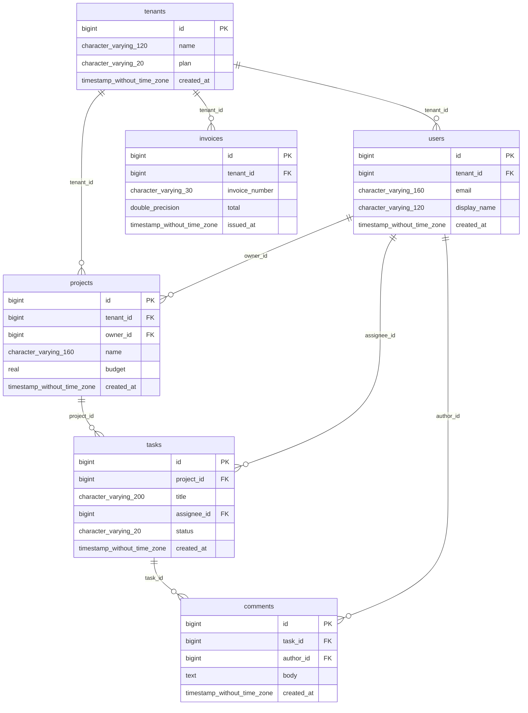
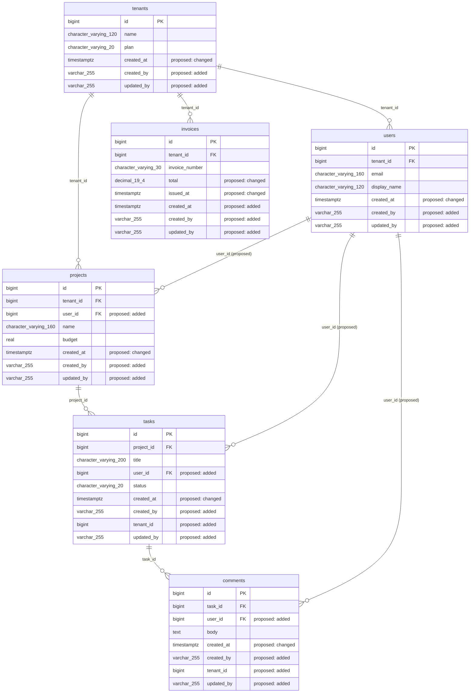

# Database assessment: saas_demo

Generated 2026-11-08T14:28:59+00:00. Plan hash `d63ba596a41224fba55646637e265498d4fe9d78752ce9f44999069cec9c2d93`.

**This report describes proposals only. Nothing has been changed.**

## Executive summary

Database saas_demo (postgres, imported from sql_dump) has 6 table(s) and 0 view(s).

Overall health is 59.0 (D) with 84% confidence.

83 finding(s): 6 confirmed defect(s), 60 optional improvement(s) and 17 context-dependent item(s). 4 are critical and 6 are high severity.

The overall score is capped because at least one confirmed critical defect exists.

104 rule(s) ran; 27 were skipped and 0 failed. See coverage.

The migration plan has 91 step(s): 42 with SQL and 49 manual. Nothing has been applied.

Top confirmed risks:

- [critical] Tenant-scoped table public.comments has no tenant identifier (`TENA-001-943cd663`)
- [critical] Tenant-scoped table public.tasks has no tenant identifier (`TENA-001-2d71408c`)
- [critical] Tenant identifier public.users.tenant_id allows NULL (`TENA-003-a7fc303f`)
- [critical] Monetary column public.invoices.total uses binary floating point (`SCH-020-f15a2d57`)
- [high] Broad grant to app_user: ALL (ALL privileges, wildcard scope) (`SECA-002-d0a96b3f`)

## Health scores

Overall **59.0**, grade **D**, confidence 84%. Capped: yes.

**Method:** Each category starts at 100. A rule deducts its worst finding's severity points (critical 25, high 12, medium 5, low 1.5, informational 0), multiplied by kind (defect 1, context-dependent 0.5, optional 0.25), finding confidence, and the square root of the number of findings. Overall is a weighted average of assessed categories, capped at 59 if a confirmed critical defect exists. Confidence is the share of applicable rules that could actually run. These weights are a framework judgment, not a published standard.

| Category | Score | Grade | Confidence | Weight | Rules run | Rules skipped | Deductions |
|---|---|---|---|---|---|---|---|
| schema_quality | 100.0 | A | 100% | 14 | 13 | 0 | 0 |
| data_integrity | 73.0 | C | 100% | 16 | 18 | 0 | 4 |
| performance | 100.0 | A | 33% | 10 | 5 | 10 | 0 |
| security | 9.9 | F | 100% | 16 | 21 | 0 | 9 |
| data_quality | 100.0 | A | 100% | 12 | 11 | 0 | 0 |
| scalability | 100.0 | A | 100% | 6 | 5 | 0 | 0 |
| maintainability | 97.9 | A | 100% | 6 | 18 | 0 | 4 |
| data_engineering_readiness | 99.5 | A | 29% | 6 | 4 | 10 | 1 |
| governance | 93.0 | A | 100% | 6 | 8 | 0 | 7 |
| reliability_recovery | 100.0 | A | 33% | 8 | 1 | 2 | 0 |

### Deductions: data_integrity

| Rule | Title | Count | Points |
|---|---|---|---|
| SCH-020 | Monetary column public.invoices.total uses binary floating point | 1 | 21.25 |
| SCH-030 | Instant column public.comments.created_at stores no time zone | 6 | 4.59 |
| SCH-007 | Foreign key on public.comments does not declare its actions | 8 | 0.9 |
| SCH-046 | Status column public.tasks.status has no CHECK or reference table | 1 | 0.3 |

### Deductions: performance

- input not available: query_stats

### Deductions: security

| Rule | Title | Count | Points |
|---|---|---|---|
| TENA-001 | Tenant-scoped table public.comments has no tenant identifier | 2 | 31.82 |
| TENA-003 | Tenant identifier public.users.tenant_id allows NULL | 1 | 22.5 |
| SECA-002 | Broad grant to app_user: ALL (ALL privileges, wildcard scope) | 2 | 15.27 |
| TENA-007 | Row-level security on public.invoices: not enabled | 3 | 9.35 |
| TENA-006 | Foreign key public.projects(owner_id) to public.users can cross tenants | 1 | 5.4 |
| SECA-005 | Sampled values in public.users.email look like email | 1 | 2.25 |
| TENA-004 | Primary key of public.invoices excludes the tenant identifier | 3 | 1.95 |
| TENA-005 | Unique key (email) on public.users excludes the tenant identifier | 1 | 1.12 |
| SECA-004 | Possible email data in public.users.email | 1 | 0.45 |

### Deductions: maintainability

| Rule | Title | Count | Points |
|---|---|---|---|
| SCH-059 | Constraints or indexes in public.comments use non-standard names | 6 | 0.78 |
| SCH-058 | Foreign key column public.comments.author_id is not named for its parent | 3 | 0.55 |
| GVN-007 | No migration history table found | 1 | 0.45 |
| SCH-057 | Primary key naming differs from the &lt;entity_singular>_id form | 1 | 0.32 |

### Deductions: data_engineering_readiness

| Rule | Title | Count | Points |
|---|---|---|---|
| DE-005 | Table public.comments has no reliable change column | 6 | 0.55 |

- input not available: pipelines

### Deductions: governance

| Rule | Title | Count | Points |
|---|---|---|---|
| SCH-044 | Table public.comments is missing audit column created_by | 19 | 1.47 |
| GVN-004 | No data classification metadata found | 1 | 1.25 |
| GVN-005 | No audit or history structures found | 1 | 1.25 |
| GVN-006 | No retention schedule structures found | 1 | 1.0 |
| GVN-001 | Table public.comments has no description | 6 | 0.83 |
| GVN-002 | Columns of public.comments have no descriptions (5) | 6 | 0.83 |
| GVN-003 | No ownership metadata found | 1 | 0.38 |

### Deductions: reliability_recovery

- input not available: live

## Distributions

| Severity | Count |
|---|---|
| critical | 4 |
| high | 6 |
| medium | 14 |
| low | 59 |
| informational | 0 |

| Kind | Count |
|---|---|
| confirmed_defect | 6 |
| optional_improvement | 60 |
| context_dependent | 17 |

| Category | Count |
|---|---|
| schema_quality | 0 |
| data_integrity | 16 |
| performance | 0 |
| security | 15 |
| data_quality | 0 |
| scalability | 0 |
| maintainability | 11 |
| data_engineering_readiness | 6 |
| governance | 35 |
| reliability_recovery | 0 |

## Findings (83)

### Confirmed defects (6)

#### CRITICAL: Monetary column public.invoices.total uses binary floating point

- **ID:** `SCH-020-f15a2d57`
- **Rule:** `SCH-020`
- **Severity:** critical
- **Kind:** confirmed_defect
- **Category:** data_integrity
- **Database:** `saas_demo`
- **Table:** `public.invoices`
- **Column:** `total`
- **Evidence:** public.invoices.total is double precision, a binary floating-point type, and its name indicates a monetary value.
- **Root cause:** A money column was declared as float, real or double.
- **Business impact:** Totals can be off by small amounts and fail reconciliation or audit.
- **Technical impact:** Binary floating point cannot hold most decimal fractions exactly, and errors accumulate in aggregates.
- **Standards:** TYP-001: Monetary values MUST be stored in an exact decimal type or in integer minor units, and MUST NOT be stored or calculated in binary floating point.
- **Recommended solution:** Change the column to an exact decimal type.
- **Complexity:** medium
- **Migration requirements:** Convert with explicit rounding reviewed by the data owner. Large tables need an online method.
- **Risks:** Rounding during conversion can change stored values.
- **Validation strategy:** Reconcile sums before and after, and confirm the catalog type.
- **Confidence:** 0.85
- **Provisional standard:** no

#### CRITICAL: Tenant-scoped table public.comments has no tenant identifier

- **ID:** `TENA-001-943cd663`
- **Rule:** `TENA-001`
- **Severity:** critical
- **Kind:** confirmed_defect
- **Category:** security
- **Database:** `saas_demo`
- **Table:** `public.comments`
- **Column:** `tenant_id`
- **Evidence:** Table public.comments has no tenant_id column.
- **Root cause:** The table was designed without a tenant identifier in a pooled database.
- **Business impact:** Data from one customer cannot be separated from another's, which risks disclosure.
- **Technical impact:** No predicate or policy on public.comments can restrict rows to a tenant.
- **Standards:** TEN-006: Every tenant-scoped table in a pooled or sharded database MUST carry a non-null tenant identifier.
- **Recommended solution:** Add tenant_id, backfill it from the owning parent, then set it NOT NULL and add it to keys.
- **Complexity:** high
- **Migration requirements:** Additive column, backfill in batches, then constraints and application changes.
- **Risks:** A wrong backfill assigns rows to the wrong tenant; review the mapping before applying it.
- **Validation strategy:** Confirm no row has a NULL tenant_id and test isolation with a non-privileged role.
- **Confidence:** 0.90
- **Provisional standard:** no

#### CRITICAL: Tenant-scoped table public.tasks has no tenant identifier

- **ID:** `TENA-001-2d71408c`
- **Rule:** `TENA-001`
- **Severity:** critical
- **Kind:** confirmed_defect
- **Category:** security
- **Database:** `saas_demo`
- **Table:** `public.tasks`
- **Column:** `tenant_id`
- **Evidence:** Table public.tasks has no tenant_id column.
- **Root cause:** The table was designed without a tenant identifier in a pooled database.
- **Business impact:** Data from one customer cannot be separated from another's, which risks disclosure.
- **Technical impact:** No predicate or policy on public.tasks can restrict rows to a tenant.
- **Standards:** TEN-006: Every tenant-scoped table in a pooled or sharded database MUST carry a non-null tenant identifier.
- **Recommended solution:** Add tenant_id, backfill it from the owning parent, then set it NOT NULL and add it to keys.
- **Complexity:** high
- **Migration requirements:** Additive column, backfill in batches, then constraints and application changes.
- **Risks:** A wrong backfill assigns rows to the wrong tenant; review the mapping before applying it.
- **Validation strategy:** Confirm no row has a NULL tenant_id and test isolation with a non-privileged role.
- **Confidence:** 0.90
- **Provisional standard:** no

#### CRITICAL: Tenant identifier public.users.tenant_id allows NULL

- **ID:** `TENA-003-a7fc303f`
- **Rule:** `TENA-003`
- **Severity:** critical
- **Kind:** confirmed_defect
- **Category:** security
- **Database:** `saas_demo`
- **Table:** `public.users`
- **Column:** `tenant_id`
- **Evidence:** public.users.tenant_id allows NULL.
- **Root cause:** The tenant column was added without NOT NULL.
- **Business impact:** Rows without a tenant belong to no customer and can escape isolation.
- **Technical impact:** Tenant predicates do not match NULL rows, and policies can behave unexpectedly.
- **Standards:** TEN-006: Every tenant-scoped table in a pooled or sharded database MUST carry a non-null tenant identifier.
- **Recommended solution:** Backfill NULL values and set tenant_id NOT NULL.
- **Complexity:** medium
- **Migration requirements:** Backfill first; the constraint fails while NULL rows exist.
- **Risks:** Rows that cannot be attributed to a tenant need a manual decision.
- **Validation strategy:** Confirm the count of NULL tenant_id is zero and the constraint is in place.
- **Confidence:** 0.90
- **Provisional standard:** no

#### HIGH: Broad grant to app_user: ALL (ALL privileges, wildcard scope)

- **ID:** `SECA-002-d0a96b3f`
- **Rule:** `SECA-002`
- **Severity:** high
- **Kind:** confirmed_defect
- **Category:** security
- **Database:** `saas_demo`
- **Table:** (none)
- **Column:** (none)
- **Evidence:** app_user holds ALL on *: ALL privileges, wildcard scope.
- **Root cause:** A grant was made more widely than the role's task requires.
- **Business impact:** Excess access increases the damage from a leaked credential or insider misuse.
- **Technical impact:** app_user holds ALL: ALL privileges, wildcard scope.
- **Standards:** SEC-001: The application runtime MUST connect with a least-privilege role that does not own database objects and holds no administrative rights.; SEC-003: Databases SHOULD use separate roles for runtime, migration, read-only analysis, audit writing, and security policy administration.
- **Recommended solution:** Replace the grant with table-level privileges limited to what app_user needs.
- **Complexity:** medium
- **Migration requirements:** Inventory what app_user uses, grant that explicitly, then revoke the broad grant.
- **Risks:** Removing a broad grant can break consumers that were not inventoried.
- **Validation strategy:** Review effective privileges of app_user after the change and exercise its workloads.
- **Confidence:** 0.90
- **Provisional standard:** yes

#### HIGH: Broad grant to PUBLIC: ALL (granted to PUBLIC, ALL privileges, wildcard scope)

- **ID:** `SECA-002-72e454df`
- **Rule:** `SECA-002`
- **Severity:** high
- **Kind:** confirmed_defect
- **Category:** security
- **Database:** `saas_demo`
- **Table:** (none)
- **Column:** (none)
- **Evidence:** PUBLIC holds ALL on the database: granted to PUBLIC, ALL privileges, wildcard scope.
- **Root cause:** A grant was made more widely than the role's task requires.
- **Business impact:** Excess access increases the damage from a leaked credential or insider misuse.
- **Technical impact:** PUBLIC holds ALL: granted to PUBLIC, ALL privileges, wildcard scope.
- **Standards:** SEC-001: The application runtime MUST connect with a least-privilege role that does not own database objects and holds no administrative rights.; SEC-003: Databases SHOULD use separate roles for runtime, migration, read-only analysis, audit writing, and security policy administration.
- **Recommended solution:** Replace the grant with table-level privileges limited to what PUBLIC needs.
- **Complexity:** medium
- **Migration requirements:** Inventory what PUBLIC uses, grant that explicitly, then revoke the broad grant.
- **Risks:** Removing a broad grant can break consumers that were not inventoried.
- **Validation strategy:** Review effective privileges of PUBLIC after the change and exercise its workloads.
- **Confidence:** 0.90
- **Provisional standard:** yes


### Optional improvements (60)

#### MEDIUM: Primary key of public.invoices excludes the tenant identifier

- **ID:** `TENA-004-e588c013`
- **Rule:** `TENA-004`
- **Severity:** medium
- **Kind:** optional_improvement
- **Category:** security
- **Database:** `saas_demo`
- **Table:** `public.invoices`
- **Column:** `tenant_id`
- **Evidence:** Primary key of public.invoices is (id), without tenant_id.
- **Root cause:** The primary key was designed for a single-tenant table.
- **Business impact:** Sharding and tenant moves become harder and costlier later.
- **Technical impact:** Rows of a tenant are not clustered, and the key cannot support a shard boundary.
- **Standards:** TEN-014: Pooled and sharded tenant-scoped tables SHOULD include the tenant identifier in the primary key, as its leading element where the table is sharded.
- **Recommended solution:** Include tenant_id in the primary key, leading where the table is sharded.
- **Complexity:** high
- **Migration requirements:** Primary key rebuild; every referencing foreign key changes with it.
- **Risks:** Long rebuild on large tables, and a coordinated change to referencing tables.
- **Validation strategy:** Confirm the key definition and query plans for tenant-filtered access.
- **Confidence:** 0.90
- **Provisional standard:** no

#### MEDIUM: Primary key of public.projects excludes the tenant identifier

- **ID:** `TENA-004-f66bd2da`
- **Rule:** `TENA-004`
- **Severity:** medium
- **Kind:** optional_improvement
- **Category:** security
- **Database:** `saas_demo`
- **Table:** `public.projects`
- **Column:** `tenant_id`
- **Evidence:** Primary key of public.projects is (id), without tenant_id.
- **Root cause:** The primary key was designed for a single-tenant table.
- **Business impact:** Sharding and tenant moves become harder and costlier later.
- **Technical impact:** Rows of a tenant are not clustered, and the key cannot support a shard boundary.
- **Standards:** TEN-014: Pooled and sharded tenant-scoped tables SHOULD include the tenant identifier in the primary key, as its leading element where the table is sharded.
- **Recommended solution:** Include tenant_id in the primary key, leading where the table is sharded.
- **Complexity:** high
- **Migration requirements:** Primary key rebuild; every referencing foreign key changes with it.
- **Risks:** Long rebuild on large tables, and a coordinated change to referencing tables.
- **Validation strategy:** Confirm the key definition and query plans for tenant-filtered access.
- **Confidence:** 0.90
- **Provisional standard:** no

#### MEDIUM: Primary key of public.users excludes the tenant identifier

- **ID:** `TENA-004-e5b8ecaa`
- **Rule:** `TENA-004`
- **Severity:** medium
- **Kind:** optional_improvement
- **Category:** security
- **Database:** `saas_demo`
- **Table:** `public.users`
- **Column:** `tenant_id`
- **Evidence:** Primary key of public.users is (id), without tenant_id.
- **Root cause:** The primary key was designed for a single-tenant table.
- **Business impact:** Sharding and tenant moves become harder and costlier later.
- **Technical impact:** Rows of a tenant are not clustered, and the key cannot support a shard boundary.
- **Standards:** TEN-014: Pooled and sharded tenant-scoped tables SHOULD include the tenant identifier in the primary key, as its leading element where the table is sharded.
- **Recommended solution:** Include tenant_id in the primary key, leading where the table is sharded.
- **Complexity:** high
- **Migration requirements:** Primary key rebuild; every referencing foreign key changes with it.
- **Risks:** Long rebuild on large tables, and a coordinated change to referencing tables.
- **Validation strategy:** Confirm the key definition and query plans for tenant-filtered access.
- **Confidence:** 0.90
- **Provisional standard:** no

#### MEDIUM: Unique key (email) on public.users excludes the tenant identifier

- **ID:** `TENA-005-5720c9a7`
- **Rule:** `TENA-005`
- **Severity:** medium
- **Kind:** optional_improvement
- **Category:** security
- **Database:** `saas_demo`
- **Table:** `public.users`
- **Column:** `email`
- **Evidence:** Unique key users_email_key on public.users does not include tenant_id.
- **Root cause:** Uniqueness was declared globally rather than per tenant.
- **Business impact:** One tenant's value blocks another's, and conflict errors reveal that the value exists.
- **Technical impact:** A global unique index spans tenants on (email).
- **Standards:** TEN-013: Unique constraints on tenant-scoped pooled tables SHOULD include the tenant identifier.
- **Recommended solution:** Create the tenant-scoped unique index, then retire the global one after review.
- **Complexity:** medium
- **Migration requirements:** Build the new index online; remove the old one only once the new key is proven.
- **Risks:** Some values are meant to be globally unique, so confirm the intent first.
- **Validation strategy:** Insert the same value under two tenants in a test environment.
- **Confidence:** 0.90
- **Provisional standard:** yes

#### LOW: Table public.comments has no reliable change column

- **ID:** `DE-005-e3d826de`
- **Rule:** `DE-005`
- **Severity:** low
- **Kind:** optional_improvement
- **Category:** data_engineering_readiness
- **Database:** `saas_demo`
- **Table:** `public.comments`
- **Column:** `updated_at`
- **Evidence:** Table public.comments has no reliable change column.
- **Root cause:** The table does not record when a row last changed.
- **Business impact:** Incremental data feeds cannot be built without full table scans.
- **Technical impact:** Query-based extraction of public.comments needs a full read.
- **Standards:** PIP-008: Tables extracted by query SHOULD maintain a reliable change column and a defined way to observe deletes.
- **Recommended solution:** Add updated_at, maintained by the engine or by a trigger, if the table will be extracted by query.
- **Complexity:** low
- **Migration requirements:** Additive column, then a trigger or an application change.
- **Risks:** Only useful if every write path maintains the column.
- **Validation strategy:** Update a row through each write path and confirm the column changes.
- **Confidence:** 0.60
- **Provisional standard:** yes

#### LOW: Table public.invoices has no reliable change column

- **ID:** `DE-005-f0c2b3f6`
- **Rule:** `DE-005`
- **Severity:** low
- **Kind:** optional_improvement
- **Category:** data_engineering_readiness
- **Database:** `saas_demo`
- **Table:** `public.invoices`
- **Column:** `updated_at`
- **Evidence:** Table public.invoices has no reliable change column.
- **Root cause:** The table does not record when a row last changed.
- **Business impact:** Incremental data feeds cannot be built without full table scans.
- **Technical impact:** Query-based extraction of public.invoices needs a full read.
- **Standards:** PIP-008: Tables extracted by query SHOULD maintain a reliable change column and a defined way to observe deletes.
- **Recommended solution:** Add updated_at, maintained by the engine or by a trigger, if the table will be extracted by query.
- **Complexity:** low
- **Migration requirements:** Additive column, then a trigger or an application change.
- **Risks:** Only useful if every write path maintains the column.
- **Validation strategy:** Update a row through each write path and confirm the column changes.
- **Confidence:** 0.60
- **Provisional standard:** yes

#### LOW: Table public.projects has no reliable change column

- **ID:** `DE-005-0615d78f`
- **Rule:** `DE-005`
- **Severity:** low
- **Kind:** optional_improvement
- **Category:** data_engineering_readiness
- **Database:** `saas_demo`
- **Table:** `public.projects`
- **Column:** `updated_at`
- **Evidence:** Table public.projects has no reliable change column.
- **Root cause:** The table does not record when a row last changed.
- **Business impact:** Incremental data feeds cannot be built without full table scans.
- **Technical impact:** Query-based extraction of public.projects needs a full read.
- **Standards:** PIP-008: Tables extracted by query SHOULD maintain a reliable change column and a defined way to observe deletes.
- **Recommended solution:** Add updated_at, maintained by the engine or by a trigger, if the table will be extracted by query.
- **Complexity:** low
- **Migration requirements:** Additive column, then a trigger or an application change.
- **Risks:** Only useful if every write path maintains the column.
- **Validation strategy:** Update a row through each write path and confirm the column changes.
- **Confidence:** 0.60
- **Provisional standard:** yes

#### LOW: Table public.tasks has no reliable change column

- **ID:** `DE-005-69aab2fa`
- **Rule:** `DE-005`
- **Severity:** low
- **Kind:** optional_improvement
- **Category:** data_engineering_readiness
- **Database:** `saas_demo`
- **Table:** `public.tasks`
- **Column:** `updated_at`
- **Evidence:** Table public.tasks has no reliable change column.
- **Root cause:** The table does not record when a row last changed.
- **Business impact:** Incremental data feeds cannot be built without full table scans.
- **Technical impact:** Query-based extraction of public.tasks needs a full read.
- **Standards:** PIP-008: Tables extracted by query SHOULD maintain a reliable change column and a defined way to observe deletes.
- **Recommended solution:** Add updated_at, maintained by the engine or by a trigger, if the table will be extracted by query.
- **Complexity:** low
- **Migration requirements:** Additive column, then a trigger or an application change.
- **Risks:** Only useful if every write path maintains the column.
- **Validation strategy:** Update a row through each write path and confirm the column changes.
- **Confidence:** 0.60
- **Provisional standard:** yes

#### LOW: Table public.tenants has no reliable change column

- **ID:** `DE-005-b63839de`
- **Rule:** `DE-005`
- **Severity:** low
- **Kind:** optional_improvement
- **Category:** data_engineering_readiness
- **Database:** `saas_demo`
- **Table:** `public.tenants`
- **Column:** `updated_at`
- **Evidence:** Table public.tenants has no reliable change column.
- **Root cause:** The table does not record when a row last changed.
- **Business impact:** Incremental data feeds cannot be built without full table scans.
- **Technical impact:** Query-based extraction of public.tenants needs a full read.
- **Standards:** PIP-008: Tables extracted by query SHOULD maintain a reliable change column and a defined way to observe deletes.
- **Recommended solution:** Add updated_at, maintained by the engine or by a trigger, if the table will be extracted by query.
- **Complexity:** low
- **Migration requirements:** Additive column, then a trigger or an application change.
- **Risks:** Only useful if every write path maintains the column.
- **Validation strategy:** Update a row through each write path and confirm the column changes.
- **Confidence:** 0.60
- **Provisional standard:** yes

#### LOW: Table public.users has no reliable change column

- **ID:** `DE-005-1b429b26`
- **Rule:** `DE-005`
- **Severity:** low
- **Kind:** optional_improvement
- **Category:** data_engineering_readiness
- **Database:** `saas_demo`
- **Table:** `public.users`
- **Column:** `updated_at`
- **Evidence:** Table public.users has no reliable change column.
- **Root cause:** The table does not record when a row last changed.
- **Business impact:** Incremental data feeds cannot be built without full table scans.
- **Technical impact:** Query-based extraction of public.users needs a full read.
- **Standards:** PIP-008: Tables extracted by query SHOULD maintain a reliable change column and a defined way to observe deletes.
- **Recommended solution:** Add updated_at, maintained by the engine or by a trigger, if the table will be extracted by query.
- **Complexity:** low
- **Migration requirements:** Additive column, then a trigger or an application change.
- **Risks:** Only useful if every write path maintains the column.
- **Validation strategy:** Update a row through each write path and confirm the column changes.
- **Confidence:** 0.60
- **Provisional standard:** yes

#### LOW: Table public.comments has no description

- **ID:** `GVN-001-daf72158`
- **Rule:** `GVN-001`
- **Severity:** low
- **Kind:** optional_improvement
- **Category:** governance
- **Database:** `saas_demo`
- **Table:** `public.comments`
- **Column:** (none)
- **Evidence:** Table public.comments has no description.
- **Root cause:** The table was created without a description in the schema.
- **Business impact:** Users misread data whose meaning is not recorded.
- **Technical impact:** public.comments has no description in the schema.
- **Standards:** GOV-003: Tables and columns SHOULD have descriptions held with the schema artefact and containing no sensitive values.
- **Recommended solution:** Add a description held with the schema, with no sensitive values.
- **Complexity:** low
- **Migration requirements:** Metadata only.
- **Risks:** None significant.
- **Validation strategy:** Re-run the check.
- **Confidence:** 0.90
- **Provisional standard:** yes

#### LOW: Table public.invoices has no description

- **ID:** `GVN-001-5c6fdcf2`
- **Rule:** `GVN-001`
- **Severity:** low
- **Kind:** optional_improvement
- **Category:** governance
- **Database:** `saas_demo`
- **Table:** `public.invoices`
- **Column:** (none)
- **Evidence:** Table public.invoices has no description.
- **Root cause:** The table was created without a description in the schema.
- **Business impact:** Users misread data whose meaning is not recorded.
- **Technical impact:** public.invoices has no description in the schema.
- **Standards:** GOV-003: Tables and columns SHOULD have descriptions held with the schema artefact and containing no sensitive values.
- **Recommended solution:** Add a description held with the schema, with no sensitive values.
- **Complexity:** low
- **Migration requirements:** Metadata only.
- **Risks:** None significant.
- **Validation strategy:** Re-run the check.
- **Confidence:** 0.90
- **Provisional standard:** yes

#### LOW: Table public.projects has no description

- **ID:** `GVN-001-e0480900`
- **Rule:** `GVN-001`
- **Severity:** low
- **Kind:** optional_improvement
- **Category:** governance
- **Database:** `saas_demo`
- **Table:** `public.projects`
- **Column:** (none)
- **Evidence:** Table public.projects has no description.
- **Root cause:** The table was created without a description in the schema.
- **Business impact:** Users misread data whose meaning is not recorded.
- **Technical impact:** public.projects has no description in the schema.
- **Standards:** GOV-003: Tables and columns SHOULD have descriptions held with the schema artefact and containing no sensitive values.
- **Recommended solution:** Add a description held with the schema, with no sensitive values.
- **Complexity:** low
- **Migration requirements:** Metadata only.
- **Risks:** None significant.
- **Validation strategy:** Re-run the check.
- **Confidence:** 0.90
- **Provisional standard:** yes

#### LOW: Table public.tasks has no description

- **ID:** `GVN-001-35115ed2`
- **Rule:** `GVN-001`
- **Severity:** low
- **Kind:** optional_improvement
- **Category:** governance
- **Database:** `saas_demo`
- **Table:** `public.tasks`
- **Column:** (none)
- **Evidence:** Table public.tasks has no description.
- **Root cause:** The table was created without a description in the schema.
- **Business impact:** Users misread data whose meaning is not recorded.
- **Technical impact:** public.tasks has no description in the schema.
- **Standards:** GOV-003: Tables and columns SHOULD have descriptions held with the schema artefact and containing no sensitive values.
- **Recommended solution:** Add a description held with the schema, with no sensitive values.
- **Complexity:** low
- **Migration requirements:** Metadata only.
- **Risks:** None significant.
- **Validation strategy:** Re-run the check.
- **Confidence:** 0.90
- **Provisional standard:** yes

#### LOW: Table public.tenants has no description

- **ID:** `GVN-001-438a3d43`
- **Rule:** `GVN-001`
- **Severity:** low
- **Kind:** optional_improvement
- **Category:** governance
- **Database:** `saas_demo`
- **Table:** `public.tenants`
- **Column:** (none)
- **Evidence:** Table public.tenants has no description.
- **Root cause:** The table was created without a description in the schema.
- **Business impact:** Users misread data whose meaning is not recorded.
- **Technical impact:** public.tenants has no description in the schema.
- **Standards:** GOV-003: Tables and columns SHOULD have descriptions held with the schema artefact and containing no sensitive values.
- **Recommended solution:** Add a description held with the schema, with no sensitive values.
- **Complexity:** low
- **Migration requirements:** Metadata only.
- **Risks:** None significant.
- **Validation strategy:** Re-run the check.
- **Confidence:** 0.90
- **Provisional standard:** yes

#### LOW: Table public.users has no description

- **ID:** `GVN-001-0f0232a4`
- **Rule:** `GVN-001`
- **Severity:** low
- **Kind:** optional_improvement
- **Category:** governance
- **Database:** `saas_demo`
- **Table:** `public.users`
- **Column:** (none)
- **Evidence:** Table public.users has no description.
- **Root cause:** The table was created without a description in the schema.
- **Business impact:** Users misread data whose meaning is not recorded.
- **Technical impact:** public.users has no description in the schema.
- **Standards:** GOV-003: Tables and columns SHOULD have descriptions held with the schema artefact and containing no sensitive values.
- **Recommended solution:** Add a description held with the schema, with no sensitive values.
- **Complexity:** low
- **Migration requirements:** Metadata only.
- **Risks:** None significant.
- **Validation strategy:** Re-run the check.
- **Confidence:** 0.90
- **Provisional standard:** yes

#### LOW: Columns of public.comments have no descriptions (5)

- **ID:** `GVN-002-03e1e3bd`
- **Rule:** `GVN-002`
- **Severity:** low
- **Kind:** optional_improvement
- **Category:** governance
- **Database:** `saas_demo`
- **Table:** `public.comments`
- **Column:** (none)
- **Evidence:** 5 of 5 columns have no description.
- **Root cause:** Columns were created without descriptions.
- **Business impact:** Users misread columns whose meaning is not recorded.
- **Technical impact:** 5 columns of public.comments have no description.
- **Standards:** GOV-003: Tables and columns SHOULD have descriptions held with the schema artefact and containing no sensitive values.
- **Recommended solution:** Describe the columns in the schema, with no sensitive values.
- **Complexity:** low
- **Migration requirements:** Metadata only.
- **Risks:** None significant.
- **Validation strategy:** Re-run the check.
- **Confidence:** 0.90
- **Provisional standard:** yes

#### LOW: Columns of public.invoices have no descriptions (5)

- **ID:** `GVN-002-464c94de`
- **Rule:** `GVN-002`
- **Severity:** low
- **Kind:** optional_improvement
- **Category:** governance
- **Database:** `saas_demo`
- **Table:** `public.invoices`
- **Column:** (none)
- **Evidence:** 5 of 5 columns have no description.
- **Root cause:** Columns were created without descriptions.
- **Business impact:** Users misread columns whose meaning is not recorded.
- **Technical impact:** 5 columns of public.invoices have no description.
- **Standards:** GOV-003: Tables and columns SHOULD have descriptions held with the schema artefact and containing no sensitive values.
- **Recommended solution:** Describe the columns in the schema, with no sensitive values.
- **Complexity:** low
- **Migration requirements:** Metadata only.
- **Risks:** None significant.
- **Validation strategy:** Re-run the check.
- **Confidence:** 0.90
- **Provisional standard:** yes

#### LOW: Columns of public.projects have no descriptions (6)

- **ID:** `GVN-002-80d620da`
- **Rule:** `GVN-002`
- **Severity:** low
- **Kind:** optional_improvement
- **Category:** governance
- **Database:** `saas_demo`
- **Table:** `public.projects`
- **Column:** (none)
- **Evidence:** 6 of 6 columns have no description.
- **Root cause:** Columns were created without descriptions.
- **Business impact:** Users misread columns whose meaning is not recorded.
- **Technical impact:** 6 columns of public.projects have no description.
- **Standards:** GOV-003: Tables and columns SHOULD have descriptions held with the schema artefact and containing no sensitive values.
- **Recommended solution:** Describe the columns in the schema, with no sensitive values.
- **Complexity:** low
- **Migration requirements:** Metadata only.
- **Risks:** None significant.
- **Validation strategy:** Re-run the check.
- **Confidence:** 0.90
- **Provisional standard:** yes

#### LOW: Columns of public.tasks have no descriptions (6)

- **ID:** `GVN-002-c352517a`
- **Rule:** `GVN-002`
- **Severity:** low
- **Kind:** optional_improvement
- **Category:** governance
- **Database:** `saas_demo`
- **Table:** `public.tasks`
- **Column:** (none)
- **Evidence:** 6 of 6 columns have no description.
- **Root cause:** Columns were created without descriptions.
- **Business impact:** Users misread columns whose meaning is not recorded.
- **Technical impact:** 6 columns of public.tasks have no description.
- **Standards:** GOV-003: Tables and columns SHOULD have descriptions held with the schema artefact and containing no sensitive values.
- **Recommended solution:** Describe the columns in the schema, with no sensitive values.
- **Complexity:** low
- **Migration requirements:** Metadata only.
- **Risks:** None significant.
- **Validation strategy:** Re-run the check.
- **Confidence:** 0.90
- **Provisional standard:** yes

#### LOW: Columns of public.tenants have no descriptions (4)

- **ID:** `GVN-002-ce24f04d`
- **Rule:** `GVN-002`
- **Severity:** low
- **Kind:** optional_improvement
- **Category:** governance
- **Database:** `saas_demo`
- **Table:** `public.tenants`
- **Column:** (none)
- **Evidence:** 4 of 4 columns have no description.
- **Root cause:** Columns were created without descriptions.
- **Business impact:** Users misread columns whose meaning is not recorded.
- **Technical impact:** 4 columns of public.tenants have no description.
- **Standards:** GOV-003: Tables and columns SHOULD have descriptions held with the schema artefact and containing no sensitive values.
- **Recommended solution:** Describe the columns in the schema, with no sensitive values.
- **Complexity:** low
- **Migration requirements:** Metadata only.
- **Risks:** None significant.
- **Validation strategy:** Re-run the check.
- **Confidence:** 0.90
- **Provisional standard:** yes

#### LOW: Columns of public.users have no descriptions (5)

- **ID:** `GVN-002-06b24064`
- **Rule:** `GVN-002`
- **Severity:** low
- **Kind:** optional_improvement
- **Category:** governance
- **Database:** `saas_demo`
- **Table:** `public.users`
- **Column:** (none)
- **Evidence:** 5 of 5 columns have no description.
- **Root cause:** Columns were created without descriptions.
- **Business impact:** Users misread columns whose meaning is not recorded.
- **Technical impact:** 5 columns of public.users have no description.
- **Standards:** GOV-003: Tables and columns SHOULD have descriptions held with the schema artefact and containing no sensitive values.
- **Recommended solution:** Describe the columns in the schema, with no sensitive values.
- **Complexity:** low
- **Migration requirements:** Metadata only.
- **Risks:** None significant.
- **Validation strategy:** Re-run the check.
- **Confidence:** 0.90
- **Provisional standard:** yes

#### LOW: Foreign key on public.comments does not declare its actions

- **ID:** `SCH-007-56e7d617`
- **Rule:** `SCH-007`
- **Severity:** low
- **Kind:** optional_improvement
- **Category:** data_integrity
- **Database:** `saas_demo`
- **Table:** `public.comments`
- **Column:** `author_id`
- **Evidence:** Foreign key comments_author_id_fkey on (author_id) to users does not state ON DELETE or ON UPDATE.
- **Root cause:** The foreign key relies on the engine's default delete and update actions.
- **Business impact:** The behaviour when a parent changes is left to chance, not recorded as a design decision.
- **Technical impact:** Actions cannot be confirmed by reading the schema, and defaults differ by engine and version.
- **Standards:** INT-005: Each foreign key SHOULD declare its delete and update actions explicitly.
- **Recommended solution:** State ON DELETE and ON UPDATE explicitly according to the relationship type.
- **Complexity:** low
- **Migration requirements:** Drop and re-create the constraint with explicit actions.
- **Risks:** Re-creating a constraint can revalidate and lock the table.
- **Validation strategy:** Catalog lists the intended actions.
- **Confidence:** 0.85
- **Provisional standard:** no

#### LOW: Foreign key on public.comments does not declare its actions

- **ID:** `SCH-007-ea6b38d8`
- **Rule:** `SCH-007`
- **Severity:** low
- **Kind:** optional_improvement
- **Category:** data_integrity
- **Database:** `saas_demo`
- **Table:** `public.comments`
- **Column:** `task_id`
- **Evidence:** Foreign key comments_task_id_fkey on (task_id) to tasks does not state ON DELETE or ON UPDATE.
- **Root cause:** The foreign key relies on the engine's default delete and update actions.
- **Business impact:** The behaviour when a parent changes is left to chance, not recorded as a design decision.
- **Technical impact:** Actions cannot be confirmed by reading the schema, and defaults differ by engine and version.
- **Standards:** INT-005: Each foreign key SHOULD declare its delete and update actions explicitly.
- **Recommended solution:** State ON DELETE and ON UPDATE explicitly according to the relationship type.
- **Complexity:** low
- **Migration requirements:** Drop and re-create the constraint with explicit actions.
- **Risks:** Re-creating a constraint can revalidate and lock the table.
- **Validation strategy:** Catalog lists the intended actions.
- **Confidence:** 0.85
- **Provisional standard:** no

#### LOW: Foreign key on public.invoices does not declare its actions

- **ID:** `SCH-007-e352e6cd`
- **Rule:** `SCH-007`
- **Severity:** low
- **Kind:** optional_improvement
- **Category:** data_integrity
- **Database:** `saas_demo`
- **Table:** `public.invoices`
- **Column:** `tenant_id`
- **Evidence:** Foreign key invoices_tenant_id_fkey on (tenant_id) to tenants does not state ON DELETE or ON UPDATE.
- **Root cause:** The foreign key relies on the engine's default delete and update actions.
- **Business impact:** The behaviour when a parent changes is left to chance, not recorded as a design decision.
- **Technical impact:** Actions cannot be confirmed by reading the schema, and defaults differ by engine and version.
- **Standards:** INT-005: Each foreign key SHOULD declare its delete and update actions explicitly.
- **Recommended solution:** State ON DELETE and ON UPDATE explicitly according to the relationship type.
- **Complexity:** low
- **Migration requirements:** Drop and re-create the constraint with explicit actions.
- **Risks:** Re-creating a constraint can revalidate and lock the table.
- **Validation strategy:** Catalog lists the intended actions.
- **Confidence:** 0.85
- **Provisional standard:** no

#### LOW: Foreign key on public.projects does not declare its actions

- **ID:** `SCH-007-39da3f0a`
- **Rule:** `SCH-007`
- **Severity:** low
- **Kind:** optional_improvement
- **Category:** data_integrity
- **Database:** `saas_demo`
- **Table:** `public.projects`
- **Column:** `owner_id`
- **Evidence:** Foreign key projects_owner_id_fkey on (owner_id) to users does not state ON DELETE or ON UPDATE.
- **Root cause:** The foreign key relies on the engine's default delete and update actions.
- **Business impact:** The behaviour when a parent changes is left to chance, not recorded as a design decision.
- **Technical impact:** Actions cannot be confirmed by reading the schema, and defaults differ by engine and version.
- **Standards:** INT-005: Each foreign key SHOULD declare its delete and update actions explicitly.
- **Recommended solution:** State ON DELETE and ON UPDATE explicitly according to the relationship type.
- **Complexity:** low
- **Migration requirements:** Drop and re-create the constraint with explicit actions.
- **Risks:** Re-creating a constraint can revalidate and lock the table.
- **Validation strategy:** Catalog lists the intended actions.
- **Confidence:** 0.85
- **Provisional standard:** no

#### LOW: Foreign key on public.projects does not declare its actions

- **ID:** `SCH-007-4896b605`
- **Rule:** `SCH-007`
- **Severity:** low
- **Kind:** optional_improvement
- **Category:** data_integrity
- **Database:** `saas_demo`
- **Table:** `public.projects`
- **Column:** `tenant_id`
- **Evidence:** Foreign key projects_tenant_id_fkey on (tenant_id) to tenants does not state ON DELETE or ON UPDATE.
- **Root cause:** The foreign key relies on the engine's default delete and update actions.
- **Business impact:** The behaviour when a parent changes is left to chance, not recorded as a design decision.
- **Technical impact:** Actions cannot be confirmed by reading the schema, and defaults differ by engine and version.
- **Standards:** INT-005: Each foreign key SHOULD declare its delete and update actions explicitly.
- **Recommended solution:** State ON DELETE and ON UPDATE explicitly according to the relationship type.
- **Complexity:** low
- **Migration requirements:** Drop and re-create the constraint with explicit actions.
- **Risks:** Re-creating a constraint can revalidate and lock the table.
- **Validation strategy:** Catalog lists the intended actions.
- **Confidence:** 0.85
- **Provisional standard:** no

#### LOW: Foreign key on public.tasks does not declare its actions

- **ID:** `SCH-007-215b2732`
- **Rule:** `SCH-007`
- **Severity:** low
- **Kind:** optional_improvement
- **Category:** data_integrity
- **Database:** `saas_demo`
- **Table:** `public.tasks`
- **Column:** `assignee_id`
- **Evidence:** Foreign key tasks_assignee_id_fkey on (assignee_id) to users does not state ON DELETE or ON UPDATE.
- **Root cause:** The foreign key relies on the engine's default delete and update actions.
- **Business impact:** The behaviour when a parent changes is left to chance, not recorded as a design decision.
- **Technical impact:** Actions cannot be confirmed by reading the schema, and defaults differ by engine and version.
- **Standards:** INT-005: Each foreign key SHOULD declare its delete and update actions explicitly.
- **Recommended solution:** State ON DELETE and ON UPDATE explicitly according to the relationship type.
- **Complexity:** low
- **Migration requirements:** Drop and re-create the constraint with explicit actions.
- **Risks:** Re-creating a constraint can revalidate and lock the table.
- **Validation strategy:** Catalog lists the intended actions.
- **Confidence:** 0.85
- **Provisional standard:** no

#### LOW: Foreign key on public.tasks does not declare its actions

- **ID:** `SCH-007-073c104d`
- **Rule:** `SCH-007`
- **Severity:** low
- **Kind:** optional_improvement
- **Category:** data_integrity
- **Database:** `saas_demo`
- **Table:** `public.tasks`
- **Column:** `project_id`
- **Evidence:** Foreign key tasks_project_id_fkey on (project_id) to projects does not state ON DELETE or ON UPDATE.
- **Root cause:** The foreign key relies on the engine's default delete and update actions.
- **Business impact:** The behaviour when a parent changes is left to chance, not recorded as a design decision.
- **Technical impact:** Actions cannot be confirmed by reading the schema, and defaults differ by engine and version.
- **Standards:** INT-005: Each foreign key SHOULD declare its delete and update actions explicitly.
- **Recommended solution:** State ON DELETE and ON UPDATE explicitly according to the relationship type.
- **Complexity:** low
- **Migration requirements:** Drop and re-create the constraint with explicit actions.
- **Risks:** Re-creating a constraint can revalidate and lock the table.
- **Validation strategy:** Catalog lists the intended actions.
- **Confidence:** 0.85
- **Provisional standard:** no

#### LOW: Foreign key on public.users does not declare its actions

- **ID:** `SCH-007-f2da47cf`
- **Rule:** `SCH-007`
- **Severity:** low
- **Kind:** optional_improvement
- **Category:** data_integrity
- **Database:** `saas_demo`
- **Table:** `public.users`
- **Column:** `tenant_id`
- **Evidence:** Foreign key users_tenant_id_fkey on (tenant_id) to tenants does not state ON DELETE or ON UPDATE.
- **Root cause:** The foreign key relies on the engine's default delete and update actions.
- **Business impact:** The behaviour when a parent changes is left to chance, not recorded as a design decision.
- **Technical impact:** Actions cannot be confirmed by reading the schema, and defaults differ by engine and version.
- **Standards:** INT-005: Each foreign key SHOULD declare its delete and update actions explicitly.
- **Recommended solution:** State ON DELETE and ON UPDATE explicitly according to the relationship type.
- **Complexity:** low
- **Migration requirements:** Drop and re-create the constraint with explicit actions.
- **Risks:** Re-creating a constraint can revalidate and lock the table.
- **Validation strategy:** Catalog lists the intended actions.
- **Confidence:** 0.85
- **Provisional standard:** no

#### LOW: Table public.comments is missing audit column created_by

- **ID:** `SCH-044-8cc41e76`
- **Rule:** `SCH-044`
- **Severity:** low
- **Kind:** optional_improvement
- **Category:** governance
- **Database:** `saas_demo`
- **Table:** `public.comments`
- **Column:** `created_by`
- **Evidence:** public.comments has none of the required audit column(s): created_by.
- **Root cause:** The table does not record who changed each row and when.
- **Business impact:** It cannot be shown who created or last changed a record.
- **Technical impact:** Incremental extraction and investigation have no change marker.
- **Standards:** TST-017: Tables subject to the audit standard SHOULD be checked automatically for the framework's required audit columns.; AUD-001: Business tables SHOULD record who created and last updated each row and when.
- **Recommended solution:** Add the audit column and populate it from the application or a trigger.
- **Complexity:** low
- **Migration requirements:** Add the column as nullable, backfill where a source exists.
- **Risks:** Historic rows cannot be accurately backfilled.
- **Validation strategy:** New and updated rows have the column populated.
- **Confidence:** 0.90
- **Provisional standard:** no

#### LOW: Table public.comments is missing audit column updated_at

- **ID:** `SCH-044-1fa0269d`
- **Rule:** `SCH-044`
- **Severity:** low
- **Kind:** optional_improvement
- **Category:** governance
- **Database:** `saas_demo`
- **Table:** `public.comments`
- **Column:** `updated_at`
- **Evidence:** public.comments has none of the required audit column(s): updated_at, updated_on.
- **Root cause:** The table does not record who changed each row and when.
- **Business impact:** It cannot be shown who created or last changed a record.
- **Technical impact:** Incremental extraction and investigation have no change marker.
- **Standards:** TST-017: Tables subject to the audit standard SHOULD be checked automatically for the framework's required audit columns.; AUD-001: Business tables SHOULD record who created and last updated each row and when.
- **Recommended solution:** Add the audit column and populate it from the application or a trigger.
- **Complexity:** low
- **Migration requirements:** Add the column as nullable, backfill where a source exists.
- **Risks:** Historic rows cannot be accurately backfilled.
- **Validation strategy:** New and updated rows have the column populated.
- **Confidence:** 0.90
- **Provisional standard:** no

#### LOW: Table public.comments is missing audit column updated_by

- **ID:** `SCH-044-76a24ebf`
- **Rule:** `SCH-044`
- **Severity:** low
- **Kind:** optional_improvement
- **Category:** governance
- **Database:** `saas_demo`
- **Table:** `public.comments`
- **Column:** `updated_by`
- **Evidence:** public.comments has none of the required audit column(s): updated_by.
- **Root cause:** The table does not record who changed each row and when.
- **Business impact:** It cannot be shown who created or last changed a record.
- **Technical impact:** Incremental extraction and investigation have no change marker.
- **Standards:** TST-017: Tables subject to the audit standard SHOULD be checked automatically for the framework's required audit columns.; AUD-001: Business tables SHOULD record who created and last updated each row and when.
- **Recommended solution:** Add the audit column and populate it from the application or a trigger.
- **Complexity:** low
- **Migration requirements:** Add the column as nullable, backfill where a source exists.
- **Risks:** Historic rows cannot be accurately backfilled.
- **Validation strategy:** New and updated rows have the column populated.
- **Confidence:** 0.90
- **Provisional standard:** no

#### LOW: Table public.invoices is missing audit column created_at

- **ID:** `SCH-044-4be16234`
- **Rule:** `SCH-044`
- **Severity:** low
- **Kind:** optional_improvement
- **Category:** governance
- **Database:** `saas_demo`
- **Table:** `public.invoices`
- **Column:** `created_at`
- **Evidence:** public.invoices has none of the required audit column(s): created_at, created_on.
- **Root cause:** The table does not record who changed each row and when.
- **Business impact:** It cannot be shown who created or last changed a record.
- **Technical impact:** Incremental extraction and investigation have no change marker.
- **Standards:** TST-017: Tables subject to the audit standard SHOULD be checked automatically for the framework's required audit columns.; AUD-001: Business tables SHOULD record who created and last updated each row and when.
- **Recommended solution:** Add the audit column and populate it from the application or a trigger.
- **Complexity:** low
- **Migration requirements:** Add the column as nullable, backfill where a source exists.
- **Risks:** Historic rows cannot be accurately backfilled.
- **Validation strategy:** New and updated rows have the column populated.
- **Confidence:** 0.90
- **Provisional standard:** no

#### LOW: Table public.invoices is missing audit column created_by

- **ID:** `SCH-044-9c861720`
- **Rule:** `SCH-044`
- **Severity:** low
- **Kind:** optional_improvement
- **Category:** governance
- **Database:** `saas_demo`
- **Table:** `public.invoices`
- **Column:** `created_by`
- **Evidence:** public.invoices has none of the required audit column(s): created_by.
- **Root cause:** The table does not record who changed each row and when.
- **Business impact:** It cannot be shown who created or last changed a record.
- **Technical impact:** Incremental extraction and investigation have no change marker.
- **Standards:** TST-017: Tables subject to the audit standard SHOULD be checked automatically for the framework's required audit columns.; AUD-001: Business tables SHOULD record who created and last updated each row and when.
- **Recommended solution:** Add the audit column and populate it from the application or a trigger.
- **Complexity:** low
- **Migration requirements:** Add the column as nullable, backfill where a source exists.
- **Risks:** Historic rows cannot be accurately backfilled.
- **Validation strategy:** New and updated rows have the column populated.
- **Confidence:** 0.90
- **Provisional standard:** no

#### LOW: Table public.invoices is missing audit column updated_at

- **ID:** `SCH-044-29e07929`
- **Rule:** `SCH-044`
- **Severity:** low
- **Kind:** optional_improvement
- **Category:** governance
- **Database:** `saas_demo`
- **Table:** `public.invoices`
- **Column:** `updated_at`
- **Evidence:** public.invoices has none of the required audit column(s): updated_at, updated_on.
- **Root cause:** The table does not record who changed each row and when.
- **Business impact:** It cannot be shown who created or last changed a record.
- **Technical impact:** Incremental extraction and investigation have no change marker.
- **Standards:** TST-017: Tables subject to the audit standard SHOULD be checked automatically for the framework's required audit columns.; AUD-001: Business tables SHOULD record who created and last updated each row and when.
- **Recommended solution:** Add the audit column and populate it from the application or a trigger.
- **Complexity:** low
- **Migration requirements:** Add the column as nullable, backfill where a source exists.
- **Risks:** Historic rows cannot be accurately backfilled.
- **Validation strategy:** New and updated rows have the column populated.
- **Confidence:** 0.90
- **Provisional standard:** no

#### LOW: Table public.invoices is missing audit column updated_by

- **ID:** `SCH-044-2ec0837a`
- **Rule:** `SCH-044`
- **Severity:** low
- **Kind:** optional_improvement
- **Category:** governance
- **Database:** `saas_demo`
- **Table:** `public.invoices`
- **Column:** `updated_by`
- **Evidence:** public.invoices has none of the required audit column(s): updated_by.
- **Root cause:** The table does not record who changed each row and when.
- **Business impact:** It cannot be shown who created or last changed a record.
- **Technical impact:** Incremental extraction and investigation have no change marker.
- **Standards:** TST-017: Tables subject to the audit standard SHOULD be checked automatically for the framework's required audit columns.; AUD-001: Business tables SHOULD record who created and last updated each row and when.
- **Recommended solution:** Add the audit column and populate it from the application or a trigger.
- **Complexity:** low
- **Migration requirements:** Add the column as nullable, backfill where a source exists.
- **Risks:** Historic rows cannot be accurately backfilled.
- **Validation strategy:** New and updated rows have the column populated.
- **Confidence:** 0.90
- **Provisional standard:** no

#### LOW: Table public.projects is missing audit column created_by

- **ID:** `SCH-044-1301bf30`
- **Rule:** `SCH-044`
- **Severity:** low
- **Kind:** optional_improvement
- **Category:** governance
- **Database:** `saas_demo`
- **Table:** `public.projects`
- **Column:** `created_by`
- **Evidence:** public.projects has none of the required audit column(s): created_by.
- **Root cause:** The table does not record who changed each row and when.
- **Business impact:** It cannot be shown who created or last changed a record.
- **Technical impact:** Incremental extraction and investigation have no change marker.
- **Standards:** TST-017: Tables subject to the audit standard SHOULD be checked automatically for the framework's required audit columns.; AUD-001: Business tables SHOULD record who created and last updated each row and when.
- **Recommended solution:** Add the audit column and populate it from the application or a trigger.
- **Complexity:** low
- **Migration requirements:** Add the column as nullable, backfill where a source exists.
- **Risks:** Historic rows cannot be accurately backfilled.
- **Validation strategy:** New and updated rows have the column populated.
- **Confidence:** 0.90
- **Provisional standard:** no

#### LOW: Table public.projects is missing audit column updated_at

- **ID:** `SCH-044-6b5eb095`
- **Rule:** `SCH-044`
- **Severity:** low
- **Kind:** optional_improvement
- **Category:** governance
- **Database:** `saas_demo`
- **Table:** `public.projects`
- **Column:** `updated_at`
- **Evidence:** public.projects has none of the required audit column(s): updated_at, updated_on.
- **Root cause:** The table does not record who changed each row and when.
- **Business impact:** It cannot be shown who created or last changed a record.
- **Technical impact:** Incremental extraction and investigation have no change marker.
- **Standards:** TST-017: Tables subject to the audit standard SHOULD be checked automatically for the framework's required audit columns.; AUD-001: Business tables SHOULD record who created and last updated each row and when.
- **Recommended solution:** Add the audit column and populate it from the application or a trigger.
- **Complexity:** low
- **Migration requirements:** Add the column as nullable, backfill where a source exists.
- **Risks:** Historic rows cannot be accurately backfilled.
- **Validation strategy:** New and updated rows have the column populated.
- **Confidence:** 0.90
- **Provisional standard:** no

#### LOW: Table public.projects is missing audit column updated_by

- **ID:** `SCH-044-5e6da280`
- **Rule:** `SCH-044`
- **Severity:** low
- **Kind:** optional_improvement
- **Category:** governance
- **Database:** `saas_demo`
- **Table:** `public.projects`
- **Column:** `updated_by`
- **Evidence:** public.projects has none of the required audit column(s): updated_by.
- **Root cause:** The table does not record who changed each row and when.
- **Business impact:** It cannot be shown who created or last changed a record.
- **Technical impact:** Incremental extraction and investigation have no change marker.
- **Standards:** TST-017: Tables subject to the audit standard SHOULD be checked automatically for the framework's required audit columns.; AUD-001: Business tables SHOULD record who created and last updated each row and when.
- **Recommended solution:** Add the audit column and populate it from the application or a trigger.
- **Complexity:** low
- **Migration requirements:** Add the column as nullable, backfill where a source exists.
- **Risks:** Historic rows cannot be accurately backfilled.
- **Validation strategy:** New and updated rows have the column populated.
- **Confidence:** 0.90
- **Provisional standard:** no

#### LOW: Table public.tasks is missing audit column created_by

- **ID:** `SCH-044-0640c25d`
- **Rule:** `SCH-044`
- **Severity:** low
- **Kind:** optional_improvement
- **Category:** governance
- **Database:** `saas_demo`
- **Table:** `public.tasks`
- **Column:** `created_by`
- **Evidence:** public.tasks has none of the required audit column(s): created_by.
- **Root cause:** The table does not record who changed each row and when.
- **Business impact:** It cannot be shown who created or last changed a record.
- **Technical impact:** Incremental extraction and investigation have no change marker.
- **Standards:** TST-017: Tables subject to the audit standard SHOULD be checked automatically for the framework's required audit columns.; AUD-001: Business tables SHOULD record who created and last updated each row and when.
- **Recommended solution:** Add the audit column and populate it from the application or a trigger.
- **Complexity:** low
- **Migration requirements:** Add the column as nullable, backfill where a source exists.
- **Risks:** Historic rows cannot be accurately backfilled.
- **Validation strategy:** New and updated rows have the column populated.
- **Confidence:** 0.90
- **Provisional standard:** no

#### LOW: Table public.tasks is missing audit column updated_at

- **ID:** `SCH-044-89d095d3`
- **Rule:** `SCH-044`
- **Severity:** low
- **Kind:** optional_improvement
- **Category:** governance
- **Database:** `saas_demo`
- **Table:** `public.tasks`
- **Column:** `updated_at`
- **Evidence:** public.tasks has none of the required audit column(s): updated_at, updated_on.
- **Root cause:** The table does not record who changed each row and when.
- **Business impact:** It cannot be shown who created or last changed a record.
- **Technical impact:** Incremental extraction and investigation have no change marker.
- **Standards:** TST-017: Tables subject to the audit standard SHOULD be checked automatically for the framework's required audit columns.; AUD-001: Business tables SHOULD record who created and last updated each row and when.
- **Recommended solution:** Add the audit column and populate it from the application or a trigger.
- **Complexity:** low
- **Migration requirements:** Add the column as nullable, backfill where a source exists.
- **Risks:** Historic rows cannot be accurately backfilled.
- **Validation strategy:** New and updated rows have the column populated.
- **Confidence:** 0.90
- **Provisional standard:** no

#### LOW: Table public.tasks is missing audit column updated_by

- **ID:** `SCH-044-24ac9296`
- **Rule:** `SCH-044`
- **Severity:** low
- **Kind:** optional_improvement
- **Category:** governance
- **Database:** `saas_demo`
- **Table:** `public.tasks`
- **Column:** `updated_by`
- **Evidence:** public.tasks has none of the required audit column(s): updated_by.
- **Root cause:** The table does not record who changed each row and when.
- **Business impact:** It cannot be shown who created or last changed a record.
- **Technical impact:** Incremental extraction and investigation have no change marker.
- **Standards:** TST-017: Tables subject to the audit standard SHOULD be checked automatically for the framework's required audit columns.; AUD-001: Business tables SHOULD record who created and last updated each row and when.
- **Recommended solution:** Add the audit column and populate it from the application or a trigger.
- **Complexity:** low
- **Migration requirements:** Add the column as nullable, backfill where a source exists.
- **Risks:** Historic rows cannot be accurately backfilled.
- **Validation strategy:** New and updated rows have the column populated.
- **Confidence:** 0.90
- **Provisional standard:** no

#### LOW: Table public.tenants is missing audit column created_by

- **ID:** `SCH-044-02fdddb5`
- **Rule:** `SCH-044`
- **Severity:** low
- **Kind:** optional_improvement
- **Category:** governance
- **Database:** `saas_demo`
- **Table:** `public.tenants`
- **Column:** `created_by`
- **Evidence:** public.tenants has none of the required audit column(s): created_by.
- **Root cause:** The table does not record who changed each row and when.
- **Business impact:** It cannot be shown who created or last changed a record.
- **Technical impact:** Incremental extraction and investigation have no change marker.
- **Standards:** TST-017: Tables subject to the audit standard SHOULD be checked automatically for the framework's required audit columns.; AUD-001: Business tables SHOULD record who created and last updated each row and when.
- **Recommended solution:** Add the audit column and populate it from the application or a trigger.
- **Complexity:** low
- **Migration requirements:** Add the column as nullable, backfill where a source exists.
- **Risks:** Historic rows cannot be accurately backfilled.
- **Validation strategy:** New and updated rows have the column populated.
- **Confidence:** 0.90
- **Provisional standard:** no

#### LOW: Table public.tenants is missing audit column updated_at

- **ID:** `SCH-044-dec4fba3`
- **Rule:** `SCH-044`
- **Severity:** low
- **Kind:** optional_improvement
- **Category:** governance
- **Database:** `saas_demo`
- **Table:** `public.tenants`
- **Column:** `updated_at`
- **Evidence:** public.tenants has none of the required audit column(s): updated_at, updated_on.
- **Root cause:** The table does not record who changed each row and when.
- **Business impact:** It cannot be shown who created or last changed a record.
- **Technical impact:** Incremental extraction and investigation have no change marker.
- **Standards:** TST-017: Tables subject to the audit standard SHOULD be checked automatically for the framework's required audit columns.; AUD-001: Business tables SHOULD record who created and last updated each row and when.
- **Recommended solution:** Add the audit column and populate it from the application or a trigger.
- **Complexity:** low
- **Migration requirements:** Add the column as nullable, backfill where a source exists.
- **Risks:** Historic rows cannot be accurately backfilled.
- **Validation strategy:** New and updated rows have the column populated.
- **Confidence:** 0.90
- **Provisional standard:** no

#### LOW: Table public.tenants is missing audit column updated_by

- **ID:** `SCH-044-41fb29ba`
- **Rule:** `SCH-044`
- **Severity:** low
- **Kind:** optional_improvement
- **Category:** governance
- **Database:** `saas_demo`
- **Table:** `public.tenants`
- **Column:** `updated_by`
- **Evidence:** public.tenants has none of the required audit column(s): updated_by.
- **Root cause:** The table does not record who changed each row and when.
- **Business impact:** It cannot be shown who created or last changed a record.
- **Technical impact:** Incremental extraction and investigation have no change marker.
- **Standards:** TST-017: Tables subject to the audit standard SHOULD be checked automatically for the framework's required audit columns.; AUD-001: Business tables SHOULD record who created and last updated each row and when.
- **Recommended solution:** Add the audit column and populate it from the application or a trigger.
- **Complexity:** low
- **Migration requirements:** Add the column as nullable, backfill where a source exists.
- **Risks:** Historic rows cannot be accurately backfilled.
- **Validation strategy:** New and updated rows have the column populated.
- **Confidence:** 0.90
- **Provisional standard:** no

#### LOW: Table public.users is missing audit column created_by

- **ID:** `SCH-044-4203a0c8`
- **Rule:** `SCH-044`
- **Severity:** low
- **Kind:** optional_improvement
- **Category:** governance
- **Database:** `saas_demo`
- **Table:** `public.users`
- **Column:** `created_by`
- **Evidence:** public.users has none of the required audit column(s): created_by.
- **Root cause:** The table does not record who changed each row and when.
- **Business impact:** It cannot be shown who created or last changed a record.
- **Technical impact:** Incremental extraction and investigation have no change marker.
- **Standards:** TST-017: Tables subject to the audit standard SHOULD be checked automatically for the framework's required audit columns.; AUD-001: Business tables SHOULD record who created and last updated each row and when.
- **Recommended solution:** Add the audit column and populate it from the application or a trigger.
- **Complexity:** low
- **Migration requirements:** Add the column as nullable, backfill where a source exists.
- **Risks:** Historic rows cannot be accurately backfilled.
- **Validation strategy:** New and updated rows have the column populated.
- **Confidence:** 0.90
- **Provisional standard:** no

#### LOW: Table public.users is missing audit column updated_at

- **ID:** `SCH-044-025e84be`
- **Rule:** `SCH-044`
- **Severity:** low
- **Kind:** optional_improvement
- **Category:** governance
- **Database:** `saas_demo`
- **Table:** `public.users`
- **Column:** `updated_at`
- **Evidence:** public.users has none of the required audit column(s): updated_at, updated_on.
- **Root cause:** The table does not record who changed each row and when.
- **Business impact:** It cannot be shown who created or last changed a record.
- **Technical impact:** Incremental extraction and investigation have no change marker.
- **Standards:** TST-017: Tables subject to the audit standard SHOULD be checked automatically for the framework's required audit columns.; AUD-001: Business tables SHOULD record who created and last updated each row and when.
- **Recommended solution:** Add the audit column and populate it from the application or a trigger.
- **Complexity:** low
- **Migration requirements:** Add the column as nullable, backfill where a source exists.
- **Risks:** Historic rows cannot be accurately backfilled.
- **Validation strategy:** New and updated rows have the column populated.
- **Confidence:** 0.90
- **Provisional standard:** no

#### LOW: Table public.users is missing audit column updated_by

- **ID:** `SCH-044-b1440965`
- **Rule:** `SCH-044`
- **Severity:** low
- **Kind:** optional_improvement
- **Category:** governance
- **Database:** `saas_demo`
- **Table:** `public.users`
- **Column:** `updated_by`
- **Evidence:** public.users has none of the required audit column(s): updated_by.
- **Root cause:** The table does not record who changed each row and when.
- **Business impact:** It cannot be shown who created or last changed a record.
- **Technical impact:** Incremental extraction and investigation have no change marker.
- **Standards:** TST-017: Tables subject to the audit standard SHOULD be checked automatically for the framework's required audit columns.; AUD-001: Business tables SHOULD record who created and last updated each row and when.
- **Recommended solution:** Add the audit column and populate it from the application or a trigger.
- **Complexity:** low
- **Migration requirements:** Add the column as nullable, backfill where a source exists.
- **Risks:** Historic rows cannot be accurately backfilled.
- **Validation strategy:** New and updated rows have the column populated.
- **Confidence:** 0.90
- **Provisional standard:** no

#### LOW: Status column public.tasks.status has no CHECK or reference table

- **ID:** `SCH-046-d531e8ef`
- **Rule:** `SCH-046`
- **Severity:** low
- **Kind:** optional_improvement
- **Category:** data_integrity
- **Database:** `saas_demo`
- **Table:** `public.tasks`
- **Column:** `status`
- **Evidence:** public.tasks.status has 2 distinct values in 5 sampled rows and no CHECK constraint or foreign key.
- **Root cause:** A status column accepts any text.
- **Business impact:** Misspelled or invented statuses can appear and break workflows or reports.
- **Technical impact:** Nothing in the schema restricts the value set.
- **Standards:** TYP-022: A value set that can change or carries attributes SHOULD be a reference table referenced by a foreign key.
- **Recommended solution:** Add a CHECK for a small stable set, or reference a lookup table if the set changes.
- **Complexity:** low
- **Migration requirements:** Clean existing values, then add the CHECK.
- **Risks:** A CHECK blocks statuses the application adds later.
- **Validation strategy:** No rows violate the constraint.
- **Confidence:** 0.80
- **Provisional standard:** no

#### LOW: Primary key naming differs from the &lt;entity_singular>_id form

- **ID:** `SCH-057-e69b837d`
- **Rule:** `SCH-057`
- **Severity:** low
- **Kind:** optional_improvement
- **Category:** maintainability
- **Database:** `saas_demo`
- **Table:** (none)
- **Column:** (none)
- **Evidence:** 6 of 6 single-column primary keys do not use the &lt;entity_singular>_id form; the naming is uniform across the database.
- **Root cause:** The surrogate primary key is not named after its entity.
- **Business impact:** Joins are less self-explanatory.
- **Technical impact:** Many tables share one column name, so unqualified references are ambiguous.
- **Standards:** NAM-017: A single-column surrogate primary key SHOULD be named as in NP-02.
- **Recommended solution:** Rename to the standard form, or record the existing uniform convention as an approved exception.
- **Complexity:** medium
- **Migration requirements:** Rename with a coordinated release, or record the exception.
- **Risks:** ORM mappings and all references must change.
- **Validation strategy:** Key names follow one convention.
- **Confidence:** 0.85
- **Provisional standard:** no

#### LOW: Foreign key column public.comments.author_id is not named for its parent

- **ID:** `SCH-058-e7dee54b`
- **Rule:** `SCH-058`
- **Severity:** low
- **Kind:** optional_improvement
- **Category:** maintainability
- **Database:** `saas_demo`
- **Table:** `public.comments`
- **Column:** `author_id`
- **Evidence:** public.comments.author_id references users but is not named user_id or &lt;role>_user_id.
- **Root cause:** The reference column does not use the parent's singular name with _id, or a role-qualified form.
- **Business impact:** Relationships are harder to recognize.
- **Technical impact:** Tools that infer relationships from names miss this one.
- **Standards:** NAM-018: A foreign key column SHOULD be named as in NP-03, or as in NP-04 where a table holds more than one reference to the same parent or the role matters.
- **Recommended solution:** Rename to user_id or &lt;role>_user_id.
- **Complexity:** medium
- **Migration requirements:** Rename with a coordinated release.
- **Risks:** All queries must change.
- **Validation strategy:** Column follows the pattern.
- **Confidence:** 0.85
- **Provisional standard:** no

#### LOW: Foreign key column public.projects.owner_id is not named for its parent

- **ID:** `SCH-058-08613045`
- **Rule:** `SCH-058`
- **Severity:** low
- **Kind:** optional_improvement
- **Category:** maintainability
- **Database:** `saas_demo`
- **Table:** `public.projects`
- **Column:** `owner_id`
- **Evidence:** public.projects.owner_id references users but is not named user_id or &lt;role>_user_id.
- **Root cause:** The reference column does not use the parent's singular name with _id, or a role-qualified form.
- **Business impact:** Relationships are harder to recognize.
- **Technical impact:** Tools that infer relationships from names miss this one.
- **Standards:** NAM-018: A foreign key column SHOULD be named as in NP-03, or as in NP-04 where a table holds more than one reference to the same parent or the role matters.
- **Recommended solution:** Rename to user_id or &lt;role>_user_id.
- **Complexity:** medium
- **Migration requirements:** Rename with a coordinated release.
- **Risks:** All queries must change.
- **Validation strategy:** Column follows the pattern.
- **Confidence:** 0.85
- **Provisional standard:** no

#### LOW: Foreign key column public.tasks.assignee_id is not named for its parent

- **ID:** `SCH-058-ca93a6d7`
- **Rule:** `SCH-058`
- **Severity:** low
- **Kind:** optional_improvement
- **Category:** maintainability
- **Database:** `saas_demo`
- **Table:** `public.tasks`
- **Column:** `assignee_id`
- **Evidence:** public.tasks.assignee_id references users but is not named user_id or &lt;role>_user_id.
- **Root cause:** The reference column does not use the parent's singular name with _id, or a role-qualified form.
- **Business impact:** Relationships are harder to recognize.
- **Technical impact:** Tools that infer relationships from names miss this one.
- **Standards:** NAM-018: A foreign key column SHOULD be named as in NP-03, or as in NP-04 where a table holds more than one reference to the same parent or the role matters.
- **Recommended solution:** Rename to user_id or &lt;role>_user_id.
- **Complexity:** medium
- **Migration requirements:** Rename with a coordinated release.
- **Risks:** All queries must change.
- **Validation strategy:** Column follows the pattern.
- **Confidence:** 0.85
- **Provisional standard:** no

#### LOW: Constraints or indexes in public.comments use non-standard names

- **ID:** `SCH-059-ecf107e4`
- **Rule:** `SCH-059`
- **Severity:** low
- **Kind:** optional_improvement
- **Category:** maintainability
- **Database:** `saas_demo`
- **Table:** `public.comments`
- **Column:** (none)
- **Evidence:** public.comments has 3 constraint or index name(s) outside the standard forms: comments_pkey, comments_task_id_fkey, comments_author_id_fkey.
- **Root cause:** Names were generated by the engine or do not follow the pk_, fk_, unique_, check_ and index_ forms.
- **Business impact:** Names differ between environments, which complicates support and releases.
- **Technical impact:** Migrations that refer to engine-generated names break across environments.
- **Standards:** NAM-023: Constraints and indexes SHOULD be named explicitly using NP-16 to NP-21, and SHOULD NOT rely on engine-generated names.
- **Recommended solution:** Rename to the standard forms in a planned change.
- **Complexity:** low
- **Migration requirements:** Rename constraints and indexes; on engines without rename, drop and re-create.
- **Risks:** Monitoring or scripts that use the old names must be updated.
- **Validation strategy:** Names match the standard forms.
- **Confidence:** 0.85
- **Provisional standard:** no

#### LOW: Constraints or indexes in public.invoices use non-standard names

- **ID:** `SCH-059-d125567c`
- **Rule:** `SCH-059`
- **Severity:** low
- **Kind:** optional_improvement
- **Category:** maintainability
- **Database:** `saas_demo`
- **Table:** `public.invoices`
- **Column:** (none)
- **Evidence:** public.invoices has 2 constraint or index name(s) outside the standard forms: invoices_pkey, invoices_tenant_id_fkey.
- **Root cause:** Names were generated by the engine or do not follow the pk_, fk_, unique_, check_ and index_ forms.
- **Business impact:** Names differ between environments, which complicates support and releases.
- **Technical impact:** Migrations that refer to engine-generated names break across environments.
- **Standards:** NAM-023: Constraints and indexes SHOULD be named explicitly using NP-16 to NP-21, and SHOULD NOT rely on engine-generated names.
- **Recommended solution:** Rename to the standard forms in a planned change.
- **Complexity:** low
- **Migration requirements:** Rename constraints and indexes; on engines without rename, drop and re-create.
- **Risks:** Monitoring or scripts that use the old names must be updated.
- **Validation strategy:** Names match the standard forms.
- **Confidence:** 0.85
- **Provisional standard:** no

#### LOW: Constraints or indexes in public.projects use non-standard names

- **ID:** `SCH-059-e59d3bf1`
- **Rule:** `SCH-059`
- **Severity:** low
- **Kind:** optional_improvement
- **Category:** maintainability
- **Database:** `saas_demo`
- **Table:** `public.projects`
- **Column:** (none)
- **Evidence:** public.projects has 3 constraint or index name(s) outside the standard forms: projects_pkey, projects_tenant_id_fkey, projects_owner_id_fkey.
- **Root cause:** Names were generated by the engine or do not follow the pk_, fk_, unique_, check_ and index_ forms.
- **Business impact:** Names differ between environments, which complicates support and releases.
- **Technical impact:** Migrations that refer to engine-generated names break across environments.
- **Standards:** NAM-023: Constraints and indexes SHOULD be named explicitly using NP-16 to NP-21, and SHOULD NOT rely on engine-generated names.
- **Recommended solution:** Rename to the standard forms in a planned change.
- **Complexity:** low
- **Migration requirements:** Rename constraints and indexes; on engines without rename, drop and re-create.
- **Risks:** Monitoring or scripts that use the old names must be updated.
- **Validation strategy:** Names match the standard forms.
- **Confidence:** 0.85
- **Provisional standard:** no

#### LOW: Constraints or indexes in public.tasks use non-standard names

- **ID:** `SCH-059-eb386df2`
- **Rule:** `SCH-059`
- **Severity:** low
- **Kind:** optional_improvement
- **Category:** maintainability
- **Database:** `saas_demo`
- **Table:** `public.tasks`
- **Column:** (none)
- **Evidence:** public.tasks has 3 constraint or index name(s) outside the standard forms: tasks_pkey, tasks_project_id_fkey, tasks_assignee_id_fkey.
- **Root cause:** Names were generated by the engine or do not follow the pk_, fk_, unique_, check_ and index_ forms.
- **Business impact:** Names differ between environments, which complicates support and releases.
- **Technical impact:** Migrations that refer to engine-generated names break across environments.
- **Standards:** NAM-023: Constraints and indexes SHOULD be named explicitly using NP-16 to NP-21, and SHOULD NOT rely on engine-generated names.
- **Recommended solution:** Rename to the standard forms in a planned change.
- **Complexity:** low
- **Migration requirements:** Rename constraints and indexes; on engines without rename, drop and re-create.
- **Risks:** Monitoring or scripts that use the old names must be updated.
- **Validation strategy:** Names match the standard forms.
- **Confidence:** 0.85
- **Provisional standard:** no

#### LOW: Constraints or indexes in public.tenants use non-standard names

- **ID:** `SCH-059-dd8a0359`
- **Rule:** `SCH-059`
- **Severity:** low
- **Kind:** optional_improvement
- **Category:** maintainability
- **Database:** `saas_demo`
- **Table:** `public.tenants`
- **Column:** (none)
- **Evidence:** public.tenants has 1 constraint or index name(s) outside the standard forms: tenants_pkey.
- **Root cause:** Names were generated by the engine or do not follow the pk_, fk_, unique_, check_ and index_ forms.
- **Business impact:** Names differ between environments, which complicates support and releases.
- **Technical impact:** Migrations that refer to engine-generated names break across environments.
- **Standards:** NAM-023: Constraints and indexes SHOULD be named explicitly using NP-16 to NP-21, and SHOULD NOT rely on engine-generated names.
- **Recommended solution:** Rename to the standard forms in a planned change.
- **Complexity:** low
- **Migration requirements:** Rename constraints and indexes; on engines without rename, drop and re-create.
- **Risks:** Monitoring or scripts that use the old names must be updated.
- **Validation strategy:** Names match the standard forms.
- **Confidence:** 0.85
- **Provisional standard:** no

#### LOW: Constraints or indexes in public.users use non-standard names

- **ID:** `SCH-059-93c744c6`
- **Rule:** `SCH-059`
- **Severity:** low
- **Kind:** optional_improvement
- **Category:** maintainability
- **Database:** `saas_demo`
- **Table:** `public.users`
- **Column:** (none)
- **Evidence:** public.users has 3 constraint or index name(s) outside the standard forms: users_pkey, users_tenant_id_fkey, users_email_key.
- **Root cause:** Names were generated by the engine or do not follow the pk_, fk_, unique_, check_ and index_ forms.
- **Business impact:** Names differ between environments, which complicates support and releases.
- **Technical impact:** Migrations that refer to engine-generated names break across environments.
- **Standards:** NAM-023: Constraints and indexes SHOULD be named explicitly using NP-16 to NP-21, and SHOULD NOT rely on engine-generated names.
- **Recommended solution:** Rename to the standard forms in a planned change.
- **Complexity:** low
- **Migration requirements:** Rename constraints and indexes; on engines without rename, drop and re-create.
- **Risks:** Monitoring or scripts that use the old names must be updated.
- **Validation strategy:** Names match the standard forms.
- **Confidence:** 0.85
- **Provisional standard:** no


### Context-dependent items (17)

#### HIGH: Foreign key public.projects(owner_id) to public.users can cross tenants

- **ID:** `TENA-006-35d3c301`
- **Rule:** `TENA-006`
- **Severity:** high
- **Kind:** context_dependent
- **Category:** security
- **Database:** `saas_demo`
- **Table:** `public.projects`
- **Column:** `owner_id`
- **Evidence:** Foreign key public.projects(owner_id) -> public.users(id) does not include tenant_id.
- **Root cause:** The foreign key references only the parent's key, not the tenant identifier.
- **Business impact:** A row can reference another tenant's record, which can expose or corrupt data.
- **Technical impact:** The engine accepts (owner_id) values belonging to a different tenant in public.users.
- **Standards:** TEN-001: A multi-tenant system MUST isolate each tenant's data by a named, documented mechanism.; TEN-002: A query path MUST NOT return data from more than one tenant unless it is explicitly designed and approved to do so.
- **Recommended solution:** Use a composite foreign key that includes the tenant identifier, unless the application enforces this and the design records it.
- **Complexity:** high
- **Migration requirements:** Add a composite unique key on the parent, verify existing rows, then replace the foreign key.
- **Risks:** Existing cross-tenant references must be repaired manually first.
- **Validation strategy:** Try to insert a cross-tenant reference with a test role; the engine must refuse it.
- **Confidence:** 0.90
- **Provisional standard:** no

#### HIGH: Row-level security on public.invoices: not enabled

- **ID:** `TENA-007-8377a792`
- **Rule:** `TENA-007`
- **Severity:** high
- **Kind:** context_dependent
- **Category:** security
- **Database:** `saas_demo`
- **Table:** `public.invoices`
- **Column:** (none)
- **Evidence:** Row-level security is not enabled on public.invoices.
- **Root cause:** Tenant isolation is left to application predicates alone.
- **Business impact:** A single missing filter in application code can expose another tenant's data.
- **Technical impact:** PostgreSQL does not restrict rows of public.invoices by tenant (not enabled).
- **Standards:** TEN-001: A multi-tenant system MUST isolate each tenant's data by a named, documented mechanism.; TEN-009: A pooled system MAY enforce tenant isolation through engine row-level security, application predicates or separate credentials; the accepted default is application predicates plus engine row-level security wherever the engine offers it and tenant identity can reach every query.
- **Recommended solution:** Enable row-level security with a tenant policy, unless the recorded isolation design uses another mechanism.
- **Complexity:** medium
- **Migration requirements:** Set the tenant context on each connection first, then enable the policy table by table.
- **Risks:** Connections without a tenant context will see no rows once policies are active.
- **Validation strategy:** Query as a non-privileged role under two tenant contexts and compare the results.
- **Confidence:** 0.90
- **Provisional standard:** no

#### HIGH: Row-level security on public.projects: not enabled

- **ID:** `TENA-007-c6f5ed6c`
- **Rule:** `TENA-007`
- **Severity:** high
- **Kind:** context_dependent
- **Category:** security
- **Database:** `saas_demo`
- **Table:** `public.projects`
- **Column:** (none)
- **Evidence:** Row-level security is not enabled on public.projects.
- **Root cause:** Tenant isolation is left to application predicates alone.
- **Business impact:** A single missing filter in application code can expose another tenant's data.
- **Technical impact:** PostgreSQL does not restrict rows of public.projects by tenant (not enabled).
- **Standards:** TEN-001: A multi-tenant system MUST isolate each tenant's data by a named, documented mechanism.; TEN-009: A pooled system MAY enforce tenant isolation through engine row-level security, application predicates or separate credentials; the accepted default is application predicates plus engine row-level security wherever the engine offers it and tenant identity can reach every query.
- **Recommended solution:** Enable row-level security with a tenant policy, unless the recorded isolation design uses another mechanism.
- **Complexity:** medium
- **Migration requirements:** Set the tenant context on each connection first, then enable the policy table by table.
- **Risks:** Connections without a tenant context will see no rows once policies are active.
- **Validation strategy:** Query as a non-privileged role under two tenant contexts and compare the results.
- **Confidence:** 0.90
- **Provisional standard:** no

#### HIGH: Row-level security on public.users: not enabled

- **ID:** `TENA-007-21a82e8b`
- **Rule:** `TENA-007`
- **Severity:** high
- **Kind:** context_dependent
- **Category:** security
- **Database:** `saas_demo`
- **Table:** `public.users`
- **Column:** (none)
- **Evidence:** Row-level security is not enabled on public.users.
- **Root cause:** Tenant isolation is left to application predicates alone.
- **Business impact:** A single missing filter in application code can expose another tenant's data.
- **Technical impact:** PostgreSQL does not restrict rows of public.users by tenant (not enabled).
- **Standards:** TEN-001: A multi-tenant system MUST isolate each tenant's data by a named, documented mechanism.; TEN-009: A pooled system MAY enforce tenant isolation through engine row-level security, application predicates or separate credentials; the accepted default is application predicates plus engine row-level security wherever the engine offers it and tenant identity can reach every query.
- **Recommended solution:** Enable row-level security with a tenant policy, unless the recorded isolation design uses another mechanism.
- **Complexity:** medium
- **Migration requirements:** Set the tenant context on each connection first, then enable the policy table by table.
- **Risks:** Connections without a tenant context will see no rows once policies are active.
- **Validation strategy:** Query as a non-privileged role under two tenant contexts and compare the results.
- **Confidence:** 0.90
- **Provisional standard:** no

#### MEDIUM: No data classification metadata found

- **ID:** `GVN-004-1eb17008`
- **Rule:** `GVN-004`
- **Severity:** medium
- **Kind:** context_dependent
- **Category:** governance
- **Database:** `saas_demo`
- **Table:** (none)
- **Column:** (none)
- **Evidence:** No classification marker in descriptions, columns or catalog tables.
- **Root cause:** Columns carry no classification attribute in this database.
- **Business impact:** Masking and retention cannot be driven by the sensitivity of the data.
- **Technical impact:** No classification can be derived from the schema; it may be held in an external catalog.
- **Standards:** GOV-004: Columns SHOULD carry a classification attribute that drives masking and retention.
- **Recommended solution:** Add a classification attribute per column that drives masking and retention.
- **Complexity:** medium
- **Migration requirements:** Metadata only.
- **Risks:** A catalog outside this database may already hold it.
- **Validation strategy:** Confirm sensitive columns resolve to a classification.
- **Confidence:** 0.50
- **Provisional standard:** yes

#### MEDIUM: No audit or history structures found

- **ID:** `GVN-005-f4a9337b`
- **Rule:** `GVN-005`
- **Severity:** medium
- **Kind:** context_dependent
- **Category:** governance
- **Database:** `saas_demo`
- **Table:** (none)
- **Column:** (none)
- **Evidence:** No audit or history table was found.
- **Root cause:** No audit or history table was found, and engine-level audit cannot be seen here.
- **Business impact:** Past changes cannot be reconstructed for investigation or audit.
- **Technical impact:** No table matches the configured audit and history patterns.
- **Standards:** RET-033: Each audit log class outside a scope with a stated period SHOULD have a retention period defined by the organization and recorded in the retention schedule.
- **Recommended solution:** Decide which record classes need audit history, and define a retention period for each audit log class.
- **Complexity:** medium
- **Migration requirements:** Depends on the chosen mechanism.
- **Risks:** Engine audit logs or external stores may already cover this.
- **Validation strategy:** Confirm audit records exist for a test change.
- **Confidence:** 0.50
- **Provisional standard:** no

#### MEDIUM: No retention schedule structures found

- **ID:** `GVN-006-4f4e563b`
- **Rule:** `GVN-006`
- **Severity:** medium
- **Kind:** context_dependent
- **Category:** governance
- **Database:** `saas_demo`
- **Table:** (none)
- **Column:** (none)
- **Evidence:** No retention schedule or legal hold table was found; this may be held outside the database.
- **Root cause:** No retention schedule or legal hold structure is visible in this database.
- **Business impact:** Requires legal review: retention obligations differ by record class and jurisdiction, and cannot be assessed from the schema.
- **Technical impact:** No table matches the configured retention patterns.
- **Standards:** RET-021: A retention schedule SHOULD be keyed by record class, jurisdiction, start event and legal hold.
- **Recommended solution:** Requires legal review. Define a schedule keyed by record class, jurisdiction, start event and legal hold.
- **Complexity:** high
- **Migration requirements:** No automatic change. Nothing is deleted on the basis of this finding.
- **Risks:** The schedule may be held outside the database.
- **Validation strategy:** Confirm the schedule with counsel for each legal entity.
- **Confidence:** 0.40
- **Provisional standard:** yes

#### MEDIUM: Instant column public.comments.created_at stores no time zone

- **ID:** `SCH-030-a0db6207`
- **Rule:** `SCH-030`
- **Severity:** medium
- **Kind:** context_dependent
- **Category:** data_integrity
- **Database:** `saas_demo`
- **Table:** `public.comments`
- **Column:** `created_at`
- **Evidence:** public.comments.created_at is timestamp without time zone, which stores no time zone, and its name indicates an instant.
- **Root cause:** A column recording a point in time uses a type without time zone handling.
- **Business impact:** Times can shift between sessions or be misread across regions.
- **Technical impact:** Comparison and arithmetic depend on undocumented conventions.
- **Standards:** TYP-012: An instant SHOULD be stored in a UTC-normalizing type where one fits the required range, or otherwise under a documented UTC convention.
- **Recommended solution:** Use a UTC-normalizing type, or document the UTC convention.
- **Complexity:** medium
- **Migration requirements:** Convert using the zone the existing values were written in; confirm it first.
- **Risks:** A wrong assumed source zone shifts all stored times.
- **Validation strategy:** Sample rows show correct instants before and after.
- **Confidence:** 0.75
- **Provisional standard:** no

#### MEDIUM: Instant column public.invoices.issued_at stores no time zone

- **ID:** `SCH-030-bbf7e5c3`
- **Rule:** `SCH-030`
- **Severity:** medium
- **Kind:** context_dependent
- **Category:** data_integrity
- **Database:** `saas_demo`
- **Table:** `public.invoices`
- **Column:** `issued_at`
- **Evidence:** public.invoices.issued_at is timestamp without time zone, which stores no time zone, and its name indicates an instant.
- **Root cause:** A column recording a point in time uses a type without time zone handling.
- **Business impact:** Times can shift between sessions or be misread across regions.
- **Technical impact:** Comparison and arithmetic depend on undocumented conventions.
- **Standards:** TYP-012: An instant SHOULD be stored in a UTC-normalizing type where one fits the required range, or otherwise under a documented UTC convention.
- **Recommended solution:** Use a UTC-normalizing type, or document the UTC convention.
- **Complexity:** medium
- **Migration requirements:** Convert using the zone the existing values were written in; confirm it first.
- **Risks:** A wrong assumed source zone shifts all stored times.
- **Validation strategy:** Sample rows show correct instants before and after.
- **Confidence:** 0.75
- **Provisional standard:** no

#### MEDIUM: Instant column public.projects.created_at stores no time zone

- **ID:** `SCH-030-85b4ef80`
- **Rule:** `SCH-030`
- **Severity:** medium
- **Kind:** context_dependent
- **Category:** data_integrity
- **Database:** `saas_demo`
- **Table:** `public.projects`
- **Column:** `created_at`
- **Evidence:** public.projects.created_at is timestamp without time zone, which stores no time zone, and its name indicates an instant.
- **Root cause:** A column recording a point in time uses a type without time zone handling.
- **Business impact:** Times can shift between sessions or be misread across regions.
- **Technical impact:** Comparison and arithmetic depend on undocumented conventions.
- **Standards:** TYP-012: An instant SHOULD be stored in a UTC-normalizing type where one fits the required range, or otherwise under a documented UTC convention.
- **Recommended solution:** Use a UTC-normalizing type, or document the UTC convention.
- **Complexity:** medium
- **Migration requirements:** Convert using the zone the existing values were written in; confirm it first.
- **Risks:** A wrong assumed source zone shifts all stored times.
- **Validation strategy:** Sample rows show correct instants before and after.
- **Confidence:** 0.75
- **Provisional standard:** no

#### MEDIUM: Instant column public.tasks.created_at stores no time zone

- **ID:** `SCH-030-c8978150`
- **Rule:** `SCH-030`
- **Severity:** medium
- **Kind:** context_dependent
- **Category:** data_integrity
- **Database:** `saas_demo`
- **Table:** `public.tasks`
- **Column:** `created_at`
- **Evidence:** public.tasks.created_at is timestamp without time zone, which stores no time zone, and its name indicates an instant.
- **Root cause:** A column recording a point in time uses a type without time zone handling.
- **Business impact:** Times can shift between sessions or be misread across regions.
- **Technical impact:** Comparison and arithmetic depend on undocumented conventions.
- **Standards:** TYP-012: An instant SHOULD be stored in a UTC-normalizing type where one fits the required range, or otherwise under a documented UTC convention.
- **Recommended solution:** Use a UTC-normalizing type, or document the UTC convention.
- **Complexity:** medium
- **Migration requirements:** Convert using the zone the existing values were written in; confirm it first.
- **Risks:** A wrong assumed source zone shifts all stored times.
- **Validation strategy:** Sample rows show correct instants before and after.
- **Confidence:** 0.75
- **Provisional standard:** no

#### MEDIUM: Instant column public.tenants.created_at stores no time zone

- **ID:** `SCH-030-3206b2be`
- **Rule:** `SCH-030`
- **Severity:** medium
- **Kind:** context_dependent
- **Category:** data_integrity
- **Database:** `saas_demo`
- **Table:** `public.tenants`
- **Column:** `created_at`
- **Evidence:** public.tenants.created_at is timestamp without time zone, which stores no time zone, and its name indicates an instant.
- **Root cause:** A column recording a point in time uses a type without time zone handling.
- **Business impact:** Times can shift between sessions or be misread across regions.
- **Technical impact:** Comparison and arithmetic depend on undocumented conventions.
- **Standards:** TYP-012: An instant SHOULD be stored in a UTC-normalizing type where one fits the required range, or otherwise under a documented UTC convention.
- **Recommended solution:** Use a UTC-normalizing type, or document the UTC convention.
- **Complexity:** medium
- **Migration requirements:** Convert using the zone the existing values were written in; confirm it first.
- **Risks:** A wrong assumed source zone shifts all stored times.
- **Validation strategy:** Sample rows show correct instants before and after.
- **Confidence:** 0.75
- **Provisional standard:** no

#### MEDIUM: Instant column public.users.created_at stores no time zone

- **ID:** `SCH-030-63750fad`
- **Rule:** `SCH-030`
- **Severity:** medium
- **Kind:** context_dependent
- **Category:** data_integrity
- **Database:** `saas_demo`
- **Table:** `public.users`
- **Column:** `created_at`
- **Evidence:** public.users.created_at is timestamp without time zone, which stores no time zone, and its name indicates an instant.
- **Root cause:** A column recording a point in time uses a type without time zone handling.
- **Business impact:** Times can shift between sessions or be misread across regions.
- **Technical impact:** Comparison and arithmetic depend on undocumented conventions.
- **Standards:** TYP-012: An instant SHOULD be stored in a UTC-normalizing type where one fits the required range, or otherwise under a documented UTC convention.
- **Recommended solution:** Use a UTC-normalizing type, or document the UTC convention.
- **Complexity:** medium
- **Migration requirements:** Convert using the zone the existing values were written in; confirm it first.
- **Risks:** A wrong assumed source zone shifts all stored times.
- **Validation strategy:** Sample rows show correct instants before and after.
- **Confidence:** 0.75
- **Provisional standard:** no

#### MEDIUM: Sampled values in public.users.email look like email

- **ID:** `SECA-005-c868042f`
- **Rule:** `SECA-005`
- **Severity:** medium
- **Kind:** context_dependent
- **Category:** security
- **Database:** `saas_demo`
- **Table:** `public.users`
- **Column:** `email`
- **Evidence:** 6 of 6 sampled values look like email; masked examples: a***@***.com, b***@***.com.
- **Root cause:** The column holds values with a recognizable sensitive format.
- **Business impact:** Sensitive data outside the inventory cannot be protected or included in erasure.
- **Technical impact:** Masked sampling matched email in email.
- **Standards:** SEC-009: Sensitive data SHOULD be inventoried and classified at attribute level, in context, with required protections per level.
- **Recommended solution:** Confirm the content, classify the column, and apply the protections for that level.
- **Complexity:** low
- **Migration requirements:** Metadata only, unless the classification calls for encryption or tokenization.
- **Risks:** Format matches can be coincidental.
- **Validation strategy:** Review the sample with the data owner; evidence is masked.
- **Confidence:** 0.90
- **Provisional standard:** no

#### LOW: No ownership metadata found

- **ID:** `GVN-003-1309bdeb`
- **Rule:** `GVN-003`
- **Severity:** low
- **Kind:** context_dependent
- **Category:** governance
- **Database:** `saas_demo`
- **Table:** (none)
- **Column:** (none)
- **Evidence:** No owner marker in table or column descriptions and no ownership catalog table.
- **Root cause:** Ownership is not recorded in this database.
- **Business impact:** Data issues and access decisions have no accountable person.
- **Technical impact:** No owner can be derived from the schema; it may be held in an external catalog.
- **Standards:** GOV-002: Each table or dataset SHOULD have a named accountable owner.
- **Recommended solution:** Record a named accountable owner per table or dataset.
- **Complexity:** low
- **Migration requirements:** Metadata only.
- **Risks:** A catalog outside this database may already hold it.
- **Validation strategy:** Confirm each table resolves to an owner.
- **Confidence:** 0.50
- **Provisional standard:** yes

#### LOW: No migration history table found

- **ID:** `GVN-007-0fa88106`
- **Rule:** `GVN-007`
- **Severity:** low
- **Kind:** context_dependent
- **Category:** maintainability
- **Database:** `saas_demo`
- **Table:** (none)
- **Column:** (none)
- **Evidence:** No known migration history table was found.
- **Root cause:** No known migration tool's history table exists in this database.
- **Business impact:** It is not possible to tell which schema version is deployed.
- **Technical impact:** Schema changes cannot be traced to versioned scripts from this database.
- **Standards:** MIG-001: Every schema change to a permanent environment SHOULD be a versioned script held in version control and applied by a migration tool that records what was applied.
- **Recommended solution:** Adopt a versioned migration tool that records what was applied.
- **Complexity:** medium
- **Migration requirements:** Baseline the current schema, then apply changes through the tool.
- **Risks:** An unrecognized tool may be in use; add its table to the params.
- **Validation strategy:** Confirm the history table records each deployment.
- **Confidence:** 0.60
- **Provisional standard:** no

#### LOW: Possible email data in public.users.email

- **ID:** `SECA-004-6692c41c`
- **Rule:** `SECA-004`
- **Severity:** low
- **Kind:** context_dependent
- **Category:** security
- **Database:** `saas_demo`
- **Table:** `public.users`
- **Column:** `email`
- **Evidence:** Column name suggests email data.
- **Root cause:** The column name matches a sensitive data pattern, and the database holds no classification for it.
- **Business impact:** Unknown sensitive data cannot be protected or included in a data inventory.
- **Technical impact:** Column email may hold email data.
- **Standards:** SEC-009: Sensitive data SHOULD be inventoried and classified at attribute level, in context, with required protections per level.
- **Recommended solution:** Confirm the content and classify the column at attribute level.
- **Complexity:** low
- **Migration requirements:** Metadata only.
- **Risks:** Name matching can be wrong in both directions.
- **Validation strategy:** Review the classification inventory against this list.
- **Confidence:** 0.60
- **Provisional standard:** no


## Root cause groups (25)

| Id | Cause | Count | Tables | Systemic | Rules | Shared fix |
|---|---|---|---|---|---|---|
| RC-1327cb660e | The table does not record who changed each row and when. | 19 | 6 | yes | SCH-044 | add_column |
| RC-f4229e7187 | The foreign key relies on the engine's default delete and update actions. | 8 | 5 | yes | SCH-007 | manual |
| RC-4119c8264c | A column recording a point in time uses a type without time zone handling. | 6 | 6 | yes | SCH-030 | alter_column_type |
| RC-5c03772c34 | Columns were created without descriptions. | 6 | 6 | yes | GVN-002 | manual |
| RC-a2e80ce0de | The table was created without a description in the schema. | 6 | 6 | yes | GVN-001 | manual |
| RC-d888335889 | Names were generated by the engine or do not follow the pk_, fk_, unique_, check_ and index_ forms. | 6 | 6 | yes | SCH-059 | manual |
| RC-e58471e113 | The table does not record when a row last changed. | 6 | 6 | yes | DE-005 | add_column |
| RC-26f6b928c4 | The primary key was designed for a single-tenant table. | 3 | 3 | yes | TENA-004 | manual |
| RC-5475d18342 | The reference column does not use the parent's singular name with _id, or a role-qualified form. | 3 | 3 | yes | SCH-058 | rename_column |
| RC-a64b0401f9 | Tenant isolation is left to application predicates alone. | 3 | 3 | yes | TENA-007 | enable_rls |
| RC-6bbacdee18 | The table was designed without a tenant identifier in a pooled database. | 2 | 2 | yes | TENA-001 | add_column |
| RC-d8a0d202e7 | A grant was made more widely than the role's task requires. | 2 | 0 | no | SECA-002 | revoke_grant |
| RC-1eb6a6f62d | The tenant column was added without NOT NULL. | 1 | 1 | no | TENA-003 | set_not_null |
| RC-212abd0861 | No audit or history table was found, and engine-level audit cannot be seen here. | 1 | 0 | no | GVN-005 | manual |
| RC-4bf7187380 | A status column accepts any text. | 1 | 1 | no | SCH-046 | add_check |
| RC-8692a57131 | Columns carry no classification attribute in this database. | 1 | 0 | no | GVN-004 | manual |
| RC-932771c995 | The surrogate primary key is not named after its entity. | 1 | 0 | no | SCH-057 | manual |
| RC-9c33155c20 | The column holds values with a recognizable sensitive format. | 1 | 1 | no | SECA-005 | manual |
| RC-b0ffba846f | The foreign key references only the parent's key, not the tenant identifier. | 1 | 1 | no | TENA-006 | manual |
| RC-d17e2e9416 | Uniqueness was declared globally rather than per tenant. | 1 | 1 | no | TENA-005 | add_index |
| RC-dd4657513e | A money column was declared as float, real or double. | 1 | 1 | no | SCH-020 | alter_column_type |
| RC-ef0e6e3ba3 | No known migration tool's history table exists in this database. | 1 | 0 | no | GVN-007 | manual |
| RC-ef3134945a | Ownership is not recorded in this database. | 1 | 0 | no | GVN-003 | manual |
| RC-fbaa2b6103 | The column name matches a sensitive data pattern, and the database holds no classification for it. | 1 | 1 | no | SECA-004 | manual |
| RC-fdedabe968 | No retention schedule or legal hold structure is visible in this database. | 1 | 0 | no | GVN-006 | manual |

## Recommendations (9)

### REC-9ae5f8c7e1 [P1] Address 13 finding(s) on public.invoices

Priority score 54.0. Findings: `DE-005-f0c2b3f6`, `GVN-001-5c6fdcf2`, `GVN-002-464c94de`, `SCH-007-e352e6cd`, `SCH-020-f15a2d57`, `SCH-030-bbf7e5c3`, `SCH-044-29e07929`, `SCH-044-2ec0837a`, `SCH-044-4be16234`, `SCH-044-9c861720`, `SCH-059-d125567c`, `TENA-004-e588c013`, `TENA-007-8377a792`.

**Priority rationale:** Worst severity is critical (40 points). Strongest finding kind is confirmed_defect (+20). Confidence 0.90 scales the score by 0.95. Complexity medium (+0). 1 database objects depend on this structure (+0). Manual work or data repair is needed (-3).

**Existing structure:**

```sql
TABLE public.invoices (
  id bigint NOT NULL,
  tenant_id bigint NOT NULL,
  invoice_number character varying(30) NOT NULL,
  total double precision NOT NULL,
  issued_at timestamp without time zone NOT NULL,
  PRIMARY KEY (id),
  FOREIGN KEY (tenant_id) REFERENCES tenants (id)
)
```

**Weakness:**

- [critical] Monetary column public.invoices.total uses binary floating point: public.invoices.total is double precision, a binary floating-point type, and its name indicates a monetary value.
- [high] Row-level security on public.invoices: not enabled: Row-level security is not enabled on public.invoices.
- [medium] Instant column public.invoices.issued_at stores no time zone: public.invoices.issued_at is timestamp without time zone, which stores no time zone, and its name indicates an instant.
- [medium] Primary key of public.invoices excludes the tenant identifier: Primary key of public.invoices is (id), without tenant_id.
- [low] Table public.invoices has no reliable change column: Table public.invoices has no reliable change column.
- [low] Table public.invoices has no description: Table public.invoices has no description.
- [low] Columns of public.invoices have no descriptions (5): 5 of 5 columns have no description.
- [low] Foreign key on public.invoices does not declare its actions: Foreign key invoices_tenant_id_fkey on (tenant_id) to tenants does not state ON DELETE or ON UPDATE.
- [low] Table public.invoices is missing audit column created_at: public.invoices has none of the required audit column(s): created_at, created_on.
- [low] Table public.invoices is missing audit column created_by: public.invoices has none of the required audit column(s): created_by.
- [low] Table public.invoices is missing audit column updated_at: public.invoices has none of the required audit column(s): updated_at, updated_on.
- [low] Table public.invoices is missing audit column updated_by: public.invoices has none of the required audit column(s): updated_by.
- [low] Constraints or indexes in public.invoices use non-standard names: public.invoices has 2 constraint or index name(s) outside the standard forms: invoices_pkey, invoices_tenant_id_fkey.

**Recommended structure:**

```sql
TABLE public.invoices (
  id bigint NOT NULL,
  tenant_id bigint NOT NULL,
  invoice_number character varying(30) NOT NULL,
  total double precision NOT NULL,
  issued_at timestamp without time zone NOT NULL,
  created_at timestamptz DEFAULT CURRENT_TIMESTAMP,
  created_by varchar(255),
  updated_by varchar(255),
  PRIMARY KEY (id),
  FOREIGN KEY (tenant_id) REFERENCES tenants (id)
)

Deferred:
- SCH-020-f15a2d57 (alter_column_type) is left as a manual decision and is not shown.
- TENA-007-8377a792 (enable_rls) is left as a manual decision and is not shown.
- SCH-030-bbf7e5c3 (alter_column_type) is left as a manual decision and is not shown.
- TENA-004-e588c013 (manual) is left as a manual decision and is not shown.
- DE-005-f0c2b3f6 (add_column) is left as a manual decision and is not shown.
- GVN-001-5c6fdcf2 (manual) is left as a manual decision and is not shown.
- GVN-002-464c94de (manual) is left as a manual decision and is not shown.
- SCH-007-e352e6cd (manual) is left as a manual decision and is not shown.
- SCH-044-29e07929 (add_column) is left as a manual decision and is not shown.
- SCH-059-d125567c (manual) is left as a manual decision and is not shown.
```

**Before:**

```sql
TABLE public.invoices (
  id bigint NOT NULL,
  tenant_id bigint NOT NULL,
  invoice_number character varying(30) NOT NULL,
  total double precision NOT NULL,
  issued_at timestamp without time zone NOT NULL,
  PRIMARY KEY (id),
  FOREIGN KEY (tenant_id) REFERENCES tenants (id)
)
```

**After:**

```sql
TABLE public.invoices (
  id bigint NOT NULL,
  tenant_id bigint NOT NULL,
  invoice_number character varying(30) NOT NULL,
  total double precision NOT NULL,
  issued_at timestamp without time zone NOT NULL,
  created_at timestamptz DEFAULT CURRENT_TIMESTAMP,
  created_by varchar(255),
  updated_by varchar(255),
  PRIMARY KEY (id),
  FOREIGN KEY (tenant_id) REFERENCES tenants (id)
)
```

**Proposed SQL:**

```sql
-- M004: Add column invoices.created_at timestamptz
SET lock_timeout = '5s';
ALTER TABLE "public"."invoices" ADD COLUMN "created_at" timestamptz DEFAULT CURRENT_TIMESTAMP;

-- M005: Add column invoices.created_by varchar(255)
SET lock_timeout = '5s';
ALTER TABLE "public"."invoices" ADD COLUMN "created_by" varchar(255);

-- M006: Add column invoices.updated_by varchar(255)
SET lock_timeout = '5s';
ALTER TABLE "public"."invoices" ADD COLUMN "updated_by" varchar(255);

-- M019: Expand: add issued_at__dbintel_new timestamptz on invoices and backfill
SET lock_timeout = '5s';
ALTER TABLE "public"."invoices" ADD COLUMN "issued_at__dbintel_new" timestamptz;
UPDATE "public"."invoices" SET "issued_at__dbintel_new" = CAST("issued_at" AS timestamptz) WHERE ("id") IN (SELECT "id" FROM "public"."invoices" WHERE "issued_at__dbintel_new" IS NULL AND "issued_at" IS NOT NULL LIMIT 1000);

-- M020: Swap: make issued_at__dbintel_new the live invoices.issued_at
SET lock_timeout = '5s';
ALTER TABLE "public"."invoices" RENAME COLUMN "issued_at" TO "issued_at__dbintel_old";
ALTER TABLE "public"."invoices" RENAME COLUMN "issued_at__dbintel_new" TO "issued_at";

-- M021: Expand: add total__dbintel_new decimal(19,4) on invoices and backfill
SET lock_timeout = '5s';
ALTER TABLE "public"."invoices" ADD COLUMN "total__dbintel_new" decimal(19,4);
UPDATE "public"."invoices" SET "total__dbintel_new" = CAST("total" AS decimal(19,4)) WHERE ("id") IN (SELECT "id" FROM "public"."invoices" WHERE "total__dbintel_new" IS NULL AND "total" IS NOT NULL LIMIT 1000);

-- M022: Swap: make total__dbintel_new the live invoices.total
SET lock_timeout = '5s';
ALTER TABLE "public"."invoices" RENAME COLUMN "total" TO "total__dbintel_old";
ALTER TABLE "public"."invoices" RENAME COLUMN "total__dbintel_new" TO "total";

-- M043 MANUAL: Two proposals add public.invoices.updated_at with different types.

-- M049 MANUAL: Table invoices matches the financial table protection; drop_column is not generated automatically and needs a separately reviewed change. Intended change: Contract: drop the old invoices.issued_at__dbintel_old.

-- M050 MANUAL: Table invoices matches the financial table protection; drop_column is not generated automatically and needs a separately reviewed change. Intended change: Contract: drop the old invoices.total__dbintel_old.

-- M051 MANUAL: Table invoices matches the financial table protection; breaking rename or access change is not generated automatically and needs a separately reviewed change. Intended change: Enable row level security on invoices by tenant_id.

-- M065 MANUAL: Add a description to the table, with no sensitive values.

-- M066 MANUAL: Describe the columns, with no sensitive values.

-- M067 MANUAL: Rename constraints and indexes to the standard pk_, fk_, unique_, check_ and index_ forms in a planned change.

-- M068 MANUAL: Choose the delete and update action for this relationship.

-- M069 MANUAL: Rebuild the primary key of public.invoices to include tenant_id; plan dependent keys.
```

**Application dependencies:**

- status: not_evaluated, message: Application impact was not evaluated: no application source directory was supplied.

**Data dependencies:**

- kind: foreign_key_out, object: invoices_tenant_id_fkey, method: metadata, columns: ['tenant_id'], detail: This table references tenants.

**Data migration:** M019 (expand): Expand: add issued_at__dbintel_new timestamptz on invoices and backfill.
M020 (swap): Swap: make issued_at__dbintel_new the live invoices.issued_at.
M020: repair data if needed before this step: Backfill of issued_at__dbintel_new is complete; issued_at__dbintel_new matches issued_at.
M021 (expand): Expand: add total__dbintel_new decimal(19,4) on invoices and backfill.
M021: repair data if needed before this step: Could not write a generic check that invoices.total converts from double precision to decimal(19,4). Verify conversion by hand before running..
M022 (swap): Swap: make total__dbintel_new the live invoices.total.
M022: repair data if needed before this step: Backfill of total__dbintel_new is complete; total__dbintel_new matches total.
M049 (contract): Contract: drop the old invoices.issued_at__dbintel_old.
M050 (contract): Contract: drop the old invoices.total__dbintel_old.

**Rollback:** M004: rollback SQL is provided; test it in a sandbox before relying on it.
M005: rollback SQL is provided; test it in a sandbox before relying on it.
M006: rollback SQL is provided; test it in a sandbox before relying on it.
M019: rollback SQL is provided; test it in a sandbox before relying on it.
M020: rollback SQL is provided; test it in a sandbox before relying on it.
M021: rollback SQL is provided; test it in a sandbox before relying on it.
M022: rollback SQL is provided; test it in a sandbox before relying on it.
M043: manual step; define the rollback during its review.
M049: manual step; define the rollback during its review.
M050: manual step; define the rollback during its review.
M051: manual step; define the rollback during its review.
M065: manual step; define the rollback during its review.
M066: manual step; define the rollback during its review.
M067: manual step; define the rollback during its review.
M068: manual step; define the rollback during its review.
M069: manual step; define the rollback during its review.

**Validation tests:**

- Reconcile sums before and after, and confirm the catalog type.
- Query as a non-privileged role under two tenant contexts and compare the results.
- Sample rows show correct instants before and after.
- Confirm the key definition and query plans for tenant-filtered access.
- Update a row through each write path and confirm the column changes.
- Re-run the check.
- Catalog lists the intended actions.
- New and updated rows have the column populated.
- Names match the standard forms.
- M004 precheck: Table public.invoices exists (expect 1)
- M004 precheck: Column invoices.created_at does not exist (expect 0)
- M004 postcheck: Column invoices.created_at exists (expect 1)
- M005 precheck: Table public.invoices exists (expect 1)
- M005 precheck: Column invoices.created_by does not exist (expect 0)
- M005 postcheck: Column invoices.created_by exists (expect 1)
- M006 precheck: Table public.invoices exists (expect 1)
- M006 precheck: Column invoices.updated_by does not exist (expect 0)
- M006 postcheck: Column invoices.updated_by exists (expect 1)
- M019 precheck: Table public.invoices exists (expect 1)
- M019 precheck: Column invoices.issued_at exists (expect 1)
- M019 postcheck: Column invoices.issued_at__dbintel_new exists (expect 1)
- M020 precheck: Backfill of issued_at__dbintel_new is complete (expect 0)
- M020 precheck: issued_at__dbintel_new matches issued_at (expect 0)
- M020 postcheck: Column invoices.issued_at exists (expect 1)
- M020 postcheck: Column invoices.issued_at__dbintel_old exists (expect 1)
- M020 postcheck: Column invoices.issued_at__dbintel_new does not exist (expect 0)
- M021 precheck: Table public.invoices exists (expect 1)
- M021 precheck: Column invoices.total exists (expect 1)
- M021 postcheck: Column invoices.total__dbintel_new exists (expect 1)
- M022 precheck: Backfill of total__dbintel_new is complete (expect 0)
- M022 precheck: total__dbintel_new matches total (expect 0)
- M022 postcheck: Column invoices.total exists (expect 1)
- M022 postcheck: Column invoices.total__dbintel_old exists (expect 1)
- M022 postcheck: Column invoices.total__dbintel_new does not exist (expect 0)
- M049 precheck: Column invoices.issued_at__dbintel_old exists (expect 1)
- M049 postcheck: Column invoices.issued_at__dbintel_old does not exist (expect 0)
- M050 precheck: Column invoices.total__dbintel_old exists (expect 1)
- M050 postcheck: Column invoices.total__dbintel_old does not exist (expect 0)
- M051 precheck: Table public.invoices exists (expect 1)
- M051 precheck: Column invoices.tenant_id exists (expect 1)
- M051 precheck: No NULLs in invoices.tenant_id (tenant isolation would fail) (expect 0)
- M051 postcheck: RLS is enabled on invoices (expect 1)
- M051 postcheck: Policy rls_invoices_tenant_id exists (expect 1)

**Business notes:**

- No business rule was inferred. Confirm each change against how the business uses this data.
- TENA-007-8377a792: context dependent; a data owner must decide whether it applies.
- SCH-030-bbf7e5c3: context dependent; a data owner must decide whether it applies.
- invoices matches financial table protection; destructive changes are refused and left as manual steps.
- M049: Table invoices matches the financial table protection; drop_column is not generated automatically and needs a separately reviewed change.
- M050: Table invoices matches the financial table protection; drop_column is not generated automatically and needs a separately reviewed change.
- M051: Table invoices matches the financial table protection; breaking rename or access change is not generated automatically and needs a separately reviewed change.

**Requires review:** yes


### REC-4c71c9efc2 [P1] Address 15 finding(s) on public.users

Priority score 52.0. Findings: `DE-005-1b429b26`, `GVN-001-0f0232a4`, `GVN-002-06b24064`, `SCH-007-f2da47cf`, `SCH-030-63750fad`, `SCH-044-025e84be`, `SCH-044-4203a0c8`, `SCH-044-b1440965`, `SCH-059-93c744c6`, `SECA-004-6692c41c`, `SECA-005-c868042f`, `TENA-003-a7fc303f`, `TENA-004-e5b8ecaa`, `TENA-005-5720c9a7`, `TENA-007-21a82e8b`.

**Priority rationale:** Worst severity is critical (40 points). Strongest finding kind is confirmed_defect (+20). Confidence 0.90 scales the score by 0.95. Complexity medium (+0). 4 database objects depend on this structure (-2). Manual work or data repair is needed (-3).

**Existing structure:**

```sql
TABLE public.users (
  id bigint NOT NULL,
  tenant_id bigint,
  email character varying(160) NOT NULL,
  display_name character varying(120),
  created_at timestamp without time zone NOT NULL,
  PRIMARY KEY (id),
  FOREIGN KEY (tenant_id) REFERENCES tenants (id)
)
UNIQUE INDEX users_email_key ON users (email)
```

**Weakness:**

- [critical] Tenant identifier public.users.tenant_id allows NULL: public.users.tenant_id allows NULL.
- [high] Row-level security on public.users: not enabled: Row-level security is not enabled on public.users.
- [medium] Instant column public.users.created_at stores no time zone: public.users.created_at is timestamp without time zone, which stores no time zone, and its name indicates an instant.
- [medium] Sampled values in public.users.email look like email: 6 of 6 sampled values look like email; masked examples: a***@***.com, b***@***.com.
- [medium] Primary key of public.users excludes the tenant identifier: Primary key of public.users is (id), without tenant_id.
- [medium] Unique key (email) on public.users excludes the tenant identifier: Unique key users_email_key on public.users does not include tenant_id.
- [low] Table public.users has no reliable change column: Table public.users has no reliable change column.
- [low] Table public.users has no description: Table public.users has no description.
- [low] Columns of public.users have no descriptions (5): 5 of 5 columns have no description.
- [low] Foreign key on public.users does not declare its actions: Foreign key users_tenant_id_fkey on (tenant_id) to tenants does not state ON DELETE or ON UPDATE.
- [low] Table public.users is missing audit column created_by: public.users has none of the required audit column(s): created_by.
- [low] Table public.users is missing audit column updated_at: public.users has none of the required audit column(s): updated_at, updated_on.
- [low] Table public.users is missing audit column updated_by: public.users has none of the required audit column(s): updated_by.
- [low] Constraints or indexes in public.users use non-standard names: public.users has 3 constraint or index name(s) outside the standard forms: users_pkey, users_tenant_id_fkey, users_email_key.
- [low] Possible email data in public.users.email: Column name suggests email data.

**Recommended structure:**

```sql
TABLE public.users (
  id bigint NOT NULL,
  tenant_id bigint NOT NULL,
  email character varying(160) NOT NULL,
  display_name character varying(120),
  created_at timestamptz NOT NULL,
  created_by varchar(255),
  updated_by varchar(255),
  PRIMARY KEY (id),
  FOREIGN KEY (tenant_id) REFERENCES tenants (id)
)
UNIQUE INDEX users_email_key ON users (email)
UNIQUE INDEX (unnamed) ON users (tenant_id, email)
ROW LEVEL SECURITY ENABLED ON users

Deferred:
- SECA-005-c868042f (manual) is left as a manual decision and is not shown.
- TENA-004-e5b8ecaa (manual) is left as a manual decision and is not shown.
- DE-005-1b429b26 (add_column) is left as a manual decision and is not shown.
- GVN-001-0f0232a4 (manual) is left as a manual decision and is not shown.
- GVN-002-06b24064 (manual) is left as a manual decision and is not shown.
- SCH-007-f2da47cf (manual) is left as a manual decision and is not shown.
- SCH-044-025e84be (add_column) is left as a manual decision and is not shown.
- SCH-059-93c744c6 (manual) is left as a manual decision and is not shown.
- SECA-004-6692c41c (manual) is left as a manual decision and is not shown.
```

**Before:**

```sql
TABLE public.users (
  id bigint NOT NULL,
  tenant_id bigint,
  email character varying(160) NOT NULL,
  display_name character varying(120),
  created_at timestamp without time zone NOT NULL,
  PRIMARY KEY (id),
  FOREIGN KEY (tenant_id) REFERENCES tenants (id)
)
UNIQUE INDEX users_email_key ON users (email)
```

**After:**

```sql
TABLE public.users (
  id bigint NOT NULL,
  tenant_id bigint NOT NULL,
  email character varying(160) NOT NULL,
  display_name character varying(120),
  created_at timestamptz NOT NULL,
  created_by varchar(255),
  updated_by varchar(255),
  PRIMARY KEY (id),
  FOREIGN KEY (tenant_id) REFERENCES tenants (id)
)
UNIQUE INDEX users_email_key ON users (email)
UNIQUE INDEX (unnamed) ON users (tenant_id, email)
ROW LEVEL SECURITY ENABLED ON users
```

**Proposed SQL:**

```sql
-- M014: Add column users.created_by varchar(255)
SET lock_timeout = '5s';
ALTER TABLE "public"."users" ADD COLUMN "created_by" varchar(255);

-- M015: Add column users.updated_by varchar(255)
SET lock_timeout = '5s';
ALTER TABLE "public"."users" ADD COLUMN "updated_by" varchar(255);

-- M032: Expand: add created_at__dbintel_new timestamptz on users and backfill
SET lock_timeout = '5s';
ALTER TABLE "public"."users" ADD COLUMN "created_at__dbintel_new" timestamptz;
UPDATE "public"."users" SET "created_at__dbintel_new" = CAST("created_at" AS timestamptz) WHERE ("id") IN (SELECT "id" FROM "public"."users" WHERE "created_at__dbintel_new" IS NULL AND "created_at" IS NOT NULL LIMIT 1000);

-- M033: Swap: make created_at__dbintel_new the live users.created_at
SET lock_timeout = '5s';
ALTER TABLE "public"."users" RENAME COLUMN "created_at" TO "created_at__dbintel_old";
ALTER TABLE "public"."users" RENAME COLUMN "created_at__dbintel_new" TO "created_at";

-- M034: Contract: drop the old users.created_at__dbintel_old
SET lock_timeout = '5s';
ALTER TABLE "public"."users" DROP COLUMN "created_at__dbintel_old";

-- M035: Set users.tenant_id NOT NULL
SET lock_timeout = '5s';
ALTER TABLE "public"."users" ADD CONSTRAINT "nn_users_tenant_id" CHECK ("tenant_id" IS NOT NULL) NOT VALID;
ALTER TABLE "public"."users" VALIDATE CONSTRAINT "nn_users_tenant_id";
ALTER TABLE "public"."users" ALTER COLUMN "tenant_id" SET NOT NULL;
ALTER TABLE "public"."users" DROP CONSTRAINT "nn_users_tenant_id";

-- M036: Add unique index on users (tenant_id, email)
SET lock_timeout = '5s';
CREATE UNIQUE INDEX CONCURRENTLY "uq_users_tenant_id_email" ON "public"."users" ("tenant_id", "email");

-- M039: Enable row level security on users by tenant_id
SET lock_timeout = '5s';
CREATE POLICY "rls_users_tenant_id" ON "public"."users" USING ("tenant_id" = CAST(current_setting('app.tenant_id') AS bigint)) WITH CHECK ("tenant_id" = CAST(current_setting('app.tenant_id') AS bigint));
ALTER TABLE "public"."users" ENABLE ROW LEVEL SECURITY;

-- M046 MANUAL: Two proposals add public.users.updated_at with different types.

-- M085 MANUAL: Add a description to the table, with no sensitive values.

-- M086 MANUAL: Describe the columns, with no sensitive values.

-- M087 MANUAL: Rename constraints and indexes to the standard pk_, fk_, unique_, check_ and index_ forms in a planned change.

-- M088 MANUAL: Classify email (email) and record its required protections.

-- M089 MANUAL: Classify email (email) and protect it accordingly.

-- M090 MANUAL: Choose the delete and update action for this relationship.

-- M091 MANUAL: Rebuild the primary key of public.users to include tenant_id; plan dependent keys.
```

**Application dependencies:**

- status: not_evaluated, message: Application impact was not evaluated: no application source directory was supplied.

**Data dependencies:**

- kind: foreign_key_in, object: public.projects.projects_owner_id_fkey, method: metadata, columns: ['id'], detail: public.projects (owner_id) references this table.
- kind: foreign_key_in, object: public.tasks.tasks_assignee_id_fkey, method: metadata, columns: ['id'], detail: public.tasks (assignee_id) references this table.
- kind: foreign_key_in, object: public.comments.comments_author_id_fkey, method: metadata, columns: ['id'], detail: public.comments (author_id) references this table.
- kind: foreign_key_out, object: users_tenant_id_fkey, method: metadata, columns: ['tenant_id'], detail: This table references tenants.

**Data migration:** M032 (expand): Expand: add created_at__dbintel_new timestamptz on users and backfill.
M033 (swap): Swap: make created_at__dbintel_new the live users.created_at.
M033: repair data if needed before this step: Backfill of created_at__dbintel_new is complete; created_at__dbintel_new matches created_at.
M034 (contract): Contract: drop the old users.created_at__dbintel_old.
M035: repair data if needed before this step: No NULLs in users.tenant_id (NOT NULL would fail).
M036: repair data if needed before this step: No duplicate values in users (tenant_id, email) (UNIQUE would fail).
M039: repair data if needed before this step: No NULLs in users.tenant_id (tenant isolation would fail).

**Rollback:** M014: rollback SQL is provided; test it in a sandbox before relying on it.
M015: rollback SQL is provided; test it in a sandbox before relying on it.
M032: rollback SQL is provided; test it in a sandbox before relying on it.
M033: rollback SQL is provided; test it in a sandbox before relying on it.
M034: NOT reversible without loss. Dropping the old column removes its data. Restoring it requires a backup.
M035: rollback SQL is provided; test it in a sandbox before relying on it.
M036: rollback SQL is provided; test it in a sandbox before relying on it.
M039: rollback SQL is provided; test it in a sandbox before relying on it.
M046: manual step; define the rollback during its review.
M085: manual step; define the rollback during its review.
M086: manual step; define the rollback during its review.
M087: manual step; define the rollback during its review.
M088: manual step; define the rollback during its review.
M089: manual step; define the rollback during its review.
M090: manual step; define the rollback during its review.
M091: manual step; define the rollback during its review.

**Validation tests:**

- Confirm the count of NULL tenant_id is zero and the constraint is in place.
- Query as a non-privileged role under two tenant contexts and compare the results.
- Sample rows show correct instants before and after.
- Review the sample with the data owner; evidence is masked.
- Confirm the key definition and query plans for tenant-filtered access.
- Insert the same value under two tenants in a test environment.
- Update a row through each write path and confirm the column changes.
- Re-run the check.
- Catalog lists the intended actions.
- New and updated rows have the column populated.
- Names match the standard forms.
- Review the classification inventory against this list.
- M014 precheck: Table public.users exists (expect 1)
- M014 precheck: Column users.created_by does not exist (expect 0)
- M014 postcheck: Column users.created_by exists (expect 1)
- M015 precheck: Table public.users exists (expect 1)
- M015 precheck: Column users.updated_by does not exist (expect 0)
- M015 postcheck: Column users.updated_by exists (expect 1)
- M032 precheck: Table public.users exists (expect 1)
- M032 precheck: Column users.created_at exists (expect 1)
- M032 postcheck: Column users.created_at__dbintel_new exists (expect 1)
- M033 precheck: Backfill of created_at__dbintel_new is complete (expect 0)
- M033 precheck: created_at__dbintel_new matches created_at (expect 0)
- M033 postcheck: Column users.created_at exists (expect 1)
- M033 postcheck: Column users.created_at__dbintel_old exists (expect 1)
- M033 postcheck: Column users.created_at__dbintel_new does not exist (expect 0)
- M034 precheck: Column users.created_at__dbintel_old exists (expect 1)
- M034 postcheck: Column users.created_at__dbintel_old does not exist (expect 0)
- M035 precheck: Table public.users exists (expect 1)
- M035 precheck: Column users.tenant_id exists (expect 1)
- M035 precheck: No NULLs in users.tenant_id (NOT NULL would fail) (expect 0)
- M035 postcheck: users.tenant_id is NOT NULL (expect 1)
- M036 precheck: Table public.users exists (expect 1)
- M036 precheck: Column users.tenant_id exists (expect 1)
- M036 precheck: Column users.email exists (expect 1)
- M036 precheck: No duplicate values in users (tenant_id, email) (UNIQUE would fail) (expect 0)
- M036 postcheck: Index uq_users_tenant_id_email exists (expect 1)
- M039 precheck: Table public.users exists (expect 1)
- M039 precheck: Column users.tenant_id exists (expect 1)
- M039 precheck: No NULLs in users.tenant_id (tenant isolation would fail) (expect 0)
- M039 postcheck: RLS is enabled on users (expect 1)
- M039 postcheck: Policy rls_users_tenant_id exists (expect 1)

**Business notes:**

- No business rule was inferred. Confirm each change against how the business uses this data.
- TENA-007-21a82e8b: context dependent; a data owner must decide whether it applies.
- SCH-030-63750fad: context dependent; a data owner must decide whether it applies.
- SECA-005-c868042f: context dependent; a data owner must decide whether it applies.
- SECA-004-6692c41c: context dependent; a data owner must decide whether it applies.

**Requires review:** yes


### REC-e9fe7f62cd [P2] Address 2 finding(s) on security

Priority score 47.5. Findings: `SECA-002-72e454df`, `SECA-002-d0a96b3f`.

**Priority rationale:** Worst severity is high (30 points). Strongest finding kind is confirmed_defect (+20). Confidence 0.90 scales the score by 0.95. Complexity medium (+0). 0 database objects depend on this structure (+3). Manual work or data repair is needed (-3).

**Existing structure:**

```sql
Concern: security. Not specific to one table.
```

**Weakness:**

- [high] Broad grant to app_user: ALL (ALL privileges, wildcard scope): app_user holds ALL on *: ALL privileges, wildcard scope.
- [high] Broad grant to PUBLIC: ALL (granted to PUBLIC, ALL privileges, wildcard scope): PUBLIC holds ALL on the database: granted to PUBLIC, ALL privileges, wildcard scope.

**Recommended structure:**

```sql
Concern: security. Not specific to one table.
```

**Before:**

```sql
Concern: security. Not specific to one table.
```

**After:**

```sql
Concern: security. Not specific to one table.
```

**Proposed SQL:**

```sql
-- M052 MANUAL: revoke_grant needs a grantee and a table scope.

-- M053 MANUAL: revoke_grant needs a grantee and a table scope.
```

**Application dependencies:**

- status: not_evaluated, message: Application impact was not evaluated: no application source directory was supplied.

**Data dependencies:**

- None.

**Data migration:** The proposed SQL does not change existing data. Confirm that against your own requirements.

**Rollback:** M052: manual step; define the rollback during its review.
M053: manual step; define the rollback during its review.

**Validation tests:**

- Review effective privileges of app_user after the change and exercise its workloads.
- Review effective privileges of PUBLIC after the change and exercise its workloads.

**Business notes:**

- No business rule was inferred. Confirm each change against how the business uses this data.

**Requires review:** yes


### REC-10b3f9d43a [P2] Address 13 finding(s) on public.tasks

Priority score 47.0. Findings: `DE-005-69aab2fa`, `GVN-001-35115ed2`, `GVN-002-c352517a`, `SCH-007-073c104d`, `SCH-007-215b2732`, `SCH-030-c8978150`, `SCH-044-0640c25d`, `SCH-044-24ac9296`, `SCH-044-89d095d3`, `SCH-046-d531e8ef`, `SCH-058-ca93a6d7`, `SCH-059-eb386df2`, `TENA-001-2d71408c`.

**Priority rationale:** Worst severity is critical (40 points). Strongest finding kind is confirmed_defect (+20). Confidence 0.90 scales the score by 0.95. Complexity high (-5). 3 database objects depend on this structure (-2). Manual work or data repair is needed (-3).

**Existing structure:**

```sql
TABLE public.tasks (
  id bigint NOT NULL,
  project_id bigint NOT NULL,
  title character varying(200) NOT NULL,
  assignee_id bigint,
  status character varying(20) NOT NULL,
  created_at timestamp without time zone NOT NULL,
  PRIMARY KEY (id),
  FOREIGN KEY (project_id) REFERENCES projects (id),
  FOREIGN KEY (assignee_id) REFERENCES users (id)
)
```

**Weakness:**

- [critical] Tenant-scoped table public.tasks has no tenant identifier: Table public.tasks has no tenant_id column.
- [medium] Instant column public.tasks.created_at stores no time zone: public.tasks.created_at is timestamp without time zone, which stores no time zone, and its name indicates an instant.
- [low] Table public.tasks has no reliable change column: Table public.tasks has no reliable change column.
- [low] Table public.tasks has no description: Table public.tasks has no description.
- [low] Columns of public.tasks have no descriptions (6): 6 of 6 columns have no description.
- [low] Foreign key on public.tasks does not declare its actions: Foreign key tasks_assignee_id_fkey on (assignee_id) to users does not state ON DELETE or ON UPDATE.
- [low] Foreign key on public.tasks does not declare its actions: Foreign key tasks_project_id_fkey on (project_id) to projects does not state ON DELETE or ON UPDATE.
- [low] Table public.tasks is missing audit column created_by: public.tasks has none of the required audit column(s): created_by.
- [low] Table public.tasks is missing audit column updated_at: public.tasks has none of the required audit column(s): updated_at, updated_on.
- [low] Table public.tasks is missing audit column updated_by: public.tasks has none of the required audit column(s): updated_by.
- [low] Status column public.tasks.status has no CHECK or reference table: public.tasks.status has 2 distinct values in 5 sampled rows and no CHECK constraint or foreign key.
- [low] Foreign key column public.tasks.assignee_id is not named for its parent: public.tasks.assignee_id references users but is not named user_id or &lt;role>_user_id.
- [low] Constraints or indexes in public.tasks use non-standard names: public.tasks has 3 constraint or index name(s) outside the standard forms: tasks_pkey, tasks_project_id_fkey, tasks_assignee_id_fkey.

**Recommended structure:**

```sql
TABLE public.tasks (
  id bigint NOT NULL,
  project_id bigint NOT NULL,
  title character varying(200) NOT NULL,
  user_id bigint,
  status character varying(20) NOT NULL,
  created_at timestamptz NOT NULL,
  tenant_id bigint,
  created_by varchar(255),
  updated_by varchar(255),
  PRIMARY KEY (id),
  FOREIGN KEY (project_id) REFERENCES projects (id),
  FOREIGN KEY (user_id) REFERENCES users (id),
  CHECK (status IN ('done', 'open')) -- check_tasks_status
)

Deferred:
- DE-005-69aab2fa (add_column) is left as a manual decision and is not shown.
- GVN-001-35115ed2 (manual) is left as a manual decision and is not shown.
- GVN-002-c352517a (manual) is left as a manual decision and is not shown.
- SCH-007-215b2732 (manual) is left as a manual decision and is not shown.
- SCH-007-073c104d (manual) is left as a manual decision and is not shown.
- SCH-044-89d095d3 (add_column) is left as a manual decision and is not shown.
- SCH-059-eb386df2 (manual) is left as a manual decision and is not shown.
```

**Before:**

```sql
TABLE public.tasks (
  id bigint NOT NULL,
  project_id bigint NOT NULL,
  title character varying(200) NOT NULL,
  assignee_id bigint,
  status character varying(20) NOT NULL,
  created_at timestamp without time zone NOT NULL,
  PRIMARY KEY (id),
  FOREIGN KEY (project_id) REFERENCES projects (id),
  FOREIGN KEY (assignee_id) REFERENCES users (id)
)
```

**After:**

```sql
TABLE public.tasks (
  id bigint NOT NULL,
  project_id bigint NOT NULL,
  title character varying(200) NOT NULL,
  user_id bigint,
  status character varying(20) NOT NULL,
  created_at timestamptz NOT NULL,
  tenant_id bigint,
  created_by varchar(255),
  updated_by varchar(255),
  PRIMARY KEY (id),
  FOREIGN KEY (project_id) REFERENCES projects (id),
  FOREIGN KEY (user_id) REFERENCES users (id),
  CHECK (status IN ('done', 'open')) -- check_tasks_status
)
```

**Proposed SQL:**

```sql
-- M009: Add column tasks.created_by varchar(255)
SET lock_timeout = '5s';
ALTER TABLE "public"."tasks" ADD COLUMN "created_by" varchar(255);

-- M010: Add column tasks.tenant_id bigint
SET lock_timeout = '5s';
ALTER TABLE "public"."tasks" ADD COLUMN "tenant_id" bigint;

-- M011: Add column tasks.updated_by varchar(255)
SET lock_timeout = '5s';
ALTER TABLE "public"."tasks" ADD COLUMN "updated_by" varchar(255);

-- M026: Expand: add created_at__dbintel_new timestamptz on tasks and backfill
SET lock_timeout = '5s';
ALTER TABLE "public"."tasks" ADD COLUMN "created_at__dbintel_new" timestamptz;
UPDATE "public"."tasks" SET "created_at__dbintel_new" = CAST("created_at" AS timestamptz) WHERE ("id") IN (SELECT "id" FROM "public"."tasks" WHERE "created_at__dbintel_new" IS NULL AND "created_at" IS NOT NULL LIMIT 1000);

-- M027: Swap: make created_at__dbintel_new the live tasks.created_at
SET lock_timeout = '5s';
ALTER TABLE "public"."tasks" RENAME COLUMN "created_at" TO "created_at__dbintel_old";
ALTER TABLE "public"."tasks" RENAME COLUMN "created_at__dbintel_new" TO "created_at";

-- M028: Contract: drop the old tasks.created_at__dbintel_old
SET lock_timeout = '5s';
ALTER TABLE "public"."tasks" DROP COLUMN "created_at__dbintel_old";

-- M037: Add check constraint check_tasks_status on tasks
SET lock_timeout = '5s';
ALTER TABLE "public"."tasks" ADD CONSTRAINT "check_tasks_status" CHECK (status IN ('done', 'open')) NOT VALID;
ALTER TABLE "public"."tasks" VALIDATE CONSTRAINT "check_tasks_status";

-- M042: Rename column tasks.assignee_id to user_id
SET lock_timeout = '5s';
ALTER TABLE "public"."tasks" RENAME COLUMN "assignee_id" TO "user_id";

-- M045 MANUAL: Two proposals add public.tasks.updated_at with different types.

-- M077 MANUAL: Add a description to the table, with no sensitive values.

-- M078 MANUAL: Describe the columns, with no sensitive values.

-- M079 MANUAL: Rename constraints and indexes to the standard pk_, fk_, unique_, check_ and index_ forms in a planned change.

-- M080 MANUAL: Choose the delete and update action for this relationship.

-- M081 MANUAL: Choose the delete and update action for this relationship.
```

**Application dependencies:**

- status: not_evaluated, message: Application impact was not evaluated: no application source directory was supplied.

**Data dependencies:**

- kind: foreign_key_in, object: public.comments.comments_task_id_fkey, method: metadata, columns: ['id'], detail: public.comments (task_id) references this table.
- kind: foreign_key_out, object: tasks_project_id_fkey, method: metadata, columns: ['project_id'], detail: This table references projects.
- kind: foreign_key_out, object: tasks_assignee_id_fkey, method: metadata, columns: ['assignee_id'], detail: This table references users.

**Data migration:** M026 (expand): Expand: add created_at__dbintel_new timestamptz on tasks and backfill.
M027 (swap): Swap: make created_at__dbintel_new the live tasks.created_at.
M027: repair data if needed before this step: Backfill of created_at__dbintel_new is complete; created_at__dbintel_new matches created_at.
M028 (contract): Contract: drop the old tasks.created_at__dbintel_old.
M037: repair data if needed before this step: No rows violate status IN ('done', 'open').

**Rollback:** M009: rollback SQL is provided; test it in a sandbox before relying on it.
M010: rollback SQL is provided; test it in a sandbox before relying on it.
M011: rollback SQL is provided; test it in a sandbox before relying on it.
M026: rollback SQL is provided; test it in a sandbox before relying on it.
M027: rollback SQL is provided; test it in a sandbox before relying on it.
M028: NOT reversible without loss. Dropping the old column removes its data. Restoring it requires a backup.
M037: rollback SQL is provided; test it in a sandbox before relying on it.
M042: rollback SQL is provided; test it in a sandbox before relying on it.
M045: manual step; define the rollback during its review.
M077: manual step; define the rollback during its review.
M078: manual step; define the rollback during its review.
M079: manual step; define the rollback during its review.
M080: manual step; define the rollback during its review.
M081: manual step; define the rollback during its review.

**Validation tests:**

- Confirm no row has a NULL tenant_id and test isolation with a non-privileged role.
- Sample rows show correct instants before and after.
- Update a row through each write path and confirm the column changes.
- Re-run the check.
- Catalog lists the intended actions.
- New and updated rows have the column populated.
- No rows violate the constraint.
- Column follows the pattern.
- Names match the standard forms.
- M009 precheck: Table public.tasks exists (expect 1)
- M009 precheck: Column tasks.created_by does not exist (expect 0)
- M009 postcheck: Column tasks.created_by exists (expect 1)
- M010 precheck: Table public.tasks exists (expect 1)
- M010 precheck: Column tasks.tenant_id does not exist (expect 0)
- M010 postcheck: Column tasks.tenant_id exists (expect 1)
- M011 precheck: Table public.tasks exists (expect 1)
- M011 precheck: Column tasks.updated_by does not exist (expect 0)
- M011 postcheck: Column tasks.updated_by exists (expect 1)
- M026 precheck: Table public.tasks exists (expect 1)
- M026 precheck: Column tasks.created_at exists (expect 1)
- M026 postcheck: Column tasks.created_at__dbintel_new exists (expect 1)
- M027 precheck: Backfill of created_at__dbintel_new is complete (expect 0)
- M027 precheck: created_at__dbintel_new matches created_at (expect 0)
- M027 postcheck: Column tasks.created_at exists (expect 1)
- M027 postcheck: Column tasks.created_at__dbintel_old exists (expect 1)
- M027 postcheck: Column tasks.created_at__dbintel_new does not exist (expect 0)
- M028 precheck: Column tasks.created_at__dbintel_old exists (expect 1)
- M028 postcheck: Column tasks.created_at__dbintel_old does not exist (expect 0)
- M037 precheck: Table public.tasks exists (expect 1)
- M037 precheck: No rows violate status IN ('done', 'open') (expect 0)
- M037 postcheck: Constraint check_tasks_status exists (expect 1)
- M042 precheck: Column tasks.assignee_id exists (expect 1)
- M042 precheck: Column tasks.user_id does not exist (expect 0)
- M042 postcheck: Column tasks.user_id exists (expect 1)
- M042 postcheck: Column tasks.assignee_id does not exist (expect 0)

**Business notes:**

- No business rule was inferred. Confirm each change against how the business uses this data.
- SCH-030-c8978150: context dependent; a data owner must decide whether it applies.

**Requires review:** yes


### REC-a2a0e9b86a [P2] Address 12 finding(s) on public.comments

Priority score 47.0. Findings: `DE-005-e3d826de`, `GVN-001-daf72158`, `GVN-002-03e1e3bd`, `SCH-007-56e7d617`, `SCH-007-ea6b38d8`, `SCH-030-a0db6207`, `SCH-044-1fa0269d`, `SCH-044-76a24ebf`, `SCH-044-8cc41e76`, `SCH-058-e7dee54b`, `SCH-059-ecf107e4`, `TENA-001-943cd663`.

**Priority rationale:** Worst severity is critical (40 points). Strongest finding kind is confirmed_defect (+20). Confidence 0.90 scales the score by 0.95. Complexity high (-5). 2 database objects depend on this structure (-2). Manual work or data repair is needed (-3).

**Existing structure:**

```sql
TABLE public.comments (
  id bigint NOT NULL,
  task_id bigint NOT NULL,
  author_id bigint NOT NULL,
  body text NOT NULL,
  created_at timestamp without time zone NOT NULL,
  PRIMARY KEY (id),
  FOREIGN KEY (task_id) REFERENCES tasks (id),
  FOREIGN KEY (author_id) REFERENCES users (id)
)
```

**Weakness:**

- [critical] Tenant-scoped table public.comments has no tenant identifier: Table public.comments has no tenant_id column.
- [medium] Instant column public.comments.created_at stores no time zone: public.comments.created_at is timestamp without time zone, which stores no time zone, and its name indicates an instant.
- [low] Table public.comments has no reliable change column: Table public.comments has no reliable change column.
- [low] Table public.comments has no description: Table public.comments has no description.
- [low] Columns of public.comments have no descriptions (5): 5 of 5 columns have no description.
- [low] Foreign key on public.comments does not declare its actions: Foreign key comments_author_id_fkey on (author_id) to users does not state ON DELETE or ON UPDATE.
- [low] Foreign key on public.comments does not declare its actions: Foreign key comments_task_id_fkey on (task_id) to tasks does not state ON DELETE or ON UPDATE.
- [low] Table public.comments is missing audit column created_by: public.comments has none of the required audit column(s): created_by.
- [low] Table public.comments is missing audit column updated_at: public.comments has none of the required audit column(s): updated_at, updated_on.
- [low] Table public.comments is missing audit column updated_by: public.comments has none of the required audit column(s): updated_by.
- [low] Foreign key column public.comments.author_id is not named for its parent: public.comments.author_id references users but is not named user_id or &lt;role>_user_id.
- [low] Constraints or indexes in public.comments use non-standard names: public.comments has 3 constraint or index name(s) outside the standard forms: comments_pkey, comments_task_id_fkey, comments_author_id_fkey.

**Recommended structure:**

```sql
TABLE public.comments (
  id bigint NOT NULL,
  task_id bigint NOT NULL,
  user_id bigint NOT NULL,
  body text NOT NULL,
  created_at timestamptz NOT NULL,
  tenant_id bigint,
  created_by varchar(255),
  updated_by varchar(255),
  PRIMARY KEY (id),
  FOREIGN KEY (task_id) REFERENCES tasks (id),
  FOREIGN KEY (user_id) REFERENCES users (id)
)

Deferred:
- DE-005-e3d826de (add_column) is left as a manual decision and is not shown.
- GVN-001-daf72158 (manual) is left as a manual decision and is not shown.
- GVN-002-03e1e3bd (manual) is left as a manual decision and is not shown.
- SCH-007-56e7d617 (manual) is left as a manual decision and is not shown.
- SCH-007-ea6b38d8 (manual) is left as a manual decision and is not shown.
- SCH-044-1fa0269d (add_column) is left as a manual decision and is not shown.
- SCH-059-ecf107e4 (manual) is left as a manual decision and is not shown.
```

**Before:**

```sql
TABLE public.comments (
  id bigint NOT NULL,
  task_id bigint NOT NULL,
  author_id bigint NOT NULL,
  body text NOT NULL,
  created_at timestamp without time zone NOT NULL,
  PRIMARY KEY (id),
  FOREIGN KEY (task_id) REFERENCES tasks (id),
  FOREIGN KEY (author_id) REFERENCES users (id)
)
```

**After:**

```sql
TABLE public.comments (
  id bigint NOT NULL,
  task_id bigint NOT NULL,
  user_id bigint NOT NULL,
  body text NOT NULL,
  created_at timestamptz NOT NULL,
  tenant_id bigint,
  created_by varchar(255),
  updated_by varchar(255),
  PRIMARY KEY (id),
  FOREIGN KEY (task_id) REFERENCES tasks (id),
  FOREIGN KEY (user_id) REFERENCES users (id)
)
```

**Proposed SQL:**

```sql
-- M001: Add column comments.created_by varchar(255)
SET lock_timeout = '5s';
ALTER TABLE "public"."comments" ADD COLUMN "created_by" varchar(255);

-- M002: Add column comments.tenant_id bigint
SET lock_timeout = '5s';
ALTER TABLE "public"."comments" ADD COLUMN "tenant_id" bigint;

-- M003: Add column comments.updated_by varchar(255)
SET lock_timeout = '5s';
ALTER TABLE "public"."comments" ADD COLUMN "updated_by" varchar(255);

-- M016: Expand: add created_at__dbintel_new timestamptz on comments and backfill
SET lock_timeout = '5s';
ALTER TABLE "public"."comments" ADD COLUMN "created_at__dbintel_new" timestamptz;
UPDATE "public"."comments" SET "created_at__dbintel_new" = CAST("created_at" AS timestamptz) WHERE ("id") IN (SELECT "id" FROM "public"."comments" WHERE "created_at__dbintel_new" IS NULL AND "created_at" IS NOT NULL LIMIT 1000);

-- M017: Swap: make created_at__dbintel_new the live comments.created_at
SET lock_timeout = '5s';
ALTER TABLE "public"."comments" RENAME COLUMN "created_at" TO "created_at__dbintel_old";
ALTER TABLE "public"."comments" RENAME COLUMN "created_at__dbintel_new" TO "created_at";

-- M018: Contract: drop the old comments.created_at__dbintel_old
SET lock_timeout = '5s';
ALTER TABLE "public"."comments" DROP COLUMN "created_at__dbintel_old";

-- M040: Rename column comments.author_id to user_id
SET lock_timeout = '5s';
ALTER TABLE "public"."comments" RENAME COLUMN "author_id" TO "user_id";

-- M044 MANUAL: Two proposals add public.comments.updated_at with different types.

-- M060 MANUAL: Add a description to the table, with no sensitive values.

-- M061 MANUAL: Describe the columns, with no sensitive values.

-- M062 MANUAL: Rename constraints and indexes to the standard pk_, fk_, unique_, check_ and index_ forms in a planned change.

-- M063 MANUAL: Choose the delete and update action for this relationship.

-- M064 MANUAL: Choose the delete and update action for this relationship.
```

**Application dependencies:**

- status: not_evaluated, message: Application impact was not evaluated: no application source directory was supplied.

**Data dependencies:**

- kind: foreign_key_out, object: comments_task_id_fkey, method: metadata, columns: ['task_id'], detail: This table references tasks.
- kind: foreign_key_out, object: comments_author_id_fkey, method: metadata, columns: ['author_id'], detail: This table references users.

**Data migration:** M016 (expand): Expand: add created_at__dbintel_new timestamptz on comments and backfill.
M017 (swap): Swap: make created_at__dbintel_new the live comments.created_at.
M017: repair data if needed before this step: Backfill of created_at__dbintel_new is complete; created_at__dbintel_new matches created_at.
M018 (contract): Contract: drop the old comments.created_at__dbintel_old.

**Rollback:** M001: rollback SQL is provided; test it in a sandbox before relying on it.
M002: rollback SQL is provided; test it in a sandbox before relying on it.
M003: rollback SQL is provided; test it in a sandbox before relying on it.
M016: rollback SQL is provided; test it in a sandbox before relying on it.
M017: rollback SQL is provided; test it in a sandbox before relying on it.
M018: NOT reversible without loss. Dropping the old column removes its data. Restoring it requires a backup.
M040: rollback SQL is provided; test it in a sandbox before relying on it.
M044: manual step; define the rollback during its review.
M060: manual step; define the rollback during its review.
M061: manual step; define the rollback during its review.
M062: manual step; define the rollback during its review.
M063: manual step; define the rollback during its review.
M064: manual step; define the rollback during its review.

**Validation tests:**

- Confirm no row has a NULL tenant_id and test isolation with a non-privileged role.
- Sample rows show correct instants before and after.
- Update a row through each write path and confirm the column changes.
- Re-run the check.
- Catalog lists the intended actions.
- New and updated rows have the column populated.
- Column follows the pattern.
- Names match the standard forms.
- M001 precheck: Table public.comments exists (expect 1)
- M001 precheck: Column comments.created_by does not exist (expect 0)
- M001 postcheck: Column comments.created_by exists (expect 1)
- M002 precheck: Table public.comments exists (expect 1)
- M002 precheck: Column comments.tenant_id does not exist (expect 0)
- M002 postcheck: Column comments.tenant_id exists (expect 1)
- M003 precheck: Table public.comments exists (expect 1)
- M003 precheck: Column comments.updated_by does not exist (expect 0)
- M003 postcheck: Column comments.updated_by exists (expect 1)
- M016 precheck: Table public.comments exists (expect 1)
- M016 precheck: Column comments.created_at exists (expect 1)
- M016 postcheck: Column comments.created_at__dbintel_new exists (expect 1)
- M017 precheck: Backfill of created_at__dbintel_new is complete (expect 0)
- M017 precheck: created_at__dbintel_new matches created_at (expect 0)
- M017 postcheck: Column comments.created_at exists (expect 1)
- M017 postcheck: Column comments.created_at__dbintel_old exists (expect 1)
- M017 postcheck: Column comments.created_at__dbintel_new does not exist (expect 0)
- M018 precheck: Column comments.created_at__dbintel_old exists (expect 1)
- M018 postcheck: Column comments.created_at__dbintel_old does not exist (expect 0)
- M040 precheck: Column comments.author_id exists (expect 1)
- M040 precheck: Column comments.user_id does not exist (expect 0)
- M040 postcheck: Column comments.user_id exists (expect 1)
- M040 postcheck: Column comments.author_id does not exist (expect 0)

**Business notes:**

- No business rule was inferred. Confirm each change against how the business uses this data.
- SCH-030-a0db6207: context dependent; a data owner must decide whether it applies.

**Requires review:** yes


### REC-30b899cdd4 [P4] Address 14 finding(s) on public.projects

Priority score 18.5. Findings: `DE-005-0615d78f`, `GVN-001-e0480900`, `GVN-002-80d620da`, `SCH-007-39da3f0a`, `SCH-007-4896b605`, `SCH-030-85b4ef80`, `SCH-044-1301bf30`, `SCH-044-5e6da280`, `SCH-044-6b5eb095`, `SCH-058-08613045`, `SCH-059-e59d3bf1`, `TENA-004-f66bd2da`, `TENA-006-35d3c301`, `TENA-007-c6f5ed6c`.

**Priority rationale:** Worst severity is high (30 points). Strongest finding kind is context_dependent (+0). Confidence 0.90 scales the score by 0.95. Complexity high (-5). 3 database objects depend on this structure (-2). Manual work or data repair is needed (-3).

**Existing structure:**

```sql
TABLE public.projects (
  id bigint NOT NULL,
  tenant_id bigint NOT NULL,
  owner_id bigint NOT NULL,
  name character varying(160) NOT NULL,
  budget real,
  created_at timestamp without time zone NOT NULL,
  PRIMARY KEY (id),
  FOREIGN KEY (tenant_id) REFERENCES tenants (id),
  FOREIGN KEY (owner_id) REFERENCES users (id)
)
```

**Weakness:**

- [high] Foreign key public.projects(owner_id) to public.users can cross tenants: Foreign key public.projects(owner_id) -> public.users(id) does not include tenant_id.
- [high] Row-level security on public.projects: not enabled: Row-level security is not enabled on public.projects.
- [medium] Instant column public.projects.created_at stores no time zone: public.projects.created_at is timestamp without time zone, which stores no time zone, and its name indicates an instant.
- [medium] Primary key of public.projects excludes the tenant identifier: Primary key of public.projects is (id), without tenant_id.
- [low] Table public.projects has no reliable change column: Table public.projects has no reliable change column.
- [low] Table public.projects has no description: Table public.projects has no description.
- [low] Columns of public.projects have no descriptions (6): 6 of 6 columns have no description.
- [low] Foreign key on public.projects does not declare its actions: Foreign key projects_owner_id_fkey on (owner_id) to users does not state ON DELETE or ON UPDATE.
- [low] Foreign key on public.projects does not declare its actions: Foreign key projects_tenant_id_fkey on (tenant_id) to tenants does not state ON DELETE or ON UPDATE.
- [low] Table public.projects is missing audit column created_by: public.projects has none of the required audit column(s): created_by.
- [low] Table public.projects is missing audit column updated_at: public.projects has none of the required audit column(s): updated_at, updated_on.
- [low] Table public.projects is missing audit column updated_by: public.projects has none of the required audit column(s): updated_by.
- [low] Foreign key column public.projects.owner_id is not named for its parent: public.projects.owner_id references users but is not named user_id or &lt;role>_user_id.
- [low] Constraints or indexes in public.projects use non-standard names: public.projects has 3 constraint or index name(s) outside the standard forms: projects_pkey, projects_tenant_id_fkey, projects_owner_id_fkey.

**Recommended structure:**

```sql
TABLE public.projects (
  id bigint NOT NULL,
  tenant_id bigint NOT NULL,
  user_id bigint NOT NULL,
  name character varying(160) NOT NULL,
  budget real,
  created_at timestamptz NOT NULL,
  created_by varchar(255),
  updated_by varchar(255),
  PRIMARY KEY (id),
  FOREIGN KEY (tenant_id) REFERENCES tenants (id),
  FOREIGN KEY (user_id) REFERENCES users (id)
)
ROW LEVEL SECURITY ENABLED ON projects

Deferred:
- TENA-006-35d3c301 (manual) is left as a manual decision and is not shown.
- TENA-004-f66bd2da (manual) is left as a manual decision and is not shown.
- DE-005-0615d78f (add_column) is left as a manual decision and is not shown.
- GVN-001-e0480900 (manual) is left as a manual decision and is not shown.
- GVN-002-80d620da (manual) is left as a manual decision and is not shown.
- SCH-007-39da3f0a (manual) is left as a manual decision and is not shown.
- SCH-007-4896b605 (manual) is left as a manual decision and is not shown.
- SCH-044-6b5eb095 (add_column) is left as a manual decision and is not shown.
- SCH-059-e59d3bf1 (manual) is left as a manual decision and is not shown.
```

**Before:**

```sql
TABLE public.projects (
  id bigint NOT NULL,
  tenant_id bigint NOT NULL,
  owner_id bigint NOT NULL,
  name character varying(160) NOT NULL,
  budget real,
  created_at timestamp without time zone NOT NULL,
  PRIMARY KEY (id),
  FOREIGN KEY (tenant_id) REFERENCES tenants (id),
  FOREIGN KEY (owner_id) REFERENCES users (id)
)
```

**After:**

```sql
TABLE public.projects (
  id bigint NOT NULL,
  tenant_id bigint NOT NULL,
  user_id bigint NOT NULL,
  name character varying(160) NOT NULL,
  budget real,
  created_at timestamptz NOT NULL,
  created_by varchar(255),
  updated_by varchar(255),
  PRIMARY KEY (id),
  FOREIGN KEY (tenant_id) REFERENCES tenants (id),
  FOREIGN KEY (user_id) REFERENCES users (id)
)
ROW LEVEL SECURITY ENABLED ON projects
```

**Proposed SQL:**

```sql
-- M007: Add column projects.created_by varchar(255)
SET lock_timeout = '5s';
ALTER TABLE "public"."projects" ADD COLUMN "created_by" varchar(255);

-- M008: Add column projects.updated_by varchar(255)
SET lock_timeout = '5s';
ALTER TABLE "public"."projects" ADD COLUMN "updated_by" varchar(255);

-- M023: Expand: add created_at__dbintel_new timestamptz on projects and backfill
SET lock_timeout = '5s';
ALTER TABLE "public"."projects" ADD COLUMN "created_at__dbintel_new" timestamptz;
UPDATE "public"."projects" SET "created_at__dbintel_new" = CAST("created_at" AS timestamptz) WHERE ("id") IN (SELECT "id" FROM "public"."projects" WHERE "created_at__dbintel_new" IS NULL AND "created_at" IS NOT NULL LIMIT 1000);

-- M024: Swap: make created_at__dbintel_new the live projects.created_at
SET lock_timeout = '5s';
ALTER TABLE "public"."projects" RENAME COLUMN "created_at" TO "created_at__dbintel_old";
ALTER TABLE "public"."projects" RENAME COLUMN "created_at__dbintel_new" TO "created_at";

-- M025: Contract: drop the old projects.created_at__dbintel_old
SET lock_timeout = '5s';
ALTER TABLE "public"."projects" DROP COLUMN "created_at__dbintel_old";

-- M038: Enable row level security on projects by tenant_id
SET lock_timeout = '5s';
CREATE POLICY "rls_projects_tenant_id" ON "public"."projects" USING ("tenant_id" = CAST(current_setting('app.tenant_id') AS bigint)) WITH CHECK ("tenant_id" = CAST(current_setting('app.tenant_id') AS bigint));
ALTER TABLE "public"."projects" ENABLE ROW LEVEL SECURITY;

-- M041: Rename column projects.owner_id to user_id
SET lock_timeout = '5s';
ALTER TABLE "public"."projects" RENAME COLUMN "owner_id" TO "user_id";

-- M047 MANUAL: Two proposals add public.projects.updated_at with different types.

-- M070 MANUAL: Add a description to the table, with no sensitive values.

-- M071 MANUAL: Describe the columns, with no sensitive values.

-- M072 MANUAL: Rename constraints and indexes to the standard pk_, fk_, unique_, check_ and index_ forms in a planned change.

-- M073 MANUAL: Choose the delete and update action for this relationship.

-- M074 MANUAL: Add a unique key on public.users (tenant_id, id), then replace this foreign key with one that includes tenant_id.

-- M075 MANUAL: Choose the delete and update action for this relationship.

-- M076 MANUAL: Rebuild the primary key of public.projects to include tenant_id; plan dependent keys.
```

**Application dependencies:**

- status: not_evaluated, message: Application impact was not evaluated: no application source directory was supplied.

**Data dependencies:**

- kind: foreign_key_in, object: public.tasks.tasks_project_id_fkey, method: metadata, columns: ['id'], detail: public.tasks (project_id) references this table.
- kind: foreign_key_out, object: projects_tenant_id_fkey, method: metadata, columns: ['tenant_id'], detail: This table references tenants.
- kind: foreign_key_out, object: projects_owner_id_fkey, method: metadata, columns: ['owner_id'], detail: This table references users.

**Data migration:** M023 (expand): Expand: add created_at__dbintel_new timestamptz on projects and backfill.
M024 (swap): Swap: make created_at__dbintel_new the live projects.created_at.
M024: repair data if needed before this step: Backfill of created_at__dbintel_new is complete; created_at__dbintel_new matches created_at.
M025 (contract): Contract: drop the old projects.created_at__dbintel_old.
M038: repair data if needed before this step: No NULLs in projects.tenant_id (tenant isolation would fail).

**Rollback:** M007: rollback SQL is provided; test it in a sandbox before relying on it.
M008: rollback SQL is provided; test it in a sandbox before relying on it.
M023: rollback SQL is provided; test it in a sandbox before relying on it.
M024: rollback SQL is provided; test it in a sandbox before relying on it.
M025: NOT reversible without loss. Dropping the old column removes its data. Restoring it requires a backup.
M038: rollback SQL is provided; test it in a sandbox before relying on it.
M041: rollback SQL is provided; test it in a sandbox before relying on it.
M047: manual step; define the rollback during its review.
M070: manual step; define the rollback during its review.
M071: manual step; define the rollback during its review.
M072: manual step; define the rollback during its review.
M073: manual step; define the rollback during its review.
M074: manual step; define the rollback during its review.
M075: manual step; define the rollback during its review.
M076: manual step; define the rollback during its review.

**Validation tests:**

- Try to insert a cross-tenant reference with a test role; the engine must refuse it.
- Query as a non-privileged role under two tenant contexts and compare the results.
- Sample rows show correct instants before and after.
- Confirm the key definition and query plans for tenant-filtered access.
- Update a row through each write path and confirm the column changes.
- Re-run the check.
- Catalog lists the intended actions.
- New and updated rows have the column populated.
- Column follows the pattern.
- Names match the standard forms.
- M007 precheck: Table public.projects exists (expect 1)
- M007 precheck: Column projects.created_by does not exist (expect 0)
- M007 postcheck: Column projects.created_by exists (expect 1)
- M008 precheck: Table public.projects exists (expect 1)
- M008 precheck: Column projects.updated_by does not exist (expect 0)
- M008 postcheck: Column projects.updated_by exists (expect 1)
- M023 precheck: Table public.projects exists (expect 1)
- M023 precheck: Column projects.created_at exists (expect 1)
- M023 postcheck: Column projects.created_at__dbintel_new exists (expect 1)
- M024 precheck: Backfill of created_at__dbintel_new is complete (expect 0)
- M024 precheck: created_at__dbintel_new matches created_at (expect 0)
- M024 postcheck: Column projects.created_at exists (expect 1)
- M024 postcheck: Column projects.created_at__dbintel_old exists (expect 1)
- M024 postcheck: Column projects.created_at__dbintel_new does not exist (expect 0)
- M025 precheck: Column projects.created_at__dbintel_old exists (expect 1)
- M025 postcheck: Column projects.created_at__dbintel_old does not exist (expect 0)
- M038 precheck: Table public.projects exists (expect 1)
- M038 precheck: Column projects.tenant_id exists (expect 1)
- M038 precheck: No NULLs in projects.tenant_id (tenant isolation would fail) (expect 0)
- M038 postcheck: RLS is enabled on projects (expect 1)
- M038 postcheck: Policy rls_projects_tenant_id exists (expect 1)
- M041 precheck: Column projects.owner_id exists (expect 1)
- M041 precheck: Column projects.user_id does not exist (expect 0)
- M041 postcheck: Column projects.user_id exists (expect 1)
- M041 postcheck: Column projects.owner_id does not exist (expect 0)

**Business notes:**

- No business rule was inferred. Confirm each change against how the business uses this data.
- TENA-006-35d3c301: context dependent; a data owner must decide whether it applies.
- TENA-007-c6f5ed6c: context dependent; a data owner must decide whether it applies.
- SCH-030-85b4ef80: context dependent; a data owner must decide whether it applies.

**Requires review:** yes


### REC-3ce72258a5 [P4] Address 4 finding(s) on governance

Priority score 15.0. Findings: `GVN-003-1309bdeb`, `GVN-004-1eb17008`, `GVN-005-f4a9337b`, `GVN-006-4f4e563b`.

**Priority rationale:** Worst severity is medium (20 points). Strongest finding kind is context_dependent (+0). Confidence 0.50 scales the score by 0.75. Complexity medium (+0). 0 database objects depend on this structure (+3). Manual work or data repair is needed (-3).

**Existing structure:**

```sql
Concern: governance. Not specific to one table.
```

**Weakness:**

- [medium] No data classification metadata found: No classification marker in descriptions, columns or catalog tables.
- [medium] No audit or history structures found: No audit or history table was found.
- [medium] No retention schedule structures found: No retention schedule or legal hold table was found; this may be held outside the database.
- [low] No ownership metadata found: No owner marker in table or column descriptions and no ownership catalog table.

**Recommended structure:**

```sql
Concern: governance. Not specific to one table.
```

**Before:**

```sql
Concern: governance. Not specific to one table.
```

**After:**

```sql
Concern: governance. Not specific to one table.
```

**Proposed SQL:**

```sql
-- M054 MANUAL: Record an accountable owner per table or dataset.

-- M055 MANUAL: Add a classification attribute per column that drives masking and retention.

-- M056 MANUAL: Decide which record classes need audit history and how long it is retained.

-- M057 MANUAL: Requires legal review: define retention by record class, jurisdiction, start event and hold.
```

**Application dependencies:**

- status: not_evaluated, message: Application impact was not evaluated: no application source directory was supplied.

**Data dependencies:**

- None.

**Data migration:** The proposed SQL does not change existing data. Confirm that against your own requirements.

**Rollback:** M054: manual step; define the rollback during its review.
M055: manual step; define the rollback during its review.
M056: manual step; define the rollback during its review.
M057: manual step; define the rollback during its review.

**Validation tests:**

- Confirm sensitive columns resolve to a classification.
- Confirm audit records exist for a test change.
- Confirm the schedule with counsel for each legal entity.
- Confirm each table resolves to an owner.

**Business notes:**

- No business rule was inferred. Confirm each change against how the business uses this data.
- GVN-004-1eb17008: context dependent; a data owner must decide whether it applies.
- GVN-005-f4a9337b: context dependent; a data owner must decide whether it applies.
- GVN-006-4f4e563b: context dependent; a data owner must decide whether it applies.
- GVN-003-1309bdeb: context dependent; a data owner must decide whether it applies.

**Requires review:** yes


### REC-03a60a3534 [P4] Address 8 finding(s) on public.tenants

Priority score 14.0. Findings: `DE-005-b63839de`, `GVN-001-438a3d43`, `GVN-002-ce24f04d`, `SCH-030-3206b2be`, `SCH-044-02fdddb5`, `SCH-044-41fb29ba`, `SCH-044-dec4fba3`, `SCH-059-dd8a0359`.

**Priority rationale:** Worst severity is medium (20 points). Strongest finding kind is context_dependent (+0). Confidence 0.90 scales the score by 0.95. Complexity medium (+0). 3 database objects depend on this structure (-2). Manual work or data repair is needed (-3).

**Existing structure:**

```sql
TABLE public.tenants (
  id bigint NOT NULL,
  name character varying(120) NOT NULL,
  plan character varying(20) NOT NULL,
  created_at timestamp without time zone NOT NULL,
  PRIMARY KEY (id)
)
```

**Weakness:**

- [medium] Instant column public.tenants.created_at stores no time zone: public.tenants.created_at is timestamp without time zone, which stores no time zone, and its name indicates an instant.
- [low] Table public.tenants has no reliable change column: Table public.tenants has no reliable change column.
- [low] Table public.tenants has no description: Table public.tenants has no description.
- [low] Columns of public.tenants have no descriptions (4): 4 of 4 columns have no description.
- [low] Table public.tenants is missing audit column created_by: public.tenants has none of the required audit column(s): created_by.
- [low] Table public.tenants is missing audit column updated_at: public.tenants has none of the required audit column(s): updated_at, updated_on.
- [low] Table public.tenants is missing audit column updated_by: public.tenants has none of the required audit column(s): updated_by.
- [low] Constraints or indexes in public.tenants use non-standard names: public.tenants has 1 constraint or index name(s) outside the standard forms: tenants_pkey.

**Recommended structure:**

```sql
TABLE public.tenants (
  id bigint NOT NULL,
  name character varying(120) NOT NULL,
  plan character varying(20) NOT NULL,
  created_at timestamptz NOT NULL,
  created_by varchar(255),
  updated_by varchar(255),
  PRIMARY KEY (id)
)

Deferred:
- DE-005-b63839de (add_column) is left as a manual decision and is not shown.
- GVN-001-438a3d43 (manual) is left as a manual decision and is not shown.
- GVN-002-ce24f04d (manual) is left as a manual decision and is not shown.
- SCH-044-dec4fba3 (add_column) is left as a manual decision and is not shown.
- SCH-059-dd8a0359 (manual) is left as a manual decision and is not shown.
```

**Before:**

```sql
TABLE public.tenants (
  id bigint NOT NULL,
  name character varying(120) NOT NULL,
  plan character varying(20) NOT NULL,
  created_at timestamp without time zone NOT NULL,
  PRIMARY KEY (id)
)
```

**After:**

```sql
TABLE public.tenants (
  id bigint NOT NULL,
  name character varying(120) NOT NULL,
  plan character varying(20) NOT NULL,
  created_at timestamptz NOT NULL,
  created_by varchar(255),
  updated_by varchar(255),
  PRIMARY KEY (id)
)
```

**Proposed SQL:**

```sql
-- M012: Add column tenants.created_by varchar(255)
SET lock_timeout = '5s';
ALTER TABLE "public"."tenants" ADD COLUMN "created_by" varchar(255);

-- M013: Add column tenants.updated_by varchar(255)
SET lock_timeout = '5s';
ALTER TABLE "public"."tenants" ADD COLUMN "updated_by" varchar(255);

-- M029: Expand: add created_at__dbintel_new timestamptz on tenants and backfill
SET lock_timeout = '5s';
ALTER TABLE "public"."tenants" ADD COLUMN "created_at__dbintel_new" timestamptz;
UPDATE "public"."tenants" SET "created_at__dbintel_new" = CAST("created_at" AS timestamptz) WHERE ("id") IN (SELECT "id" FROM "public"."tenants" WHERE "created_at__dbintel_new" IS NULL AND "created_at" IS NOT NULL LIMIT 1000);

-- M030: Swap: make created_at__dbintel_new the live tenants.created_at
SET lock_timeout = '5s';
ALTER TABLE "public"."tenants" RENAME COLUMN "created_at" TO "created_at__dbintel_old";
ALTER TABLE "public"."tenants" RENAME COLUMN "created_at__dbintel_new" TO "created_at";

-- M031: Contract: drop the old tenants.created_at__dbintel_old
SET lock_timeout = '5s';
ALTER TABLE "public"."tenants" DROP COLUMN "created_at__dbintel_old";

-- M048 MANUAL: Two proposals add public.tenants.updated_at with different types.

-- M082 MANUAL: Add a description to the table, with no sensitive values.

-- M083 MANUAL: Describe the columns, with no sensitive values.

-- M084 MANUAL: Rename constraints and indexes to the standard pk_, fk_, unique_, check_ and index_ forms in a planned change.
```

**Application dependencies:**

- status: not_evaluated, message: Application impact was not evaluated: no application source directory was supplied.

**Data dependencies:**

- kind: foreign_key_in, object: public.users.users_tenant_id_fkey, method: metadata, columns: ['id'], detail: public.users (tenant_id) references this table.
- kind: foreign_key_in, object: public.projects.projects_tenant_id_fkey, method: metadata, columns: ['id'], detail: public.projects (tenant_id) references this table.
- kind: foreign_key_in, object: public.invoices.invoices_tenant_id_fkey, method: metadata, columns: ['id'], detail: public.invoices (tenant_id) references this table.

**Data migration:** M029 (expand): Expand: add created_at__dbintel_new timestamptz on tenants and backfill.
M030 (swap): Swap: make created_at__dbintel_new the live tenants.created_at.
M030: repair data if needed before this step: Backfill of created_at__dbintel_new is complete; created_at__dbintel_new matches created_at.
M031 (contract): Contract: drop the old tenants.created_at__dbintel_old.

**Rollback:** M012: rollback SQL is provided; test it in a sandbox before relying on it.
M013: rollback SQL is provided; test it in a sandbox before relying on it.
M029: rollback SQL is provided; test it in a sandbox before relying on it.
M030: rollback SQL is provided; test it in a sandbox before relying on it.
M031: NOT reversible without loss. Dropping the old column removes its data. Restoring it requires a backup.
M048: manual step; define the rollback during its review.
M082: manual step; define the rollback during its review.
M083: manual step; define the rollback during its review.
M084: manual step; define the rollback during its review.

**Validation tests:**

- Sample rows show correct instants before and after.
- Update a row through each write path and confirm the column changes.
- Re-run the check.
- New and updated rows have the column populated.
- Names match the standard forms.
- M012 precheck: Table public.tenants exists (expect 1)
- M012 precheck: Column tenants.created_by does not exist (expect 0)
- M012 postcheck: Column tenants.created_by exists (expect 1)
- M013 precheck: Table public.tenants exists (expect 1)
- M013 precheck: Column tenants.updated_by does not exist (expect 0)
- M013 postcheck: Column tenants.updated_by exists (expect 1)
- M029 precheck: Table public.tenants exists (expect 1)
- M029 precheck: Column tenants.created_at exists (expect 1)
- M029 postcheck: Column tenants.created_at__dbintel_new exists (expect 1)
- M030 precheck: Backfill of created_at__dbintel_new is complete (expect 0)
- M030 precheck: created_at__dbintel_new matches created_at (expect 0)
- M030 postcheck: Column tenants.created_at exists (expect 1)
- M030 postcheck: Column tenants.created_at__dbintel_old exists (expect 1)
- M030 postcheck: Column tenants.created_at__dbintel_new does not exist (expect 0)
- M031 precheck: Column tenants.created_at__dbintel_old exists (expect 1)
- M031 postcheck: Column tenants.created_at__dbintel_old does not exist (expect 0)

**Business notes:**

- No business rule was inferred. Confirm each change against how the business uses this data.
- SCH-030-3206b2be: context dependent; a data owner must decide whether it applies.

**Requires review:** yes


### REC-d7225bb9a1 [P4] Address 2 finding(s) on maintainability

Priority score 9.2. Findings: `GVN-007-0fa88106`, `SCH-057-e69b837d`.

**Priority rationale:** Worst severity is low (10 points). Strongest finding kind is context_dependent (+0). Confidence 0.85 scales the score by 0.93. Complexity medium (+0). 0 database objects depend on this structure (+3). Manual work or data repair is needed (-3).

**Existing structure:**

```sql
Concern: maintainability. Not specific to one table.
```

**Weakness:**

- [low] No migration history table found: No known migration history table was found.
- [low] Primary key naming differs from the &lt;entity_singular>_id form: 6 of 6 single-column primary keys do not use the &lt;entity_singular>_id form; the naming is uniform across the database.

**Recommended structure:**

```sql
Concern: maintainability. Not specific to one table.
```

**Before:**

```sql
Concern: maintainability. Not specific to one table.
```

**After:**

```sql
Concern: maintainability. Not specific to one table.
```

**Proposed SQL:**

```sql
-- M058 MANUAL: Adopt a versioned migration tool that records what was applied.

-- M059 MANUAL: Decide whether to adopt the standard name or record the existing uniform convention as an exception.
```

**Application dependencies:**

- status: not_evaluated, message: Application impact was not evaluated: no application source directory was supplied.

**Data dependencies:**

- None.

**Data migration:** The proposed SQL does not change existing data. Confirm that against your own requirements.

**Rollback:** M058: manual step; define the rollback during its review.
M059: manual step; define the rollback during its review.

**Validation tests:**

- Confirm the history table records each deployment.
- Key names follow one convention.

**Business notes:**

- No business rule was inferred. Confirm each change against how the business uses this data.
- GVN-007-0fa88106: context dependent; a data owner must decide whether it applies.

**Requires review:** yes


## Migration plan summary

Target dialect postgres. Plan hash `d63ba596a41224fba55646637e265498d4fe9d78752ce9f44999069cec9c2d93`. 91 step(s): 42 executable, 49 manual, 5 destructive, 3 refused, 5 not reversible.

**Backup first:** Take a verified physical base backup with continuous WAL archiving (pg_basebackup or your backup platform), or confirm the latest one is usable. pg_dump is a supplement only, useful for portable or partial restore. A replica or standby is not a backup. Restore the backup to a separate instance and verify it before relying on it, and record the time so the recovery point is known.

| Order | Id | Title | Type | Destructive | Reversible | Loss risk | Lock risk |
|---|---|---|---|---|---|---|---|
| 1 | M001 | Add column comments.created_by varchar(255) | sql | False | True | none | low |
| 2 | M002 | Add column comments.tenant_id bigint | sql | False | True | none | low |
| 3 | M003 | Add column comments.updated_by varchar(255) | sql | False | True | none | low |
| 4 | M004 | Add column invoices.created_at timestamptz | sql | False | True | none | low |
| 5 | M005 | Add column invoices.created_by varchar(255) | sql | False | True | none | low |
| 6 | M006 | Add column invoices.updated_by varchar(255) | sql | False | True | none | low |
| 7 | M007 | Add column projects.created_by varchar(255) | sql | False | True | none | low |
| 8 | M008 | Add column projects.updated_by varchar(255) | sql | False | True | none | low |
| 9 | M009 | Add column tasks.created_by varchar(255) | sql | False | True | none | low |
| 10 | M010 | Add column tasks.tenant_id bigint | sql | False | True | none | low |
| 11 | M011 | Add column tasks.updated_by varchar(255) | sql | False | True | none | low |
| 12 | M012 | Add column tenants.created_by varchar(255) | sql | False | True | none | low |
| 13 | M013 | Add column tenants.updated_by varchar(255) | sql | False | True | none | low |
| 14 | M014 | Add column users.created_by varchar(255) | sql | False | True | none | low |
| 15 | M015 | Add column users.updated_by varchar(255) | sql | False | True | none | low |
| 16 | M016 | Expand: add created_at__dbintel_new timestamptz on comments and backfill | sql | False | True | none | medium |
| 17 | M017 | Swap: make created_at__dbintel_new the live comments.created_at | sql | False | True | none | medium |
| 18 | M018 | Contract: drop the old comments.created_at__dbintel_old | sql | True | False | high | medium |
| 19 | M019 | Expand: add issued_at__dbintel_new timestamptz on invoices and backfill | sql | False | True | none | medium |
| 20 | M020 | Swap: make issued_at__dbintel_new the live invoices.issued_at | sql | False | True | none | medium |
| 21 | M021 | Expand: add total__dbintel_new decimal(19,4) on invoices and backfill | sql | False | True | none | medium |
| 22 | M022 | Swap: make total__dbintel_new the live invoices.total | sql | False | True | none | medium |
| 23 | M023 | Expand: add created_at__dbintel_new timestamptz on projects and backfill | sql | False | True | none | medium |
| 24 | M024 | Swap: make created_at__dbintel_new the live projects.created_at | sql | False | True | none | medium |
| 25 | M025 | Contract: drop the old projects.created_at__dbintel_old | sql | True | False | high | medium |
| 26 | M026 | Expand: add created_at__dbintel_new timestamptz on tasks and backfill | sql | False | True | none | medium |
| 27 | M027 | Swap: make created_at__dbintel_new the live tasks.created_at | sql | False | True | none | medium |
| 28 | M028 | Contract: drop the old tasks.created_at__dbintel_old | sql | True | False | high | medium |
| 29 | M029 | Expand: add created_at__dbintel_new timestamptz on tenants and backfill | sql | False | True | none | medium |
| 30 | M030 | Swap: make created_at__dbintel_new the live tenants.created_at | sql | False | True | none | medium |
| 31 | M031 | Contract: drop the old tenants.created_at__dbintel_old | sql | True | False | high | medium |
| 32 | M032 | Expand: add created_at__dbintel_new timestamptz on users and backfill | sql | False | True | none | medium |
| 33 | M033 | Swap: make created_at__dbintel_new the live users.created_at | sql | False | True | none | medium |
| 34 | M034 | Contract: drop the old users.created_at__dbintel_old | sql | True | False | high | medium |
| 35 | M035 | Set users.tenant_id NOT NULL | sql | False | True | none | medium |
| 36 | M036 | Add unique index on users (tenant_id, email) | sql | False | True | none | low |
| 37 | M037 | Add check constraint check_tasks_status on tasks | sql | False | True | none | low |
| 38 | M038 | Enable row level security on projects by tenant_id | sql | False | True | none | medium |
| 39 | M039 | Enable row level security on users by tenant_id | sql | False | True | none | medium |
| 40 | M040 | Rename column comments.author_id to user_id | sql | False | True | none | low |
| 41 | M041 | Rename column projects.owner_id to user_id | sql | False | True | none | low |
| 42 | M042 | Rename column tasks.assignee_id to user_id | sql | False | True | none | low |
| 43 | M043 | Decision needed: conflicting proposals for public.invoices.updated_at | manual | False | False | none | low |
| 44 | M044 | Decision needed: conflicting proposals for public.comments.updated_at | manual | False | False | none | low |
| 45 | M045 | Decision needed: conflicting proposals for public.tasks.updated_at | manual | False | False | none | low |
| 46 | M046 | Decision needed: conflicting proposals for public.users.updated_at | manual | False | False | none | low |
| 47 | M047 | Decision needed: conflicting proposals for public.projects.updated_at | manual | False | False | none | low |
| 48 | M048 | Decision needed: conflicting proposals for public.tenants.updated_at | manual | False | False | none | low |
| 49 | M049 | Contract: drop the old invoices.issued_at__dbintel_old | manual | False | False | high | medium |
| 50 | M050 | Contract: drop the old invoices.total__dbintel_old | manual | False | False | high | medium |
| 51 | M051 | Enable row level security on invoices by tenant_id | manual | False | False | none | medium |
| 52 | M052 | Manual: revoke_grant on database | manual | False | False | none | low |
| 53 | M053 | Manual: revoke_grant on database | manual | False | False | none | low |
| 54 | M054 | Manual: Record an accountable owner per table or dataset. | manual | False | False | none | low |
| 55 | M055 | Manual: Add a classification attribute per column that drives masking and retention. | manual | False | False | none | low |
| 56 | M056 | Manual: Decide which record classes need audit history and how long it is retained. | manual | False | False | none | low |
| 57 | M057 | Manual: Requires legal review: define retention by record class, jurisdiction, start eve | manual | False | False | none | low |
| 58 | M058 | Manual: Adopt a versioned migration tool that records what was applied. | manual | False | False | none | low |
| 59 | M059 | Manual: Decide whether to adopt the standard name or record the existing uniform convent | manual | False | False | none | low |
| 60 | M060 | Manual: Add a description to the table, with no sensitive values. | manual | False | False | none | low |
| 61 | M061 | Manual: Describe the columns, with no sensitive values. | manual | False | False | none | low |
| 62 | M062 | Manual: Rename constraints and indexes to the standard pk_, fk_, unique_, check_ and ind | manual | False | False | none | low |
| 63 | M063 | Manual: Choose the delete and update action for this relationship. | manual | False | False | none | low |
| 64 | M064 | Manual: Choose the delete and update action for this relationship. | manual | False | False | none | low |
| 65 | M065 | Manual: Add a description to the table, with no sensitive values. | manual | False | False | none | low |
| 66 | M066 | Manual: Describe the columns, with no sensitive values. | manual | False | False | none | low |
| 67 | M067 | Manual: Rename constraints and indexes to the standard pk_, fk_, unique_, check_ and ind | manual | False | False | none | low |
| 68 | M068 | Manual: Choose the delete and update action for this relationship. | manual | False | False | none | low |
| 69 | M069 | Manual: Rebuild the primary key of public.invoices to include tenant_id; plan dependent | manual | False | False | none | low |
| 70 | M070 | Manual: Add a description to the table, with no sensitive values. | manual | False | False | none | low |
| 71 | M071 | Manual: Describe the columns, with no sensitive values. | manual | False | False | none | low |
| 72 | M072 | Manual: Rename constraints and indexes to the standard pk_, fk_, unique_, check_ and ind | manual | False | False | none | low |
| 73 | M073 | Manual: Choose the delete and update action for this relationship. | manual | False | False | none | low |
| 74 | M074 | Manual: Add a unique key on public.users (tenant_id, id), then replace this foreign key | manual | False | False | none | low |
| 75 | M075 | Manual: Choose the delete and update action for this relationship. | manual | False | False | none | low |
| 76 | M076 | Manual: Rebuild the primary key of public.projects to include tenant_id; plan dependent | manual | False | False | none | low |
| 77 | M077 | Manual: Add a description to the table, with no sensitive values. | manual | False | False | none | low |
| 78 | M078 | Manual: Describe the columns, with no sensitive values. | manual | False | False | none | low |
| 79 | M079 | Manual: Rename constraints and indexes to the standard pk_, fk_, unique_, check_ and ind | manual | False | False | none | low |
| 80 | M080 | Manual: Choose the delete and update action for this relationship. | manual | False | False | none | low |
| 81 | M081 | Manual: Choose the delete and update action for this relationship. | manual | False | False | none | low |
| 82 | M082 | Manual: Add a description to the table, with no sensitive values. | manual | False | False | none | low |
| 83 | M083 | Manual: Describe the columns, with no sensitive values. | manual | False | False | none | low |
| 84 | M084 | Manual: Rename constraints and indexes to the standard pk_, fk_, unique_, check_ and ind | manual | False | False | none | low |
| 85 | M085 | Manual: Add a description to the table, with no sensitive values. | manual | False | False | none | low |
| 86 | M086 | Manual: Describe the columns, with no sensitive values. | manual | False | False | none | low |
| 87 | M087 | Manual: Rename constraints and indexes to the standard pk_, fk_, unique_, check_ and ind | manual | False | False | none | low |
| 88 | M088 | Manual: Classify email (email) and record its required protections. | manual | False | False | none | low |
| 89 | M089 | Manual: Classify email (email) and protect it accordingly. | manual | False | False | none | low |
| 90 | M090 | Manual: Choose the delete and update action for this relationship. | manual | False | False | none | low |
| 91 | M091 | Manual: Rebuild the primary key of public.users to include tenant_id; plan dependent key | manual | False | False | none | low |

### Destructive steps (5)

- M018: Contract: drop the old comments.created_at__dbintel_old (table public.comments, loss risk high, reversible False)
- M025: Contract: drop the old projects.created_at__dbintel_old (table public.projects, loss risk high, reversible False)
- M028: Contract: drop the old tasks.created_at__dbintel_old (table public.tasks, loss risk high, reversible False)
- M031: Contract: drop the old tenants.created_at__dbintel_old (table public.tenants, loss risk high, reversible False)
- M034: Contract: drop the old users.created_at__dbintel_old (table public.users, loss risk high, reversible False)

### Refused steps (3)

- M049: Contract: drop the old invoices.issued_at__dbintel_old. Reason: Table invoices matches the financial table protection; drop_column is not generated automatically and needs a separately reviewed change.
- M050: Contract: drop the old invoices.total__dbintel_old. Reason: Table invoices matches the financial table protection; drop_column is not generated automatically and needs a separately reviewed change.
- M051: Enable row level security on invoices by tenant_id. Reason: Table invoices matches the financial table protection; breaking rename or access change is not generated automatically and needs a separately reviewed change.

Unaddressed findings: 0. Already satisfied: 0.

Generated SQL files are in the `migrations` folder.

## Lineage (0 edges)

No lineage edges were found.

- Lineage is at object level. Column-level lineage is not derived.
- No pipeline manifest was supplied, so pipeline lineage is absent.

## Architecture

### Tables (6)

| Table | Columns | Primary key | FKs out | Referenced by | Indexes | Rows | RLS |
|---|---|---|---|---|---|---|---|
| public.tenants | 4 | id | 0 | 3 | 0 | 3 | False |
| public.users | 5 | id | 1 | 3 | 1 | 6 | False |
| public.projects | 6 | id | 2 | 1 | 0 | 4 | False |
| public.tasks | 6 | id | 2 | 1 | 0 | 5 | False |
| public.comments | 5 | id | 2 | 0 | 0 | 3 | False |
| public.invoices | 5 | id | 1 | 0 | 0 | 4 | False |

### Relations (8)

| From | Columns | To | Ref columns | On delete | On update |
|---|---|---|---|---|---|
| public.users | tenant_id | tenants | id |  |  |
| public.projects | tenant_id | tenants | id |  |  |
| public.projects | owner_id | users | id |  |  |
| public.tasks | project_id | projects | id |  |  |
| public.tasks | assignee_id | users | id |  |  |
| public.comments | task_id | tasks | id |  |  |
| public.comments | author_id | users | id |  |  |
| public.invoices | tenant_id | tenants | id |  |  |

### Domains by connectivity (1)

- **users domain** (6): `public.comments`, `public.invoices`, `public.projects`, `public.tasks`, `public.tenants`, `public.users`

### ER diagrams

#### Current: Current schema of saas_demo



#### Proposed: Proposed schema of saas_demo



## Improvement roadmap

Phases follow recommendation priority (P1 to P4). A recommendation that another depends on is moved up to the phase of its dependent.

Prerequisites:

- Confirm a verified backup exists and has been restored in a test.
- Review every proposal with the people who own the data.
- Repair data before these steps: M017, M020, M021, M022, M024, M027, M030, M033, M035, M036, M037, M038, M039.
- Decide the 49 manual step(s); they carry no SQL.

### Phase 1: Stabilize: critical and high-priority fixes

| Rec | Title | Priority | Score | Steps | Depends on | Moved for |
|---|---|---|---|---|---|---|
| REC-9ae5f8c7e1 | Address 13 finding(s) on public.invoices | P1 | 54.0 | M004, M005, M006, M019, M020, M021, M022, M043, M049, M050, M051, M065, M066, M067, M068, M069 |  |  |
| REC-4c71c9efc2 | Address 15 finding(s) on public.users | P1 | 52.0 | M014, M015, M032, M033, M034, M035, M036, M039, M046, M085, M086, M087, M088, M089, M090, M091 |  |  |

### Phase 2: Strengthen: integrity and security

| Rec | Title | Priority | Score | Steps | Depends on | Moved for |
|---|---|---|---|---|---|---|
| REC-e9fe7f62cd | Address 2 finding(s) on security | P2 | 47.5 | M052, M053 |  |  |
| REC-10b3f9d43a | Address 13 finding(s) on public.tasks | P2 | 47.0 | M009, M010, M011, M026, M027, M028, M037, M042, M045, M077, M078, M079, M080, M081 |  |  |
| REC-a2a0e9b86a | Address 12 finding(s) on public.comments | P2 | 47.0 | M001, M002, M003, M016, M017, M018, M040, M044, M060, M061, M062, M063, M064 |  |  |

### Phase 4: Refine: conventions and polish

| Rec | Title | Priority | Score | Steps | Depends on | Moved for |
|---|---|---|---|---|---|---|
| REC-30b899cdd4 | Address 14 finding(s) on public.projects | P4 | 18.5 | M007, M008, M023, M024, M025, M038, M041, M047, M070, M071, M072, M073, M074, M075, M076 |  |  |
| REC-3ce72258a5 | Address 4 finding(s) on governance | P4 | 15.0 | M054, M055, M056, M057 |  |  |
| REC-03a60a3534 | Address 8 finding(s) on public.tenants | P4 | 14.0 | M012, M013, M029, M030, M031, M048, M082, M083, M084 |  |  |
| REC-d7225bb9a1 | Address 2 finding(s) on maintainability | P4 | 9.2 | M058, M059 |  |  |

## Coverage

104 rules executed, 27 skipped, 0 errors. Inputs available: data, declared_schema, security_metadata.

### Executed

`DE-005`, `DE-006`, `DE-014`, `DE-015`, `DQ-001`, `DQ-002`, `DQ-003`, `DQ-005`, `DQ-006`, `DQ-007`, `DQ-009`, `DQ-011`, `DQ-012`, `DQ-013`, `DQ-014`, `DQ-015`, `DQ-016`, `FINA-001`, `FINA-002`, `FINA-003`, `GVN-001`, `GVN-002`, `GVN-003`, `GVN-004`, `GVN-005`, `GVN-006`, `GVN-007`, `PERF-001`, `PERF-002`, `PERF-003`, `PERF-005`, `PERF-006`, `PERF-030`, `PERF-031`, `PERF-032`, `PERF-033`, `REL-003`, `SCH-001`, `SCH-002`, `SCH-003`, `SCH-004`, `SCH-005`, `SCH-006`, `SCH-007`, `SCH-010`, `SCH-011`, `SCH-012`, `SCH-013`, `SCH-020`, `SCH-021`, `SCH-022`, `SCH-023`, `SCH-024`, `SCH-030`, `SCH-031`, `SCH-032`, `SCH-033`, `SCH-034`, `SCH-035`, `SCH-036`, `SCH-037`, `SCH-038`, `SCH-039`, `SCH-040`, `SCH-041`, `SCH-042`, `SCH-043`, `SCH-044`, `SCH-045`, `SCH-046`, `SCH-047`, `SCH-050`, `SCH-051`, `SCH-052`, `SCH-053`, `SCH-054`, `SCH-055`, `SCH-056`, `SCH-057`, `SCH-058`, `SCH-059`, `SCH-060`, `SCH-061`, `SECA-001`, `SECA-002`, `SECA-003`, `SECA-004`, `SECA-005`, `SECA-006`, `SECA-007`, `SECA-008`, `SECA-009`, `SECA-010`, `SECA-011`, `SECA-012`, `TENA-001`, `TENA-003`, `TENA-004`, `TENA-005`, `TENA-006`, `TENA-007`, `TENA-008`, `TENA-009`, `TENA-010`

### Skipped

| Rule | Reason |
|---|---|
| DE-001 | input not available: pipelines |
| DE-002 | input not available: pipelines |
| DE-003 | input not available: pipelines |
| DE-004 | input not available: pipelines |
| DE-007 | input not available: pipelines |
| DE-008 | input not available: pipelines |
| DE-009 | input not available: pipelines |
| DE-010 | input not available: pipelines |
| DE-011 | input not available: pipelines |
| DE-012 | not applicable to workload OLTP |
| DE-013 | input not available: pipelines |
| DQ-004 | not applicable to workload OLTP |
| DQ-008 | not applicable to workload OLTP |
| DQ-010 | not applicable to workload OLTP |
| PERF-004 | input not available: query_stats |
| PERF-010 | input not available: query_stats |
| PERF-011 | input not available: query_stats |
| PERF-012 | input not available: query_stats |
| PERF-013 | input not available: query_stats |
| PERF-014 | input not available: query_stats |
| PERF-015 | input not available: query_stats |
| PERF-016 | input not available: query_stats |
| PERF-020 | input not available: query_stats |
| PERF-021 | input not available: query_stats |
| REL-001 | input not available: live |
| REL-002 | input not available: live |
| TENA-002 | not applicable to tenancy pool |

### Errors

None.

## Import warnings (0)

- None.

## Limitations

- No query workload was available, so query-level performance rules were skipped.
- No pipeline manifest was supplied, so pipeline rules were skipped.
- The source is an import, not a live server: runtime settings, recovery configuration and real row counts may be absent or different from production.
- No application source was supplied, so application impact was not evaluated.
- Findings are heuristic. Severity and scores are guidance for review, not certification.
- Proposed SQL is untested against your data and must be reviewed before use.
